# GitHub 项目研究索引

记录近期遇到的优秀开源项目，沉淀用途、原理、实践结果与选择依据。每个子项目独立研究，首页保留有序索引、简短摘要与真实截图，方便回查和继续探索。

<!-- PROJECTS:START -->

## 子项目索引

已收录 **13** 个项目。

| 顺序 | 编号 | 子项目 | 简介 | 状态 | 链接 |
| --- | --- | --- | --- | --- | --- |
| 1 | `0001` | [动画制作 Skills 图谱](projects/0001-animation-skills-atlas/README.md) | 以 AI＋Remotion 为主线，对照 18 项动画技术、真实作品与三工具同案成片，帮助判断该复用什么、何时加库、哪些可不学。 | 暂缓 | [原仓库](https://github.com/remotion-dev/skills) · [演示](https://yydshly.github.io/20261115_codex_project/demos/0001-animation-skills-atlas/summary.html) |
| 2 | `0002` | [溪谷花园 · 从氛围到可漫游空间](projects/0002-valley-garden/README.md) | 以田园视频为氛围参考，用程序搭景与免费素材整合保留两版三维漫游，对照空间、细节和环境反馈，积累可复用的浏览器体验。 | 已验证 | [参考来源](https://x.com/siradisidekor/status/2121702120852492788) · [演示](https://yydshly.github.io/20261115_codex_project/demos/0002-valley-garden/overview/) |
| 3 | `0003` | [从单图到可编辑三维 · 运河世界研究](projects/0003-ai-wide-area-modeling/README.md) | 从一张 AI 运河图探索高斯外观与 Blender 实体协作，以十次实验检验空间一致性、编辑与换光，记录失败原因和可复用路线。 | 研究中 | [原仓库](https://github.com/Kotohibi/ai-wide-area-modeling) · [演示](https://yydshly.github.io/20261115_codex_project/demos/0003-ai-wide-area-modeling/) |
| 4 | `0005` | [风归小庭 · 像素风与庭院游戏](projects/0005-wind-return-garden/README.md) | 从 SpriteCook 素材出发，验证分层风动与可玩庭院，整理素材价值、实际效果、创作复用和 AI 居民扩展路线。 | 已验证 | [参考来源](https://www.spritecook.ai/blog/pixel-art-trees-wind-animation) · [演示](https://yydshly.github.io/20261115_codex_project/demos/0005-wind-return-garden/index.html) |
| 5 | `0008` | [鹈鹕骑车研究 · 艺术巡游的价值、方法与扩展](projects/0008-pelican-layout-study/README.md) | 从原作20幕与真实结尾拆解持续主角、整幕美术、三维巡游、情绪承接与整体规划，沉淀艺术统筹、叙事和跨题材创作方法，并汇总《光》《雨》与七种连接的网页效果和未达标教训。 | 已验证 | [参考来源](https://x.com/nft_chen/status/2121616583110115341) · [演示](https://yydshly.github.io/20261115_codex_project/demos/0008-pelican-layout-study/) |
| 6 | `0009` | [知源 · AI 与开源信息源指南](projects/0009-ai-source-field-guide/README.md) | 把AI与开源平台、作者和项目连成发现→理解→验证→实践的路径，帮助选对工具、核对证据，并积累可复用的项目经验。 | 已验证 | [原仓库](https://github.com/yydshly/20261115_codex_project) · [参考来源](https://x.com/yxl44/status/2121581932412895507) · [演示](https://yydshly.github.io/20261115_codex_project/demos/0009-ai-source-field-guide/index.html) |
| 7 | `0011` | [日常奇想 · 参考影像与故事创作档案](projects/0011-everyday-wonders/README.md) | 从原片提炼日常动作改变世界的创作方法，整理四条方向、七份故事和六项可沉淀能力，供后续选题、分镜与试制复用。 | 已验证 | [参考来源](https://x.com/VidusheWrites/status/2121596512878870615) · [演示](https://yydshly.github.io/20261115_codex_project/demos/0011-everyday-wonders/map.html) |
| 8 | `0016` | [海的生成 · 海底世界与提示词手记](projects/0016-abyssal-world-notes/README.md) | 研究 Abyssal Garden 可运行、可读源码的程序化海底与验收任务书，沉淀我们独立创作海底世界的七项提示词。 | 已验证 | [原仓库](https://github.com/Noniv/abyssal-garden) · [演示](https://yydshly.github.io/20261115_codex_project/demos/0016-abyssal-world-notes/) |
| 9 | `0017` | [观式 · 100 个设计与影像网站](projects/0017-design-reference-atlas/README.md) | 把100个设计与影像网站整理成可搜索的参考库：对照真实预览，解释效果、实现原理，以及对庭院三维、短片、研究网页和AI创作的具体价值。 | 已验证 | [参考来源](https://x.com/EianLu/status/2121219503988113557) · [演示](https://yydshly.github.io/20261115_codex_project/demos/0017-design-reference-atlas/) |
| 10 | `0018` | [定制 Bot · 分工、能力与研究迁移](projects/0018-bot-role-research/README.md) | 以完整信息图和交互图厘清 Bot 身份、工具权限和协作价值，整理交易与研究的讨论，并说明八到五岗位的功能迁移。 | 已验证 | [参考来源](https://x.com/Bober_smart/status/2121686230467285097) · [演示](https://yydshly.github.io/20261115_codex_project/demos/0018-bot-role-research/) |
| 11 | `0019` | [山河共造 · 多人文明世界创作档案](projects/0019-shanhe-co-creation/README.md) | 从魔兽湖岸社交参考出发，以原创岚角族、完整故事和多人文明设计，整理共同生活、学习创造的实现思路与后期价值。 | 研究中 | [参考来源](https://x.com/thorgram/status/2121601256557051920) · [演示](https://yydshly.github.io/20261115_codex_project/demos/0019-shanhe-co-creation/index.html) |
| 12 | `0020` | [风与春 · 自然体验影像研究](projects/0020-human-nature-film-study/README.md) | 从人物开窗与门边姿态进入风的体验，分析框景、室内外明暗和自然响应的拍摄思路，提炼人物引导与万物展开的创作方法，并用“写春”试片检验。 | 研究中 | [参考来源](https://x.com/purelivn/status/2121568067402514672) · [演示](https://yydshly.github.io/20261115_codex_project/demos/0020-human-nature-film-study/index.html) |
| 13 | `0021` | [数字人口播制作 · 能力、样片与复用工作流](projects/0021-avatar-video-workflow/README.md) | 从模型与平台的分工出发，用真实样片、完整研究图和可复用后期模板，整理人物、内容、剪辑与三维的制作方法及价值。 | 已验证 | [参考来源](https://x.com/AndyL5cc/status/2121553136615596139) · [演示](https://yydshly.github.io/20261115_codex_project/demos/0021-avatar-video-workflow/index.html) |

## 项目图览

### 0001 · 动画制作 Skills 图谱

以 AI＋Remotion 为主线，对照 18 项动画技术、真实作品与三工具同案成片，帮助判断该复用什么、何时加库、哪些可不学。

内容：18 项技术的作用、场景、效果和成本；六库真实案例、三工具同案改稿、六件交互实验、8 段动态预览及 13 个 Remotion Skill 任务入口。

价值：区分素材、动画规则、绘图、场景与成片输出，结合实际任务说明能省什么工作，避免只因“效果相似”或“库很多”而盲目选型。

阅读引导：先看在线总结与效果图谱，再看真实案例和同案制作证据；下图为本轮生成的技术效果全景，可点击放大。

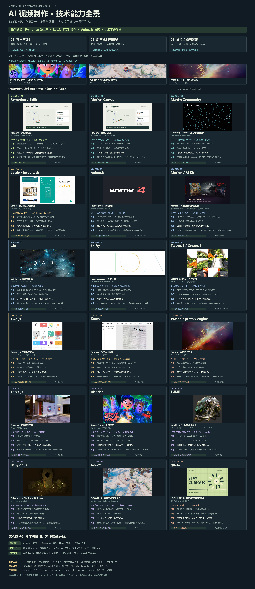

2026-11-15 本库整理，3600×8300。实际成片、官方预览、成熟作品与 LUME 示例模型资产图分别署名；完整出处和验证范围见项目说明。

[进入研究](projects/0001-animation-skills-atlas/README.md) · [原仓库](https://github.com/remotion-dev/skills) · [在线网页](https://yydshly.github.io/20261115_codex_project/demos/0001-animation-skills-atlas/summary.html)

### 0002 · 溪谷花园 · 从氛围到可漫游空间

以田园视频为氛围参考，用程序搭景与免费素材整合保留两版三维漫游，对照空间、细节和环境反馈，积累可复用的浏览器体验。

研究过程：内置浏览器观察原参考，程序搭景建立空间，再整合模型、PBR、高程、光照、动作与声音，记录实际效果及边界。

两版入口：介绍页对照原视频、代码版 V1 与精致素材版 V2；可页内启动、切换、放大或独立漫游，两版保留。

直接价值：验证空间与氛围方案，支持展示沟通；49 条来源索引保留网站、原始链接、许可与本地记录，便于查找和继续复用。

阅读引导：下图为我们生成的研究总览，含两版实际运行截图、制作过程、来源与价值；可在网页中放大。

[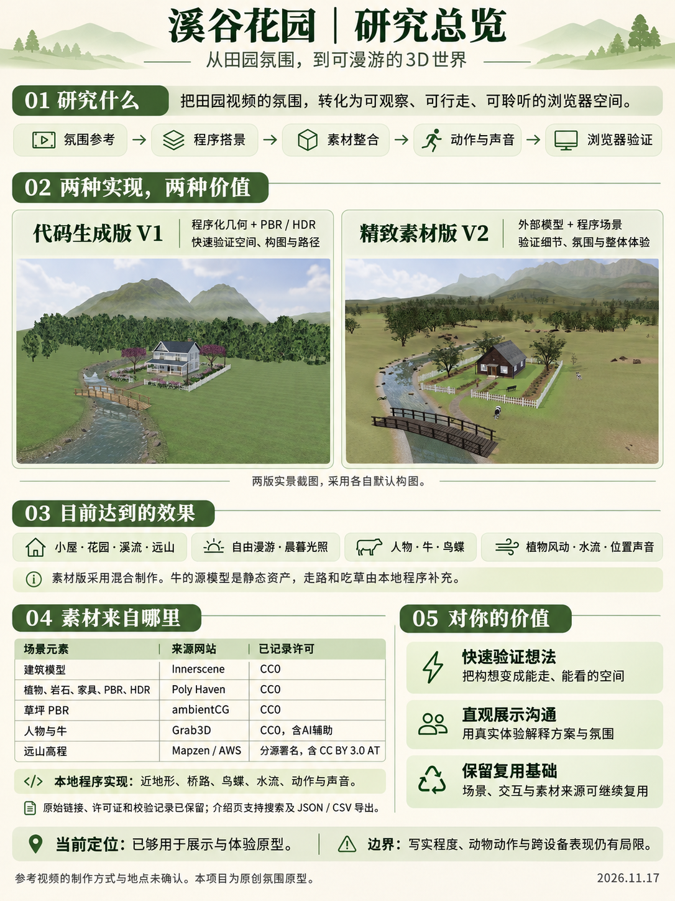](projects/0002-valley-garden/assets/research-overview-20261117/valley-garden-research-overview.png)

本聊天生成的研究总览，基于两版真实运行截图与已核对的来源记录；1086×1448，点击放大。

[进入研究](projects/0002-valley-garden/README.md) · [参考来源](https://x.com/siradisidekor/status/2121702120852492788) · [在线网页](https://yydshly.github.io/20261115_codex_project/demos/0002-valley-garden/overview/)

### 0003 · 从单图到可编辑三维 · 运河世界研究

从一张 AI 运河图探索高斯外观与 Blender 实体协作，以十次实验检验空间一致性、编辑与换光，记录失败原因和可复用路线。

一张完整架构图串联 11 个步骤、29 项库／模型／产品与 10 次实验，按节点查看技术、证据和失败原因。

公开查看 6 段视频、6 个高斯／三维诊断入口、98 项去重图片与 39 份工程／几何文件。

高斯保留外观，Blender 提供结构与控制；共同空间、绑定与物理换光仍需分别验证。

保留近景、反向与门口连接未通过的结果；完整可编辑世界尚未完成，原模型只读。


我们生成的完整研究架构图；11 个流程节点串联尝试、证据与边界，点击进入网页放大查看。

[进入研究](projects/0003-ai-wide-area-modeling/README.md) · [原仓库](https://github.com/Kotohibi/ai-wide-area-modeling) · [在线网页](https://yydshly.github.io/20261115_codex_project/demos/0003-ai-wide-area-modeling/)

### 0005 · 风归小庭 · 像素风与庭院游戏

从 SpriteCook 素材出发，验证分层风动与可玩庭院，整理素材价值、实际效果、创作复用和 AI 居民扩展路线。

素材与实践：两份原始树图、9项免费样例进入三种风动对照和庭院；种植、猫、小屋、天气、布置、五封来信与保存已能运转。

制作价值：把统一风格的形象变成可调效果、可用场景和持续状态，保留原件、结构、参数、模块、同素材对照和验收方法。

扩展方向：自有素材、完整生活事件、居民自主日常与平等交流，以及环境视频和三维花园的机制迁移；真实AI和跨项目集成尚未完成。

游戏入口：主页直接演示庭院，一键切到房间；可以漫步、摸猫、看窗景、在炉边停留和开关灯。“我的庭院”继续已有存档。

[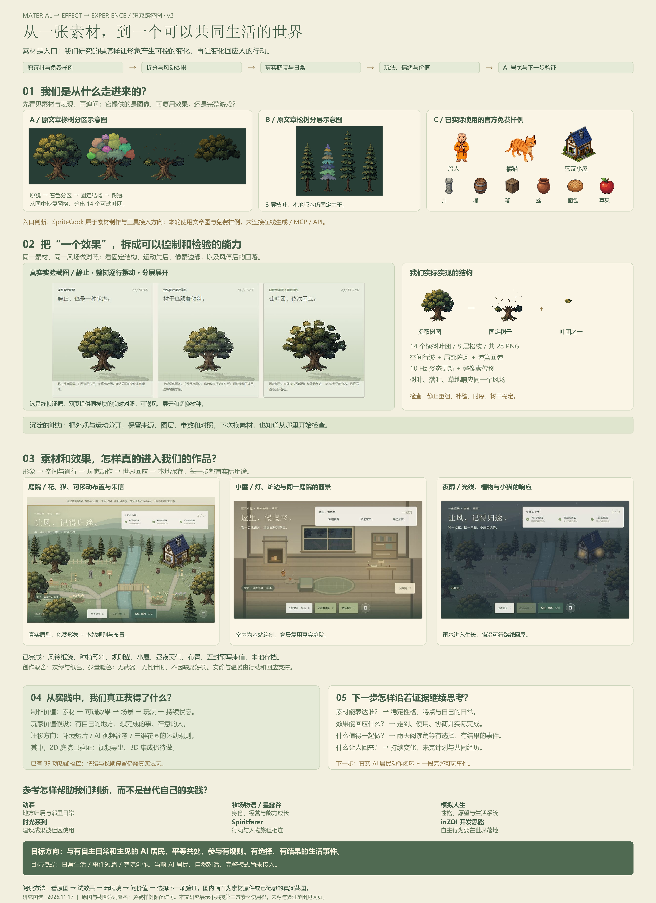](projects/0005-wind-return-garden/assets/understanding-research-map-v2-public.png)

沿用本轮生成的3200×4400 v2图谱，含18处原素材与真实研究画面；点击放大。素材来源、制作能力与体验价值分别说明，AI居民、视频和三维扩展仍待验证。

[进入研究](projects/0005-wind-return-garden/README.md) · [参考来源](https://www.spritecook.ai/blog/pixel-art-trees-wind-animation) · [在线网页](https://yydshly.github.io/20261115_codex_project/demos/0005-wind-return-garden/index.html)

### 0008 · 鹈鹕骑车研究 · 艺术巡游的价值、方法与扩展

从原作20幕与真实结尾拆解持续主角、整幕美术、三维巡游、情绪承接与整体规划，沉淀艺术统筹、叙事和跨题材创作方法，并汇总《光》《雨》与七种连接的网页效果和未达标教训。

原作价值：同一骑行题目进入不同艺术与媒介系统，主角随画风转译；每幕有独立意境，空间、顺序与结尾将差异串成完整体验。

对我们的意义：学习组织艺术体验的能力，先明确艺术、历史与氛围，再规划构图、材料、光影、情绪和前后承接，最后选择角色与技术。

扩展方向：艺术导览、历史与地方记忆、光雨季节的氛围旅程；比较行旅、传送、进入细节、世界形变、同地换时、行动触发与形状接棒。

实际效果：保留《光的几种语言》《雨的三种距离》、早期白鸟动效、七种连接及46秒传送原型；明确情绪不足、普通3D demo感与遮挡构图问题，工程通过不等于艺术达标。

完整阅读：使用本次生成总览图作引导，提供21条逐幕证据、12章综合分析、12份专题和12份数据，支持全文搜索、放大与实验入口；原作观察、研究解读、原创实验和未知项分别标注。

[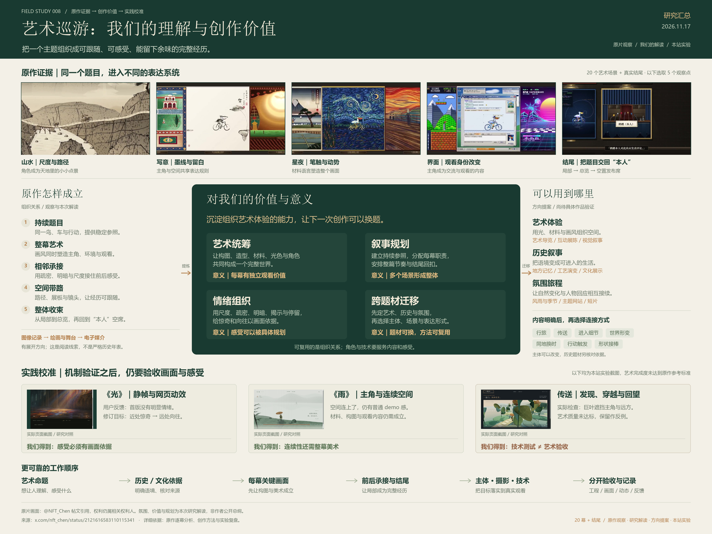](projects/0008-pelican-layout-study/assets/research-understanding-map-20261117.png)

本次生成的研究总览图（2026-11-17），点击查看5400×4050完整原图；原片引用与我们的实验截图分别标注。

[进入研究](projects/0008-pelican-layout-study/README.md) · [参考来源](https://x.com/nft_chen/status/2121616583110115341) · [在线网页](https://yydshly.github.io/20261115_codex_project/demos/0008-pelican-layout-study/)

### 0009 · 知源 · AI 与开源信息源指南

把AI与开源平台、作者和项目连成发现→理解→验证→实践的路径，帮助选对工具、核对证据，并积累可复用的项目经验。

理解：平台提供候选，作者解释机制与取舍，仓库、模型卡和实测支撑判断，项目让理解进入实践。

价值：用11个平台、7位作者和4个项目建立有次序的研究路径，减少无目的刷信息流，留下可复查的选择与验证记录。

阅读引导：先看下方简化关系图，再进入完整指南和可点击节点；详细清单图保留全部参考链接与使用边界。

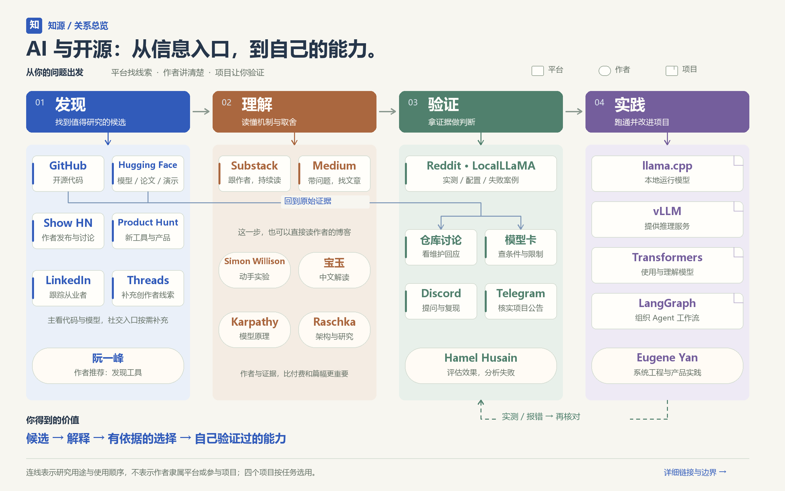

2026-11-16 本库原创关系图，2400×1500；连线表示研究用途，不代表作者隶属、项目合作或必须组合使用，完整链接与边界另见详细清单。

[进入研究](projects/0009-ai-source-field-guide/README.md) · [原仓库](https://github.com/yydshly/20261115_codex_project) · [参考来源](https://x.com/yxl44/status/2121581932412895507) · [在线网页](https://yydshly.github.io/20261115_codex_project/demos/0009-ai-source-field-guide/index.html)

### 0011 · 日常奇想 · 参考影像与故事创作档案

从原片提炼日常动作改变世界的创作方法，整理四条方向、七份故事和六项可沉淀能力，供后续选题、分镜与试制复用。

理解：小愿望通过日常动作触发奇幻变化，多个场景共享世界规则，结尾回应人物愿望或关系。

价值：把喜欢的效果转为可继续使用的选题方法、故事档案、艺术方向与任务书，帮助后续分镜和试制。

阅读引导：先看下方一图总览，再进入完整研究与七份故事；五个种子和两份完整方向均未生成视频，实际制作与稳定复用仍待验证。

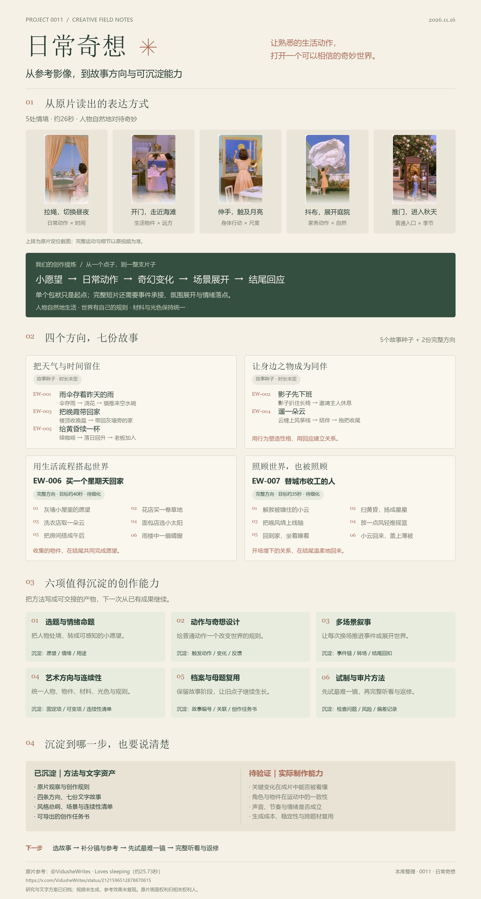

2026-11-16 本库整理，2400×4480；文字、故事与图文编排为本次讨论沉淀，内含原片定位缩略图，画面权利归相关权利人。

[进入研究](projects/0011-everyday-wonders/README.md) · [参考来源](https://x.com/VidusheWrites/status/2121596512878870615) · [在线网页](https://yydshly.github.io/20261115_codex_project/demos/0011-everyday-wonders/map.html)

### 0016 · 海的生成 · 海底世界与提示词手记

研究 Abyssal Garden 可运行、可读源码的程序化海底与验收任务书，沉淀我们独立创作海底世界的七项提示词。

原库价值：用真实海底效果对照可读源码，理解空间构图、水下光照、密集内容与性能控制；原始提示词提供目标、取舍与验收方法。

我们的沉淀：从独立设计出发，整理创作目标、气质、空间、画面、技术取舍、验收和交付七项原创要求；不照搬作者的引擎、设备与单文件限制，任务书尚未执行。

阅读引导：先看本轮生成的完整总结图，再切换三视点、阅读机制与作者中英文原文，最后查看我们的原创任务书及可复制文本；图内海底画面为 Noniv 场景实测截图。

[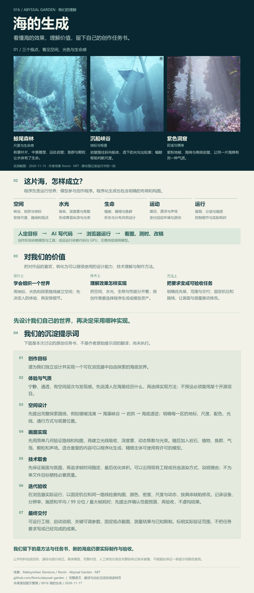](projects/0016-abyssal-world-notes/assets/understanding-summary.png)

2026-11-17 本库原创图文排版，2400×5595；嵌入 Noniv 场景实测截图并保留 MIT 来源。原创海底世界任务书尚未执行。

[进入研究](projects/0016-abyssal-world-notes/README.md) · [原仓库](https://github.com/Noniv/abyssal-garden) · [在线网页](https://yydshly.github.io/20261115_codex_project/demos/0016-abyssal-world-notes/)

### 0017 · 观式 · 100 个设计与影像网站

把100个设计与影像网站整理成可搜索的参考库：对照真实预览，解释效果、实现原理，以及对庭院三维、短片、研究网页和AI创作的具体价值。

理解：奖项提供质量标尺，图库提供素材与镜头参考，规范组织状态与视觉规则，前端与三维实现动态；按资源作用选择实现方式。

运用：看清效果→拆分原理→做小样→比较差异→沉淀规则，形成庭院、短片、研究网页和AI执行四条可继续实践的路线。

内容与边界：100份逐站解析、98站真实预览，保留原网址和示例入口；45项官方资料结合建议、5项视觉推断、50项通用方案，复用建议尚未跨项目实装。

[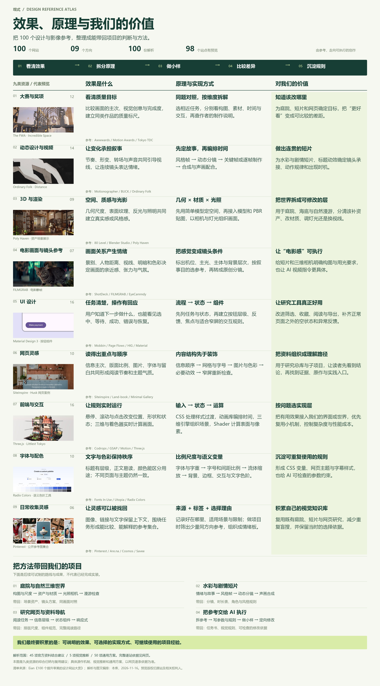](projects/0017-design-reference-atlas/assets/effects-principles-value-overview-v1.png)

本库生成的效果、原理与项目价值总览原图，3200×5768，九张真实代表预览与四条应用路线；不重新绘制。预览版权归原权利人，具体原作机制与证据范围以逐站解析为准。

[进入研究](projects/0017-design-reference-atlas/README.md) · [参考来源](https://x.com/EianLu/status/2121219503988113557) · [在线网页](https://yydshly.github.io/20261115_codex_project/demos/0017-design-reference-atlas/)

### 0018 · 定制 Bot · 分工、能力与研究迁移

以完整信息图和交互图厘清 Bot 身份、工具权限和协作价值，整理交易与研究的讨论，并说明八到五岗位的功能迁移。

理解：我们已有搜集与研究能力，重点是组织目标、证据、工具权限和交接；五岗位可以由单任务顺序完成。

图解：完整PNG/SVG、五组8到5转换、原双场景交互图与讨论；EXIT到适配包含新增研究判断，并非等价改名。

价值与边界：留下适配理由、原始证据、最小试验与可回查积累；原帖收益和官方归属未核实，研究采集与定时未部署。

[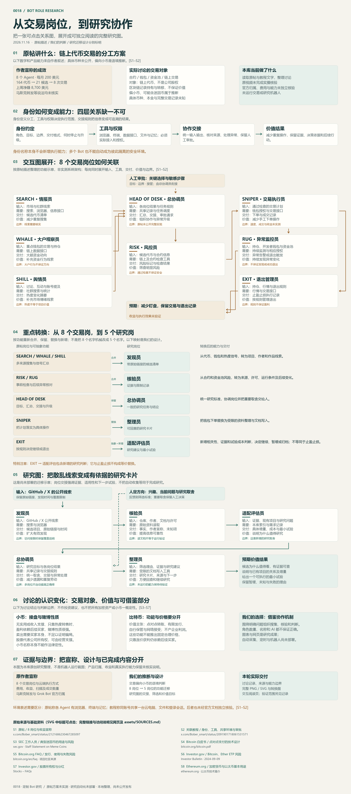](projects/0018-bot-role-research/assets/bot-role-overview.png)

沿用2026-11-16生成的3200×7230完整图原件，2026-11-17整理发布。图内未发布字样是制作时的历史记录；原帖能力与收益未核实，研究机器人仍未部署。

[进入研究](projects/0018-bot-role-research/README.md) · [参考来源](https://x.com/Bober_smart/status/2121686230467285097) · [在线网页](https://yydshly.github.io/20261115_codex_project/demos/0018-bot-role-research/)

### 0019 · 山河共造 · 多人文明世界创作档案

从魔兽湖岸社交参考出发，以原创岚角族、完整故事和多人文明设计，整理共同生活、学习创造的实现思路与后期价值。

参考与理解：从Thorgram原帖的湖岸聚集、钓鱼与闲聊出发，提炼值得停留的生活空间、鲜明种族和自然社交；原视频版本与服务器未核实。

世界与故事：保存五张概念、原始参考和13步探索；原创岚角族与环境共享文化，七章完整故事把旧水道、六聚落、技术权威与共同代价串联。

玩家与学习价值：走动、钓鱼、聊天形成起点，再通过观察、试验、制作与协作理解材料、设施、交换和制度，逐步留下社区历史。

对我们的意义：沉淀美术规则、人物弧、多人选择边界和验证顺序，作为后续策划、美术与程序的共同依据，避免把概念图误当成可交付游戏。

能力与后期：当前完成研究网站、故事与规则示意；三维角色、实机与联网待制作，文明生活世界、活动创作器及学习平台仍需真实验证。

阅读引导：先点击本轮生成的高清总览图，再进入环境人物、完整故事、多人机制和后期产品；来源、被否定方案与实际验证分别保存。

[](projects/0019-shanhe-co-creation/assets/shanhe-understanding-overview-v1.png)

本轮生成的3200×12684高清总览图，10个模块、约3600字符；使用已有概念原图与可校对排版，原图保持不变。点击查看完整图；现有成果、故事与系统草案、后期待验证价值分别标注。

[进入研究](projects/0019-shanhe-co-creation/README.md) · [参考来源](https://x.com/thorgram/status/2121601256557051920) · [在线网页](https://yydshly.github.io/20261115_codex_project/demos/0019-shanhe-co-creation/index.html)

### 0020 · 风与春 · 自然体验影像研究

从人物开窗与门边姿态进入风的体验，分析框景、室内外明暗和自然响应的拍摄思路，提炼人物引导与万物展开的创作方法，并用“写春”试片检验。

原参考效果：人物开窗、站在门边，带观看者接近天气；讨论认为它把风拍了出来，人物仍承担情绪主题和价值引导。

可见拍摄组织：以背影、门窗框景、室内外明暗和湿润材质建立身体与环境的关系；完整运镜、声音和原作者制作流程尚未取得。

对我们的价值：把偏爱转为人物入口、事物响应、注意移动和整个场景的展开，可迁移到雨雪雾与春；保留九次关键讨论、四项价值和五步创作路径。

实际验证：《多停一会儿》两版整片与六段原片、实际提示词和差距复盘；此前六个任务共975积分，首版反馈偏弱，30秒重剪待反馈。

[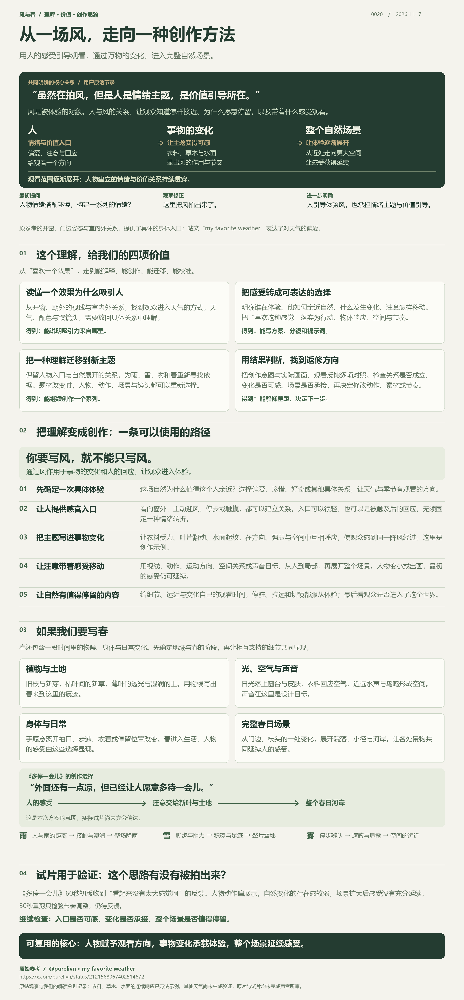](projects/0020-human-nature-film-study/assets/understanding-map-v1.png)

本次生成的2400×5166理解总图原文件，内容与此前交付一致。先读原参考的效果与可见拍摄组织，再看对我们的价值和创作思路；试片只作验证。点击可打开完整高清图。

[进入研究](projects/0020-human-nature-film-study/README.md) · [参考来源](https://x.com/purelivn/status/2121568067402514672) · [在线网页](https://yydshly.github.io/20261115_codex_project/demos/0020-human-nature-film-study/index.html)

### 0021 · 数字人口播制作 · 能力、样片与复用工作流

从模型与平台的分工出发，用真实样片、完整研究图和可复用后期模板，整理人物、内容、剪辑与三维的制作方法及价值。

理解与思路：以14模块、28问的完整研究图，梳理模型、数字人平台、编排、内容与后期的分工，保留原作者声明、实测和判断的区别。

实际效果：5秒抠像与字幕、5秒三维屏幕、10秒整合和6秒换配置片；保留连续原声与音画校对，人物仍是二维视频素材。

复用价值：本次创建的后期模板可替换素材和文字，复用抠像与三维缓存；新人物、真实图表、上游生成和批量收益仍需进一步验证。

阅读引导：先点击下图看完整全景，再进入网页播放样片、看制作方法与选型价值，最后使用配置导出和模板源码。

[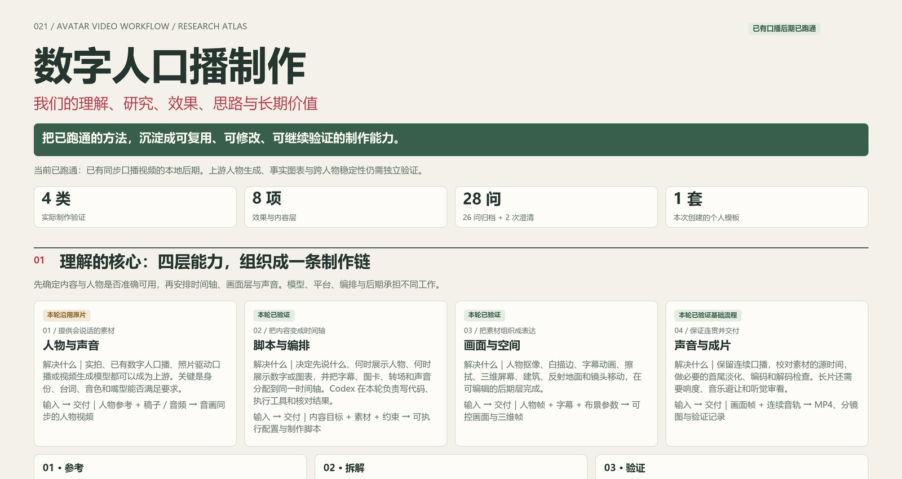](projects/0021-avatar-video-workflow/assets/avatar-research-overview-v1.png)

2026-11-17 本轮生成的研究全景图；点击顶部预览查看 3200×26588 完整 PNG。包含真实样片、14 个模块与 28 问，人物和原声来自 @tm\_uchal；已实测与待验证分别标明。

[进入研究](projects/0021-avatar-video-workflow/README.md) · [参考来源](https://x.com/AndyL5cc/status/2121553136615596139) · [在线网页](https://yydshly.github.io/20261115_codex_project/demos/0021-avatar-video-workflow/index.html)

<!-- PROJECTS:END -->

## 开始研究

需要 Python 3.10 或更新版本，无需安装第三方依赖。在仓库根目录执行（将示例参数换成实际项目）：

```bash
python scripts/projects.py add project-slug --name "项目名称" --repository "https://github.com/owner/repository" --summary "它解决什么问题，为什么值得研究"
```

命令会分配下一个固定编号、创建研究目录，并更新首页。随后补充子项目 README，将真实截图放入该项目的 `assets/`，再在 `projects.json` 登记图片、标签或已上线的演示链接。

```bash
python scripts/projects.py render
python scripts/projects.py check
```

编号是稳定标识，`order` 决定展示顺序。调整顺序时只改 `order`，保留已有编号和目录链接。

## 仓库导航

| 位置 | 内容 |
| --- | --- |
| [projects/](projects/) | 按固定编号归档的子项目研究、截图与实验 |
| [projects.json](projects.json) | 项目元数据与展示顺序的唯一登记表 |
| [研究规范](docs/conventions.md) | 新增项目、状态、截图与引用约定 |
| [Web 部署约定](docs/deployment.md) | 多个演示站点的目录、路径与发布方式 |
| [研究模板](templates/project/README.md) | 每个子项目的研究提纲 |

已启用 [GitHub Pages 总导航](https://yydshly.github.io/20261115_codex_project/)，首项为动画制作研究图谱。内容和验证记录在项目目录中保留；其他项目按明确发布任务接入。

第三方项目的源码与素材遵循各自许可证；研究记录应注明来源、验证范围与仍待确认的问题。
