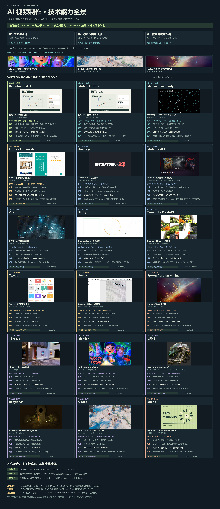

# 0001 · 动画制作 Skills 图谱

以 **AI＋Remotion 制作视频**为主线，对照 18 项动画技术、成熟作品与三工具同案成片，说明各工具负责什么、何时值得加、能省哪些制作工作，以及哪些暂时不必学。

本轮整理已完成，研究保持暂缓。**[打开完整在线总结与效果图谱](https://yydshly.github.io/20261115_codex_project/demos/0001-animation-skills-atlas/summary.html)**；已通过 GitHub Pages 发布与公开地址检查。

## 从哪里看

| 阅读目标 | 页面 | 能获得什么 |
| --- | --- | --- |
| 先形成整体认识 | [阶段总结与动态效果图谱](https://yydshly.github.io/20261115_codex_project/demos/0001-animation-skills-atlas/summary.html) | 五条共识、18 项技术卡片、大幅实际画面、8 段可播放预览、完整 AI 视频选型表 |
| 看清真实价值 | [六库的成熟作品与归因](https://yydshly.github.io/20261115_codex_project/demos/0001-animation-skills-atlas/cases.html) | Spotify Wrapped、DARK、ProgressBar.js、ZIM、p5.js 等；分别说明设计、框架和底层库的贡献 |
| 比较实际制作 | [Remotion / Manim / Motion Canvas 同案](https://yydshly.github.io/20261115_codex_project/demos/0001-animation-skills-atlas/compare.html) | 同一主题的初稿与改稿成片、制作路线、实际源码差异、计时及验证边界 |
| 亲手操作 | [六件本站交互实验](https://yydshly.github.io/20261115_codex_project/demos/0001-animation-skills-atlas/showcase.html) | 连续改目标、相机 seek、多对象流程、SVG 编排、Lottie 状态与 GIF 实际导出 |
| 查技能和工具入口 | [原始 18 项目录与 13 个 Remotion Skill 任务](https://yydshly.github.io/20261115_codex_project/demos/0001-animation-skills-atlas/index.html) | 分类、搜索、边界、原始仓库和任务提示 |
| 看基础机制 | [运行实验室](https://yydshly.github.io/20261115_codex_project/demos/0001-animation-skills-atlas/lab.html) | 实际 npm 运行库与数学、流程片段；与成熟作品分开呈现 |
| 查素材出处 | [素材与引用说明](https://yydshly.github.io/20261115_codex_project/demos/0001-animation-skills-atlas/sources.html) | 逐项来源、作者、媒体角色及素材许可说明 |

站内首页、案例、同案对比和实验均相互链接。动态预览按视区播放，支持暂停与放大；离线资料可下载 [高清 PNG](assets/technology-understanding.png) 与 [可缩放 SVG](assets/technology-understanding.svg)。



## 我们最终形成的理解

1. **这些不是同一种素材包。** Lottie 是动画资产与播放生态；Anime.js、Motion 组织运动；Ola、Shifty、TweenJS 处理补间；Two.js、Konva 绘图和编辑；Three.js、LUME、Babylon.js 组织网页三维；Blender、Godot 提供更完整的制作或交互环境；gifenc 负责编码。Skill 提供指导，运行库执行工作。
2. **画面相近，不代表工作流相同。** Remotion、Manim、Motion Canvas 能交付类似效果，但数学对象、信号关系、组件复用、修改方法和输出流程不同。同案资料提供可核查的实际差异，不虚构能力壁垒。
3. **成熟案例的漂亮画面不是库自动生成的。** 素材、构图、灯光、字体、节奏和声音仍由创作者完成。Ola、TweenJS 等常只承担整件作品的一层；gifenc 不负责创作画面。
4. **以 AI 视频交付为目标，Remotion 可作为主干。** Lottie 值得学现成资产接入；Anime.js 只在已有复杂片段可复用时考虑。Ola、Shifty、TweenJS、gifenc 在纯视频流程可先跳过；数学、流程、三维按题材再用专用工具。
5. **额外引库要能抵消额外工作。** 收益通常来自复用成熟资产、专业对象或已有逻辑，并非自动提高画质或渲染速度。接入仍需同步帧时间、兼容版本并验片。

## 内容、证据与复现

- [understanding.json](understanding.json)：全部技术职责、场景、效果和建议的统一文字源。
- [effect-media.json](effect-media.json)：18 项效果的原作、署名、预览角色与归因。
- [research.md](research.md)、[cases-research.md](cases-research.md)：来源核对与判断依据。
- [comparison/README.md](comparison/README.md)：同案脚本、改稿要求、版本、制作过程和计时口径。
- [总图说明](assets/technology-understanding-notes.md)：关键帧提取、图面生成、素材角色和复现。
- [发布与验证记录](publication.md)：GitHub Pages 路径、媒体包、上线检查和限制。
- [第三方素材说明](THIRD_PARTY_NOTICES.md)：逐项引用信息；不把第三方素材纳入本项目原创许可。

本地网页：在 `web/` 执行 `npm ci`、`npm run dev`，打开 `http://127.0.0.1:52842/summary.html`。完整站点构建和媒体恢复见 [部署约定](../../docs/deployment.md)。依赖由 lockfile 固定，源码、媒体和发布产物分开保存。

验证范围分为本地成片、本地实验、来源案例和仅资料核对。官方预览不代表本项目复现了完整工程；LUME 静态图是官方示例使用的模型资产预览。没有逐一运行 18 项工具，也没有生产提效百分比测量。当前会话的上线验收以构建、媒体解码和 HTTP 检查为准，浏览器交互结果仅引用已有实测记录。

## 研究过程归档

下列各轮保留当时的过程和验证状态；“未发布”等文字是历史记录，以本页和发布记录为准。

## 第六轮：真实作品、使用证据与选型

针对主要用 AI 制作视频的读者，新增 [与 Remotion 的搭配建议](web/cases.html#ai-video)：Lottie 优先学素材接入，Anime.js 仅在已有复杂片段可复用时考虑，其余四项在纯视频工作流中先跳过。逐项对照实际案例、可省的制作工作和接入成本；Remotion 官方 Lottie 包与 Anime.js 集成示例已核对，未安装新集成包或声称实测提效。

优先查看 [真实作品与选型](web/cases.html)，本地服务地址为 `http://127.0.0.1:52842/cases.html#lottie`。这一轮不再用本站自制作品证明上游能力，而是引用可追溯的实际项目和原作者作品：

| 库 | 代表案例 | 证据与判断 |
| --- | --- | --- |
| Lottie | Spotify Wrapped 2023 | 团队一手复盘，明确区分共用品牌动画与原生数据/交互；网页对照展示原文动图 |
| Anime.js | 官方完整网站、Julian Garnier 作品 | 作者原作与官方发布动图；官网/CodePen 拒绝内嵌，保留原作入口，不绕过限制 |
| gifenc | p5.js 2.4.0 saveGif()、looom-tools | p5.js 源码直接调用编码器；原作导出工具可体验，但作者将工具标为 WIP |
| TweenJS | ZIM / Scrambled Pics | 产品确认使用 ZIM，框架文档确认 animate() 使用 TweenJS；是框架层归因，不把整个产品效果归给底层库 |
| Shifty | ProgressBar.js | package.json 明确依赖 Shifty 2.x；展示成熟上层组件，而非宣称它是成片框架 |
| Ola | DARK HTML5 cinematics / Scroll-Btween | 完整个人滚动电影作品，README 与页面脚本明确列出 Ola；它只负责平滑，不负责素材、构图与帧序列制作 |

每个案例说明看什么、库承担什么、为什么值得用、什么时候用，以及何时继续用 Remotion。页面明确承认 Remotion Player 可集成到应用、Remotion 本身可导 GIF；选型理由是目标和现有工作流，不是虚构能力壁垒。

原案例页的原作画面采用远程引用或原站嵌入。后续效果图谱为本地研究缓存部分公开预览，保留逐项署名；媒体与嵌入图片的生成 SVG 均被 Git 忽略，没有将第三方媒体作为可再分发资源提交。版权仍属相应权利人。《DARK》为个人致敬作品，非 Netflix 官方案例；原站可能包含影视、音乐与字体素材，不推定商业再分发授权。旧 [自制交互实验](web/showcase.html) 保留并标明身份。

核查记录见 [cases-research.md](cases-research.md)。无新框架、无依赖变更、无部署。

## 第五轮：六件完整的交互作品

新增 [六种能力作品](web/showcase.html)。启动方式与下文相同，访问 `http://127.0.0.1:52842/showcase.html`；需要本地服务，不能以 file 协议直接运行。

| 工具 | 本站原创作品 | 可直接检查的能力 |
| --- | --- | --- |
| Ola | FORM · 600 粒子生成雕塑 | 三种构型、指针引力、途中改目标、插值开关与追随时长 |
| Shifty | NOCTURNE · 夜间城市漫游 | 三个镜头、暂停/恢复、时间定位、缓动与途中换目的地 |
| TweenJS | PARCEL · 唱片包裹出库旅程 | 包裹/扫描光/机械臂/闸门多轨同步、整组暂停、阶段事件 |
| Anime.js | AURA · 耳机品牌发布序列 | SVG 轮廓描边、分字错时、产品与信息分层出现、时间线定位 |
| Lottie Web | CLOUDPOST · 递送状态素材 | 同一 JSON 的三处复用、三段业务状态、SVG/Canvas、源帧与 JSON 下载 |
| gifenc | LOOP PRESS · 动态海报制作台 | 改文案/配色、32/128/256 色、原稿/编码结果对照、真实 GIF 下载 |

每件作品说明运行库与本站视觉实现的职责、适用任务和边界，附关键代码与官方出处。这里的完整作品用于展示实际操作与交付方式，不将视觉设计归功于库，也不声称是能力上限。未接入真实上传、订单、地图服务或商业产品。

六个作品均使用已有锁定依赖，未新增框架。素材与代码为本站原创，生成的可下载文件不提交。详细验收见 [showcase-verification.md](showcase-verification.md)。

## 第四轮：同案成片与真实改稿对比

新增 [同案成片对比页](web/compare.html)，将《相似，来自方向。》分别用 Remotion、Manim、Motion Canvas 独立实现。保留三份 18 秒初版与三份 24 秒改稿成片，统一 720p / 24 fps / 中文字幕。可同步播放、定位到同一秒、单独或并排观看，并查看源码差异、实际修改规模和导出记录。

研究方法、真实返修和复现说明见 [comparison/README.md](comparison/README.md)。耗时口径不同，网页不做通用性能排名；分数为二维夹角计算，不是模型检索实测。

## 第三轮：以实际任务理解价值

优先查看 [五个任务实验](web/lab.html)：Ola 的实时监控前后对照、Shifty 的可暂停和定位的镜头过渡、TweenJS 的订单动作与事件编排，以及同一语义检索主题下的 Motion Canvas 流程讲解和 Manim 数学讲解。页面明确说明库负责什么、选型依据、相邻工具区别与边界。其余九项仍保留为基础机制示意。

复现与验证记录见 [experiments/README.md](experiments/README.md)。新增 1280×720 的 Manim 成片和真实编译的 Motion Canvas 场景；生成文件不提交，需按说明重建。

## 它解决什么问题

### 真实效果实验室（第二轮，保留历史说明）

新增 [效果实验室](web/lab.html)，使用真实 npm 依赖运行 12 个示例，而非用 CSS 冒充库的输出。安装和启动：

```shell
cd projects/0001-animation-skills-atlas/web
npm ci
npm run dev
```

访问 `http://127.0.0.1:52842/lab.html`。可切换工具、重播和调速；Ola 跟随光标，Konva 可拖拽变换，Three.js 实时渲染，gifenc 可生成和下载真实 GIF。

Remotion 按官方 `remotion-markup` Skill 的逐帧规范编写，已输出 3 秒、640×360、30 FPS 的 H.264 样片。重新渲染：`npm run render:sample`。生成视频在 `web/public/atlas-sample.mp4`，属于可再生成的本地输出，已忽略；首次运行可能需要下载 Remotion 官方浏览器组件。`npm run build` 输出多页面站点到 `web/dist/`，保留相对资源路径。

12 项为 Remotion、Motion、Anime.js、Ola、Shifty、Two.js、Lottie Web、TweenJS、Konva、Three.js、Proton、gifenc。尚未运行其余六项，未将最小几何示例表述为完整制作能力验证。包版本由 `web/package-lock.json` 固定。实验室不能直接通过 file 协议打开，需要上述开发服务或构建后静态服务；原资料目录仍可直接打开。

浏览器已逐一切换验证 12 项正常加载；GIF 实际编码 320×180、36 帧、约 31 KB；浏览器确认 MP4 时长 3 秒、640×360。详细记录见 [lab-verification.md](lab-verification.md)。

面对一份动画工具清单，需要先知道每个项目能制作什么、如何配合编码 Agent、输出什么，以及它在制作流程中的位置。这个子项目把原帖的 18 项资源整理为可检索的能力目录，并提供项目详情、官方技能说明和制作路线。

本项目是多仓库的专题研究集合；登记表的 `repository` 指向主研究入口，全部上游仓库见下表。

## 为什么关注

这些工具把 AI 生成代码的能力连接到动画制作：通过明确的对象、参数与时间安排，让画面可修改、可重复生成，并逐步沉淀为模板。具体价值取决于作品题材和已验证的运行环境。

首轮重点回答三件事：哪些项目提供现成 Agent Skill；其他项目分别承担什么制作能力；为了一个明确作品应该怎样选择工具。

## 研究结论

**官方资料已确认：** Remotion 提供官方 Agent Skills；Motion 的官方 AI Kit 也提供 `/motion` Skill 与文档 MCP，并在其说明中明确支持 Codex。其余项目在本轮阅读的 README 中，未确认独立官方 Agent Skill 入口；这不等于断言其生态不存在第三方 Skill。

**本站判断：** 18 项资源适合按作品选择，不必全部安装。制作短片可先验证 Remotion；信息图解关注 Motion Canvas；公式和几何关注 Manim；网页动效关注 Motion / Anime.js；交互画布关注 Konva；三维再按交付形式选择引擎。

**实际验证：** 本轮验证本站展示页的数据与交互。上游 18 项的安装、实际渲染、模型资产处理和跨工具集成尚未逐一实测。原帖关于 Muse 虚拟机的集成效果也未验证。

### 18 项制作资源

保留原帖编号，能力方向为本站归纳。官方 README 的分支范围见[来源与研究范围](research.md)。

| 编号 | 项目 | 类型 / 官方 Skill | 主要能力 |
| --- | --- | --- | --- |
| 01 | [Remotion Skills](https://github.com/remotion-dev/skills) | 官方 AI 技能集 | 视频创建、编排、字幕、预览与渲染指导 |
| 02 | [Motion Canvas](https://github.com/motion-canvas/motion-canvas) | 动画框架 + 编辑器 | 信息型矢量动画、旁白同步 |
| 03 | [Motion](https://github.com/motiondivision/motion) | 动画库；另有[官方 AI Kit](https://github.com/motiondivision/ai-kit) | 布局、手势、弹簧、滚动与时间轴 |
| 04 | [Ola](https://github.com/franciscop/ola) | 数值插值库 | 平滑实时变化的数值 |
| 05 | [Anime.js](https://github.com/juliangarnier/anime) | 通用动画库 | CSS、SVG、DOM、对象动画 |
| 06 | [Manim](https://github.com/ManimCommunity/manim) | Python 数学动画引擎 | 公式、几何与精确变换 |
| 07 | [Shifty](https://github.com/jeremyckahn/shifty) | 补间动画引擎 | 缓动、补间与异步动作编排 |
| 08 | [Two.js](https://github.com/jonobr1/two.js) | 二维绘图库 | SVG / Canvas / WebGL 二维图形 |
| 09 | [Lottie Web](https://github.com/airbnb/lottie-web) | 动画播放器 | 在网页播放 Lottie JSON 素材 |
| 10 | [TweenJS](https://github.com/CreateJS/TweenJS) | 补间与时间轴库 | 链式动作与多个补间协调 |
| 11 | [LUME](https://github.com/lume/lume) | 网页三维工具集 | 通过 HTML 元素组织二维 / 三维场景 |
| 12 | [gifenc](https://github.com/mattdesl/gifenc) | GIF 编码器 | 将画面帧编码为 GIF |
| 13 | [Konva](https://github.com/konvajs/konva) | 交互画布框架 | 对象事件、拖拽、变换与编辑工具基础 |
| 14 | [Blender](https://github.com/blender/blender) | 三维桌面软件 | 建模、绑定、动画、模拟、渲染与合成 |
| 15 | [Three.js](https://github.com/mrdoob/three.js) | 网页三维库 | 场景、相机、几何体与实时三维渲染 |
| 16 | [Godot](https://github.com/godotengine/godot) | 游戏引擎 | 二维 / 三维交互场景与跨平台游戏 |
| 17 | [Babylon.js](https://github.com/BabylonJS/Babylon.js) | 网页三维引擎 | 场景、相机、灯光与网格渲染 |
| 18 | [Proton](https://github.com/drawcall/Proton) | 粒子动画库 | 发射器、生命周期与粒子行为 |

### 官方 Skills

Remotion README 当前列出 13 个入口：`remotion-best-practices`、`remotion-create`、`remotion-markup`、`remotion-studio`、`remotion-render`、`remotion-maps`、`remotion-captions`、`remotion-saas`、`remotion-interactivity`、`remotion-docs`、`remotion-license`、`remotion-upgrade`、`remotion-multimedia`。网页提供逐项中文说明。

以下命令仅作官方入口摘录，本轮未执行安装：

```shell
npx skills add remotion-dev/skills
npx motion-ai
```

Motion AI Kit 的免费入口提供技能、文档与弹簧生成；Motion+ 的源代码检索、性能审计等属于增强功能，不能将所有功能都归入免费基础能力。

## 关键机制

制作流程分为需求与分镜、选择工具、生成代码或素材、预览小样、修改与交付。Agent Skill 提供制作知识与调用方式；动画库或软件承担具体执行；编码导出还要结合最终交付格式。

网页源码：

- [web/resources.js](web/resources.js)：18 项资源、13 个 Remotion 技能及 4 条制作路线的结构化内容。
- [web/index.html](web/index.html)：页面结构。
- [web/app.js](web/app.js)：搜索、联合筛选、详情对话框、复制、路线标签页与键盘交互。
- [web/styles.css](web/styles.css)：响应式排版、原生运动示意及减少动态效果支持。

网页中的制作路线和提示词为本站示例，不冒充官方推荐或已经执行成功的结果。首页图形为本站 CSS / SVG 示意，不是任一上游库的运行效果。

## 运行与验证

- 研究日期：2026-11-15（Asia/Shanghai）。
- 资料范围：各上游默认分支 README；详细分支及已读取提交见 [research.md](research.md)。
- 验证环境：Windows、Python 3.10.11、Node.js 22.15.0、Codex 内置浏览器。
- 依赖：原生 HTML / CSS / JavaScript，无第三方运行依赖、外部字体或 CDN 请求。

直接打开 `web/index.html` 即可浏览。需要 HTTP 预览时，在本仓库根目录运行：

```shell
python -m http.server 52842 --bind 127.0.0.1 --directory projects/0001-animation-skills-atlas/web
```

浏览器访问 `http://127.0.0.1:52842/`。端口被占用时可自行更换，按 Ctrl+C 停止。未来汇总发布的相对目录为 `_site/demos/0001-animation-skills-atlas/`；资源链接采用相对路径。

检查命令：

```shell
node --check projects/0001-animation-skills-atlas/web/resources.js
node --check projects/0001-animation-skills-atlas/web/app.js
python scripts/projects.py check
```

详细浏览器检查结果见 [verification.md](verification.md)。记录网页验证与上游工具验证的区别，后者仍待按实际作品开展。

## 图片与演示

网页可本地浏览，尚未部署。本站绘制的分类封面用于研究索引，非上游项目运行截图。素材文件放在 `assets/`。

## 后续计划

- [x] 核对 18 个仓库的 README，区分资源类型并记录能力与边界
- [x] 整理官方 Skill 入口与制作路线
- [x] 完成本地展示页与交互检查
- [ ] 选一个明确题材，运行首个 3 秒动画小样并记录版本与输出
- [ ] 根据实际制作结果补充安装、渲染与组合验证记录

## 来源与许可

完整来源见 [research.md](research.md)。本站用自己的中文摘要说明上游能力，未收录第三方完整源码、Git 历史、文档原文、商标图片或示例素材。网页字母标记和几何图形由本站绘制。

上游软件、关联商业产品、模型和音视频素材的许可需分别核对；GitHub 公开不代表所有用途和增值功能均免费。
