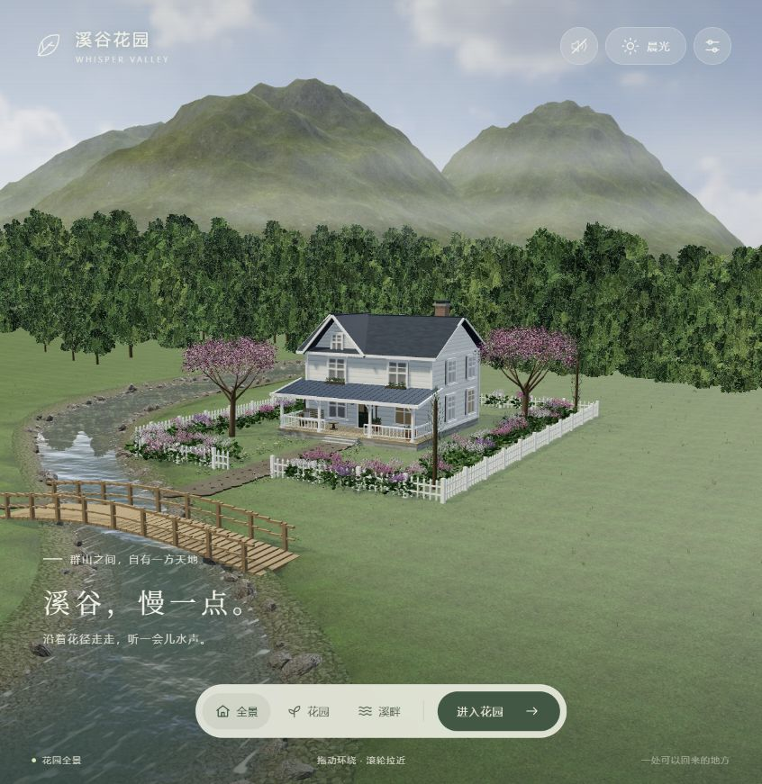
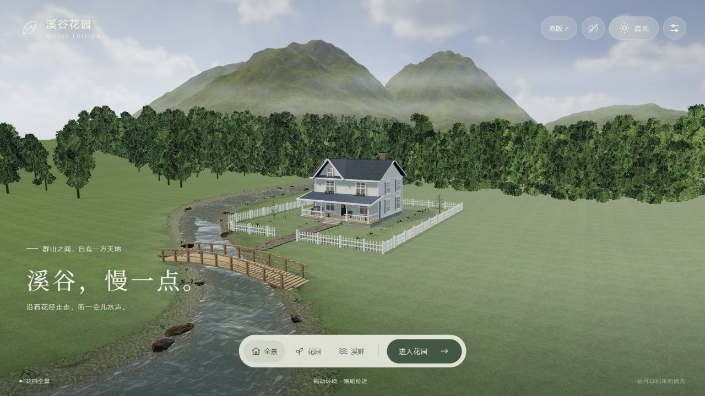

# 0002 · 溪谷花园漫游 · Three.js 原型

以田园小屋视频为氛围参考，构建可在浏览器自由漫游的溪谷、花园与远山场景。

- 原项目：[https://github.com/mrdoob/three.js](https://github.com/mrdoob/three.js)
- 研究状态：以根目录 `projects.json` 为准
- 演示入口：尚未部署

## 项目介绍与双版本展示

打开 **`http://127.0.0.1:4173/overview/`**，并排查看代码生成版与精致素材版的实际画面，在同一体验台启动、切换和放大查看场景，并阅读实现差异、各自价值及这次迭代形成的理解。

介绍页源码与使用说明见 [web/overview/](web/overview/README.md)。该页是当前状态汇总；下方按日期保留的迭代记录反映各阶段当时的验证范围。V1 与 V2 的原入口、场景源码和素材保持不变。

## 两个保留入口

- **V1 程序化写实原型**：`http://127.0.0.1:4173/`，现有 `web/` 源码、启动入口和材质文件保持原样。
- **V2 模型资产版**：`http://127.0.0.1:4173/model-version/`，独立目录 [web/model-version/](web/model-version/README.md)，实际导入外部 glTF/GLB 植物、幼松和扫描岩石，默认使用带建筑细部和独立 2K PBR 的砖墙石板小屋，新增真实高程远山与动态浅水。

本轮原版 27 个源码和素材文件逐文件 SHA-256 已记录并复核一致，见 [V1 保留说明](versions/procedural-v1/README.md)。两版共享只读的引擎依赖和地表/HDR 贴图，新版代码、下载模型及独立构建均存放在自己的目录，未用新版替换旧入口。

## 它解决什么问题

把田园景观的视觉参考转化为可持续探索的三维空间：白色小屋、深蓝瓦顶、门廊、粉色花树、绣球花与薰衣草、白色栅栏、反射溪流、木桥、森林、山脉和云雾。浏览器实时渲染，支持自由行走与环顾。

## 为什么关注

参考视频表达了被山谷包围、被花园接纳的安静感。本原型保留主体关系和光色情绪，验证这种构图是否能扩展成可走动的空间。视频没有给出完整场景或制作方法，本项目不是原视频的三维重建，也没有导入其中的图片或模型。

## 研究结论

已完成本地实时三维原型。以下是本实现的验证结论，不代表对 Three.js 全部能力的验证：

- 原创程序化模型建立小屋、庭院、溪流及远景之间的连续空间关系；写实迭代加入已随项目保存的 CC0 实拍材质与 HDR 天空。
- 采用合并静态网格与实例化植被，避免为每棵树、每朵花单独提交绘制。
- 水面采用较低的介电反射率、非周期波纹、浅水碎石与泡沫近似；远山结合多尺度沟壑、三向岩壁投射、苔草分布与薄雾。它仍是实时美术原型，不等同于原视频的细节或摄影真实感。
- 建筑是外观模型，首版尚未制作可进入的室内。河道设有通行边界，通过木桥过溪。

## 关键机制

- [main.js](web/main.js)：渲染、观景/步行模式、碰撞、视角过渡、画质、晨暮光照、合成环境音。
- [cottage.js](web/cottage.js)：小屋、门廊、窗户、烟囱、家具和程序化建筑纹理。
- [vegetation.js](web/vegetation.js)：实例化森林叶片、花树、绣球、薰衣草、草丛及微风。
- [landscape.js](web/landscape.js)：连续地形、山脉、云雾、水面光学近似、河岸、栅栏、石径和木桥。
- [nature.js](web/nature.js)：本地实拍材质加载、正确的色彩／数据贴图空间、HDR 天空；HDR 经 PMREM 预过滤参与环境照明。
- 资源全部使用相对路径，构建后可放入 `/20261115_codex_project/demos/0002-valley-garden/`。

## 运行与验证

- 验证日期：2026-11-15。
- 运行环境：Windows、Node.js 22.15.0、npm 10.9.2、内置 Chromium 浏览器；依赖固定为 Three.js 0.180.0，包含 npm 完整性锁定。
- 环境要求：支持 WebGL 2 且开启硬件加速的现代浏览器。Node.js 20+ 用于本地服务；首次安装依赖需要网络，实拍素材已保存在项目内，此后运行不依赖 CDN 或外部图片、字体、音频服务。

在本目录的 `web/` 中双击 **[start.cmd](web/start.cmd)**，或执行：

```powershell
cd projects/0002-valley-garden/web
npm ci --ignore-scripts
npm start
```

打开 `http://127.0.0.1:4173/`。启动器会复用同一个本地服务，后台启动时隐藏控制台窗口。结束后台服务可双击 [stop.cmd](web/stop.cmd)；停止前会核对保存的运行标识和服务 PID，避免误停其他进程。使用 `npm start` 启动时，在其终端按 Ctrl+C 停止。

操作：

- 默认全景：拖动环绕、滚轮缩放、空格暂停或继续缓缓观景。
- 点击“进入花园”：WASD / 方向键移动，拖动环顾，Shift 快步；双击锁定鼠标，Esc 释放。
- “花园”“溪畔”直接切换到对应步行视角，“全景”或“返回全景”退出步行。
- 触屏设备显示方向键，拖动画面环顾。
- 右上角开关切换晨光/暮色、手动开启合成溪流与鸟鸣；设置中可切换细腻/流畅品质和环顾灵敏度。

静态检查与打包：

```powershell
npm run check
npm run build
```

`dist/` 包含静态页面与必要的 Three.js 运行文件，不需要后端 API。`dist/`、依赖目录和运行 PID 状态不提交。

实际浏览器验证：场景加载无控制台错误；全景与步行切换；按住 W 从花径走到门廊并在建筑边界停止；鼠标拖动后视角变化；溪畔预设；晨暮和画质切换；音频开关状态与调用无报错（未进行听感验收）；390×844 窄屏布局无控制条溢出。触屏方向键代码已提供，尚未在真实手机上验收；Pointer Lock 有拖动环顾回退，尚未在所有浏览器逐一验证。

写实迭代复验：源码版和 `dist/` 子路径均能加载本地 PBR／HDR 素材；近看花瓣、叶片、门廊及溪畔，测试键盘移动、晨暮和品质切换，控制台无报错。细腻模式在当前内置浏览器窗口中曾观察到约 54–57 帧/秒；这仅是本机瞬时读数，不是跨设备基准，首次加载及切换材质时会有编译开销。

已知限制：尚无可进入的室内、任务系统、多人或持久化编辑；仅提供局部可行走山谷，远山用于远景。声场为代码合成，无真实录音；性能随设备而变化。

## 图片与演示



截图来源：2026-11-15 本原型写实迭代在内置浏览器的实际运行画面，不是原视频截图。[初版运行截图](assets/overview.jpg)保留供对照。

本地预览已可运行，尚未公开部署，`demo_url` 保持 `null`。

### 独立模型资产版 V2



[植物模型近景](assets/models-plants.jpg)展示实际导入的长春花、蕨类及草叶网格；截图来自本地浏览器运行结果。这些截图是前一轮模型版，尚不反映本轮双层住宅和山水更新。新版还载入幼松、小型灌木、两组扫描岩石及两套 Innerscene 建筑，所有模型的出处、作者、许可、原件哈希均在 [模型版说明](web/model-version/README.md) 中列出。

V2 当前默认使用实际导入的“砖墙花园小屋”，原“双层住宅”“乡间平房”与“经典白屋”均可切换。新增 58 株灌木和 180 株勋章菊真实模型，形成更有体量的花境；不要求房屋与参考视频相同。新屋面和墙面使用独立 2K PBR；远山由奥地利 Wilder Kaiser 公开高程生成，具有真实山脊与沟谷；溪水加入沿河波纹、浅水河床、菲涅耳反射和吸收近似。近地形、栅栏、石径和木桥仍为程序化，不能称为全场景外部高精模型或视频重建。原版文件保持不动。

本轮已通过源码、资产和原版保留校验，CPU 实际解析九组模型并核对碰撞与山水几何，独立打包成功。内置浏览器确认过本轮早期山水与默认平房；最后加入的双层住宅及 2K 材质受浏览器控制不可用/Chrome 未获批准的限制，尚未完成最终视觉复验。

模型版已检查源码与独立构建入口、模型透明遮罩和顶点颜色、建筑切换、键盘步行及门廊高度，控制台未见报错；原版 27 个文件逐文件哈希未变。新版校验还覆盖 44 个原始模型下载文件及 31 条 glTF 本地外部依赖。真实手机尚未验收，原版的验证结论也不自动视为新版跨设备性能保证。

## 后续计划

- [x] 构建并运行可漫游原型
- [x] 验证主要操作与补充截图
- [x] 植物改用细叶与小花瓣、加入实拍 PBR／HDR 材质、细化山体及浅水光学近似
- [ ] 继续提高植被的物种与尺度变化、山坡植被分层和水流绕石的细节
- [ ] 按后续需求增加室内和可保存的庭院布置

## 来源与许可

引擎来源：[Three.js](https://github.com/mrdoob/three.js)，固定版本 0.180.0，MIT 许可。使用包内 `Water.js`、`BufferGeometryUtils.js` 和 `HDRLoader.js`，构建保留上游 `LICENSE`。模型、地形、植物与建筑程序纹理、界面与合成声音为本项目代码生成。

本轮新增 Poly Haven 官方 **CC0** 资产：Leafy Grass、Rock Face 03、Gray Rocks、Aerial Grass Rock 和 Kloofendal 部分多云纯天空，合计约 10.82 MB。色彩图使用 sRGB，法线和粗糙度使用 NoColorSpace，法线为 OpenGL 正 Y。色调与尺度在材质中调整，下载原件不重编码。具体作者、许可、原始 URL、文件大小及校验见 [素材来源](web/assets/materials/SOURCES.md) 和 [下载清单](web/assets/materials/download-manifest.json)。

氛围参考：[Sıradışı Dekorlar 的 X 帖子](https://x.com/siradisidekor/status/2121702120852492788)。该帖仅作为人工观察的风格参考，不据此推断拍摄地点、制作软件或素材再分发权。

官方资料：[Three.js 场景基础](https://threejs.org/manual/pages/fundamentals.html)、[InstancedMesh](https://threejs.org/docs/pages/InstancedMesh.html)、[WebGLRenderer](https://threejs.org/docs/pages/WebGLRenderer.html)。

本轮模型升级的资源、实际 GLTF 几何解析和实例化布置检查通过，原版 27 文件保持一致；运行资源和独立构建保存在原模型版入口。当前浏览器自动控制受限，最终画面没有自动复验，以上截图继续仅作历史记录。

河水与大树专项迭代：模型版当前使用 224 棵完整成熟树模型及三个 LOD，已停止调用程序化花树和树林；水面改用沿河弧长坐标的非规则细波，去除固定条纹和周期泡沫。原件与优化说明见模型版 README。资源、实际几何/实例化/LOD 检查与独立构建通过，浏览器最终视觉与帧率仍待复验。

地表与光照迭代：模型版草坪换用密实绿色 PBR，新增 6500 个低矮草簇，草地/泥土/碎石/湿岸按区域混合，近处网格加密并带有厘米级微起伏；墙脚、树根、花境增加轻微接触遮蔽，光照集中同步管理。原版仍未修改。源码、资产、地形接缝与分布检查通过，最终浏览器画面仍待复验，详见模型版说明。

### 默认小屋窗户与室内（2026-11-16）

模型版保留七扇原始玻璃网格，修正玻璃材质并补充窗格、半拉窗帘；默认砖墙小屋增加地板、吊顶、隔墙及窗外可见的家具陈设。真实导入的沙发、桌、扶手椅和灯具来源见 [室内素材说明](web/model-version/assets/models/interior/SOURCES.md)。新增室内目前为布景，不支持进入或家具交互。原版与旧资产均保留；本轮 CPU、哈希和资源检查通过，浏览器最终视觉与帧率尚未复验。

### 实际画面验收（2026-11-16）

本轮已在内置浏览器检查源码版与独立包，修正反射/透射重复渲染、远景树木与草叶缩小后丢失、水面运行久后拉成细条纹，以及桥面缺乏木材细节的问题。窗口陈设、晨暮切换、键盘行走和墙体边界有实际画面记录；原版 27 文件逐字节未变。[验收记录与真实截图](assets/qa-20261116/REPORT.md)。本机全景瞬时观察约 32–43 FPS，原型仍不等同于原视频的摄影真实感。

### 庭院草坪与石板路（2026-11-16）

模型版继续按实际园林庭院调整：院内改密实短草、围栏边略长；石径采用不同形状的拼合薄板、连续石面 PBR 与少量缝隙植物，沿溪路线接至木桥东桥头。原版和旧资产保留，修改前另存源码快照。实际浏览器画面与来源见 [庭院返修验收记录](assets/qa-20261116-courtyard/REPORT.md)。

### 混合花境与贴地光影（2026-11-16）

模型版按真实庭院花境调整为错位重复的植物组合，补充 CC0 酢浆草低矮叶丛，统一土带、植物比例和叶片受光；新增实际网格生成的柔化接触遮蔽。原版及旧资产保留，修改前源码另存。来源、真实浏览器截图和验证边界见 [花境与光照验收记录](assets/qa-20261116-flower-lighting/REPORT.md)。

### 中远景与山谷植被（2026-11-16）

模型版以真实山谷的林地结构为参考，将三种完整冷杉树形与原阔叶树混合，重排树群、空地和坡脚过渡；补充成簇灌木、幼树、蕨类、地被与草坡草丛，柔化山脚材质交界。原版与旧资产保留。真实浏览器截图、来源和验证边界见 [山谷植被验收记录](assets/qa-20261116-valley-ecology/REPORT.md)。

### 地形、溪水与生活元素（2026-11-16）

模型版补充米级地形起伏、侵蚀裸土、露岩与埋入式扫描石块，改进溪床深浅、浅滩及岩石尾流；加入沿花径行走的人物和两头静态奶牛，可从设置关闭。原版保持不动。新模型的许可与 AI 辅助生成说明、实际截图及测试结果见 [本轮验收记录](assets/qa-20261116-terrain-water-life/REPORT.md)。

人物后续修正了缓存自身阴影的明暗跳动、停步/转身的姿态重置与动画循环衔接。原始模型保留；骨骼前后对照、内置浏览器截图及阴影取舍见 [人物稳定性记录](assets/qa-20261116-person-stability/REPORT.md)。

光照与宽视野阶段增加独立人物动态投影，恢复身体接收场景阴影；统一直射/间接受光，稳定漫游阴影的采样，并按距离切换窗玻璃的绘制方式以减少整场透射预绘制。原版和原资产保持不变。同视口性能数据与内置浏览器检查见 [光照、人物阴影与性能记录](assets/qa-20261116-light-shadow-performance/REPORT.md)。

牛与溪水返修：取消低头时向下拉伸颈骨，保持骨段长度并让嘴部对准新增草丛；水面补充连续顺流的细波、漂叶与绕石碎沫，浅滩与岸边速度有变化。原版和旧素材保持不动。实际内置浏览器画面与近似边界见 [吃草姿态及水流记录](assets/qa-20261116-cow-anatomy/REPORT.md)。

溪流与牧场后续：按石头实际水线调整绕流，增强短流痕、碎沫和浅滩；两头牛增加小范围随机慢走、转向、停稳吃草与当前姿态投影，原版和原始模型保留。最终走牛和浅滩的内置浏览器视觉复验因控制工具中断尚未完成，详见 [当前验证记录](assets/qa-20261116-stream-current/REPORT.md)。
