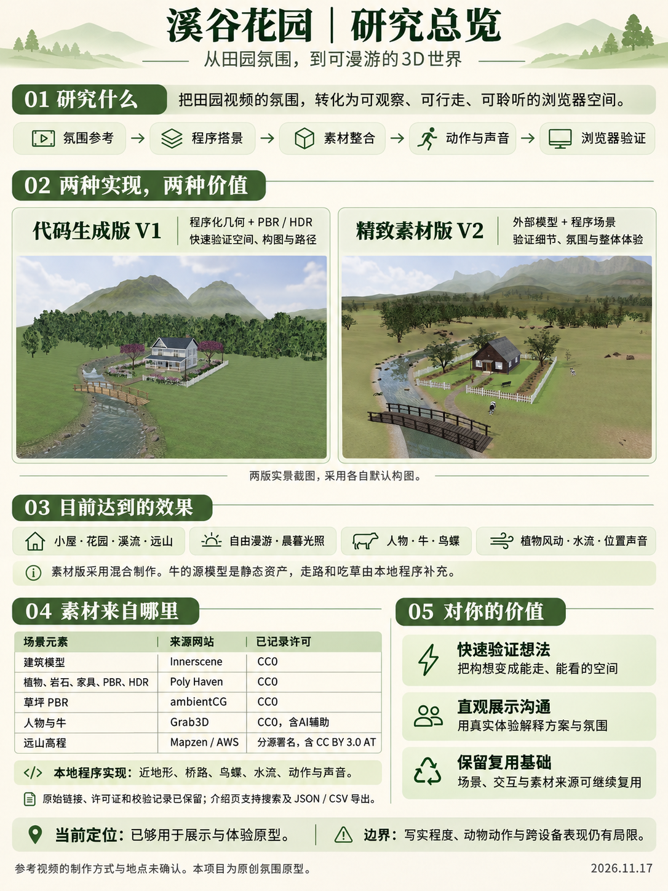

# 溪谷花园 · 从视频氛围到可漫游空间

以田园小屋视频为氛围参考，先用程序搭景，再整合免费模型、实拍材质、地形与环境反馈；保留两版浏览器实时演示，研究各自的效果、整合成本和复用价值。



引导图由本聊天生成，使用两版真实运行截图整理研究过程；[原图、提示词和来源归档](assets/research-overview-20261117/)。

## 从哪里进入

- **[在线介绍与双版本演示台](https://yydshly.github.io/20261115_codex_project/demos/0002-valley-garden/overview/)**：先看参考和我们的理解，再对照两版。可页内启动、切换、放大或独立打开。
- **[代码版 V1 · 独立漫游](https://yydshly.github.io/20261115_codex_project/demos/0002-valley-garden/)**：程序化主体几何结合 PBR/HDR，验证空间、构图、尺度与交互。
- **[精致素材版 V2 · 独立漫游](https://yydshly.github.io/20261115_codex_project/demos/0002-valley-garden/model-version/)**：外部模型与程序场景混合制作，验证细节、生活元素和氛围反馈。
- 本地入口仍为 `http://127.0.0.1:4173/overview/`、`/` 和 `/model-version/`。素材版首次网络加载较大，页面显示实际进度，结束漫游可取消。

[上线与验收记录](publication.md)保留实际提交、Actions、资源校验与浏览器结果。

## 参考与研究目标

[原参考 · @siradisidekor](https://x.com/siradisidekor/status/2121702120852492788)用约 10 秒镜头呈现白屋、花境、溪流、林带和山谷薄雾。我们观察主体关系、层次和安静感；原帖没有给出制作工程，不能确认它是实拍、3D 或 AI 生成。

研究目标是将这种氛围变成可以换视角、行走和聆听的连续空间。我们采用自己的建筑和空间设计；当前画面与参考的完成度仍有差距。介绍页并列原参考及两版实景，通过外链封面与可选官方嵌入展示原帖，没有把其图片或模型用于场景。

## 我们如何进行

1. 用内置浏览器观察原帖，提炼“小屋—花园—溪流—林缘—远山”的关系。
2. 用 Three.js 建立程序化场景与自由漫游，保留为 V1。
3. 在独立 V2 整合免费建筑、植被、扫描岩石、PBR、HDR 与真实高程，统一尺度、材质和光照。
4. 参考真实庭院，迭代花境、草土过渡、裸土、岩石、石板路、窗内布景与阴影；补充水流、人物、牛、鸟蝶、风动与距离声音。
5. 在内置浏览器检查效果，把来源、许可、实际能力与边界集中到介绍页。

## 两版效果与价值

| 维度 | 代码版 V1 | 精致素材版 V2 |
| --- | --- | --- |
| 空间构建 | 主要形体由代码生成；结合实拍 PBR/HDR | 外部模型与程序地形、水体和行为混合 |
| 当前体验 | 自由行走、环顾、晨暮、基础环境声 | 分层地表与植被、溪水、窗内布景、人物和牛、鸟蝶、风与位置声音 |
| 适合验证 | 空间关系、路径、构图、交互方向 | 近看细节、自然反馈、氛围与运行取舍 |
| 整合工作 | 通过规则调整布局和形态 | 处理尺度、材质、性能、接地、动作与声音 |
| 可复用内容 | 搭景规则、场景结构、漫游方式 | 来源索引、材质组织、环境反馈与整合经验 |

**对我们的直接价值**：把“喜欢一个视频画面”变成可从多视角评估的方案；用浏览器演示支持沟通；保留源码、资产线索和可替换模块，为下一次庭院、空间展示或沉浸体验减少重复搭建。

自然感来自细节之间的关系，单个高精模型不能代替整合。人物保留源骨骼行走；牛基于静态源模型补充程序骨骼和步态，仍是程序近似。室内以窗内布景为主，远山以远景为主；手机操作、跨设备帧率和听感仍需进一步验收。当前适合作为可展示、可漫游的体验原型。

## 素材来自哪里

[来源索引 JSON](web/overview/assets/source-catalog.json)共 49 条：37 条外部素材／依赖、12 条程序内容。按元素列出网站、原始链接、作者、获取时许可、本地路径和校验记录；也有 [CSV](web/overview/assets/source-catalog.csv)。

主要来源为 Innerscene（建筑、室内）、Poly Haven／ambientCG（植物、岩石、PBR、HDR）、Grab3D（人物、静态牛）、Mapzen／AWS（高程）。不能全部标为 CC0：高程包含 CC BY 3.0 AT，需保留各上游署名；Three.js 和离线处理依赖另有 MIT。人物与牛的上游披露 AI 辅助来源。程序内容未因本轮整理获得额外的独立素材许可。

原视频仅为外部参考，不再分发完整视频；各素材原许可和必要署名分别保留。

## 运行与发布

```powershell
python projects/0002-valley-garden/scripts/media.py
cd projects/0002-valley-garden/web
npm ci --ignore-scripts
npm start
```

模型、贴图及高程原件保存在带包级与逐文件 SHA-256 的 Release；[清单](publication-media.json)记录 URL、字节数与哈希，恢复时验证路径和完整性。来源文本、许可与自建代码留在 Git。依赖和素材就绪后，场景使用本地资源；介绍页的原参考需要连接 X。

`python projects/0002-valley-garden/scripts/build.py` 构建两个场景和介绍页，统一站点由根目录 `python scripts/build_site.py` 汇总。两版原始源码与资产不变；发布副本无损压缩大二进制，浏览器解压后送入原场景。构建输出不提交。

- [V1 保留和原文件哈希](versions/procedural-v1/README.md)
- [模型版实现、素材与验证](web/model-version/README.md)
- [介绍页与来源索引](web/overview/README.md)
- [公开发布验收](publication.md)
- [历史迭代原记录](ITERATIONS.md)：保留各阶段状态，旧的“尚未部署”等描述仅指当时。
- 引擎：[Three.js](https://github.com/mrdoob/three.js)，固定 0.180.0。本项目是自建原型，不是上游官方示例。
