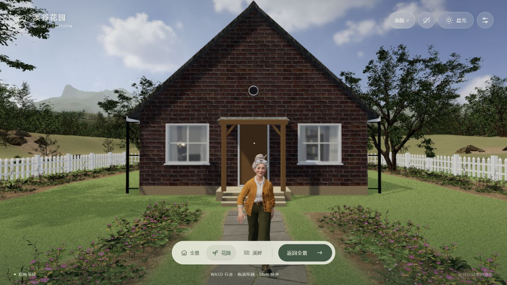
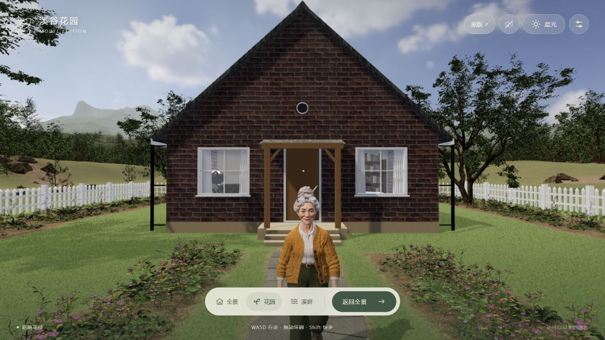
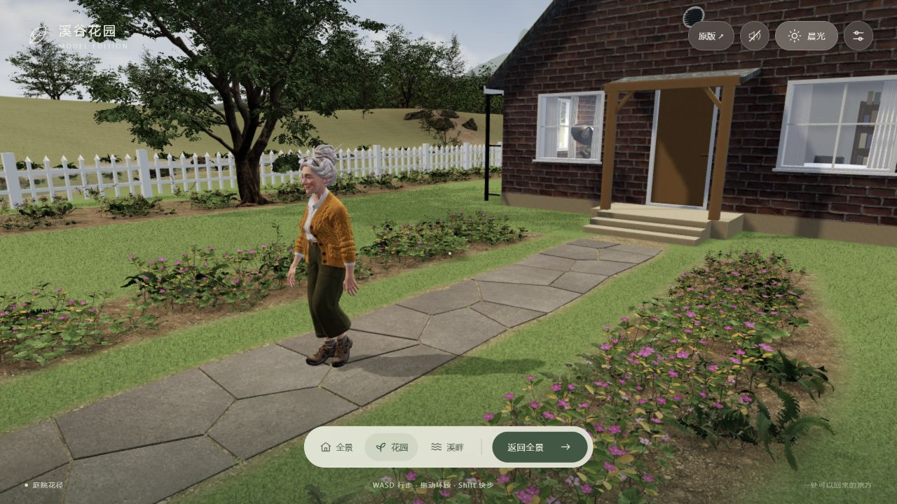
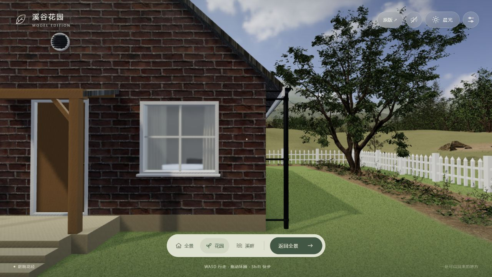

# 模型版：庭院近景预算与人物接地 · 2026-11-16

本轮仅修改模型版，所有旧资产保留。修改前根目录 39 个源码、工具和页面文件已存入 `../../versions/model-v2-before-closeup-grounding/`，原版 27 文件继续按基线逐字节校验。

## 人物接地

旧逻辑将静态模型的底部放在路线高度加 12 mm 的位置，当前行走姿态的鞋底仍会离地约 20–30 mm。新增 `foot-grounding.js`，从原始蒙皮鞋部选取 160 个底面采样顶点，每帧用当前骨骼计算鞋底位置，再对人物根部做小幅、平滑的竖向修正。没有修改 GLB、动作轨道或现有动作混合，也没有把人物放回缓存自身阴影中。

石板使用实际顶面三角形的空间索引取高，窄缝使用与近景地表一致的 0.5 m 网格插值。地形顶点高度缓存，避免每个鞋底点都重复计算多层地形噪声。CPU 局部观察约 0.28 ms/帧，不是整场景帧时保证。

连续性检查覆盖 3200 帧、约 53 秒，并按间隔抽查全部 19682 个鞋部蒙皮顶点。完整鞋面最低净空范围为 −1.54 至 5.64 mm，人物根部最大竖向单帧变化 4.91 mm；四肢最大旋转步进保持 4.85°。轻微负值来自采样近似、平滑延迟与石板高度差，未宣称完整脚部 IK 或完全消除脚步滑移。

## 窗户与近景绘制

玻璃预算按实际窗片包围盒的最近距离计算，替代建筑根节点距离。细腻模式在窗片 6 m 内恢复原物理透射，8 m 外切换到薄窗透明近似；流畅模式为 4 / 6 m。2 m 迟滞避免阈值处反复切换。透明近似的基础遮盖量在 8–24 m 内由 0.12 平滑增加至 0.26，同时按视角计算介电菲涅耳反射；预乘混合保留完整的表面反射，避免把反射随透明度再压暗一次。保留原粗糙度、折射率和环境反射参数；原玻璃材质、窗格、窗帘与室内模型不变。

每组窗片拥有独立的透明材质，避免共用材质时距离不同导致相互改写。可见预算只统计当前显示的房型。近处与普通观景的主材质均在启动时预编译；首次模型解析及首次物理透射通道仍可能有额外准备成本。

## 内置浏览器检查

近景对照使用同一标签页、1280×720 视口及实际绘制缓冲、细腻模式、同一“花园”默认机位；排除切换机位及首次编译阶段，优化前后各记录 8 个间隔 5 秒的稳定采样。帧率受设备、其他负载和机位影响，不把此结果当作所有设备的保证。

| 默认庭院近景 | 优化前 | 最终版本 |
| --- | ---: | ---: |
| 帧率范围 | 39–40 FPS | 52–80 FPS |
| 帧率中位数 | 39 FPS | 69 FPS |
| 累计绘制调用/帧 | 953–1111 | 494–651 |
| 累计三角形/帧 | 4310–5286 万 | 2169–3144 万 |

中位帧率约提高 77%，主要来自普通庭院观景不再触发整场玻璃透射预绘制。数据见 `before-near-metrics.json`、`after-near-metrics.json`、`comparison.json`；前一版普通 Alpha 玻璃的中间数据保留在 `after-initial-near-metrics.json`，不作为最终成绩。两次使用同一目标机位；视锥缓存停在过渡末端的不同帧，地平线可见树为 403 / 400 棵，其余树 LOD、林缘层次数量一致。资产总量、分布及模型细节预算没有降低。

优化前：

优化后同一机位：

人物脚部与地面投影：

近窗物理玻璃：

## 验证边界

这是沿现有庭院路线的鞋底高度修正，未改为完整两腿 IK，也未增加新的动作或动物动画。普通观景窗户使用透明近似，只有近窗检查恢复原物理透射；不能把它称为所有距离都做物理折射。现有独立逐帧人物阴影及世界阴影隔离保持，人物身体不接收自己的动态投影。

靠窗行走已实际触发 `physicalPanes=1`，见 `physical-window-check.json`。后段预览出现固定约 1 FPS、但日志单次绘制约 6–15 ms 的限帧现象；可见性设置未消除它。进一步记录显示动画回调间隔约 1000 ms，更新约 1 ms、绘制约 7–14 ms，见 `package-check.json`。因此当时主要受动画回调节奏限制，具体环境原因尚未确认；这段记录只证明操作与材质切换，未计入上面的稳定性能比较。不能据此前期基准声称已经解决所有运行环境的卡顿。晨光/暮色及细腻/流畅均有实际检查；本轮未观察到此前的身体明暗闪烁，仍不作所有设备与角度的绝对保证。

`npm run check` 和 `npm run build` 通过，包含原版 27 文件与模型/材质哈希、石板顶面高度、真实鞋部几何、动作连续性及玻璃迟滞验证。独立包包含匹配源码的 29 个运行脚本，额外诊断字段添加后再次验证主脚本语法与构建一致。修改前 39 文件快照逐项匹配哈希，详见 `automated-checks.json`。没有部署、提交或修改原版。

结束时重置了临时视口，回到无检查参数的默认入口，保留内置浏览器标签页。自然窗口 CSS 约 692×871、绘制缓冲 1038×1307，细腻模式和生活元素开启，ready=true、无本次加载警告或错误；回调限帧仍存在。证据为 `source-natural-check.json`、`source-natural-overview.jpg`。独立包截图为 `package-overview.jpg`，同样无本次加载警告或错误。
