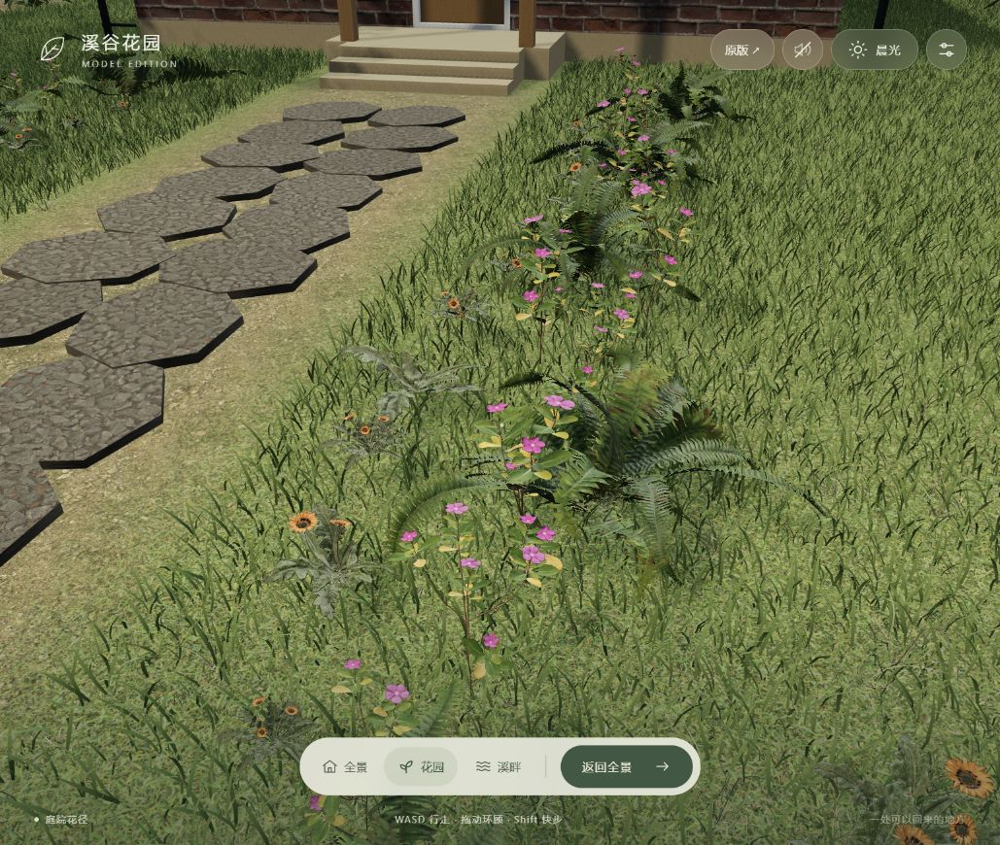
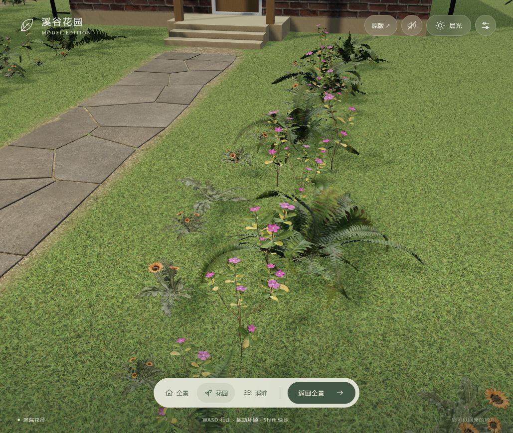
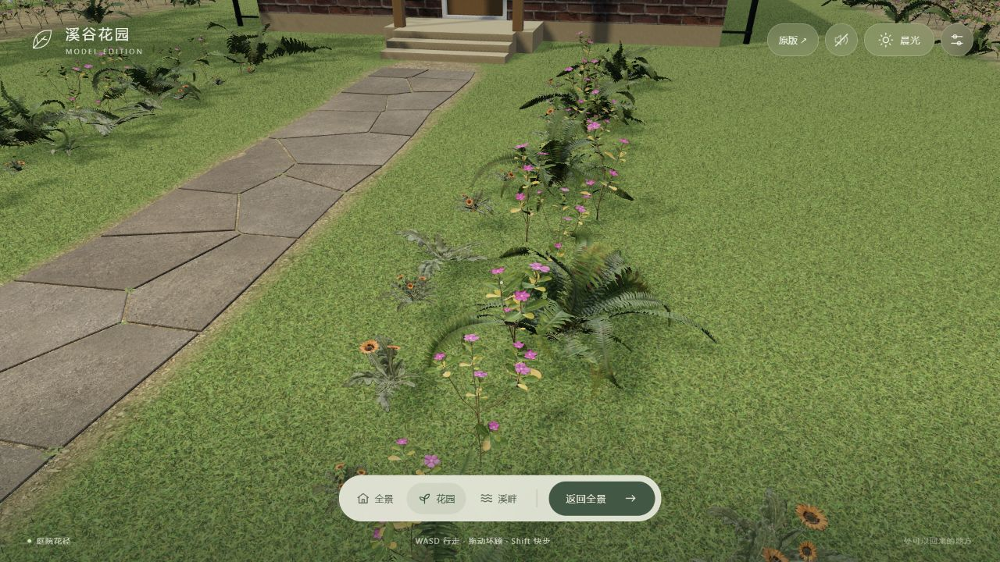
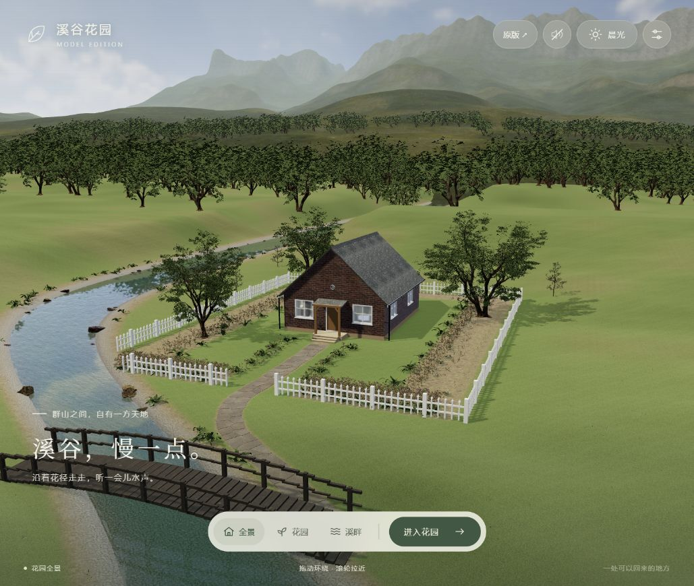

# 模型版庭院草坪与铺装验收 · 2026-11-16

本轮仅更新模型版；原版 27 个源码与材质文件逐字节一致。旧模型版源码快照：`../../versions/model-v2-before-courtyard-refinement/`，原模型、旧地表图片和草簇资产仍在原位置。

## 实景参考与取舍

- [Schäfer & Stich 园林施工实景](https://www.schaefer-stich.de/einblicke.html)：通过内置浏览器直接观察其 [庭院照片](https://www.schaefer-stich.de/var/media/1f3f6f9/l/einblicke-07.jpeg)。可见密实短草、较长的草坪边缘、拼合的不规则薄板、窄土缝和零星缝生植物。参考照片仅在线观察，未打包或再分发。
- [RHS 草坪修剪指南](https://www.rhs.org.uk/lawns/mowing)及[分步修剪建议](https://www.rhs.org.uk/lawns/how-to-mow-a-lawn)：辅助区分修剪庭院与外围长草。本文草高、板宽和倒角均为场景设计值，不是从参考照片测量得到。
- [Poly Haven Rock 01](https://polyhaven.com/a/rock_01)：Rob Tuytel，CC0；三张原始 2K 纹理均核对官方 MD5，并记录本地 SHA256。其原始物理尺寸 1.5 × 1.5 米，用于连续风化石面。板块几何仍是本地生成，不称为扫描石板模型。

## 实际改动

1. 庭院细草改为约 2.5–5 厘米的密实短草，围栏边略长。584788 片本地细草叶补充原扫描草簇；颜色沿连续生长斑块变化，减小风摆与过深的根部明暗。原草簇模型未改写，只调整院内实例高度。外围野草保留。
2. 旧七边柱体石块改为 64 块彼此拼合、各自不同的板块，主径约 1.3 米宽。接缝约 1.4–2.4 厘米，边缘露出土面约 6–10 毫米，3.5 毫米倒角，选取少量角隙补低矮叶片。石面换用连续石材的颜色、法线和粗糙度，替代碎石地表图。
3. 路径土层与石板采用同一路线，缩小原先过宽的裸土带。外围路线绕溪东岸连接木桥东桥头，修正旧路线切入河道的问题。
4. 细草保留反射省略、分块裁切与流畅模式减密；高画质近草范围 18 米，流畅模式 12 米，远端逐渐稀疏。

## 浏览器实测

Windows，Codex 内置 Chromium。源码视口 1029 × 871 CSS 像素，细腻模式绘图缓冲 1544 × 1307；独立包视口为 1280 × 720、绘图缓冲 1920 × 1080。实际打开源码入口与独立包；检查近景、短距离键盘行走、细腻/流畅切换以及全景路线。

- 源码：`http://127.0.0.1:4173/model-version/`
- 独立包：`http://127.0.0.1:4173/model-version/dist/`
- 本机瞬时读数：细腻模式全景约 52 FPS，庭院近景约 49 FPS，向前行走后的近景约 67–68 FPS；同一局部流畅模式曾显示 92 FPS。这些是单机、不同视角的短时读数，不是稳定帧率承诺。
- 本次源码与独立包检查未观察到浏览器错误或警告。

## 画面证据

以下均为内置浏览器直接截图，未合成或重绘。

调整前，同庭院起点和向下环顾角度：

调整后：

独立包：

全景与通向桥头的新路线：

## 自动校验与边界

`npm run check` 通过：原版 27 文件、116 个模型及派生文件、137 个 glTF 依赖、全部新增纹理哈希、草根落点、草叶距离裁切、石板边缘高度、上表面朝向与路线避水通过。100 个中心线射线中 94 个命中石板，其余为窄接缝。板块上表面在地形细小起伏之上 2 厘米内。

`npm run build` 通过；18 个运行模块与独立包一致，三张新石材贴图字节一致。根索引检查通过。

本轮改善草坪尺度、铺装构造和地表衔接，整体仍为实时三维原型。短草微结构、局部阴影和花境的自然混生层次仍有进一步提升空间，不等同于摄影或原视频画质。
