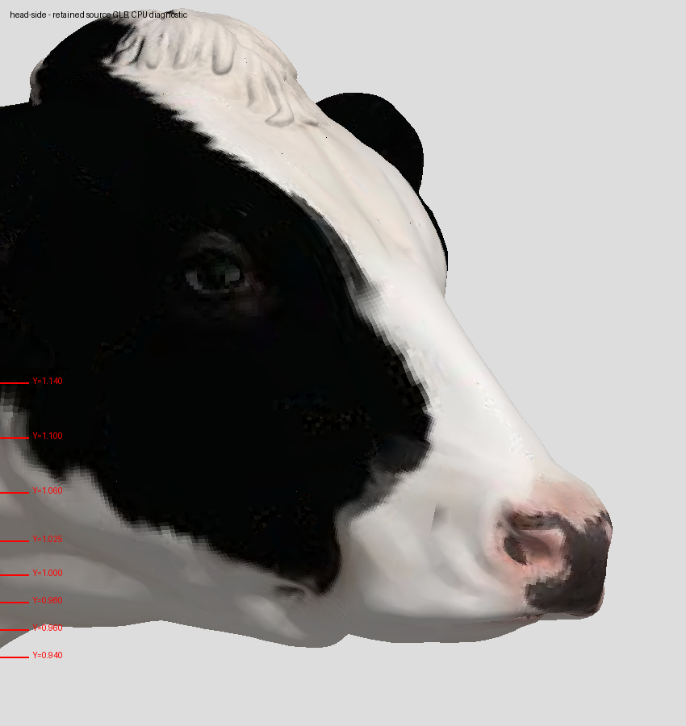
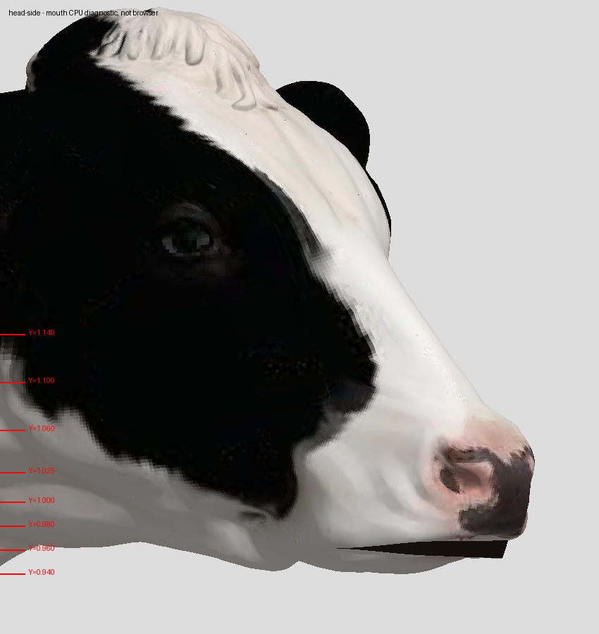
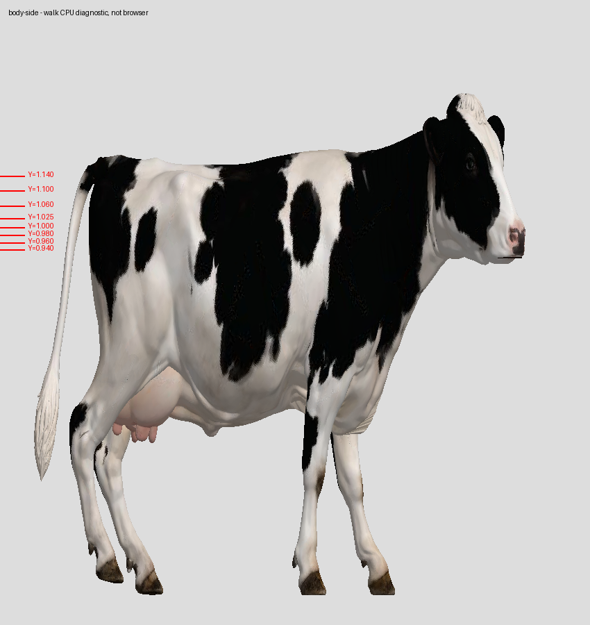
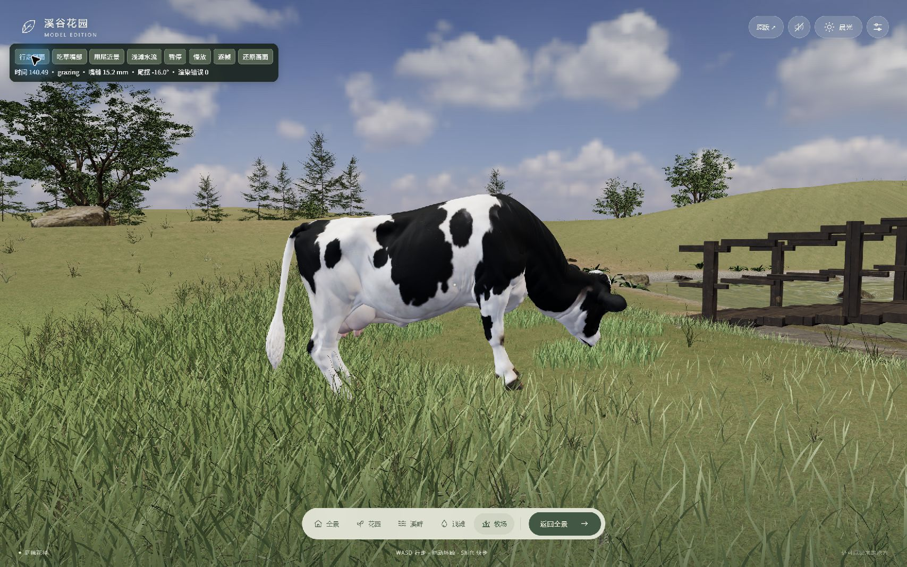

# 牛的鼻口、迈腿和原地滑转返修

本轮处理用户指出的三个实际问题：嘴缝切到了鼻子、腿部姿态不对、站立时转动和平移。原版与既有模型/贴图保持原字节，改动前 50 个根目录文件另存于 `../../versions/model-v2-before-cow-anatomy-repair/source.zip`，附逐文件清单。

## 鼻口位置

使用保留的原始 GLB 和原纹理生成侧面/正面的正交诊断图，定位到原口唇约在模型 Y=0.966–0.968 m。旧切分面约 1.025 m，穿过了鼻翼，不能作为正确的嘴部。新切分线移到鼻头下方，鼻垫上部不分配下颌权重；下颌动作幅度缩小，嘴缝实测约 1.8–15.6 mm。鼻子随整颗头部移动，但不随咀嚼单独裂开。

上述两图由 `inspect_source.py` 与 `export_pose.mjs` 对实际网格/纹理进行 CPU 投影，不包含生成式图像，也不代表场景浏览器验收。后者为看清鼻口而临时固定头颈角度，只保留实际下颌变形。原始 GLB 未改写；临时顶点导出位于 `.local/`，不是新的来源资产。

## 腿部姿态与脚底

前腿的两段关节此前使用了与原模型相反的弯曲分支，现按原绑定姿态修正。后腿髋部落点重新对齐，蹄部及下段网格完整分配到对应腿，避免部分蹄尖仍被身体权重拉扯。

新增 `cattle-gait.js`。落蹄时记录世界坐标并保持，抬蹄后才移动至预计落点；髋部同时处理前后与横向角度，因此身体沿弧线改变朝向时，支撑蹄仍保持落点。步态使用同侧后腿接前腿的四拍顺序，起步先用短步，停稳后逐只小幅收蹄。身体高度受腿部可达距离约束，并缓慢回升，避免关节在伸直极限附近突然翻折。它仍是原静态网格上的运行时近似绑定，不是专业动物动作捕捉。

## 不再原地转身

原逻辑把身体留在原点，直接插值朝向。现改为预先检查的平滑牧场曲线：身体向前迈步时才沿曲线转弯，站立、抬头和吃草阶段的位置与朝向固定。六处吃草点按曲线切线放置，停留时长和访问间隔使用可复现的随机序列；活动仍在约 4.6 m 半径内。路径会检查草地、围栏、石径、河岸和障碍物，找不到安全回路时改选起点，不使用原地旋转作为替代。

## 当前验证状态

完整 `npm run check` 已通过，包括原版 27 文件、146 个来源/派生模型文件、169 条 glTF 依赖、原人物动作与脚底，以及已有水流、地形和材质检查。随后对检查页面时间入口与测试采样作了定向复验。新测试确认：站立位置/朝向恒定；移动方向与身体朝向一致；四拍落蹄顺序正确；鼻翼不含下颌权重；世界坐标下的支撑蹄不随身体滑转。

指定平地回路测试中，120 秒/30 Hz 的最大关节步长约 9.15°，蹄底最低约 4.93 mm，抬蹄时抽查蹄部最高约 7.19 cm；连续支撑期的蹄部帧间位移小于数值精度的 1e-12 m。它们是自动测试样例的数据，不是所有地形或真实设备的精度保证。

本轮通过内置浏览器实际读取了新的行走侧面（页面时间约 18.65 s）以及低头吃草侧面（约 140.49 s），检查页面的渲染错误计数为 0；吃草实图保存如下。随后活动预览切换到其他项目，本轮没有继续操作其他项目页面。完整连续动作周期及嘴部近景仍未完成实看，不能把两个状态截图或上述模型诊断图描述为完整验收。

