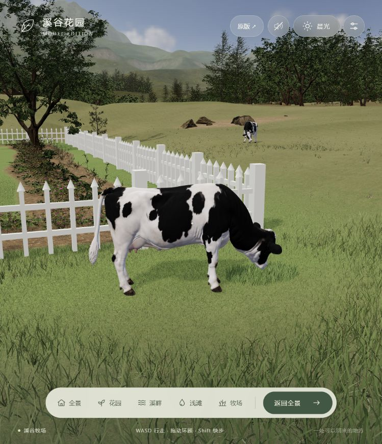
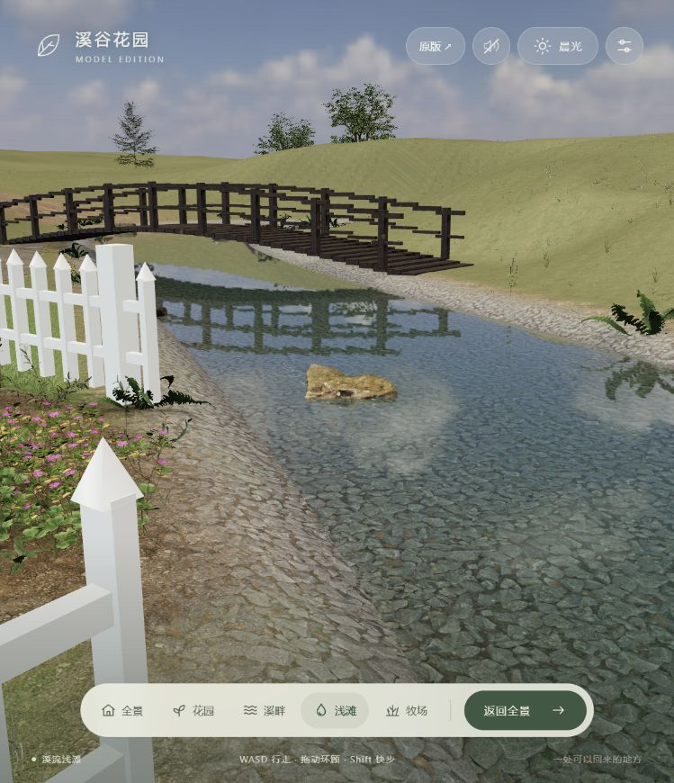

# 模型版：吃草姿态与连续水流返修

本轮只处理用户指出的牛颈部、吃草位置及溪水流动。原版 27 个源码/材质文件逐字节未变，146 个原始/派生模型文件及 169 条 glTF 依赖完整；旧素材没有替换或删除。修改前 44 个根目录文件保存在 `../../versions/model-v2-before-cow-anatomy-fix/source.zip`，有对应清单。

## 牛的姿态与嘴边草

上一版为了让嘴部到达 4.5 cm 高度，额外把颈骨向下移动约 21 cm，造成不自然的颈部变形。本次取消此位移，各骨段保持原始长度；颈部下转约 63°，头部反向转动约 17°，脸部总俯角约 46°。蒙皮权重收回到颈部和头部，躯干与腿固定，进食点在前蹄前方。嘴部约距地 9–12 cm，附近草丛直接以实际嘴部高度和位置生成。

每头牛补充 14 簇现有 Grass Medium 02 扫描草丛与 1400 片细草叶。草根匹配实际渲染地形，草尖覆盖进食高度；保留周围啃食区、高草及原有吃草/抬头循环。细草仍是本项目程序几何，原牛仍是 AI 辅助生成的静态网格加运行时骨架，并非专业动物动作捕捉或解剖级绑定。牛的固定躯干/蹄部进入缓存太阳投影，运动的头部和尾部尚无逐帧太阳投影。

参考通过内置浏览器实际观察的 [Wikimedia Commons 侧面吃草奶牛照片](https://commons.wikimedia.org/wiki/File:Nordrhein-Westfalen_weidende_Milchk%C3%BChe.JPG)，用于比较肩颈走势、脸部俯角与嘴部相对前蹄的位置。原照片未下载打包。

## 溪水的流向与运动

水面增加最高不到 1 cm 的实际顶点起伏，近段河道网格加密；细波和光学扰动向下游移动。16 片漂叶与 364 个细小碎沫由同一沿河行程时间场驱动：中心较快、岸边稍慢，浅滩速度增加，岩石附近横向绕行。碎沫在浅滩和石旁逐渐出现、消散，漂叶随水面起伏。流畅画质减半碎沫数量。视觉时钟按实际经过时间推进，避免低帧率时流动变慢；人物/行走的步长保护保持。

这是局部水面与粒子运动近似，河水仍为统一水位，没有求解坡降、体积守恒、湍流或真实流体动力学。不能将它称为物理水流模拟。

## 检查

`npm run check` 通过，包含原有素材、地形、人物稳定性及绘制预算检查。新增验证覆盖 38 秒完整牛动作中的固定骨段长度、头部总俯角、嘴部在前蹄前方、蹄部位移为 0、头部不穿地；测试实例最低头部净空约 9.6 cm。另检查两处嘴边各 14 簇扫描草和总计 2800 片细草的实际根部/高度。

水流检查覆盖弯曲河道内的持续漂移、岸边减速、浅滩加速、绕石不穿入、碎沫矩阵/透明度有效、小起伏边界及岸边水位固定。独立构建包含 33 个运行脚本，与源码一致；见 `automated-checks.json`。

内置浏览器实际检查源码版中的侧面低头姿态、嘴边草及浅滩连续画面，未见控制台警告或错误。水流两帧保存在 `stream-flow-a.jpg`、`stream-flow-b.jpg`；静态截图只展示材质与构图，方向运动需打开“浅滩”观察。本轮没有重新展开帧率基准或全场光照调整。

独立包已实际加载侧面牧场视图，`ready=true`，控制台没有警告或错误，见 `package-check.json` 和 `package-cow-side.jpg`。

最后回到不带检查参数的模型版入口，实际点击“牧场”和“浅滩”按钮，选中状态正常；保留浅滩供继续浏览，牧场实图为 `default-pasture.jpg`。
