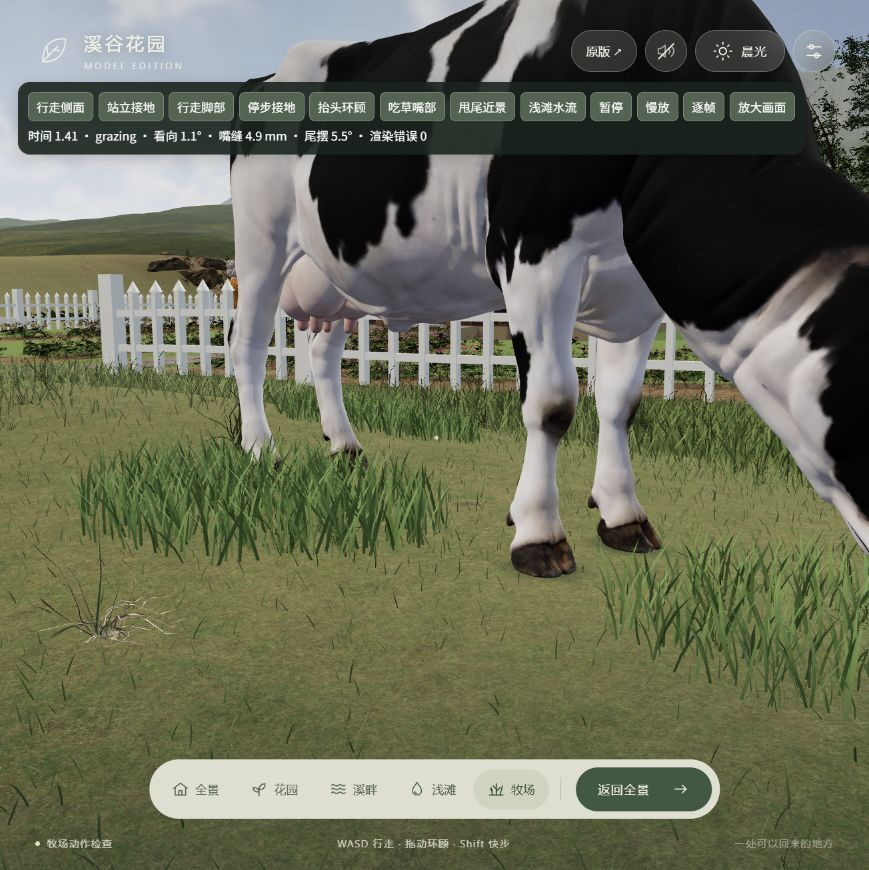
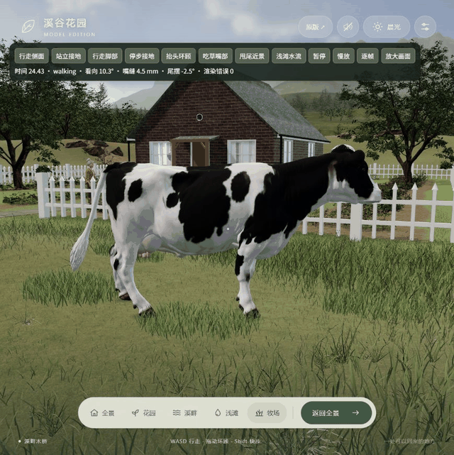
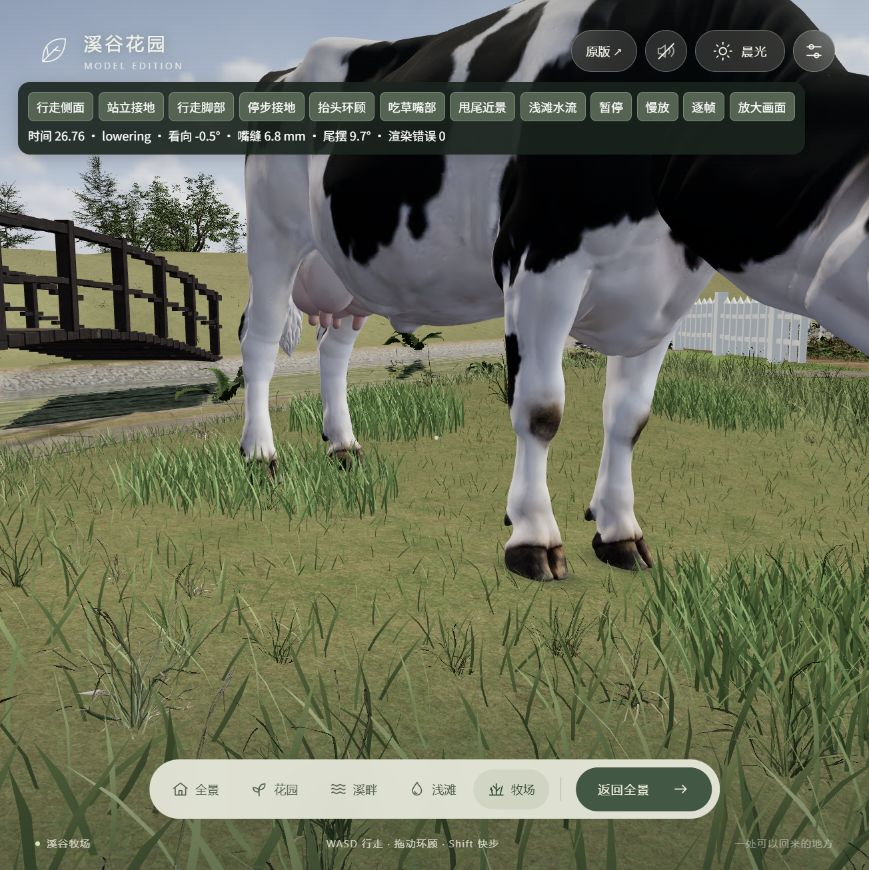
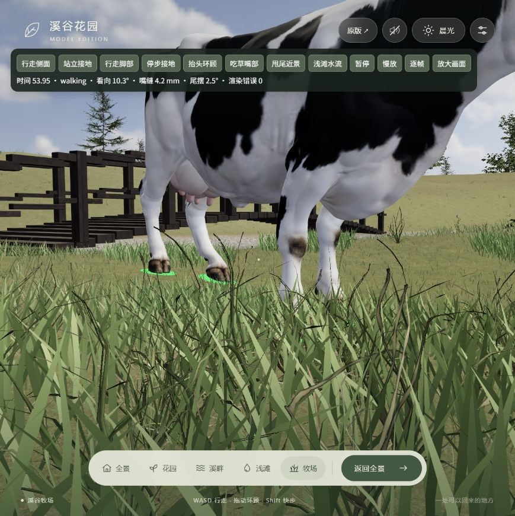

# 牛蹄接地与慢走返修

本轮只修改模型版，原版与来源 GLB 保持原字节。修改前 53 个根目录文件另存于 `../../versions/model-v2-before-hoof-grounding/source.zip`，附 SHA256 清单。

## 接地原因与修正

旧逻辑在第一次走动前不启用腿部地形求解，站立时只有整体身体朝向适配坡面；走动后依赖固定的蹄底偏移。两个真实山谷高度场样例中，有的支撑蹄离地约 16 mm，有的陷入约 23 mm，详见 `before-metrics.json`。

新增 `cattle-grounding.js`，从各蹄的原网格低部提取支撑形状，以实际地面三角形和各蹄处的坡度求解蹄底高度、蹄面朝向。站立、吃草和走动均执行接地；支撑蹄的位置和朝向保持在世界坐标，摆腿时才移往下一落点。地形查询使用与近处 0.5 m 网格对齐的缓存细分，避免每帧为全部蹄底采样点重复计算程序化地形。

较宽的动物阳光投影不足以表现厘米级脚边遮蔽，因此增加随蹄底位置移动、抬蹄时淡出的柔和接触阴影，八个蹄子合并为一次绘制，不增加地表材质的纹理采样器。内置浏览器的绿色定位诊断用于核对接地点确实与画面中的蹄底重合，普通预览不显示绿色标记。

## 步态调整

慢走速度从约 0.42 降至 0.36 m/s，每条腿的完整步幅从 0.56 缩至 0.48 m。保留同侧后腿接前腿的四拍顺序，缩短前伸落点，使用加减速连续的摆腿曲线；增加抬蹄时的蹄部弯曲，落地前逐渐放平。躯干增加很轻的承重侧移与起伏，身体高度仍受所有腿的可达距离限制，腿段长度不变。

## 自动检查

完整 `npm run check` 通过，包括实际场景的两头牛、真实选点与障碍物路线、原版 27 文件、146 个来源/派生模型文件和 169 条 glTF 依赖。接触阴影补充后又通过语法、阴影渲染状态和真实地形接地定向复验。最终独立构建成功。

完整场景的实际蒙皮蹄底抽查净空约 1.42–1.73 mm；两个山谷高度场样例的最低净空约 0.76–1.36 mm，支撑蹄最高净空约 1.50 mm。90 秒检查中连续支撑期的世界坐标帧间漂移约为浮点误差量级。平地 120 秒、30 Hz 样例最大关节帧间变化约 9.86°，四拍落蹄顺序保持 `[2,0,3,1]`。数据保存在 `after-metrics.json`，是特定采样的检查结果，不是所有地形和帧率条件的精度保证。

仍为保留静态模型上的运行时近似骨架，未引入专业动物动作捕捉、完整多关节后肢或蹄部物理接触模拟。

## 内置浏览器记录

本聊天的内置浏览器实际检查了约 1.2 秒的站立/吃草接地近景、约 24.4–27.1 秒的行走至停步低头衔接，以及约 26.7–28.1 秒的停稳后蹄部位置。连续支撑时未看到原地滑动，画面和界面状态均报告渲染错误 0。并非完整牧场循环或整片山谷的性能验收。

动图由同一次浏览器预览的 14 张连续截图缩小后编码，按记录的实际抓取间隔播放，末帧额外停留 0.9 秒；循环首尾是重新回放，不是场景动作接缝。原帧位于 `.local/`，抓取时间与界面状态见 `browser-motion-record.json`。

绿色定位图仅用于确认接地点，不代表普通材质效果。普通预览不显示诊断标记。
