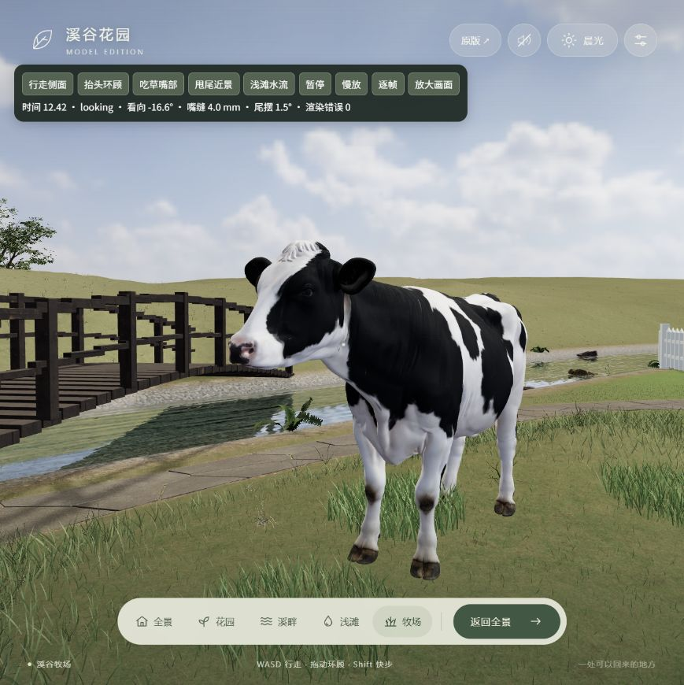
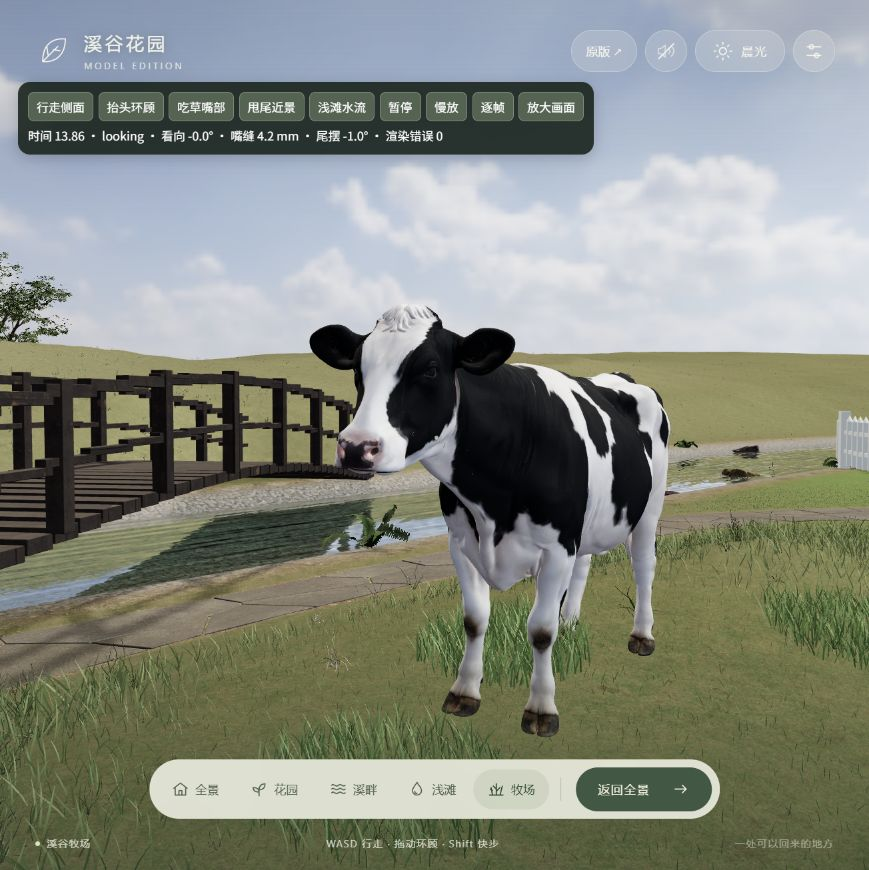
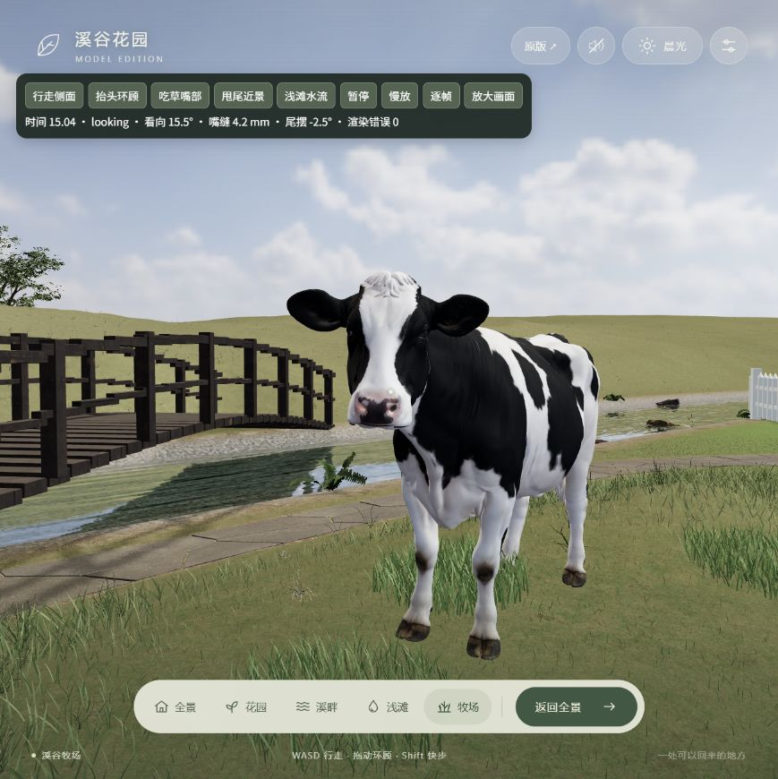
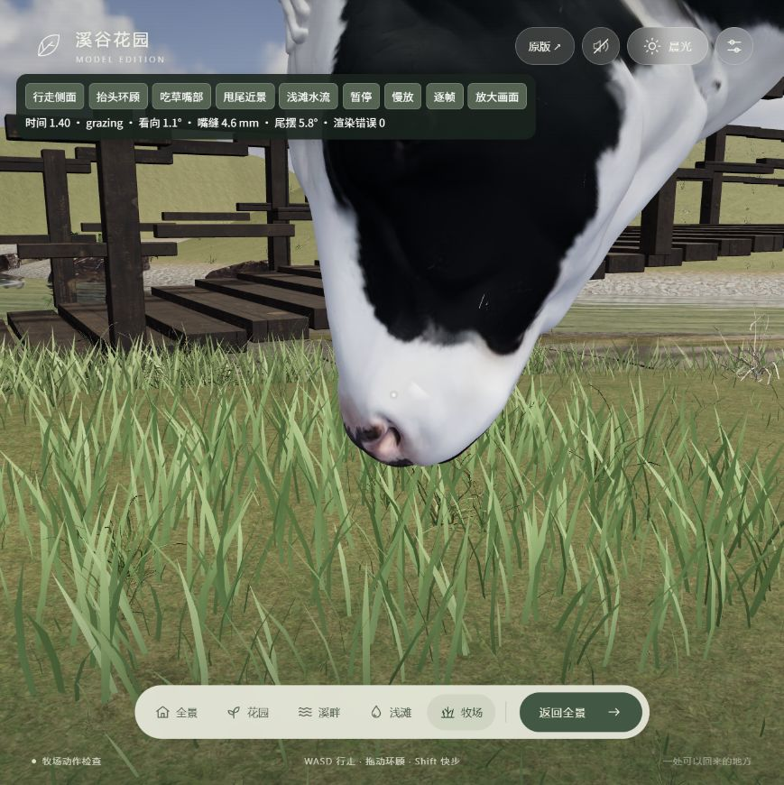

# 牛的头部朝向与环顾动作

用户指出牛头始终偏向同一边。本轮仅改模型版，原版与来源 GLB 保持原字节；修改前 51 个根目录文件另存于 `../../versions/model-v2-before-head-attention/source.zip`，附 SHA256 清单。

原静态网格的鼻头相对头骨已有右偏。原来的小幅正弦动作不足以消除这个偏向，也没有明确的左右注视。现在从原始鼻垫顶点的中心测得约 25.56° 的偏向，在固定长度颈骨上校正默认姿态，再叠加运行时动作；未旋转原资产、修改纹理或拉长颈部。

停步抬头后先向一侧看，短暂停留，转向另一侧，再回正、低头；两头牛使用不同顺序及错开的行为时段。吃草时仅轻微换点啃食，行走时按路线转弯速率朝弯道方向偏头。头部转动不修改身体根节点的位置和朝向，不改变支撑蹄的世界落点。抬头观察窗口延长至约 4.8 秒，避免刚抬头便低下。

## 实际内置浏览器检查

使用本聊天的内置浏览器标签，刷新源码模型版后检查，未使用外部浏览器或生成图片代替实图。连续截图记录约 12.42、13.86、15.04 秒的左右环顾过程；无身体原地滑转，检查面板渲染错误计数为 0。随后检查行走侧面约 22.76 秒，头部朝弯道方向偏约 10.3°；低头嘴部近景约 1.25 秒仍对着新增草丛。

`browser-observations.json` 保存相邻采样时刻的界面状态文本。截图和文本采样间有少量时间差；这是定向动作复看，不是整片山谷的全面性能验收。

## 自动检查与构建

完整 `npm run check` 与 `npm run build` 均通过；独立包 38 个运行时 JS 文件与源码一致（保留构建器对材质路径的必要改写）。原版 27 文件、146 个来源/派生模型文件和 169 条 glTF 依赖检查通过。

新增 `verify-cattle-attention.mjs` 检查实际蒙皮鼻垫的方向，而非只检查动画角度变量。指定平地样例中，校正后默认朝向约 0°；左右观察范围约 −16.62° 至 +15.47°，30 Hz 环顾样例最大帧间转角约 0.98°。站立时身体和支撑蹄保持不动，骨段长度保持不变；两头牛观察顺序不同，向左右弯道的偏头方向正确。

吃草横向换点样例中，嘴部离地约 11.1–12.0 cm，最大横向偏离原啃食点约 3.92 cm。已有咀嚼与鼻翼保护、甩尾、四拍步态、连续支撑落点、人物与水流检查仍通过。上述数值是自动测试样例，不是所有场景地形的精度保证。

牛仍使用静态来源网格上的运行时近似骨架；此次修正了固定偏头与缺少主动环顾的问题，并未替换成专业动物动作捕捉模型。
