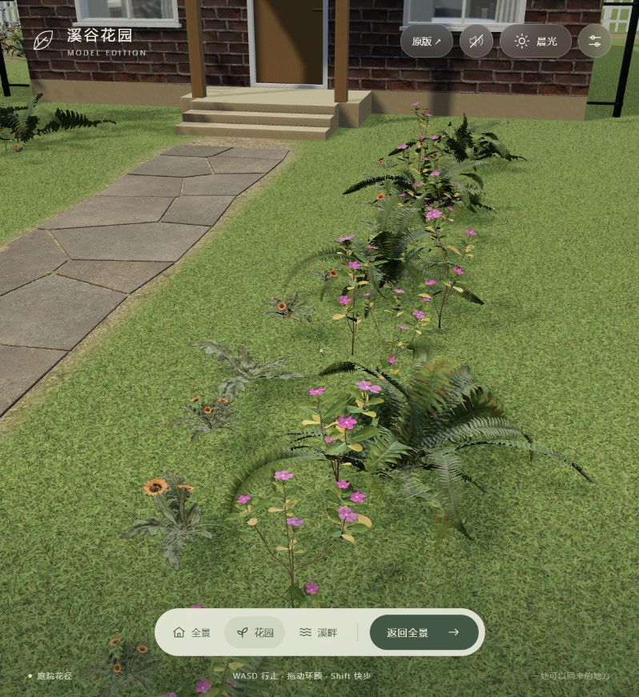
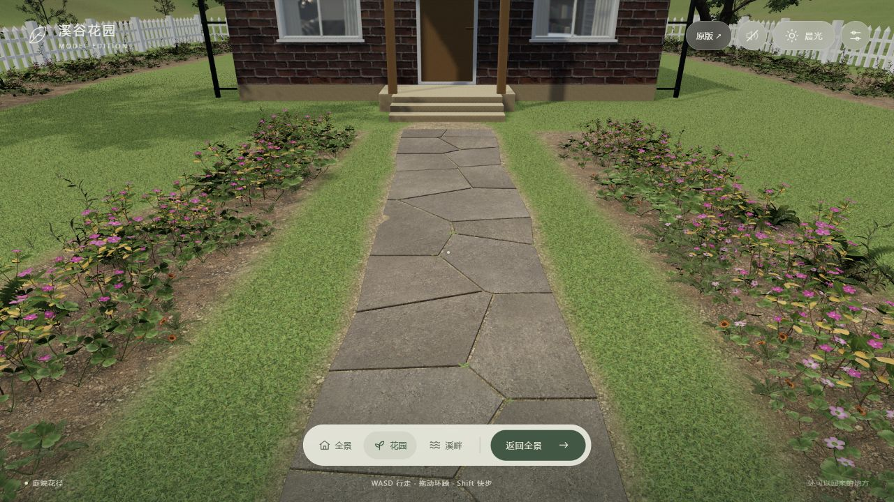
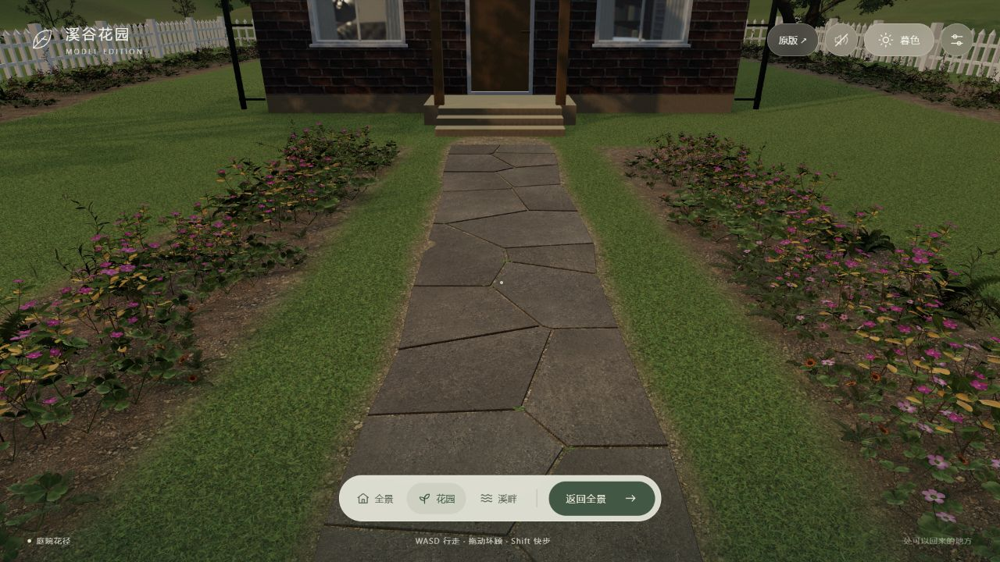
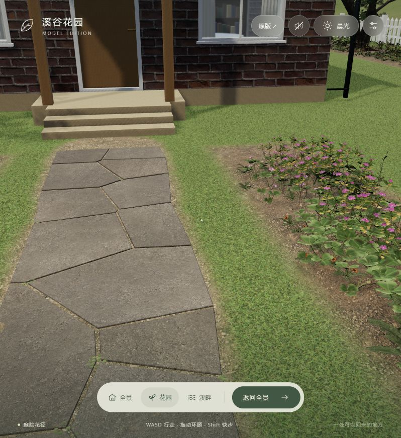

# 模型版花境、受光与接触阴影 · 2026-11-16

本轮只修改模型版。原版 27 个源码/材质文件逐字节一致，旧模型及贴图继续保留；改动前源码存于 `../../versions/model-v2-before-flower-lighting/`。

## 参考与实施

- [RHS Bluebell Cottage Gardens](https://www.rhs.org.uk/gardens/GardenDetails/BLUEBELL-COTTAGE-GARDENS)及其[实景花境照片](https://www.rhs.org.uk/getmedia/595a9e38-5d88-4eb3-a333-af7c10ea416f/Square_borders_RHS_940x627.jpg)：本轮在内置浏览器实际观察。参考层叠叶丛、成片重复的植物和花朵之间的高度变化，未复制具体品种或再分发照片。
- [RHS 花境规划建议](https://www.rhs.org.uk/garden-design/how-to-plan-a-border)：辅助采用成组种植，减少逐株点缀的零碎感。下列尺寸为本项目设计值，不是照片测量结果。
- 新增 [Poly Haven Shrub Sorrel 01](https://polyhaven.com/a/shrub_sorrel_01)，Rico Cilliers，CC0。6 个原始文件共 1,250,741 字节，全部匹配官方 MD5，另存 SHA256；旧资产不覆盖。

## 实际变化

1. `planting-plan.js` 组织 65 组错位重复的混合花境：698 株长春花、1057 株低矮酢浆草、480 株 Gazania、92 丛蕨类、61 株灌木。低处宽叶托住花朵，灌木位于后层；植物落点和土层边界使用同一方案。
2. 蕨类缩回庭院比例，Gazania 选择较矮、较宽的变体；同一组合共享变体和相近高度。根部从旧的土面上方 1.5 厘米改为略埋入土面。步道入口移至石径中央，避免站在花带中。
3. 日光减少偏黄和均匀补光，统一植物粗糙度、法线、环境反射和根部间接光。花坛保留原始土壤 PBR，在运行层调整为较深的有机土色。
4. 地表接触场从 1024² RG 增加为 2048² RGBA，独立记录根部遮蔽、土层和花坛区域。
5. `contact-shadows.js` 从实际小屋、近处树木和花境网格生成 768 × 1024 的低处遮蔽，保留真实叶片 Alpha，按距土面的高度衰减，再作水平/垂直柔化。纹理衰减地面间接光；启动与切换房型时重建。
6. 静止视角复用日照阴影，在视点、光照、画质或房型变化时刷新。低处植株减少重复倒影和细碎的实时阴影投射，以接触遮蔽补充贴地感。

## 实际浏览器与 GPU 验证

在 Windows 的 Codex 内置 Chromium 中打开源码及最终独立包，检查庭院近景、晨暮、画质及房型切换。独立包视口 1280 × 720 CSS 像素，细腻模式缓冲为 1920 × 1080。未观察到浏览器错误或警告。

GPU 读回不是空纹理：默认小屋接触图最低值 41，均值 222，约 23.2% 像素含遮蔽；屋内/屋脚样点为 41，空草地样点为 255。切换平房后覆盖率约 27.7%，切回小屋恢复 23.2%，捕获计数依次为 1、2、3。原始读回日志保存在 [contact-readback.json](contact-readback.json)。

独立包开着另一模型预览时，曾观察到细腻模式近景约 26–28 FPS、流畅模式约 33 FPS；这不是单窗口性能基准，也不与旧版不同视角读数直接比较。首次切换另一房型时观察到数秒的编译/加载停顿，回切正常。

关闭临时验证页后，正式入口在 798 × 871 CSS 像素、1197 × 1307 绘图缓冲下，庭院视角和步道近景观察到约 62–66 FPS，并实际执行短距离键盘行走。最终读数见 [source-metrics.json](source-metrics.json)。这些仍是本机短时读数，不是稳定帧率保证。

## 截图

全部来自内置浏览器真实渲染，未合成或重绘。旧入口位于花带旁，新入口在石径中央，因此下图用于记录版本状态，视角不同。

旧花境：

最终独立包晨光花境：

最终独立包暮色：

源码正式入口：

## 自动检查与边界

`npm run check` 通过：原版 27 文件未变；122 个模型/派生文件与 141 条 glTF 依赖有效；实际加载 23 组外部资产。检查花境落点、根部高度、共享土层、近草裁切、石径避水、材质/渲染器状态恢复，以及相机、光照和房型变化时的阴影刷新。模拟接触捕获失败后，主场景材质、可见性、目标、视口、XR、清屏色和阴影状态仍恢复。

`npm run build` 输出独立包，旧入口未改写。此版本仍是实时原型；接触遮蔽面向近乎平坦的庭院，按固定土面高度近似，并非完整全局光照或通用地形烘焙。静止视角的细微风动树影不逐帧重算。花境品种和低处混生的丰富度仍可继续提升。
