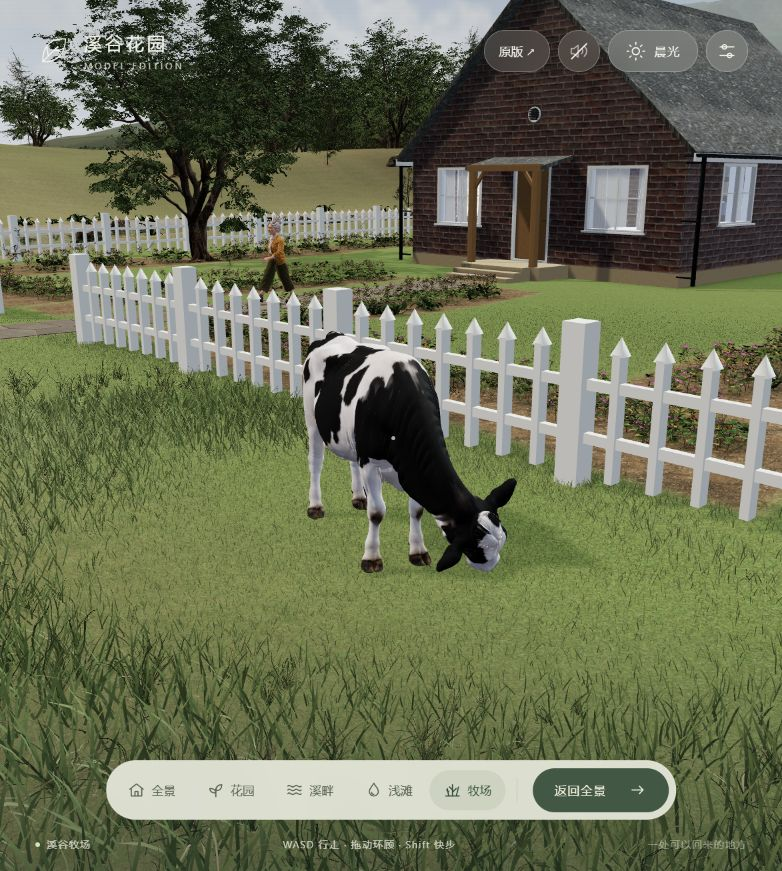
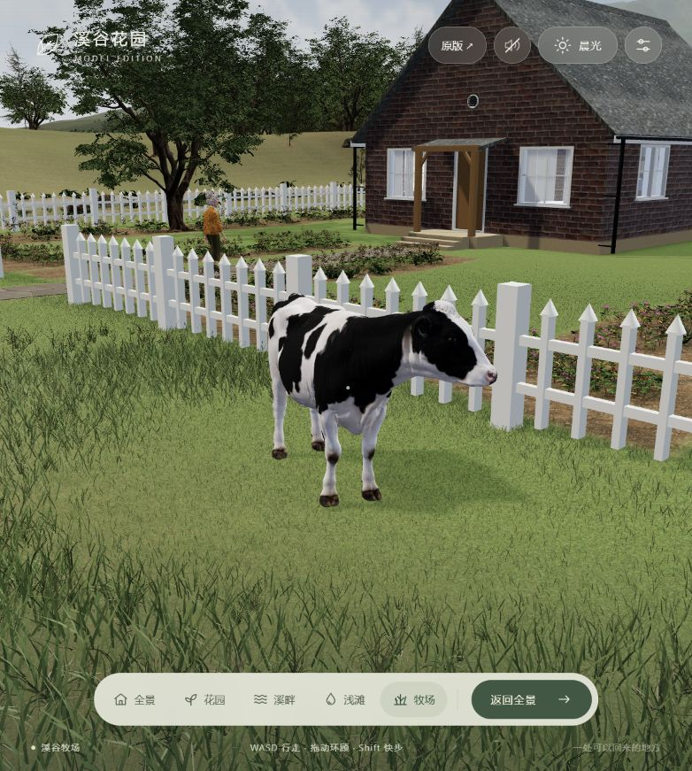
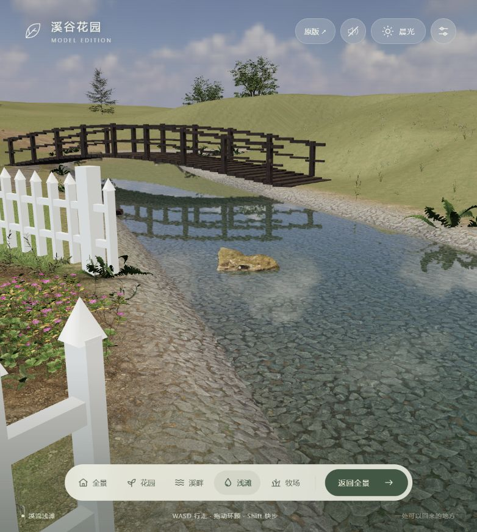

# 模型版：牛吃草、溪流与草地层次

本轮按三个内容项收尾，没有继续改光照或玻璃预算。原版 27 文件逐字节未变，原模型与贴图全部保留；修改前 41 个根目录源码/工具文件见 `../../versions/model-v2-before-grazing-water-meadow/`。

- **牛**：在保留的静态牛模型上增加运行时颈部、头部、下颌和尾部骨架。两头牛错开低头啃草、抬头、张望和再次低头的 38 秒循环；咀嚼与尾巴有独立运动，身体和脚保持固定。原 GLB 未改，不是新增的动物动作捕捉素材，也没有做走动寻路。
- **草地**：两头牛附近新增 1700 簇扫描草丛，以及约 3.36 万片近景细草叶。共享不规则啃食区：牛周围较短，外缘成簇变高，颜色随生长斑块变化。地表复用接触贴图的空闲通道，没有新增地表纹理采样器。细草叶是程序细节，扫描草丛沿用原有资产；不是整片新扫描草地。
- **水**：岩石前方增加窄水沫，后方改为随水流移动的碎泡与尾流；浅滩有局部流痕，减弱原先较宽的岸边白带。16 片小落叶沿河道漂流，提供可见的水流方向参照。仍是实时表面近似，不是流体模拟。

新增 **牧场** 和 **浅滩** 观景入口，分别查看动物/草地与近处溪流。切换观景按实际经过时间完成，行走碰撞仍保留原来的步长保护。

## 实际画面

低头吃草与草地高低变化：

抬头张望：

溪流浅滩：

## 验证

`npm run check` 通过：原版与全部既有素材哈希、原有几何、人物动作稳定性均保持；新增检查覆盖奶牛四个行为阶段、咀嚼/尾部运动、共享几何但独立骨架、脚部位置不随吃草漂移、头部不穿地、啃食区与长草区高度差、细草根部及漂流叶片始终留在河道。奶牛完整循环检查中的脚部位移为 0，头部最低净空约 4.5 cm。原牛网格仍按原字节保留。

太阳缓存投影使用固定的牛躯干与腿部，运动头部/尾部未逐帧重绘太阳投影，避免沿用旧姿态的自身阴影。原人物的独立阴影保持。这里没有为动物动作再展开一轮全场光照优化。

截图与状态通过内置浏览器获取；本轮不做帧率基准。检查源码和独立包、动物与浅滩入口后，默认入口保留给用户继续浏览。

独立包已实际加载，牧场视图 ready=true，31 个运行脚本与源码匹配；本次加载无警告或错误，见 `package-check.json`。无检查参数的默认入口已分别点击“浅滩”“牧场”，实图为 `default-shallows.jpg`、`default-pasture.jpg`。原版与既有模型/材质再次通过哈希检查，见 `automated-checks.json`。
