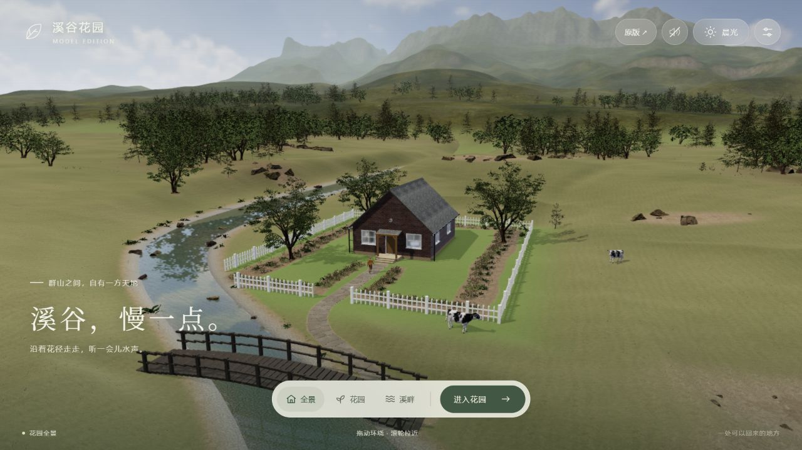
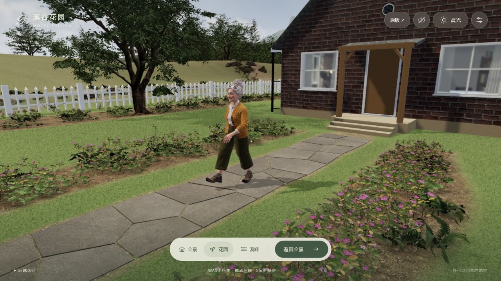
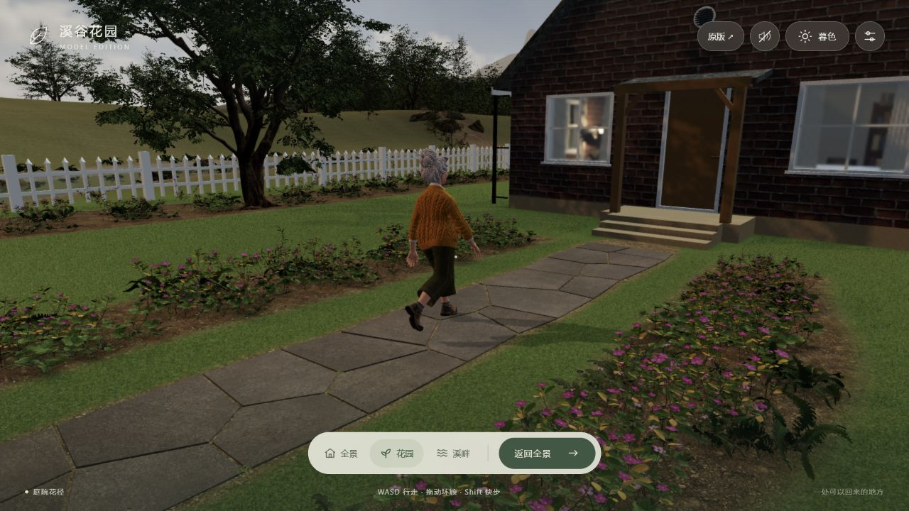
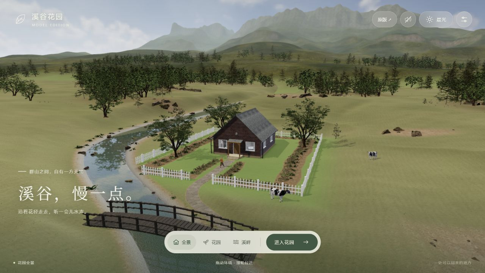

# 模型版光照、人物阴影与宽视野性能 · 2026-11-16

本轮只修改模型版。原版 27 个文件按既有基线逐字节校验；全部旧模型、贴图和此前模块保留。修改前 46 个源码/工具文件的快照与哈希位于 `../../versions/model-v2-before-light-shadow-performance/`。

## 阴影与光照

- 人物不再进入整片山谷的缓存太阳阴影，但恢复接收该图中的场景阴影，避免将旧骨骼姿态的自身阴影叠到新姿态上。
- 人物地面投影由独立的 9×9 m 深度图逐帧生成，细腻 1024²、流畅 512²。深度绘制与主画面使用同一套当前骨骼，投影作用于地表、细草、扫描草簇、庭院花叶、石板路和桥面；补齐草叶和花叶受影，避免它们遮住底面的阴影。每次只绘制人物，并恢复可见性、场景矩阵更新、渲染目标、视口、清屏状态、XR 和全局阴影状态，异常路径也验证恢复。
- 深度图采用最近邻与显式 LOD 采样、四点比较过滤，避免条件分支中的隐式梯度采样。人物的平滑动作过渡、循环衔接和邻近停步迟滞继续保留；53 秒固定步长骨骼检查没有回退到突然重置。
- 漫游中的场景阴影在光照平面按实际纹素对齐，重新居中只改变整数纹素，减少镜头移动时的阴影游动。静止全景不会因人物动作而刷新整个山谷阴影。
- 阳光强度从 2.35 调到 2.15，半球光从 0.36 调到 0.45，环境强度从 0.65 调到 0.75；曝光和暮色一起调整，减轻过深的暗部。水面、叶片背光与人物仍共用同一太阳方向和颜色。

## 宽视野预算

远景窗户采用透明反射近似，省去小窗口触发的整场透射预绘制。细腻模式 25 m 外切换，20 m 内恢复原物理透射；流畅模式为 21 / 16 m。迟滞避免阈值处反复变化。原材质保留，近远变体预热；窗格、窗帘和室内家具不删除。透射缓冲按细腻 0.75、流畅 0.5 比例绘制。

树木与草丛数量保持不变。地表移除一张土层粗糙度采样，改为 0.94 常数，为独立人物深度图留出纹理单元；颜色、法线和湿润区域的粗糙度变化继续保留，完整地表仍满足 WebGL 2 最低 16 个片元纹理单元。

## 对比条件与数据

通过内置 Chromium，在同一个标签页、同样 1280×720 视口与绘制缓冲、细腻画质、同一固定全景机位下比较。使用本地只读检查参数 `inspect=1&fixed=1&time=20`，固定相机，植物和人物仍正常更新。优化前后均只保留一个模型预览参与本轮基准，日志按本次加载时间过滤。

原始数据为 `before-metrics.json`、`after-metrics.json`；绘制调用和三角形是各渲染通道的累计开销，不是场景独有的几何数量。帧率只代表本机当时状态，不保证所有设备、自然窗口尺寸或视角达到相同数值。

| 同一 1280×720 固定全景 | 优化前 | 最终版本 |
| --- | ---: | ---: |
| 每 5 秒采样，排除首次 0 FPS | 8 次 | 15 次 |
| 帧率范围 | 50–51 FPS | 58–85 FPS |
| 帧率中位数 | 50 FPS | 69 FPS |
| 累计绘制调用/帧 | 841–1119 | 438–602 |
| 累计三角形/帧 | 3409–5125 万 | 1735–2603 万 |

中位帧率约提高 38%，主要来自取消远景玻璃透射的整场预绘制。最终观察窗口约 75 秒，保留全部 15 个有效采样，没有挑选最高帧率；早期版本的 75–84 FPS 结果另存 `after-initial-metrics.json`，不作为最终成绩。植物 LOD 与层次数量在前后日志中一致。

优化前：

优化后，同一机位：

人物与石板路投影：

暮色人物与受光：

最终独立包：

## 检查与边界

自动检查涵盖原版与素材哈希、原有几何、人物动作连续性、近远玻璃迟滞、独立人物深度绘制、异常恢复、静止场景阴影缓存及漫游整数纹素对齐。实际 GPU 深度图覆盖率、控制台状态、自然窗口尺寸及独立包结果分别保存在本目录 JSON 中。

`npm run check` 与 `npm run build` 通过。46 文件的修改前快照逐项匹配清单；28 个运行脚本与独立包匹配（仅保留构建所需的贴图路径重写）。实际 GPU 深度覆盖率为 0.004046，解码得到人物约 1.61 m 高的世界空间范围，向地面投射的数值探针通过深度比较。晨光/暮色、细腻/流畅切换、关闭/开启生活元素均用内置浏览器操作；关闭人物后投影消失。近处日志显示物理窗户已恢复，细腻暮色近景约 40–44 FPS，说明近景仍有物理透射的性能成本。

浏览器源版和独立包的本次加载均没有警告或错误。相关证据见 `character-gpu.json`、`near-and-controls.json`、`package-check.json` 和 `automated-checks.json`；切换时截图另存 `low-quality-character.jpg`、`life-hidden-no-ghost.jpg`。骨骼连续性验证覆盖 3200 帧、约 53 秒，最大四肢旋转步进 4.85°；近景多姿态和切换过程中未观察到先前的身体明暗闪烁，但有限画面检查不等于所有设备、角度下的绝对保证。

结束时已重置临时视口覆盖，并回到无检查参数的默认入口 `/model-version/`。自然窗口 CSS 1280×720、实际绘制 1920×1080（1.5 倍），细腻模式和生活元素开启，状态 ready=true、控制台无警告或错误；当时瞬时读数为 76 FPS，此数据不与上表的 1 倍绘制缓冲直接比较。记录与实图见 `source-natural-metrics.json`、`source-natural-overview.jpg`。首次加载仍需解析大型模型并预热近远玻璃材质；本轮优化的是持续漫游绘制开销，不代表启动成本已经解决。

人物仍不接收自己的动态投影，从结构上避免缓存自身阴影闪烁；身体接收的是场景阴影。独立人物投影接入地表、庭院草叶/花叶、路径和桥面，未覆盖所有远处植物或建筑表面；间接光部分采用小幅遮蔽近似，不是全局光照。远景玻璃是透明反射近似，近景物理透射缓冲分辨率有所降低。有限阴影分辨率仍可能产生细小边缘走样，未宣称所有设备和角度完全无像素变化。
