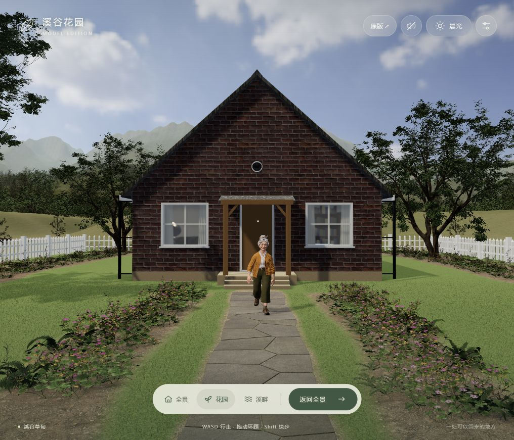
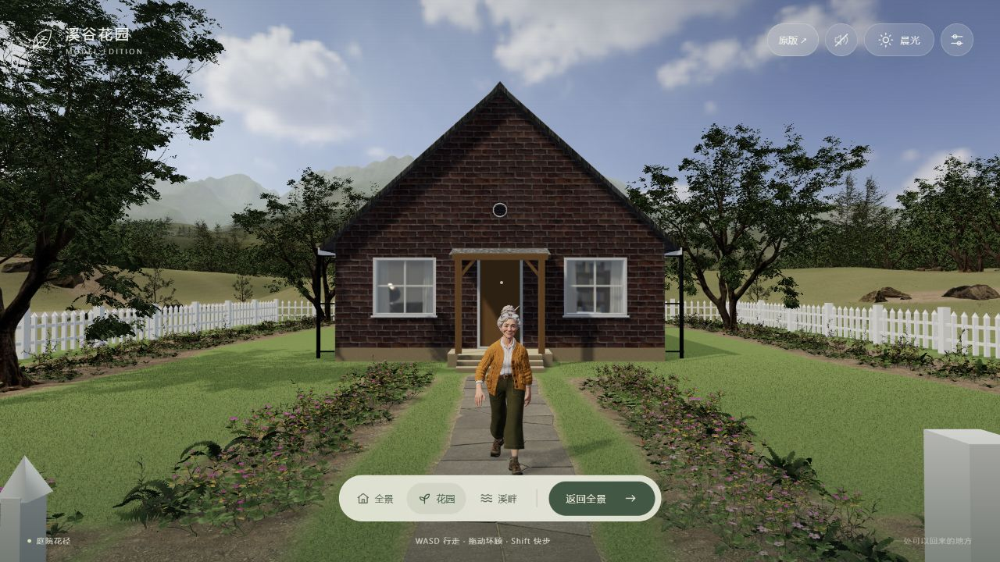

# 人物闪烁与动作跳变修正 · 2026-11-16

本轮只修改模型版的人物渲染与动作处理，保留当前模型、场景与原始 GLB。原版 27 文件继续按基线校验。修改前源码见 `../../versions/model-v2-before-person-stability/`。

## 已确认的问题

1. 人物每帧改变骨骼姿态，但共享太阳阴影缓存原来约每 0.14 秒更新。人物同时接收该阴影图，容易在新的身体姿态上采到旧姿态的自身阴影，产生明暗跳动。
2. 原实现停步/转身时每帧 `mixer.setTime(0)`，从当前步态瞬间返回第一帧。用保留的旧源码和相同 GLB，以 60 Hz 模拟 3200 帧，最大单帧骨骼角变化为 **50.083°**，发生在右腿。原动画循环的末尾与开头还存在约 10° 的膝部差异。

## 实际修正

- 人物继续投射地面阴影，但不再接收共享的缓存阴影图；降低衣服法线强度并提高粗糙度，减少细碎高光变化。单个人物的骨骼网格不使用静态姿态包围球裁切，外层仍按距离裁切。
- 近处动态投影按 0.05 秒（细腻）或 0.075 秒（流畅）请求刷新，远处维持 0.14 秒预算。
- 停步、转身通过 0.32 秒平滑过渡到保持姿态，持续推进动画混合器，不再突然清零。运行时复制的行走片段在最后 0.12 秒衔接回第一帧，原始 GLB 不改写。
- 访客距离使用 1.8 / 2.15 m 的停步/恢复迟滞，减少临界距离反复切换。

## 验证

`animation-comparison.json` 记录相同输入和 3200 帧 CPU 骨骼对照：修正后最大单帧变化为 **4.852°**。它衡量动作连续性，不是屏幕亮度或闪烁强度的测量。新增 `verify-life-stability.mjs` 覆盖跨多个转身的连续性、邻近停步、迟滞及近远阴影刷新预算。

通过内置浏览器检查正式入口和独立包的人物近景、行走与转身，截图为实际浏览器渲染。静态截图不能单独证明动态无闪烁，浏览器状态和控制台记录另存为 JSON。

`npm run check` 与 `npm run build` 均通过。正式入口另切换流畅/细腻画质检查，最后恢复细腻；正式入口与独立包均加载完成、人物开启，没有本次加载后的控制台警告或错误。26 个运行时 JS 模块与独立构建一致，素材原件哈希和原版 27 文件校验通过。

修改前：

修正后的正式入口：

独立包人物：

## 边界

人物暂不接收共享阴影图，因此身体不会精确接收树木或屋檐投影；这是当前共享阴影架构下的稳定性取舍，地面人物投影保留。若后续增加室内或深树荫活动，需要独立动态阴影方案。素材细节与浏览器抗锯齿仍会影响远景轮廓，未声称所有视角、设备均完全没有像素闪动。
