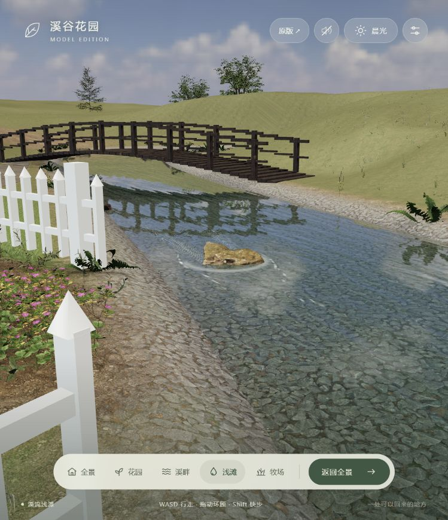

# 模型版：溪流运动与牛的牧场慢走

本轮同时处理“水流仍不明显”及后续追加的“牛小范围随机走动、停下吃草”。只改模型版，原版与全部既有模型、贴图保持原字节。修改前 46 个根目录文件另存于 `../../versions/model-v2-before-stream-current/source.zip`，清单见同目录 `manifest.json`。

## 溪水

原水沫使用石头高度的固定比例作为半径，明显小于扫描石头的实际水线，部分水沫藏在网格内。本次从摆放后的石头网格估算水线包围范围；九块石头的有效半径约 0.40–0.88 m，原观察点的石头从约 0.22 m 改为约 0.53 m。

细波纹理在局部速度场中绕石分开，使用两个交错相位混合以限制纹理拉伸；水面仍持续向下游移动。160 条短曲线流痕与 364 个碎沫、16 片漂叶沿同一弯曲河道行程场移动，经过石头时向两侧分流，流痕的形状与朝向使用实际弯曲路径。岸边减速、河心稍快，浅滩加速。流痕逐渐出现和消退，流畅模式减半流痕与碎沫。

五处浅滩统一驱动溪床、透光深度、速度和细波；新增 z=9 m 浅滩与默认水边观察点一致，其右侧浅砾石区深度小于 0.35 m。细小顶点起伏最高约 1.9 cm，岸边起伏归零，折射扰动与水面使用同一高度函数。它仍是统一水位的实时表面近似，未求解体积守恒、坡降和真实湍流。

## 牛走动与吃草

两头牛各准备六处随机草地落点，活动半径约 4.6 m，慢走速度约 0.42 m/s；每条直线路段检查围栏、石径、溪水、树干和岩石的安全余量。每段行为包含原地吃草/抬头张望、抬头、转向、慢走、抵达转身与再次低头。落点和访问顺序使用可复现的伪随机序列，约十余分钟后循环。它是小范围行为脚本，不是开放世界动物 AI 或动态寻路。

原静态 GLB 保持不变，在已有头颈/下颌/尾部骨架之外，增加四条腿的上段、膝部与蹄部。用四拍相位、65% 落蹄期、抬蹄回摆和两段腿部求解，按实际移动路程推进步态；转向时小幅踏步，开始与结束平滑过渡。身体和腿部有小幅联动。原始网格包含 AI 辅助生成内容，运行时绑定不是专业动物拓扑或动作捕捉。

十二处吃草点按停步姿态的实际嘴部位置与高度放置 84 簇已有扫描草丛和 8400 片细草叶，草根匹配渲染地形。牛的碰撞框随位置和朝向更新，原地固定接触遮蔽取消；当前姿态投影跟随全身和头部移动，避免留下旧位置的投影。

人物与动物共用 2048×1024 的深度图，分为两个 1024² 区域；人物保留原来的 9 m 近距范围，动物使用覆盖两处牧场的 34 m 范围。两者只占一个片元纹理采样器。首次浏览器检查发现单独增加第二个采样器会使地表超出设备 16 单元上限，此问题已改为分区共享并在浏览器中看到地面恢复。投影绘制不推进动画，人物既有动作、脚底校正和近距投影保持。

## 自动验证与浏览器边界

新增检查覆盖随机落点可复现、整段路线安全、活动边界、移动速度、行为衔接和位置连续；在真实地形/模型布局下检查每头牛均有六处可达落点。独立的平地迈步测试检查到 539 个完整行走帧：蹄底最低约 3.2 mm，抬蹄最高约 12.5 cm，落蹄期相邻帧的最大位移约 0.077 mm。它们是指定平地测试中的数据，不能据此声称所有地形都达到相同精度。

阴影测试覆盖人物/动物的单采样器组合、分区视口、裁切状态和渲染目标在成功及异常后的恢复。水流检查覆盖顺流位移、曲线流痕非静止、绕石不穿入、浅滩深度/加速、岸边减速、水面小起伏及流畅模式数量预算。原人物鞋底、动作连续性、玻璃、已有地形及资产完整性检查继续保留。

内置浏览器已检查：增强后的绕石流纹、碎沫与完整地面；期间发现的纹理单元超限已修正。下图与 `water-a.json` 是这一中间阶段的真实记录，当时尚未加入最终的观察点浅滩和第一头牛的安全落点修正。

最终独立包已载入并通过日志确认两头牛各有六处落点，未见新的警告/错误，但观察画面已被移动到牧场，不能据此声称完成浅滩视觉验收。随后创建独立内置验收页时，浏览器控制工具被移出本轮可用工具；没有改用外部浏览器或命令行截图来冒充内置浏览器结果。

**尚未完成：最终浅滩近景的连续视觉检查、完整走牛/停稳/吃草过程的浏览器复验，以及默认入口中的最终截图。** 当前代码与独立包已保留，可从“浅滩”和“牧场”继续检查。本轮不做帧率保证，也不把中途截图描述为最终效果。

最终 `npm run check` 和 `npm run build` 均以退出码 0 完成；34 个运行脚本与独立包逐一一致，46 个修改前快照文件全部匹配清单哈希。原版 27 文件、146 个源/派生模型文件、169 条 glTF 依赖及各类 PBR 完整性检查通过，见 `automated-checks.json`。这些自动检查不代替上述未完成的浏览器视觉复验。
