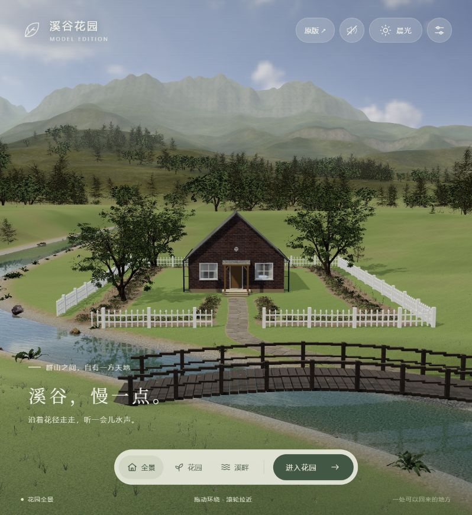
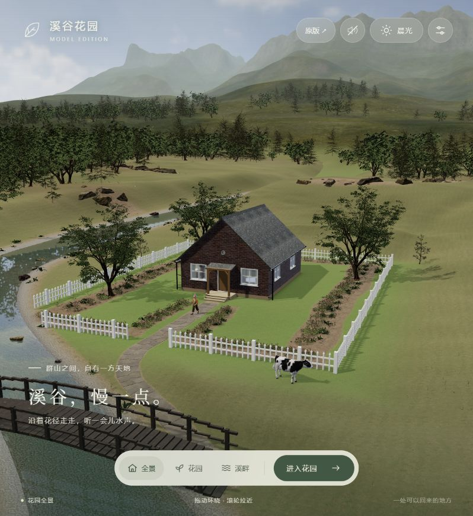
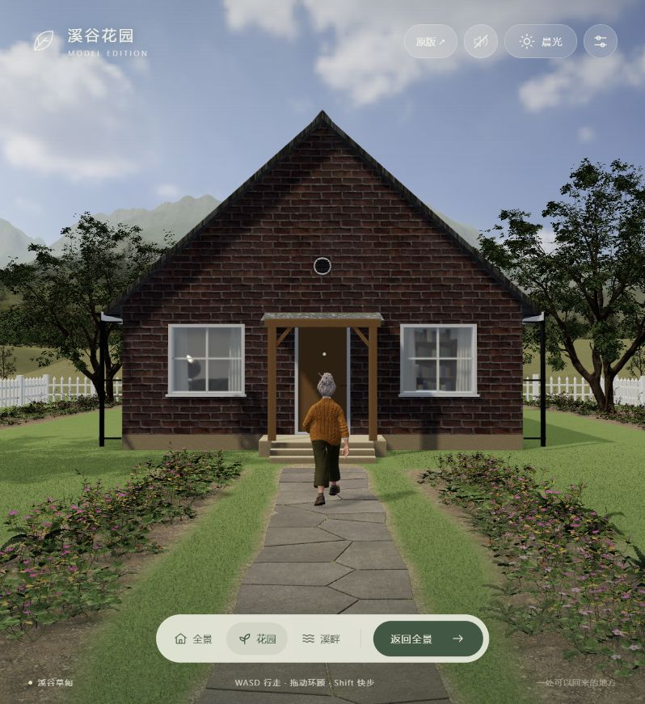
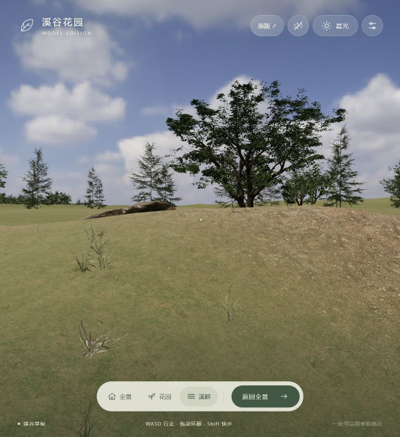
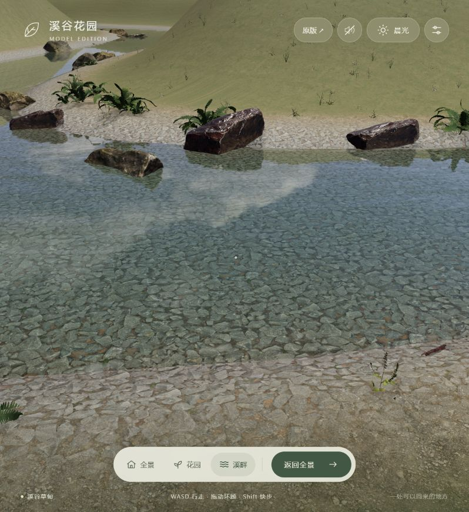
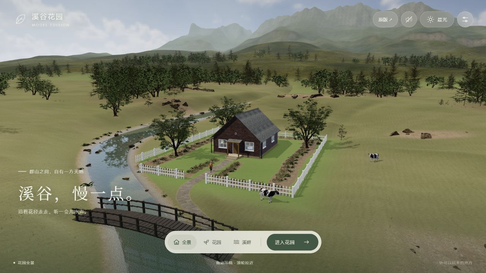

# 模型版地形、溪水与生活元素 · 2026-11-16

只更新模型版，原版 27 文件逐字节一致。旧模型、纹理和模块保留；本轮修改前源码及工具快照见 `../../versions/model-v2-before-terrain-water-life/`。

## 地形与地表

- 原来的近 / 远两层地表增加一个 1.25 m 中间层，近处仍为 0.5 m、远处为 5 m。两道衔接带与根部/行走高度采样一致。保留真实 DEM 山体，不将新增谷底形态描述成对真实地点的精确复原。
- 外围草坡增加扭曲的缓坡、米级草皮起伏、浅沟与局部坡坎；庭院及花径留出平顺基础。草坡中的裸土、岩面和石块沿同一片侵蚀区域组合，避免均匀撒点。沿用已有 PBR 地表材质，院外提高 Grass Ground 枯草与土隙色彩图的比例；石面采用高粗糙度常数，让完整地表材质满足 WebGL 2 最低 16 张片元纹理的限制。
- 新增 214 块埋入地面的扫描岩石和水中露石，其中 9 块位于水中；较大地表岩石有行走碰撞边界。表土接触和草丛遮蔽避开明显露土；前景及林缘较高草丛总数 8500，按距离和画质裁切。庭院内保留修剪草坪，与外部草坡有管理程度差异。院外色彩图采用随机平移、镜像与四邻域过渡采样，显式保留缩小层导数，减少重复条带。

## 溪水

深潭、浅滩、局部砾石隆起共同生成实际溪床网格与深度纹理，供吸收、透光与水面扰动采样；岸边宽度有小幅不规则变化。9 块露出水面的岩石与局部尾流使用同一组位置，降低全河统一波纹、统一蓝绿色的感觉。水面有实时反射和近似床面折射，仍为平面反射方案，并非完整流体、折射光追或真实水文模拟。

## 人物与动物

通过内置浏览器实际查看 [Grab3D Elderly Woman](https://grab3d.com/models/characters/elderly-woman/) 与 [Holstein Cow](https://grab3d.com/models/animals/cow/)，核对 CC0、外观和版本。选用的原生骨骼人物为 300,000 三角形、约 1.60 m，使用上游 `walk` 动画在花径往返和转向；人物路线避开正常进入庭院的落点，靠近漫游者时暂停。人物和奶牛有基本行走碰撞范围，关闭生活元素时同步取消。奶牛是 192,724 三角形的 Light 静态模型，共摆放两头，高约 1.40 m 与 1.29 m。

**上游披露它们含 AI 辅助生成内容，非真人/动物摄影扫描。奶牛目前是静态摆放，没有动物行为或交互系统。** 原始 GLB、来源、许可与本地 SHA256 保存在模型版 `assets/models/life/`。两个 GLB 合计 20,404,528 字节，增加首次加载量。设置中的“庭院人物与动物”可整体关闭，系统减少动态效果偏好会暂停人物行走。

## 实际检查

`npm run check` 自动检查覆盖原版 27 文件保留、146 个素材文件哈希、169 条本地 glTF 依赖、人物骨骼及花径范围、奶牛落地及避开岩面、地表三层接缝与实际三角形高度、岩石埋入、草丛留空、溪床深度及障碍物同步。实际加载原有 27 组资产及本轮 2 组生活元素。独立包由 `npm run build` 按现有流程生成，26 个运行时 JS 文件与源码逐一比对。

正式入口已在 Codex 内置 Chromium 中实走检查庭院、草坡与溪岸，确认人物行走、显示开关、流畅/细腻切换及晨光/暮色切换正常。最后载入后没有控制台警告和错误。单页面全景读数为细腻画质 49 FPS，CSS 视口 798×871，绘制缓冲 1197×1307；具体记录于 `source-metrics.json`。这只是本机当时读数，不代表所有设备或所有视角的稳定帧率。

浏览器截图均为真实渲染，未重绘。观景模式自动环绕，修改前后不是像素级对齐比较。独立包另行加载核对，并保存 `package-metrics.json`。

独立包同样加载完成、生活元素开启，无控制台警告或错误；其宽屏截图为 1280×720。检查时源页面也保留在另一个标签中，独立包日志曾读到约 21 FPS，且更宽视野会显示更多树木和草丛，不能与前述 49 FPS 当作等条件比较。宽视野细腻画质仍有明显性能成本，可选择流畅画质减少绘制密度与分辨率；没有宣称所有配置都能保持流畅。

修改前：

模型版全景：

花径人物与庭院：

草坡、裸土与露岩：

溪水近景：

独立包：

仍有边界：有限模型会有复用，草坡和水流都是实时近似；人物仅沿预定路线行走，没有完整导航和对话。新增元素用于建立尺度和生活感，不声称达到摄影级或完整生态模拟。
