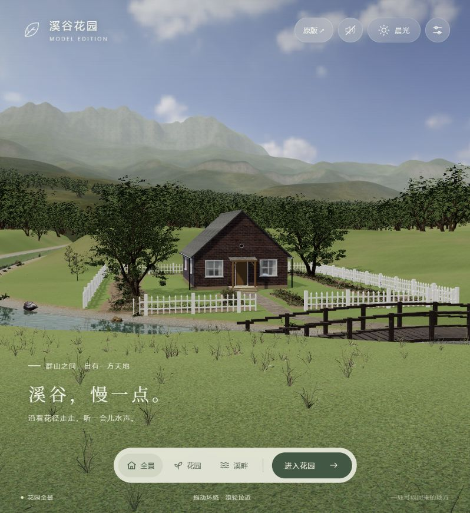
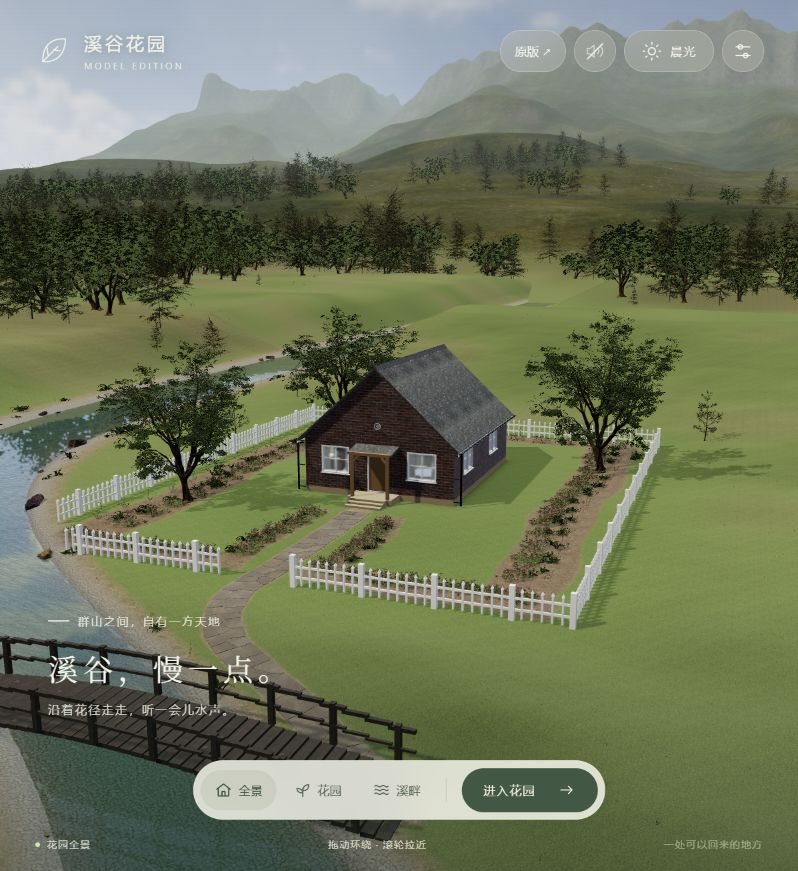
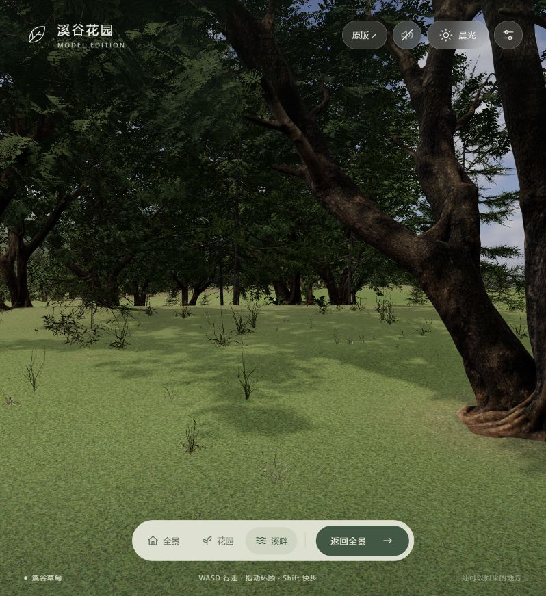
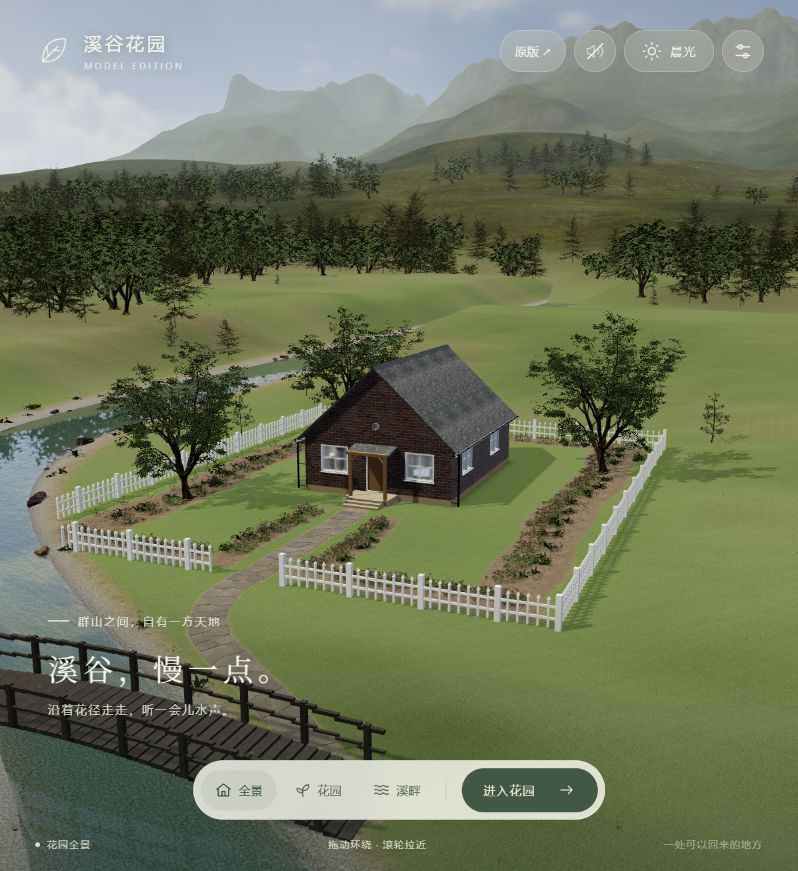

# 模型版中远景与山谷植被 · 2026-11-16

本轮只更新模型版；原版 27 个源码/材质文件逐字节一致，旧模型和纹理继续保留。修改前源码：`../../versions/model-v2-before-valley-ecology/`。旧 `woodland.js` 也保留，当前入口改用新增模块。

## 实景参考

实际通过内置浏览器查看 [Kitzbüheler Alpen 旅游方的 Kaiserbach Valley 页面](https://www.kitzbueheler-alpen.com/en/stjo/infra/a-z/nature-reserve-kaiserbach-valley.html)及其[夏季全景](https://pano.rundblick.at/viewer/?containerid=1206&panoid=5154)。观察坡脚混合林、起伏林缘、幼树灌丛及连贯的开阔草地。照片仅在线观察，未打包再分发；本场景参考其分布关系，不是当地地形、树种与位置的完整重建。

新增树形来自 [Poly Haven Fir Sapling Medium](https://polyhaven.com/a/fir_sapling_medium)，Rob Tuytel（摄影）、Rico Cilliers（建模），CC0。原始 78,427,962 字节文件保存在忽略的 `.local/research/fir-sapling/`，逐文件匹配官方 MD5，并记录 SHA256。运行衍生资产的许可、下载地址、面数与哈希见模型版 `assets/models/trees/fir/`。

## 实际调整

- 加入 a/b/c 三种完整冷杉树形，与原阔叶树组成四类主要轮廓。树高按群落年龄变化，同时改变冠幅、冠深、小幅倾斜和叶色。3088 棵树中 2700 棵在坡面；近处庭院仍保留原阔叶树框景。
- 近山脚改为不规则树群与相连空地，减少整齐的树林前沿。树群、林缘、草坡、林下土色和山体森林覆盖共用空间分布场。
- 林缘新增 430 株成簇灌木、170 棵幼树、24 丛蕨类、700 丛低矮地被和 4800 簇较高草丛。庭院、溪水和桥头路径留空；根部贴合实际渲染地形。
- 冷杉保留四级几何网格。近处约 10.4–10.9 万面/株，远处约 4–4.2 千面/株；针叶连通片围绕自身中心扩展，保留约 95% 原几何表面积。Alpha 与颜色各 11 级缩小层，减少针叶消失和黑背景混色。树皮不套针叶遮罩。
- 草坡增加粗草、干湿与林下土色变化，新增草丛使用独立运行时色调；原图不改写。山脚按与谷底的高度差逐渐接上草地/土层，柔化原来的材质硬边。
- 远近树木、灌丛与草丛分层裁切，流畅模式减密；细碎林缘植被省略倒影和重复阴影投射。
- 漫游中的太阳阴影范围跟随行走位置，并向前方偏移；光源与目标一起平移，保持日照方向。返回全景后恢复庭院范围。修复走进树林后树根附近缺少日照阴影的问题。

## 浏览器实际检查

在 Windows 的 Codex 内置 Chromium 中打开源码和最终独立包，检查全景、溪畔及从桥头走向林缘的视角；林缘切换流畅/细腻画质后正常，控制台无警告和错误。正式入口最终读数为细腻画质 55 FPS，CSS 视口 798×871、绘制缓冲 1197×1307，记录于 `source-metrics.json`。它是本机当时的页面读数，不作跨设备稳定帧率保证；独立包漫游日志见 `valley-metrics.json`。先前同时运行两份模型预览时全景曾显示约 32–34 FPS，不与单页面读数混用。

截图均为浏览器真实渲染，未合成或重绘。观景模式自动小幅环绕，修改前后截图不是像素级对齐比较。

修改前：

最终独立包全景：

林缘漫游：

正式入口全景：

## 自动验证与边界

`npm run check` 通过：原版 27 文件未变，140 个模型/派生文件与 169 条本地 glTF 依赖有效，实际加载 27 组外部资产；四类可见树冠、跨级根部/尺寸、针叶覆盖率与颜色层、树皮遮罩、视野和画质预算、灌丛落地/避水、庭院留空、地形接缝和山脚过渡有效。另验证阴影随行、回全景复位、日照方向不变及静止时不重复绘制。`npm run build` 生成独立包。

新增运行资产约 51.2 MB，首次加载量增加；原始大网格不进入运行包。整体仍是复用有限树形的实时原型，针叶网格在远处有近似，未声称消除所有重复或达到摄影级。现有树种也不等同于参考山谷的完整植物群落。
