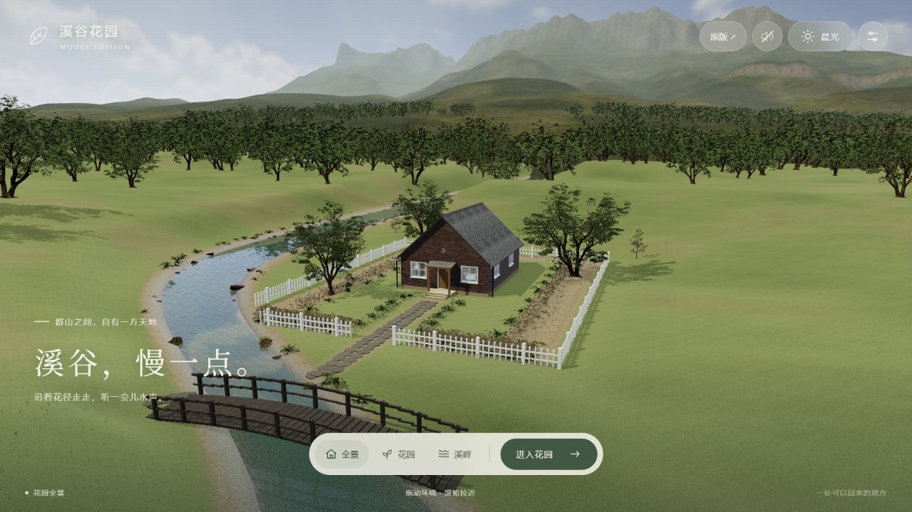
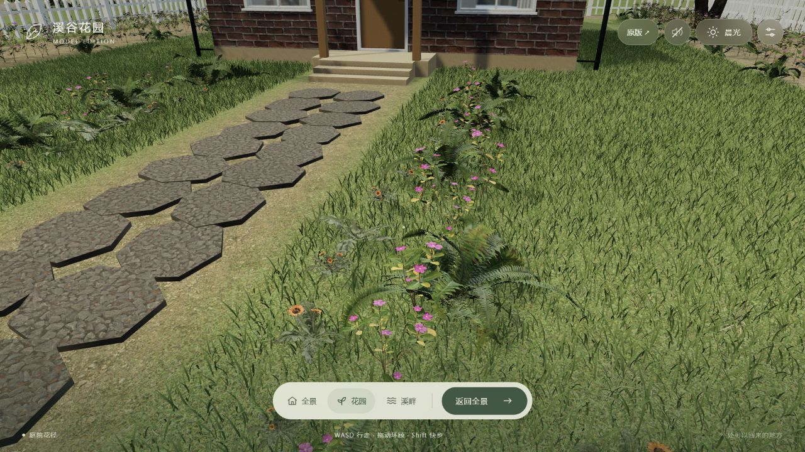
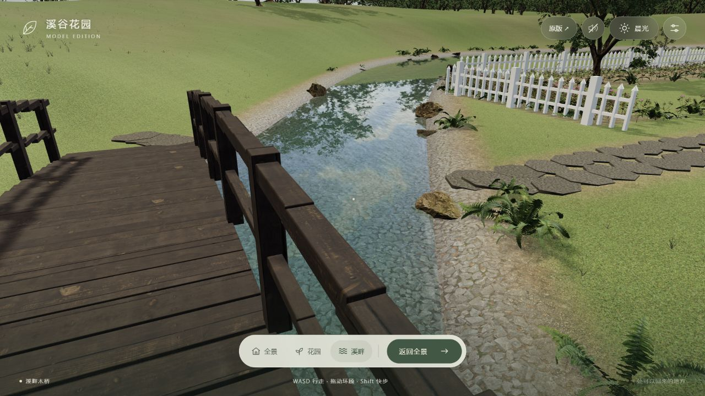
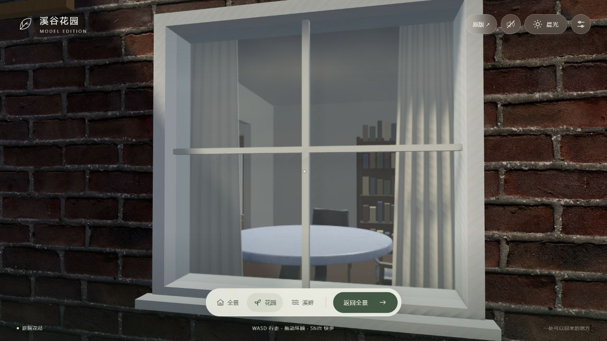
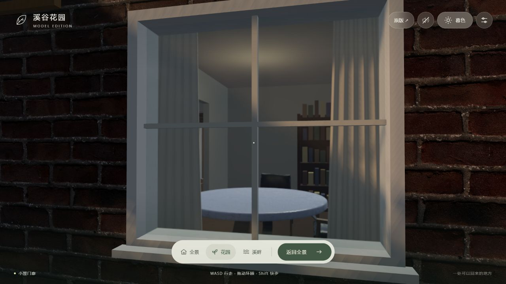

# 模型版实际浏览器验收 · 2026-11-16

本轮检查已有浏览器漫游原型：本地页面加载模型与 PBR/HDR → Three.js 渲染 → 全景/花园/溪畔切换 → 键盘和拖动漫游。原版保持不变；未部署、提交或外发。

## 环境与证据

- Windows，Codex 内置 Chromium，固定 Three.js 0.180.0。
- 画面为 1280×720 CSS 像素，实际绘图缓冲 1920×1080，细腻模式。
- 源码入口：`http://127.0.0.1:4173/model-version/`；独立包：`http://127.0.0.1:4173/model-version/dist/`。
- 本目录 JPG 均来自本轮内置浏览器实际渲染；名称含 before 的为修正前或中间阶段，以下只引用最终检查图。

## 发现与修正

| 发现 | 修正 | 证据 |
| --- | --- | --- |
| 预览连接被拒绝 | 恢复仅监听 127.0.0.1:4173 的现有服务 | 源码与独立包实际加载 |
| 原细腻模式约 13–14 FPS | 水面反射缓存；倒影省略细小草花、简化玻璃；地平线树木采用 1503 面层级；草簇按距离预算 | 全景曾观察约 32–43 FPS |
| 远景叶冠灰白、细碎 | Alpha 加权颜色 mipmaps、保持覆盖率的透明层级、降低叶片高光 | 全景中树冠保持绿色 |
| 草坪近看只有平铺纹理 | 修复草叶 mipmaps；草簇增加高宽差异；补近景弯曲实体草叶层 | 最终草地截图，近景约 39–40 FPS |
| 水面久后拉成长条纹 | 将无限增长的横向速度差改为有界扰动，减少大 UV 哈希精度损失 | 600 秒动画状态的溪岸截图 |
| 桥面纯色、近看像塑料 | 原几何加 6 mm 倒角，风化木 PBR 按木料长轴映射 | 溪岸近景可见木纹与磨损 |
| 窗口内空、玻璃不明显 | 前轮新增窗格、窗帘及真实导入家具；本轮实看并削弱吊顶补光亮斑 | 日景及暮色窗口截图 |
| 首次切换流畅模式长卡顿 | 保留阴影着色器，改用 1024/2048 阴影图切换 | 两档切换正常；流畅模式曾观察 57 FPS |

以上是同机不同视角的瞬时读数，不是跨设备或稳定帧率承诺。局部溪岸视角曾读到 79 FPS，未将其当作全场景性能。

## 实际交互

实际操作全景、花园、溪畔按钮；键盘沿桥前进、从花园靠近窗户；拖动环顾及俯看草地；晨暮与画质切换。默认砖墙小屋仍为关闭门和外墙碰撞，不支持进入室内。检查期间未观察到控制台错误或警告。CPU 检查与浏览器画面检查分别执行。

## 最终画面

## 自动检查与保留

`npm run check` 与独立构建通过：原版 27 文件逐字节一致；116 个模型及派生文件哈希、137 条 glTF 依赖有效；22 组模型实际解析；草叶贴地和裁切、家具边界、原窗玻璃射线、阴影分辨率、反射状态恢复均检查。

原始建筑、植物、旧树木层级和旧地表素材保留。修改前源码快照为项目的 `versions/model-v2-before-browser-qa/`。

场景仍是实时原型，树种和花境可以继续丰富，室内是窗外可见布景。本轮验收说明页面能实际运行并已修正上述问题，不等同于达到原视频的摄影真实感。
