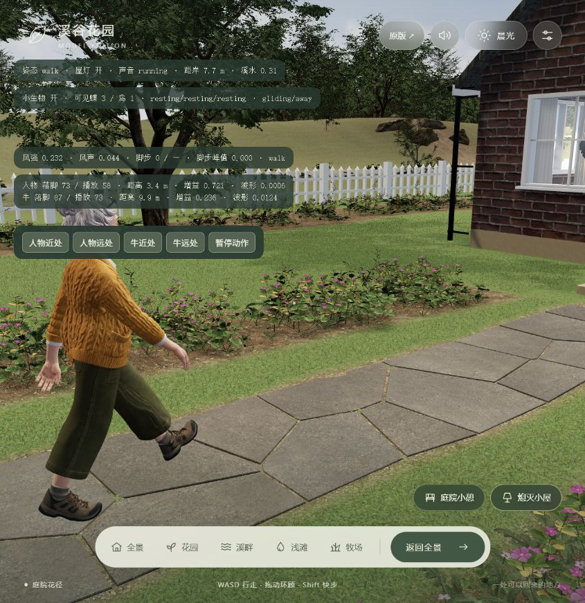
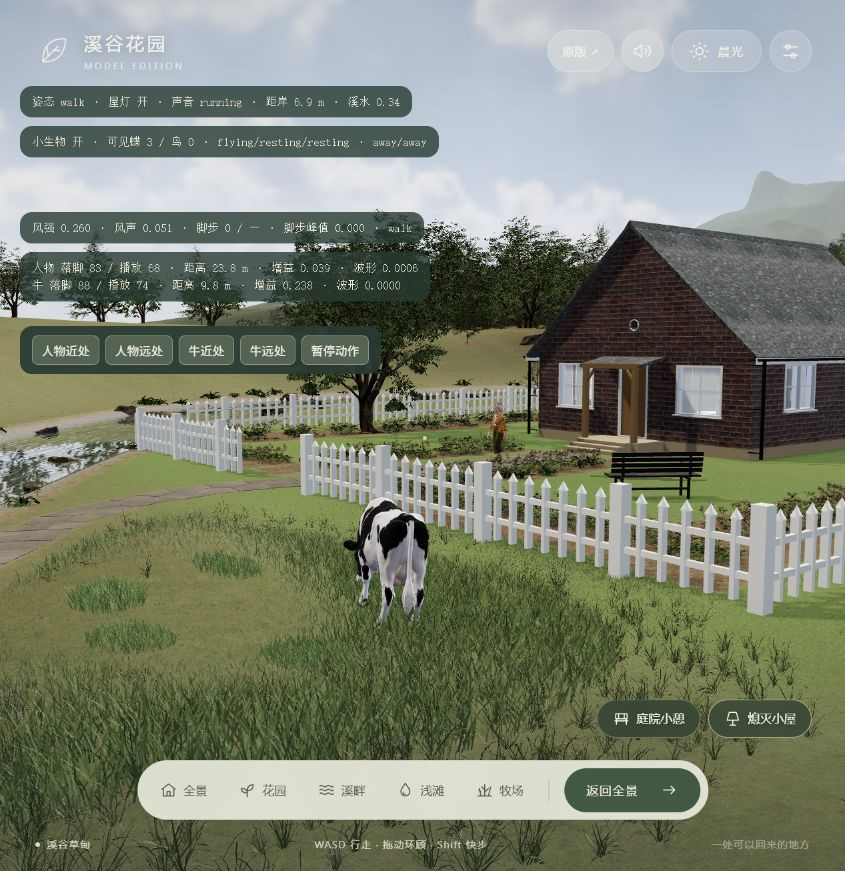
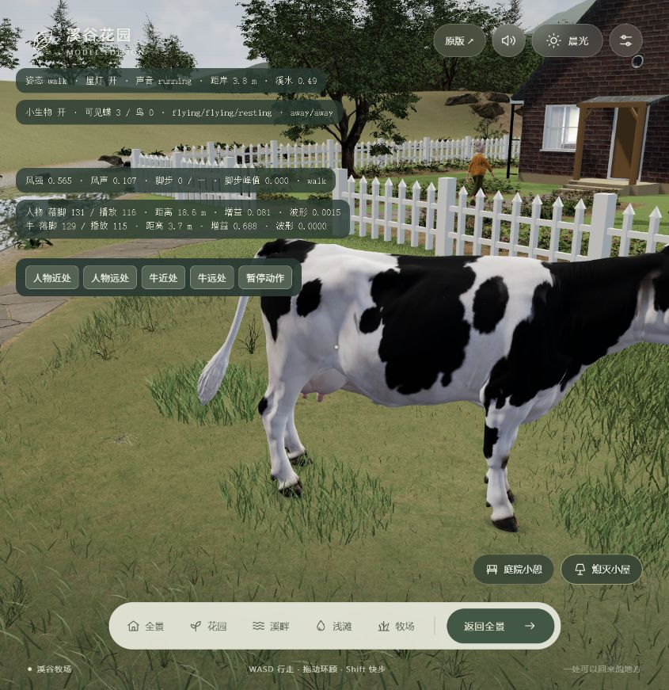
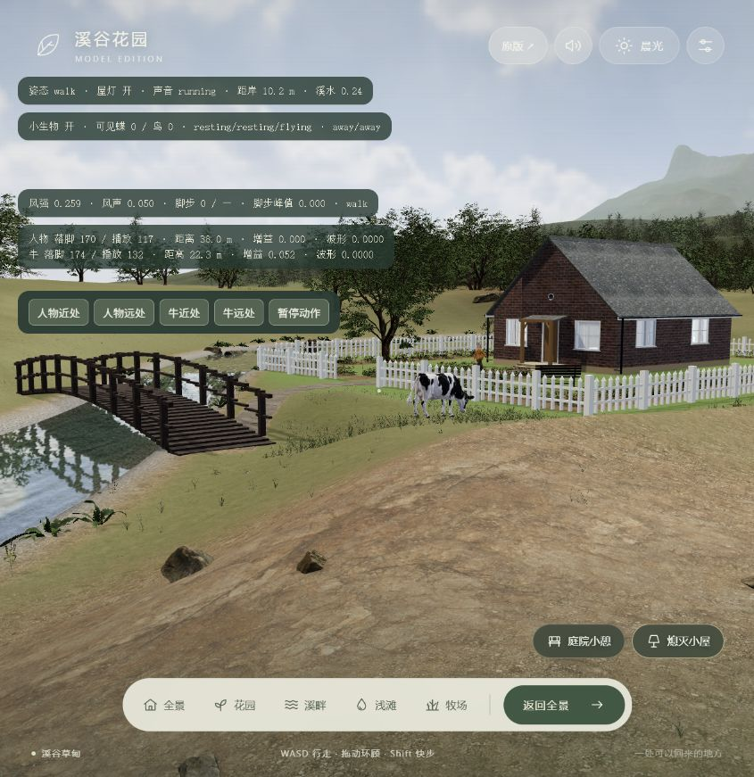
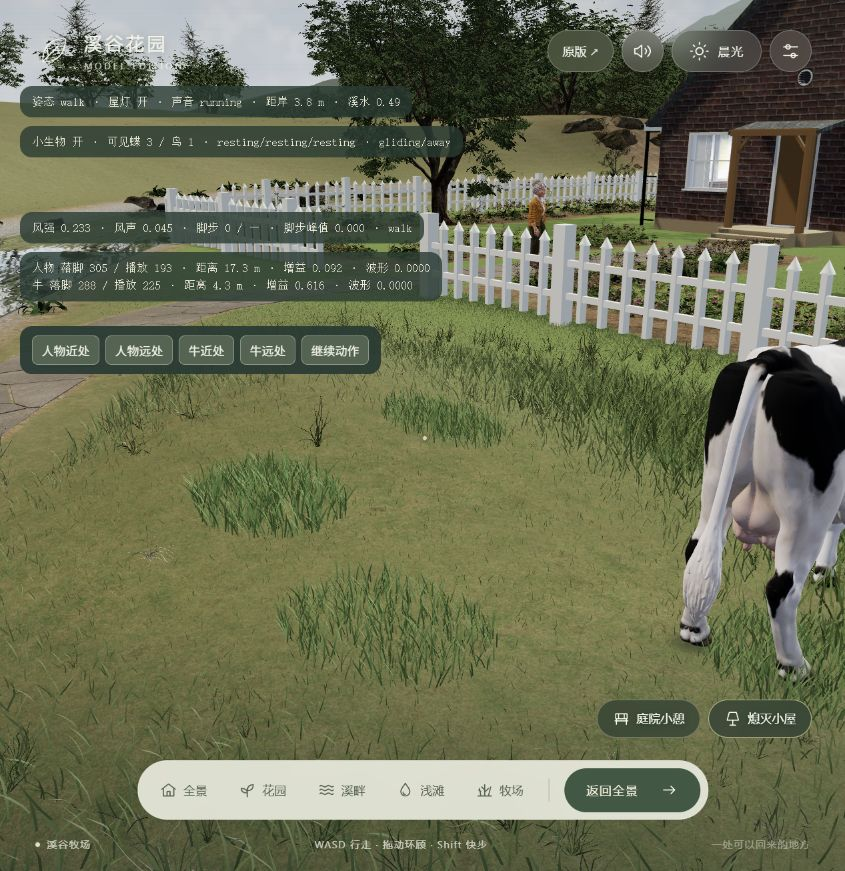
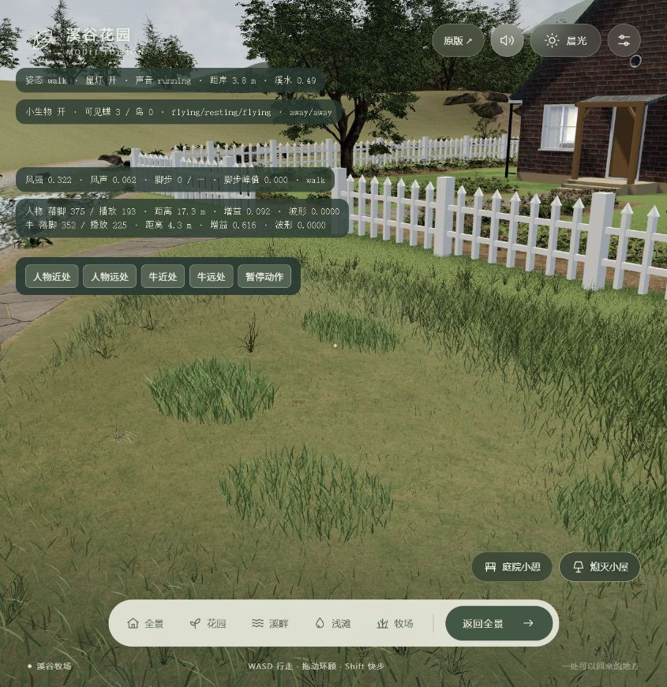

# 人物脚步与牛蹄声

日期：2026-11-17。仅更新模型版 `web/model-version/`；原版不变。

## 行为与来源

- 第一人称脚步保留，场景人物和两头牛另有独立短音源。人物复用原有 160 个鞋底采样点，按左右鞋底抬起、接地的实际转换发声；牛直接观察既有四足步态求解器的落蹄转换，不按固定计时器播放。
- 人物按地面材质选择脚步，牛在草地使用较闷的低频着地和摩擦，并有轻微双瓣着地近似；在硬地才增强敲击成分。全部为本地 Web Audio 合成，没有外部录音、下载或新许可需求。
- 每次落脚按实际世界坐标与相机计算三维距离、左右声向。近处保留细节，远处衰减并降低高频，20–32 米平滑淡出，32 米之外不再分配短音源。
- 人物停步/转向、牛停稳吃草、隐藏生活元素和减少动态效果时不再继续产生对应脚步。关闭声音或隐藏页面暂停音频；恢复后只播放新的接触事件，不补播历史事件。
- 顶部已有声音总开关控制全部声音，默认关闭。普通入口没有新增技术控件；检查入口 `?inspect=1&fixed=1&view=rest&soundReview=1` 提供人物/牛近远位置和暂停对照。

## 自动验证

- `npm run check` 完整通过，保留原版 27 文件逐字节一致；146 个模型/派生文件、169 个 glTF 依赖、既有材质与高程哈希通过校验。
- `verify-actor-footsteps.mjs` 在真实人物动画、鞋底修正和真实牛步态上采样 36 秒：人物 31 次落脚，牛 49 次落蹄；两头牛、四只蹄均有触发，吃草静止阶段没有蹄声事件。
- 人物触发时鞋底最大离地间隙约 11.94 mm，阈值带避免接触边缘抖动重复触发。另验证访客靠近停步、隐藏、跳转、暂停、重复接触及静音无积压的边界。
- 声学函数检查距离增益单调下降、相机转向后左右互换、远处高频减弱、室内衰减和范围外静音。约 3.4 米与 22.1 米的测试增益分别约 0.718 和 0.054。
- 人物原有接地/动作回归仍得到相同结果：最大逐帧关节变化约 4.85°，脚底最低间隙约 -1.54 mm，最高约 5.64 mm。牛的动作/接地回归通过。
- 最后只修正了诊断显示的静音波形清零及检查按钮标签，并补充吃草无蹄声断言；`npm run check:actors` 再次通过。
- `npm run build` 通过，50 个运行文件与最终源文件逐项一致，包含新的声音观察模块，仅有构建必需的引用路径改写。
- 本轮改前源码哈希记录为 `before-sha256.json`；8 个既有运行文件发生预期修改，其余 54 个基线文件不变。牛的动作/步态、地形、溪水、植物风场和原始 GLB 未改。比对结果见 `source-build-check.json`。

额外运行的根仓库索引检查报告 `README.md` 与 `projects.json` 未同步；这两个文件有独立的工作区修改，本轮未改动它们。该项不影响模型版运行、完整模型检查和独立构建。

## 内置浏览器实测

检查实际点击本聊天内置预览、使用正常渲染与 Web Audio 路径；没有通过浏览器脚本伪造落脚或音频计数。DOM 记录保存为 `browser-states.json`。

| 检查 | 观察 |
| --- | --- |
| 人物近处/远处 | 约 3.4 米时增益 0.722，23.8 米时 0.039；AudioContext 为 `running`，实际人物音频分析器出现非零波形 |
| 牛近处/远处 | 约 3.7 米时增益 0.688，22.3 米时 0.052；近处捕获真实蹄声音频波形约 0.0571（主音量之前） |
| 暂停动作 | 人物落脚/播放计数保持 305/193，牛保持 288/225；尾声结束后两类波形均归零 |
| 静音后继续动作 | 落脚继续增加到人物 318、牛 299，播放计数仍为 193、225，AudioContext 为 `suspended` |
| 隐藏人物与牛，再开启声音 | 生活元素开关为关闭，音频恢复 `running`；对应落脚/播放计数不再增加，波形为零 |
| 错误与普通入口 | 检查期间控制台错误为 0；完成后恢复普通模型版入口、默认显示人物与牛、默认静音 |

波形检查证明声音实际输出，不等同于人工耳机试听。单次短音之间、停稳吃草时本来就有安静间隔；截图只记录当时姿态，不能单独表达声音或证明完整运动。

## 图像

