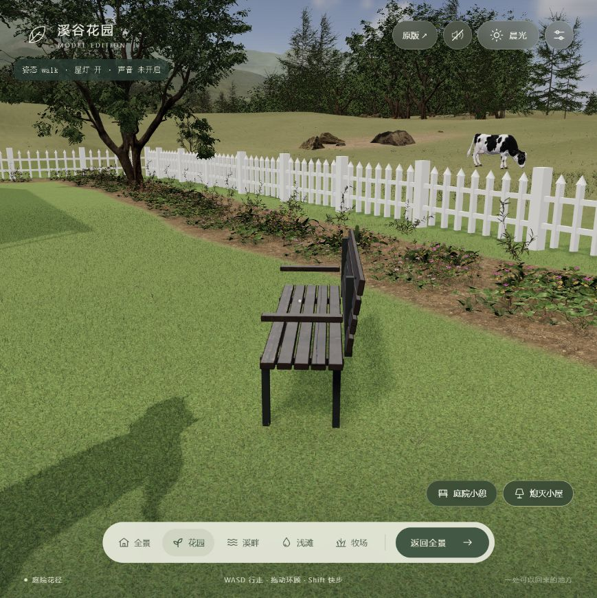
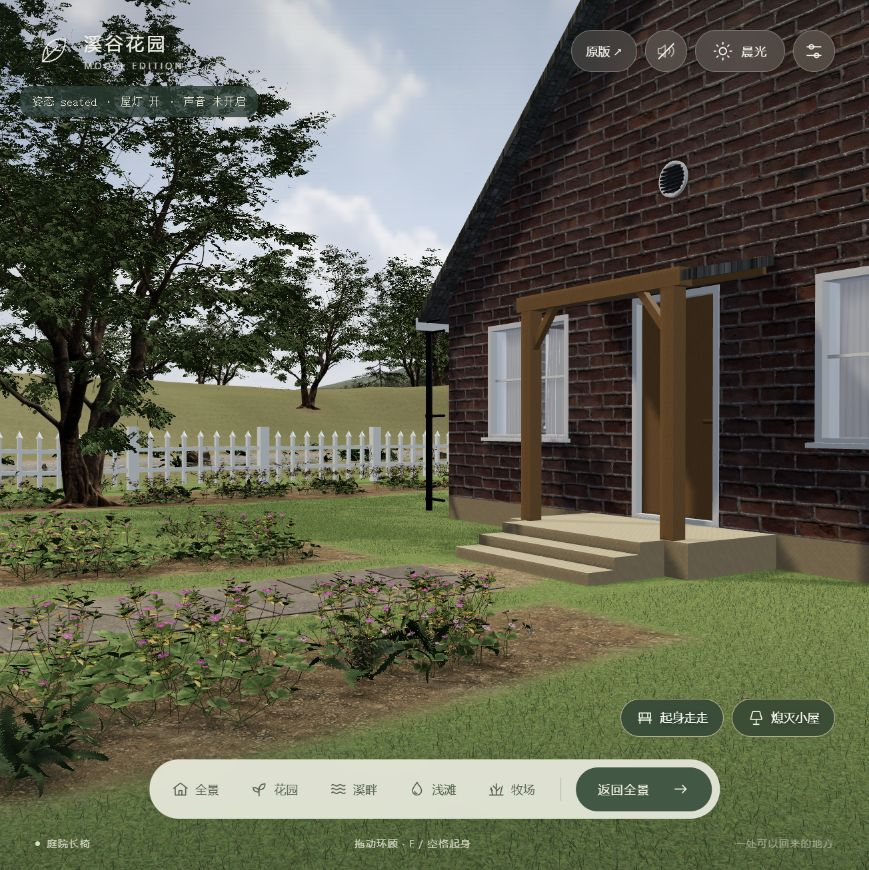
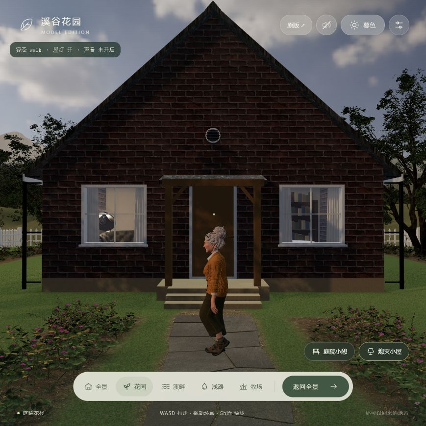
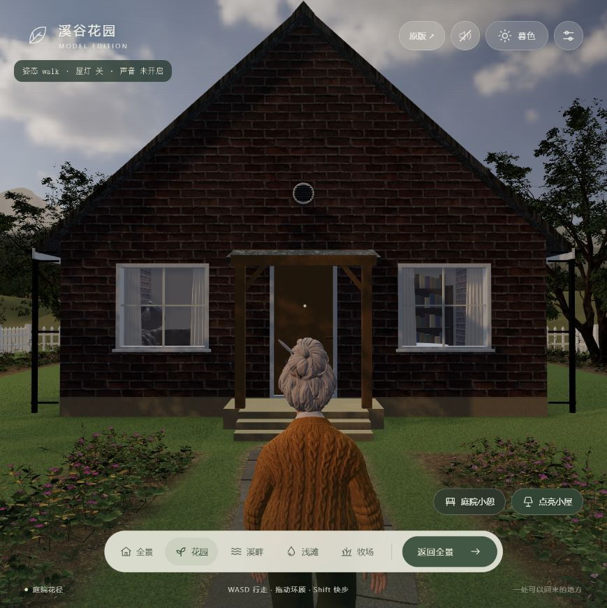
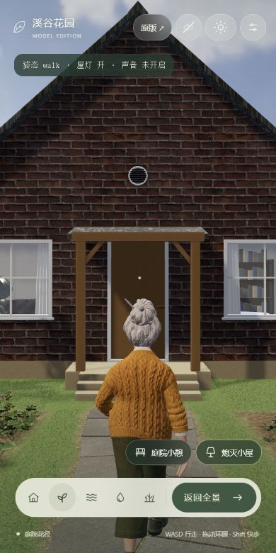

# 庭院环境声与生活交互

日期：2026-11-17。范围为现有 `web/model-version/`；用户已停止新增牛资产版本的工作，本轮没有继续处理登录，也没有替换牛。

## 已实现

- 拆出原创合成环境声：沿弯曲溪流寻找附近声源，按距离衰减，并根据相机朝向调整左右声向；叠加轻微风声及间歇鸟鸣，暮色减少鸟鸣音量。默认关闭，首次点击声音按钮后启动；静音和页面隐藏暂停 AudioContext。
- 在庭院右侧草坪增加木长椅，避开花境、花径和围栏。程序建模，使用既有木材 PBR，四个落脚点贴合地面，有碰撞边界与接触阴影；合为三个绘制对象，没有新增下载素材。
- 点击「庭院小憩」移到坐姿视角，可拖动环顾；点击「起身走走」或 E / 空格回到安全花径。坐下期间不执行行走位移，站起时清空移动输入。触屏保留按钮操作。
- 默认砖墙小屋的暖灯可以手动开关；晨暮变化保留手动状态。其他房型没有这套室内灯，隐藏开关。

## 校验

- `npm run check` 原有完整检查通过，含室内灯在暮色中保持关闭及恢复当前光照的新检查；`npm run check:moments` 通过，检查声源距离/朝向/遮蔽、暮色鸟鸣混音、长椅几何与花径净空。新增检查已接入默认 `check` 命令。
- `npm run build` 通过；独立包包含 `ambience.js`、`garden-moments.js`，没有改原版构建。
- 原版 27 个源文件/材质、146 个源/派生模型、169 个 glTF 依赖及原有地形、木材、石板、地表贴图校验通过。
- 内置浏览器实际操作：按钮坐下与按钮起身、E 起身、D 连续侧行和拖动环顾；暮色亮灯/熄灯/恢复；切换经典白屋后灯按钮隐藏，恢复砖墙小屋后按钮重新可用。
- 内置浏览器音频状态：开启后 `running`；庭院坐姿混音溪水系数约 0.22，浅滩约 0.66；关闭后 `suspended`。这是功能和混音状态验证，不能代替人耳对音色的评价。
- 390 × 780 视口布局检查：水平溢出为 0；生活按钮均在视口范围内，检查后恢复默认视口。没有把窄屏布局检查等同于真实手机设备性能测试。
- 本轮浏览器检查期间控制台错误为 0。修改范围没有包含人物、牛、地形、草地和溪水着色器。

## 实际画面

声音仍是合成音色，长椅为程序建模；本轮没有增加鸟/蝴蝶模型、开门系统、自由行走室内或天气系统。
