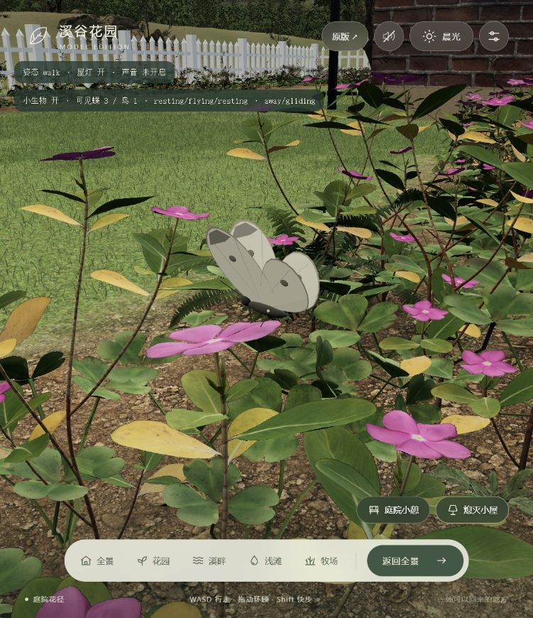
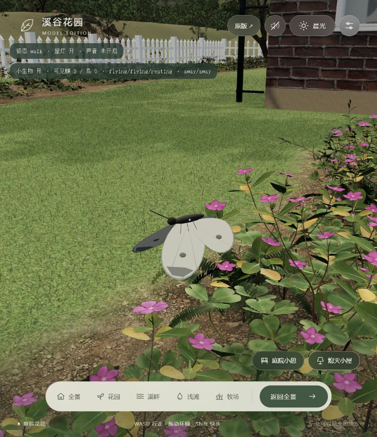
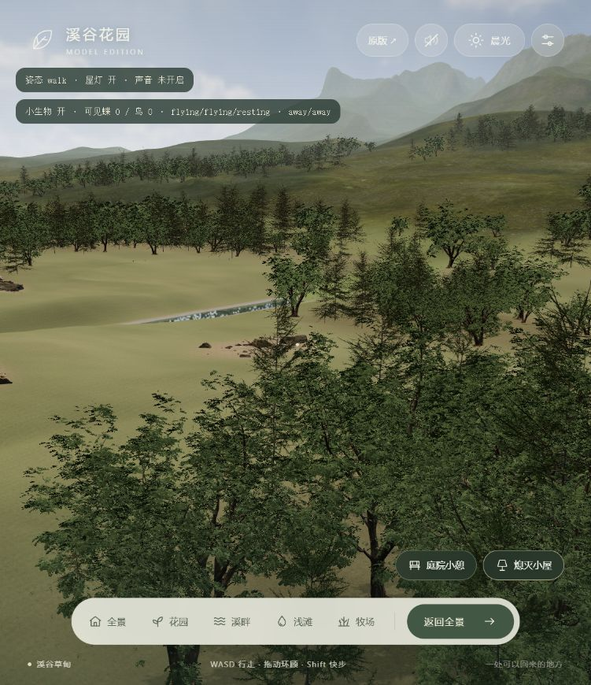

# 模型版：少量鸟与蝴蝶

日期：2026-11-17。仅修改 `web/model-version/`，保留最初原版、既有模型和材质，以及牛、人物、水流与地形实现。

## 范围

- 两只燕形背景飞鸟，真实场景尺度翼展约 0.42 m。两段翅膀、叉尾、浅腹和深色背部；沿多条高处曲线掠过，扑翼与滑翔平滑交替。两只的周期和出发时间不同，画面存在较长的无鸟时段。
- 三只小型蝴蝶，翼展约 7 cm，柔和浅色/赭色、细边、斑点与翅脉。主要在左右花径与前侧花境活动，短飞后在花枝上停留。
- 植物放置时保存实际上表面网格点及其世界变换，共 1178 个候选点；蝴蝶从附近候选中选取独立活动区域。没有以草地高度加常数冒充花瓣接触。
- 本地程序生成的轻量网格，定位为小尺寸背景生物，不是摄影级近景扫描资产；没有新增第三方下载、登录、付费或素材许可依赖。
- 不透明双面材质，不投射动态阴影，不进入溪水反射捕获。满配置合计 19 个网格、5066 个三角形，远处的蝴蝶会裁剪；流畅模式最多两蝶一鸟。独立显示开关保留人物与牛；减少动态效果时蝴蝶静止、飞鸟隐藏。

## 校验及实看

- `npm run check` 原有完整检查及新增检查通过，原版 27 个文件、146 个原有模型/派生文件、169 个 glTF 依赖及既有材质校验通过；真实植物数据检查确认三个蝴蝶活动区均可建立。
- 蝶翼颜色/轮廓与飞鸟翼关节细化后，再次运行 `npm run check:wildlife` 通过。200 秒、30 Hz 采样验证停栖与飞行、静止落点、地形净空和转向连续性；合成花境测试中蝴蝶最大速度约 0.637 m/s，最大朝向变化约 18.08°/帧，3480 / 6000 帧两鸟均不在飞行。
- `npm run build` 通过，新模块包含在独立构建中。
- 内置浏览器实际看到：蝴蝶在花瓣处停留、短飞、再次停留；两只鸟的扑翼、滑翔、离开与错峰出现。近景发现并修复蝶翼背面偏黑、轮廓过硬及鸟翼关节连接的问题。
- 浏览器中关闭「飞鸟与蝴蝶」后可见计数为 0 / 0；开启后恢复。切换流畅画质时观察到两蝶一鸟，随后恢复细腻画质。
- 检查过程中控制台错误为 0。检查专用近景通过移动相机观察原始小尺寸网格，没有放大动物；正常入口没有跟随相机与调试文字。

## 现场截图

截图是动作检查的取样，连续性由实看和数值检查共同验证；这些轻量生物没有完整生态行为或专业动物动画资产。
