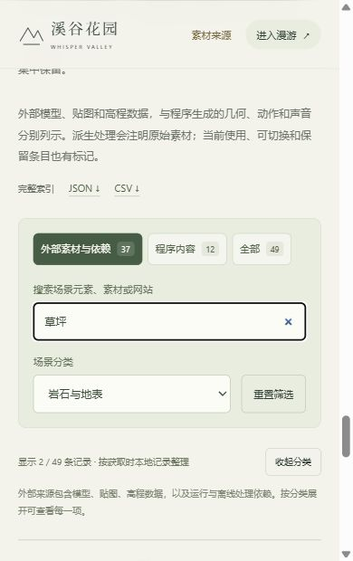

# 介绍页素材来源索引

日期：2026-11-17。入口：`http://127.0.0.1:4173/overview/#asset-sources`。

## 范围与记录

仅更新 `web/overview/`，增加来源索引及维护说明。V1 与 V2 的场景、模型、贴图、行为、声音、启动器和构建均未修改。

- 37 条外部来源：模型、PBR/HDR、地形高程，以及 Three.js / meshoptimizer 依赖。
- 12 条程序内容：代码版主体与经典白屋、地形/细草、桥路/长椅、室内补充、植被派生、水流、牛的动作、人物整合、鸟蝶、风、合成声音和运行截图。
- 每条列明场景元素、名称、网站、原始链接、作者、获取时许可、适用版本、当前使用/可切换/保留状态、本地路径和原始记录。
- 113 个原始记录引用可访问现有来源说明、文件/校验清单、许可证原文或实现源码。数量包含多项共用同一来源文件的引用，不等于 113 个独立文件。
- 完整索引提供 JSON 与 UTF-8 BOM CSV；49 条记录对应 CSV 的 49 行数据及 1 行表头，共 16 列。

原始依据为现有 `SOURCES.md`、`manifest.json` 与许可证文件；没有重新下载外部素材、购买资产或逐个重新核验上游当前下载可用性。

## 区分与维护

- 高程来源组合明确列出奥地利 DGM / CC BY 3.0 AT、Copernicus / EU-DEM、USGS 候选来源署名，不把整个数据集写成 CC0。
- Grab3D 人物与牛的 AI 辅助来源保留披露；牛的源静态模型与本地程序骨骼/步态分别列示，人物原生 walk 与本地路线/接地分别说明。
- 树木减面、草簇和 mip 派生关联原素材及许可；材质纹理与桥路/建筑形体分开，草坪 Grass004 不称为摄影扫描。
- 本地程序未单独声明素材许可，不在此新增源码授权；第三方模型/贴图/数据与工具许可分别记录。
- `build-source-catalog.py` 从既有记录与场景映射生成索引，校验本地路径及依赖 ID；遇到超出当前 CC0 映射的来源许可会停止，要求更新映射。

## 验证

- 所有 49 个 ID 唯一；原始链接均为 HTTPS，程序条目使用本地源码记录。所有记录与本地路径存在，关联来源 ID 有效。
- JSON / CSV 的 ID 与行数一致，CSV 共 50 行、每行 16 列。HTML 本地链接、锚点、唯一 ID 与两个 JS 模块语法检查通过。
- 本轮改前记录的 81 个场景顶层文件哈希全部一致。原版 27 文件逐字节一致；原模型/派生文件、169 条 glTF 依赖、高程与材质校验由原有 `verify.py` 通过。
- 内置浏览器实际检查：默认外部记录 37 条，全部视图 49 条、8 个分类；展开/收起、关键词、分类、重置和无匹配状态正常。
- 搜索“牛”，外部视图显示静态牛资产及 Grab3D 原始链接、CC0；程序视图显示牛动作与蹄声实现。关联来源链接能切回正确原件；刷新单项深链接仍可定位。
- 搜索 `Grass004` 可找到相关程序地表实现；搜索“经典”可找到两版保留的程序白屋。
- 天空/高程分类同时显示天空 CC0 与高程的来源署名条件，没有混为一种许可。
- 390 × 620 实际内置浏览器检查视窗中，页面宽与内容宽均为 375（扣除滚动条），搜索与分类可用，无横向溢出。该检查不等同于真实手机验收。
- 检查期间浏览器错误日志为 0；来源页面没有启动场景 iframe。

机器记录见 `validation.json`、`browser-states.json`；场景改前哈希见 `scene-before-sha256.json`。

