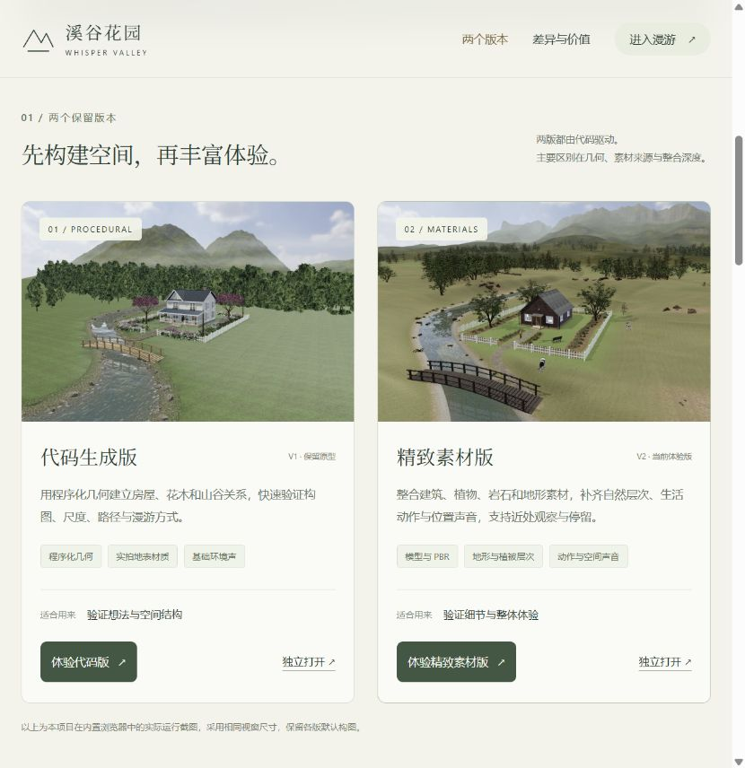
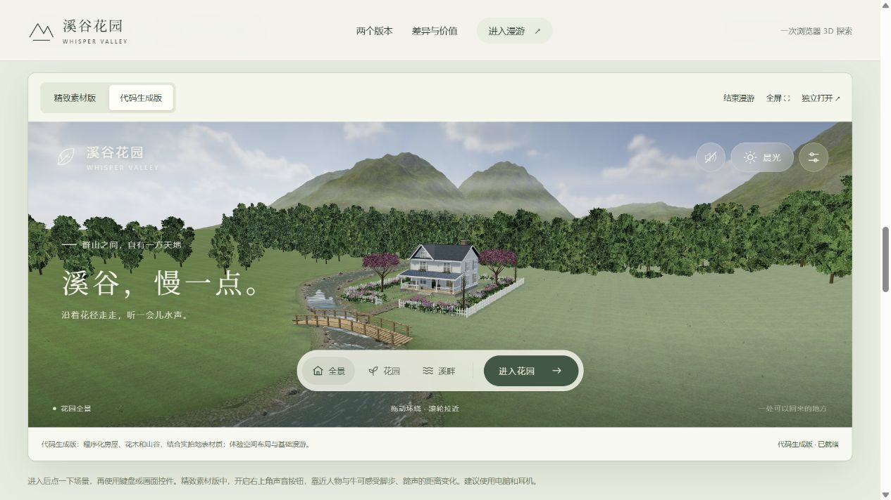
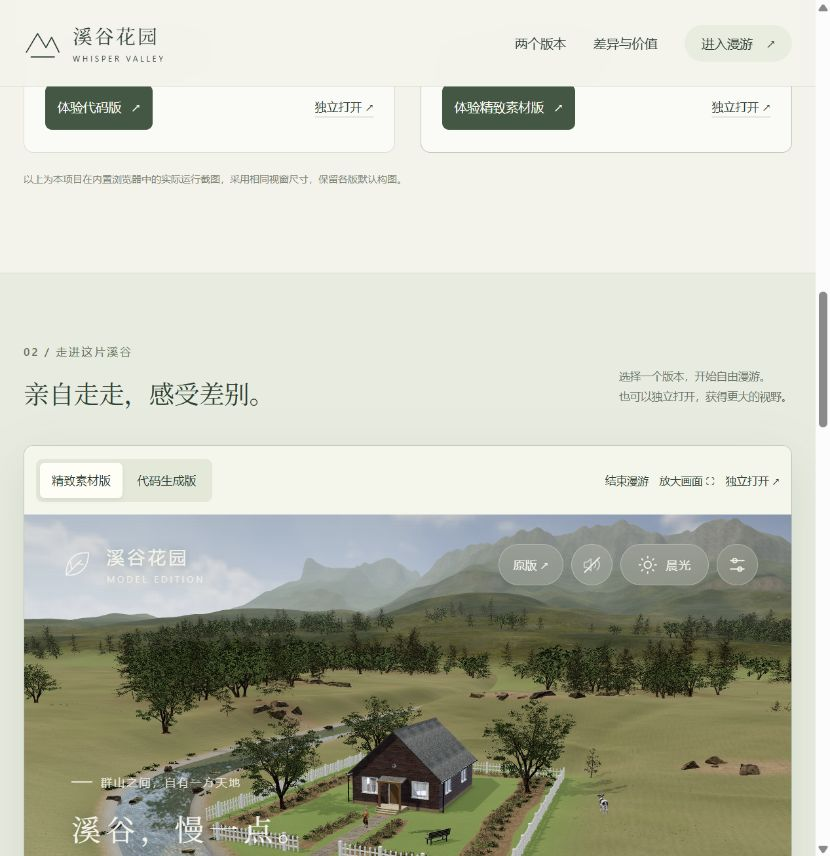
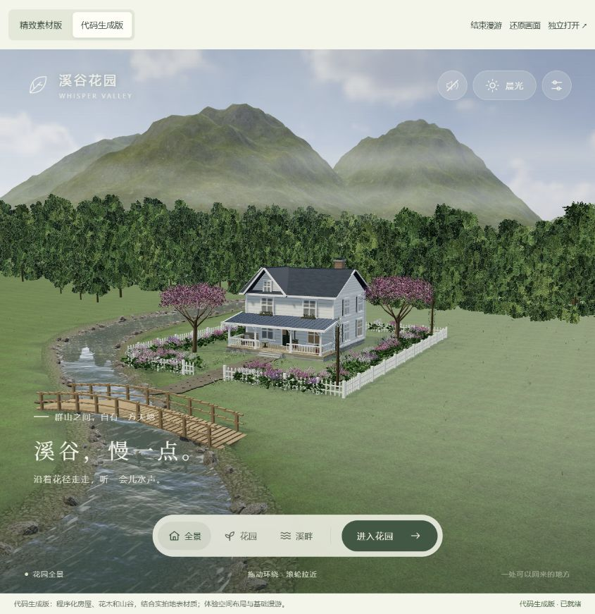
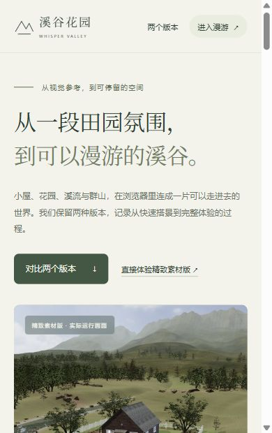
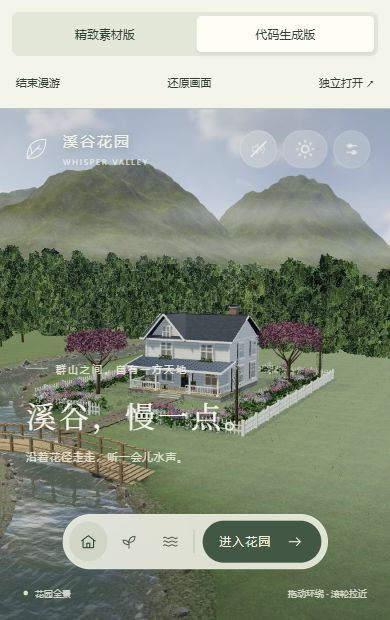

# 项目介绍与双版本展示页

日期：2026-11-17。入口：`http://127.0.0.1:4173/overview/`。

## 完成内容

- 新增独立介绍页，沿用当前本地服务，未修改 V1 `/` 和 V2 `/model-version/`。
- 同时展示两版真实场景截图，保留两个独立打开入口，并提供单个体验台的启动、版本切换、放大/还原、结束和独立打开。
- 汇总两版的空间构建、表面光照、植被层次、生活反馈、迭代方式与价值；说明两版都由代码驱动，V2 是外部素材与程序场景的混合制作。
- 汇总探索结论与用途：连续空间、资产整合、动作接地与位置声音，用于方案方向验证、浏览器体验演示及后续场景复用。
- 保留当前原型的局限、素材署名入口和参考链接；未宣称确定原视频制作方法、重建拍摄地点或达到摄影真实感。

## 图片与保留校验

- 在本聊天内置浏览器分别运行两个现有场景，以 845 × 560 相同视窗取景，保留各版默认构图。取景页只在其 iframe 中隐藏界面，没有修改原场景源码。
- 新图存于 `web/overview/assets/`，总计约 152 KB；来源、日期与 SHA256 见 `SOURCES.json`。两图不是相同相机坐标的画质/性能基准。
- V1 保留清单中的 27 个文件逐字节一致；V2 顶层 67 个文件与本轮改前 SHA256 一致。既有模型/素材目录未修改。
- `python web/model-version/verify.py` 的原版、146 个模型/派生文件、169 条 glTF 依赖、PBR 及高程校验通过。
- 项目 README 增加介绍页入口与最新状态指引；根仓库登记表、自动生成索引、启动器、构建和部署设置未改。

## 实际浏览器验证

- 在内置浏览器读取完整页面，所有截图正常加载，无缺失图片；差异表与各段内容、导航锚点和来源链接可访问。
- 从版本卡片启动 V2，等待真实场景 `data-ready` 后显示就绪；切换 V1 时，旧 iframe 移除并替换，体验台中始终只有一个场景。
- V1、V2 均实际进入花园并持续按 W 行走；返回全景控件可见。V2 的环境与脚步声音开关实际切换为开启状态。
- 检查发现内嵌场景过高后，调整为按视窗高度显示，启动时滚动到体验台，让底部漫游控件在当前窗口可见。
- 内置浏览器未允许原生全屏，因此改为不依赖该权限的页面内放大。实测放大后覆盖预览视窗，背景节点 inert；还原或 Esc 后恢复背景交互。没有增加权限请求。
- 结束漫游后 iframe 数量为 0，状态显示「漫游已结束」，重新展示静态预览；此前开启的场景声音随旧 iframe 结束。
- 390 × 620 检查视窗中，页面宽/内容宽均为 375（扣除滚动条），没有横向溢出；放大时均为 390。已实际完成窄屏版本选择、启动代码版、放大、还原及结束。真实手机性能与触控仍未验收。
- 本页不预加载两个 3D 场景；默认只显示实景截图，启动由访客操作触发。JS 语法、本地链接、锚点、27 个唯一 ID 与图片哈希检查通过。
- 本轮使用已有本地服务，没有发布、创建远程站点或增加依赖。

## 保存画面

