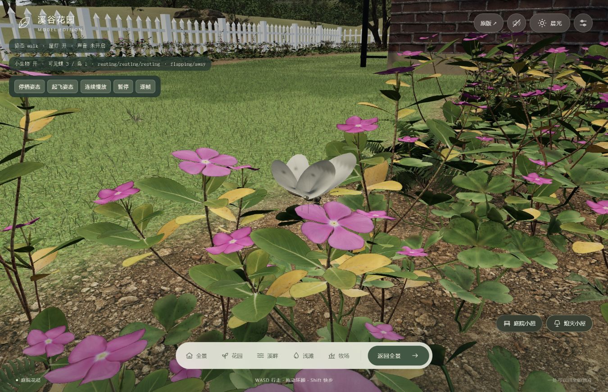
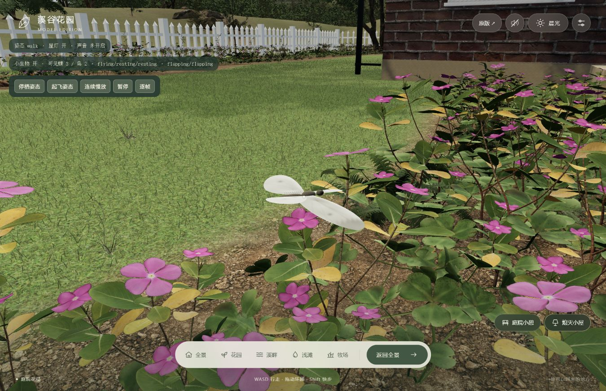
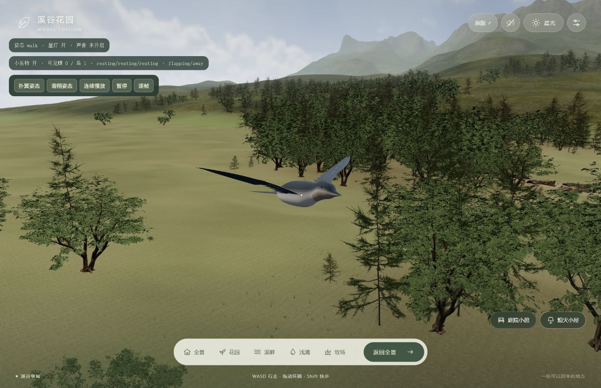
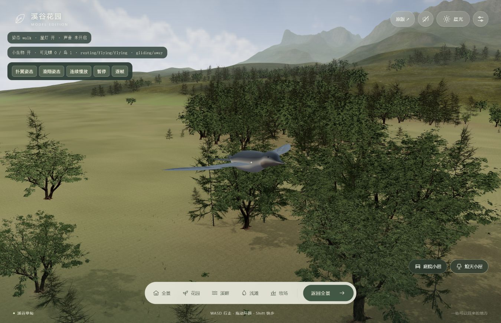

# 鸟与蝴蝶的形态、材质和翅膀返修

日期：2026-11-17。仅修改现有模型版；原版、原有模型/贴图和牛、人物、溪水、地形代码保持不变。

## 调整

- 蝶翼由平面改为细分弯曲薄壳，保留上下表面和约 0.18 mm 的边缘厚度；前翅轮廓更有方向性，后翅保持较圆轮廓。补充分段腹部、细足、触角及细毛。
- 增加本地生成的底色、翅脉/斑点/轻微色差、鳞粉微法线及粗糙度纹理，使用带细微织物光泽的材质。背光只做着色近似，材质 transmission 保持 0，没有启动全屏折射或透明排序。
- 前后翅分别旋转，后翅略有延迟，拍下与回收的时长不同；翼尖随拍动弯曲。起落幅度淡入淡出，停栖时保留原网格接触点。
- 飞鸟的身体、颈部与头部用连续截面衔接；翅膀增加弯曲羽片、重叠层次和连续翼面，修复近景羽片间隙过大的问题。腕部折叠、羽尖柔性和尾羽微调与拍翼/滑翔状态配合。
- 保留两鸟三蝶、间歇飞行、独立显示开关和距离裁剪；减少动态效果时，蝶翼与表面弯曲均静止，鸟隐藏。合计 27 个绘制网格、42988 个三角形。它们仍是程序化背景模型，没有声称换成摄影扫描或原生专业动物资产。

## 验证

- `npm run check` 完整检查通过：原版 27 文件、146 个原有模型/派生文件、169 个 glTF 依赖及既有材质哈希保持不变，现有人物/牛的动作和接地检查通过。
- 羽片重叠与蝶翼轮廓微调后，`npm run check:wildlife` 再次通过。新增检查覆盖真实翅面弧度、表面贴图、前后翅相位差、柔性翼尖、无折射捕获、法线/UV 有限性，以及减少动态效果下的静止姿态。
- `npm run build` 通过，独立构建中已包含最终形状、表面材质和动作检查入口；运行时文件与源文件逐项核对一致。
- 200 秒 / 30 Hz 采样：蝴蝶最大速度约 0.637 m/s，最大朝向变化约 18.08°/帧；前后翅最大角度差约 0.553 rad。运动范围、停留点及飞鸟的安静间隔延续上一轮。
- 内置浏览器已实际复看停栖接触、起飞姿态、飞鸟扑翼与滑翔，以及连续慢放；修正了检查中发现的羽片缝隙。检查用相机靠近小尺寸动物，没有把实际场景里的动物放大。普通入口不显示检查控件。
- 浏览器检查期间控制台错误为 0。完整检查之后只细化鸟蝶相关形状、表面和近景检查入口，原有牛、人物、溪水与地表模块哈希继续与保留基线一致。

## 已保存的检查图

程序化材质和柔性变形是实时近似；截图只代表相应姿态，不能单独证明完整动作连续性。
