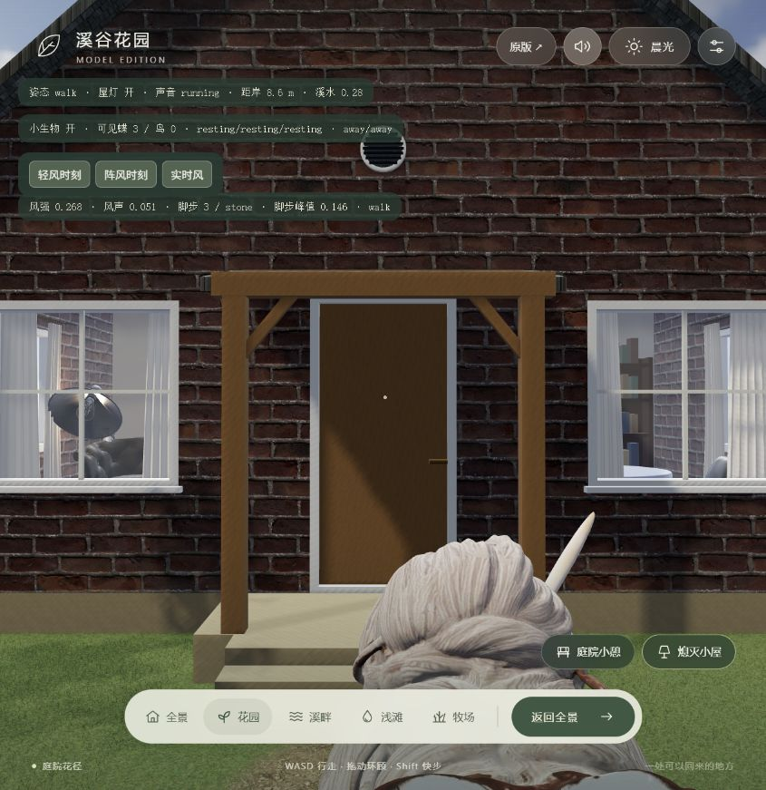
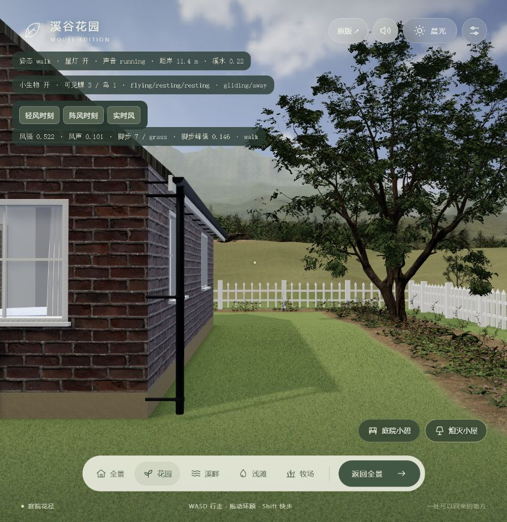
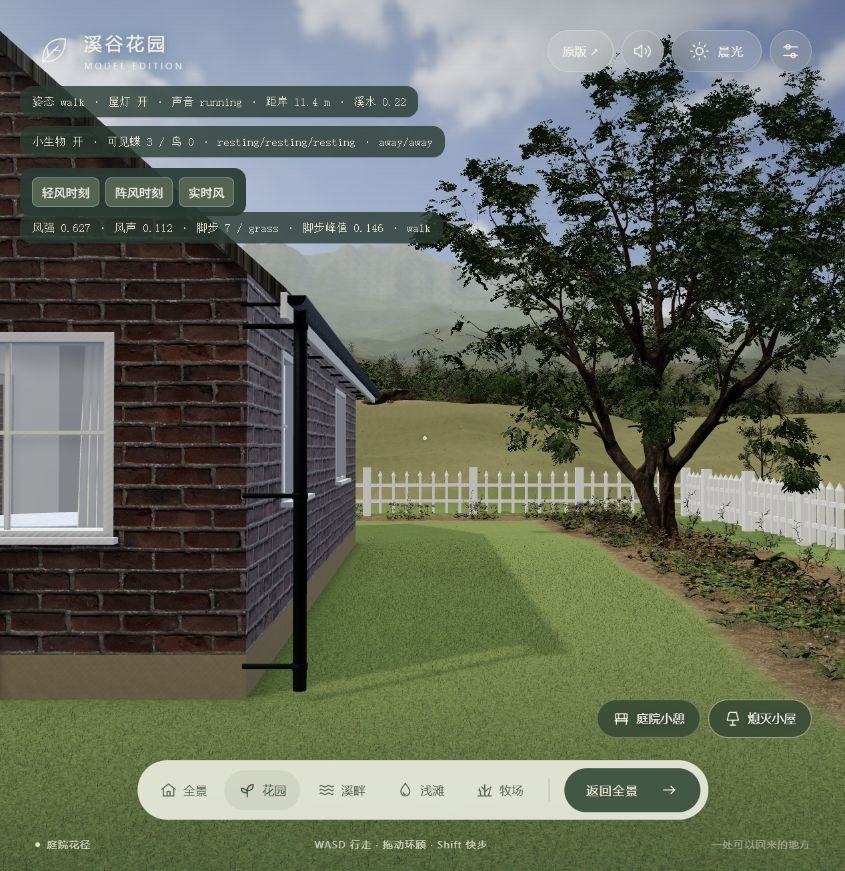
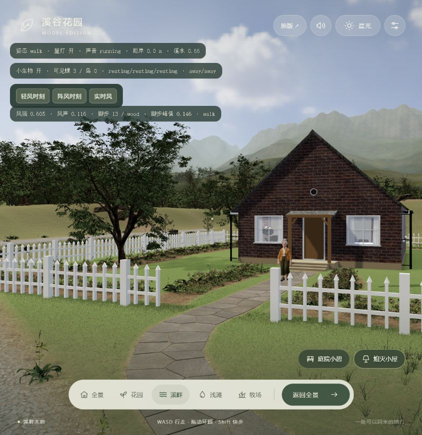
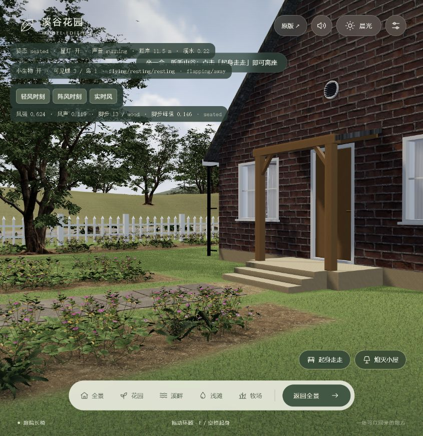
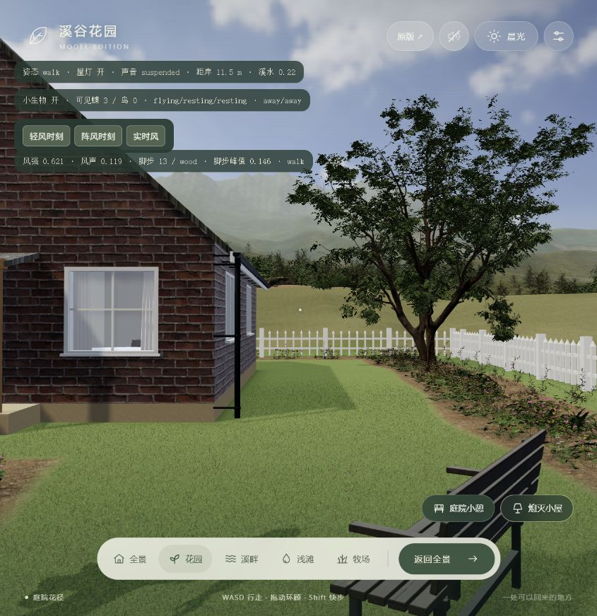

# 漫游脚步与风场联动检查

日期：2026-11-17。范围仅为 `web/model-version/`；普通入口为 `http://127.0.0.1:4173/model-version/`。使用当前聊天的内置浏览器实际点击和持续按键行走，没有用脚本伪造移动或音频计数。

## 实现

- `footsteps.js` 从碰撞求解后的实际水平位移取得速度，驱动交替脚步与镜头轻微起伏。区分石板、草地、木桥、裸土及碎石，快步提高频率；停步、受阻、坐下、视角转场和瞬移不发声。
- `ambience.js` 用短噪声和低频着地声合成材质差异，轻微改变每步音色及左右声向；音频默认关闭，点击顶部「开启环境与脚步声」后启用。关闭或隐藏页面暂停音频，不累积补播。
- `wind-field.js` 为树冠、花境、灌丛、扫描草丛与近景细草提供共享风向、平滑轻风和行进阵风。根部不偏移，上部按高度和柔韧程度弯曲，叶片有细微颤动；风声在同一局部风强下平滑改变音量、滤波与声向。
- 蝴蝶的停栖位置同步采用花枝偏移，避免植物运动后蝴蝶留在原位置。减少动态效果时风场强度为零。
- 普通入口隐藏检查面板；仅 `?inspect=1&fixed=1&view=garden&windReview=1` 提供轻风、阵风、实时风对照。

## 内置浏览器实测

| 操作 | 实际结果 |
| --- | --- |
| 开启声音，在石板行走 1.5 秒 | AudioContext 为 `running`，脚步计数 3，材质 `stone`；真实音频分析器测得非零波形峰值约 0.146（主音量之前） |
| 继续向受阻方向按住 W 6 秒 | 计数仍为 3，没有原地脚步 |
| 向右行走 2.2 秒进入草地 | 计数变为 7，材质切为 `grass` |
| 选择溪畔木桥并持续行走 | 计数变为 13，材质切为 `wood`，溪水混音随接近岸边增强 |
| 坐下后按住 W 2 秒 | 状态为 `seated`，计数仍为 13 |
| 关闭声音，起身后行走 | 状态为 `suspended`，计数仍为 13 |
| 同一庭院位置切换轻风与阵风 | 局部风强约 0.184 → 0.627；截图中的风声增益约 0.037 → 0.112，并继续平滑趋近约 0.119；树冠与草叶正常显示，无异常拉伸 |
| 回到普通入口 | 默认静音，检查控件隐藏；检查期间浏览器错误日志为 0 |

音频验证覆盖实际触发、运行/暂停状态和非零音频波形；未把数值检查表述为人工耳机试听。声音是实时合成，植物摆动为视觉近似，没有使用物理风模拟或新增第三方录音。脚步范围是第一人称漫游者，本轮没有增加 NPC 或牛蹄声音。

## 自动检查与保留边界

- `npm run check` 完整通过，新增 `verify-wind-footsteps.mjs` 覆盖 180 秒平滑风场、根部固定、共享着色器参数、随风停栖、左右脚交替、快步频率与受阻/停止/转场/瞬移抑制。
- 5 秒模拟行走采样得到普通行走 11 步、快步 16 步；180 秒风强范围约 0.183–0.636。停栖花枝偏移约 7.5 mm / 7.7 mm，蝶的位置与该偏移一致。
- `npm run build` 通过，独立输出包含 `wind-field.js` 和 `footsteps.js`；49 个运行文件与源文件逐项一致，仅保留构建所需路径改写。
- 原版 27 个源文件/材质逐字节一致；146 个原有模型/派生文件、169 个 glTF 依赖及既有地形、PBR 哈希通过校验。
- 牛动作/接地、人物、动态投影、溪水和地形等 15 个模块与保留基线哈希一致。风场没有新增绘制网格、阴影图或反射捕获。

## 保存画面

静态截图用于记录相应状态，不能单独表达声音或证明连续运动。
