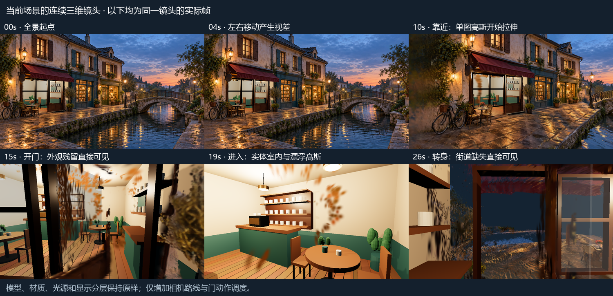
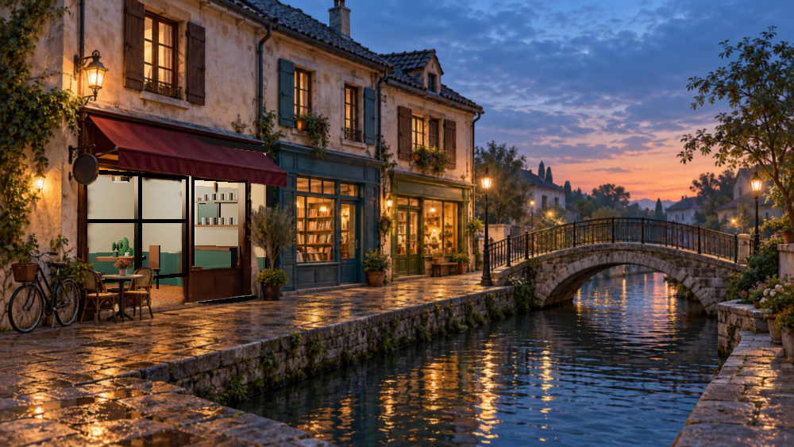
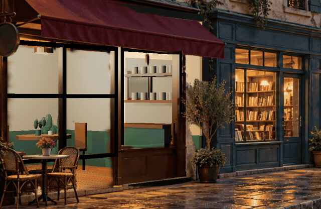
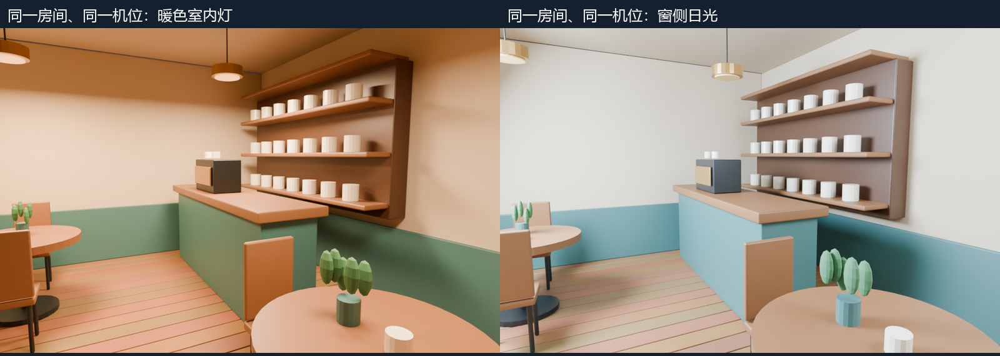

# 小咖啡店：高斯外观与 Blender 实体联动样板

2026-11-16，本机实际完成。新建 Blender 工程，验证一扇门的高斯外观随实体动作、完整小房间的内外视角，以及实体材质的独立换灯。原始高斯、参考图和历史 V3/V4 模型均未改动，哈希检查通过。

## 看实际效果

### 连续三维镜头（2026-11-16）

[播放 28 秒连续镜头](http://127.0.0.1:8771/result/continuous-tour-player.html) · [在三维场景里播放／拖动进度](http://127.0.0.1:8771/?tour=1)

镜头从运河全景左右移动，连续靠近咖啡店，停下开门，穿过门口进入室内，然后转身看街道。全程使用同一相机、同一场景与暖光，背景高斯和门高斯一直开启，实体替身的可见性保持一致。没有通过关闭高斯或切换成另一套室内模式掩盖接缝。

本次只增加相机轨迹和门动作调度，模型、材质、灯光预设及高斯文件没有改动，六个场景资产的前后 SHA256 一致。输出为实际渲染的 420 帧、15fps、28 秒；视频仅增加底部阶段字幕，无镜头剪切、交叉淡化或二维补帧。相机视场角由约 39°平滑增加到 65°，同时有实际的位置移动。设计坐标按门高 2.5m 定标，不代表实测尺寸。

连续镜头直接暴露了已有问题：近距离观察时出现高斯拉伸；进入室内后有来自室外的漂浮色块；转身后街景有明显缺失。这是当前样板的诊断结果，没有进行本轮未授权的细节优化，也不称为完成了可自由漫游的完整街道。

机位逐帧位置最大变化约 0.245 个设计单位，旋转最大变化约 2.943°；进入房间前门已打开到 75°。全部帧非空，显示分层与光源状态全程一致。见[连续镜头验收](reports/tour-verification.json)。

先看当前混合场景的运河全景：只有左侧红棚咖啡店补建了实体，其余街景仍为原单图高斯。交互页默认打开此全景，可再切换咖啡店近景及室内视角。

[交互样板](http://127.0.0.1:8771) · [开关门与换灯总览](../../assets/cafe-hybrid-prototype/prototype-overview.png) · [实体内外视角](../../assets/cafe-hybrid-prototype/interior-exterior.png)

交互页可开关门、拖动门动画时间、显示实体线框、切换暖色/窗侧日光，以及进入室内查看柜台或反向看向门口。门口是高斯＋实体混合；室内默认展示新建实体，鼠标可旋转观察。高斯开关用于核对分层，不代表室内开启高斯后所有角度都已经适配。

## 本轮真正完成的内容

- 一扇有厚度、门框、玻璃、把手和门轴的实体门；Blender 第 1 帧关闭，第 49 帧打开 75°，第 97 帧复位。
- 封闭房间壳体，实际门窗开口、地板、天花板、柜台、桌椅、架子、杯具与植物；新工程共 196 个对象。
- 木、灰泥、金属、玻璃等 PBR 材质，以及两组位置、颜色、能量不同的光源。
- 从已有 SHARP 场景分出 7,299 个门木框/木板高斯，绑定到 Blender 导出的门轴矩阵；玻璃内的原图室内不作为刚性门外观搬动。
- 48 帧开门/复位实际高斯渲染、五张 Blender Cycles 实渲染，以及网页多个机位/灯光/线框检查。
- 可编辑 `.blend`、实体 `.glb`、逐帧绑定参数，以及派生的背景/门高斯文件；大产物保留在独立本机目录，不提交研究仓库。

## 如何复用原高斯

输入为原运河 PNG 和本轮已有 `canal-sharp.ply`。没有打开或改造旧运河 `.blend`。

先以原机位投影定位咖啡店右侧门，选区为原图像素 `[405,377,523,640]`。以门下部实木面高斯初始化深度，加入墙体竖直、图像 Y 为重力方向，以及人工门槛线的结构约束；门高设计为 2.5m，并非真实测量。得到约 1.319m 门宽。房间纵深和家具均为设计补建，不称为被照片恢复的真实内部。

源数据分区：

| 分区 | 高斯数 |
| --- | ---: |
| 原始输入 | 1,179,648 |
| 门木材外观 | 7,299 |
| 保留静态背景 | 1,121,026 |
| 从派生场景移除的门窗照片室内 | 51,323 |

为了让门外观贴合门面，选中的木材高斯沿原相机射线对齐到实体门前表面，按深度比例同步调整尺度，保持原位的投影轮廓和颜色。这是明确的派生表面对齐，不冒充完整的自动表面重建；原始 PLY 始终只读。窗口和门玻璃改用透明实体，后方接新房间，避免开门后仍被一层照片室内挡住。

## 绑定与显示路径

Blender 负责实体、门轴和动作。保存初始控制矩阵 `M0`，导出各帧实际求值矩阵 `Mt`。对门高斯施加 `Mt × inverse(M0)`，再作 Blender Z 向上到 Three.js Y 向上的坐标转换。背景高斯使用固定变换。门的动作不是网页另写一份看起来类似的动画。

本轮使用 **Blender 导出 → Spark 2.4.0 显示高斯** 的离线联动。`.blend` 内可编辑和渲染的是实体结构、材质和灯光；未安装 Blender 原生高斯渲染插件。网页显示同一份实体 GLB 与高斯外观。

混合外观模式隐藏对应的实体正面替身，避免实体和高斯互相遮盖；网格本身和线框仍保留。室内实体模式恢复完整网格显示。网页玻璃和灯光采用实时近似，与 Cycles 并非逐像素相同；换灯验收以同机位的 Cycles 图为主要依据。

## 实测验证

| 检查 | 结果 |
| --- | --- |
| Blender 工程重开 | 成功；196 对象，参考原图已打包，门动画 0°→75° 可恢复 |
| Blender/Spark 绑定 | 检查帧 1、25、49、73、97；最大矩阵数值差 `1.78e-15` |
| 静态背景变换 | 各检查帧相同 |
| 实体室内换灯 | 同几何、同机位，改变光源；RGB 平均绝对变化约 44/255，有实际方向性阴影差异 |
| 实际运动帧 | 48 个，全部非空 |
| 网页操作 | 开门、关门、室内、反向视角、日光、门口混合、线框按钮均通过 |
| 源文件保护 | 原始高斯、原图、历史 V3/V4 哈希均一致 |

源高斯 SHA256：`f016afa60f439dd76c7aac808b0a27e7e7fec224a3e56638029169d81069c1a0`。

验收视频 `cafe-acceptance-review.mp4` 为 12 秒、1000×700、144 帧：前 4 秒是 48 个实渲染动作帧，其后四张实际 Cycles 机位/灯光画面各停留 2 秒。后段是静态验收图，不冒称连续漫游。GIF 为同一动作序列的缩小预览，没有 AI 视频生成或二维图片变形。

## 尚未解决的边界

这是功能样板，不是整条街的完整资产：新室内为创作设计，门窗交界仍有粗糙接缝，高斯门皮肤仍保留原图的光照。**本轮验证了刚性绑定与实体层换灯，没有实现全场景高斯重新打光。** 玻璃反射、细节材质、场景大角度外观和碰撞行走还需分别完善。

### 自有能力接续审计

用户要求暂缓外部世界模型方案、优先完成现有能力后，新增只读审计。现有六个场景资产与连续镜头基线的 SHA256 全部一致。背景高斯中有 **4,558 个中心**落在设计房间的内部（已给墙体、门面、地面和天花板留出边界），其中 4,450 个不透明度大于 0.1；门高斯在关闭状态的这一范围内为 0 个。这个结果支持进一步检查高斯与新建房间的空间冲突，**不能直接把该中心筛选当成经过验证的删除遮罩**，椭球范围、来源像素与外观保留还需检查。

已有连续镜头中，相机在约 17.93 秒进入房间内侧 0.2 个设计单位，此时门已开到约 75°。因此已检查的入口时序正常；镜头连续和门轴正确仍不足以证明完整空间可用。背景高斯始终开启，而部分门木材和门面实体替身材质始终隐藏，这两项是后续检查遮挡与背面完整性的具体入口。

审计脚本为 `audit_local_state.py`，记录见[本地状态审计](reports/local-state-audit.json)。本次没有调用新模型、生成新视角、裁剪高斯或修复场景。

## 工程与复现

本机独立目录包含：`cafe-hybrid-prototype.blend`、`cafe-structure.glb`、`background.ply`、`door-skin.ply`、`layout.json`、`binding.json` 和两个 MP4。

脚本：

1. `prepare.py`：分组高斯、导出设计坐标及原机位，不修改源文件。
2. `build_scene.py`：从空场景创建新 `.blend`，生成实体、材质、光源和门轴动画，导出 GLB/矩阵并运行 Cycles。
3. `viewer.html`：组合实体和高斯，读取 Blender 动作。使用 `../canal-single-sharp/serve.py` 指定本页面和本轮结果目录，绑定本机 8771 端口。
4. `capture.cjs`、`check_ui.cjs`：独立无界面 Chrome 实际捕获画面及操作检查。
5. `verify_and_board.py`：核对真实绑定矩阵、图片、动作帧和源哈希，生成标注清楚的研究对照图。
6. `make_review.py`：给实际帧和验收图片添加说明，准备 12fps 恒定帧率的视频序列；FFmpeg 编码。
7. `capture_overview.cjs`：捕获当前混合场景全景，并核对全景、近景与室内之间的显示切换。
8. `tour-path.json`、`capture_tour.cjs`、`package_tour.py`：定义连续机位，捕获真实逐帧画面并编码为视频；同目录 `tour-path.json` 需复制到独立结果目录供交互页读取。

环境：Blender 4.5.9、Python 3.10.11 / NumPy / Pillow / plyfile、Three.js 0.187.0、Spark 2.4.0。使用已有运行时，无新模型训练、图片生成或权重下载。原图与基础 SHARP 来源、权利边界沿用[单图高斯实验](../canal-single-sharp/README.md)，本轮未公开发布。

详细记录：[设计布局与假设](reports/layout.json)、[Blender 动作与机位](reports/binding.json)、[Cycles 渲染](reports/blender-report.json)、[实际混合渲染](reports/web-report.json)、[交互检查](reports/ui-check.json)、[最终验证](reports/verification.json)。
