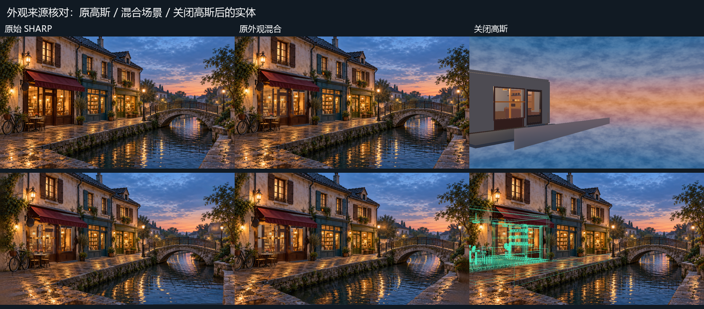
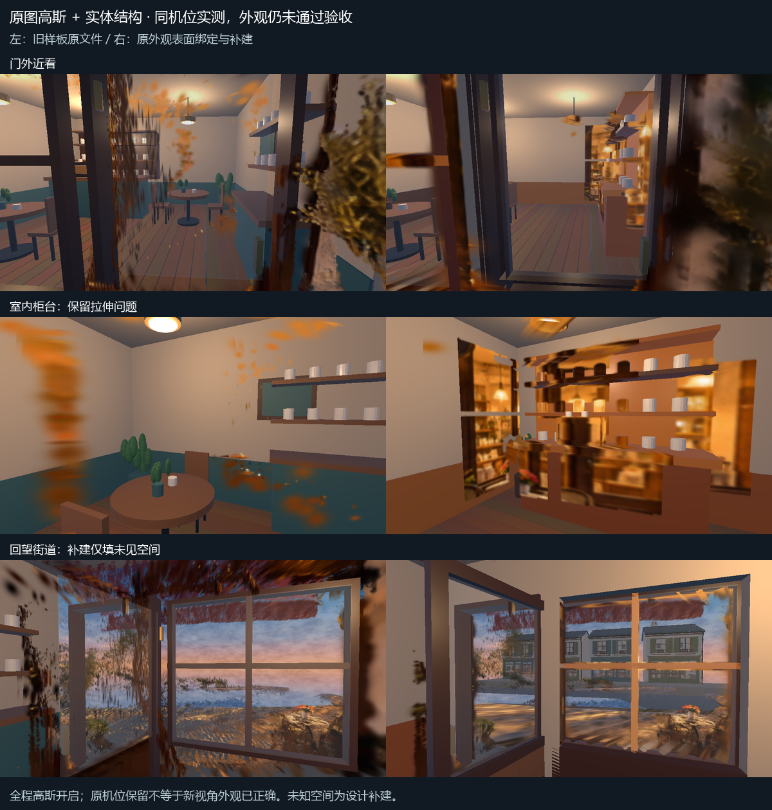

# 原图高斯与实体结构：局部表面绑定实测

2026-11-16。用户指出上一轮主要影片回到了 Blender 建模渲染，本轮回到原 SHARP 高斯作为主要外观。在新副本里处理咖啡店局部，旧工程、原图、原高斯不改。

**本轮多角度外观验收未通过。** 原机位保留、局部表面约束和背面支撑有实际进展；室内仍有照片拉伸、结构与照片物体不对应，以及未见面接缝。不得把本轮说成完整可编辑世界已完成，也不得用上一轮 Cycles 影片替它证明画质。

[原高斯混合影片](http://127.0.0.1:8773/result/review.html) · [同机位交互对照](http://127.0.0.1:8773/)

## 实际采用的流程

原图 → 已有 SHARP 原始 PLY → 局部分组与结构约束 → 原外观表面采样 → Spark 高斯与实体同场显示。**没有用 Blender 多视角渲染图重做全场景高斯。**

1. 保留街景原始高斯。主文件共 1,179,648 个高斯，SHA256 仍为 `f016afa60f439dd76c7aac808b0a27e7e7fec224a3e56638029169d81069c1a0`。
2. 复用早先咖啡店的门控制器与房间，新副本调整柜台、货架，使原机位穿过窗口的视线有对应实体支撑。原照片能看到的内部不是直接删除并换成纯 CG。
3. 直接重绑定版保留所有原始高斯颜色/透明度，沿原相机射线把局部中心与协方差约束到门、立面、地面和室内实际表面。此版仍有明显层叠颜色与长条问题，保留为比较版本。
4. 选用局部重新采样版：仅用**原始 SHARP 原机位实际渲染**解析局部外观。该输入只渲染原高斯及固定深色背景，没有 Blender 实体或补建天空参与。照片外观的表面采样减少原透明层压到面上后的颜色混合错误，但不等于恢复了物体语义。
5. 未见面的实体色调参考相应原图外观样本，属于烘焙外观匹配，不称为反照率恢复或物理重打光。原图未见的对岸、部分地面/水面保留为明确的设计补建。

最终默认混合数据为：1,095,075 个背景高斯、25,970 个照片室内表面高斯、7,299 个门高斯，合计 **1,128,344**。其中 **1,048,246 个原始街景条目逐字段、逐字节核对一致**。局部重新采样产生的新条目与改动的条目单独记账，不能再声称默认版的每个高斯颜色、透明度均未改变。

所有原始文件和最初的直接绑定试验均保留。`?raw` 可看直接绑定版；`?resolved` 为颜色解析对照，默认是原机位表面采样版。

## 结构与遮挡

原样板隐藏了门木材与立面替身的整块材质。现在只让原高斯负责原相机实际观察到的面，未见面与背面继续由实体支撑。实际原机位的射线与深度缓存用于固定的表面可见性判断，**不随当前观看机位改变或开关场景**。

新增环境仅在原相机未覆盖的空间显示。这个固定空间裁切能保护原机位外观，不能宣称原覆盖区在新视角已没有缺口。补建建筑复用我们的自有几何组件，属于创作设计，不是从照片推断出的真实对岸。

门高斯继续使用 Blender 实际求值矩阵 `Mt × inverse(M0)`，不另造网页动作。其他部件的表面所属物体已记录；编辑它们后需重新执行绑定，尚未实现所有物体的实时高斯编辑。`.blend` 包含实体、原相机、控制器和侧车文件说明；高斯由 Spark 交互页显示，未安装 Blender 原生高斯渲染插件。

## 实测结果与边界

| 检查 | 结果 |
| --- | --- |
| 原高斯、原图及旧样板文件 | 前后 SHA256 一致 |
| 未改动原始高斯条目 | 1,048,246 个，逐字段核对一致 |
| 原机位相对原高斯渲染的平均 RGB 差 | 约 1.90/255；旧混合样板约 3.05/255 |
| 原机位 PSNR | 约 30.10dB；旧混合样板约 24.48dB |
| 咖啡店局部平均 RGB 差 | 约 12.74/255；旧样板约 28.99/255，仍有明显差异 |
| 未分配背景高斯中心进入房间 | 4,558 → 0；仅为中心检查，不证明所有椭球边缘无穿帮 |
| 门矩阵 | 实际镜头抽查最大数值差 0 |
| 连续镜头 | 336 帧、12fps、28 秒，所有高斯外观分组一直开启，背景变换及显示分层不变 |
| 多角度外观 | **未通过**：照片细节仍有拉伸、错位、缺面与接缝 |

前后对照载入各自真实几何和高斯，在同一查看器使用统一渲染设置。室内结构确实有所调整，不把对照差异全部归功于某一个参数。原机位保留得更好不能证明隐藏空间恢复正确，也不能代表所有新机位画质提升。

本轮验证的是局部投影绑定、表面约束和遮挡机制。它揭示了当前缺口：照片中的柜台、货架、灯和容器与推测的房间物体仍没有充分对应；把外观放到表面上不足以得到完整多视角物体。下一阶段应优先进行部件对应与几何/外观联合校正，通过后再扩街区，不继续用场景规模掩盖问题。

## 脚本和本机产物

- `prepare_queries.py`：读取原高斯和既有设计坐标，建立局部分组与保护哈希。
- `build_structure.py`：新建派生实体，实际射线查询照片表面，导出固定原机位可见性与 GLB。
- `bind_source.py`：搬运原高斯中心与协方差，保留直接绑定及颜色解析对照。
- `resample_surfaces.py`：从原高斯实渲染采样局部外观，不使用 Blender 渲染图。
- `viewer.html`：同场显示、固定可见性、原始/旧样板/新混合对照及连续镜头。
- `capture.cjs`、`check_ui.cjs`：独立 Chrome 实际捕获与操作检查。
- `package_results.py`：只用实际帧制作影片、核对来源与绑定，并明确保留失败的外观验收。

本机产物位于 `F:\codex_project2\1115_codex_project\.local\cafe-source-bound`，包括 `.blend`、`.glb`、各 PLY、源像素/表面所属数据和验证报告。服务仅监听本机 8773，未发布。大产物不提交研究仓库。

环境沿用 Blender 4.5.9、Python 3.10 / NumPy / SciPy / Pillow / plyfile、Three.js 0.187.0、Spark 2.4.0 和 FFmpeg；未调用新模型、收费 API、图片生成或下载权重。原图与 SHARP 权利边界沿用[原单图高斯实验](../canal-single-sharp/README.md)。

验证明细：[verification.json](../../assets/cafe-source-bound/verification.json)。
