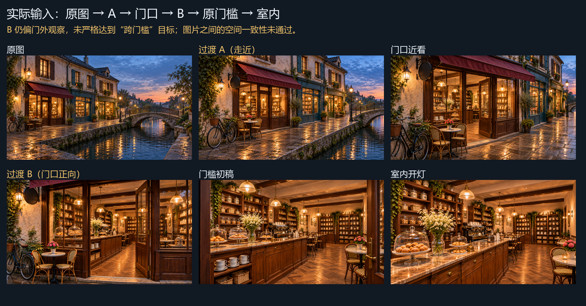
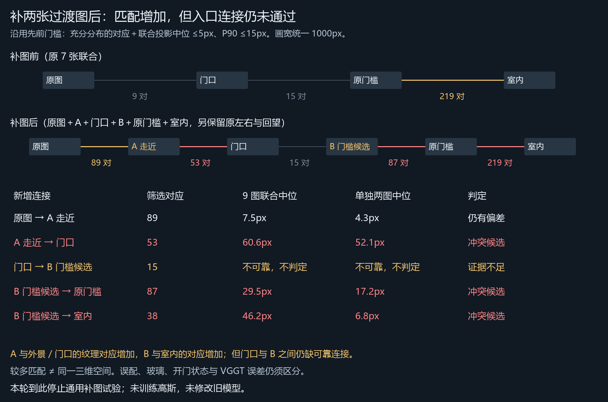
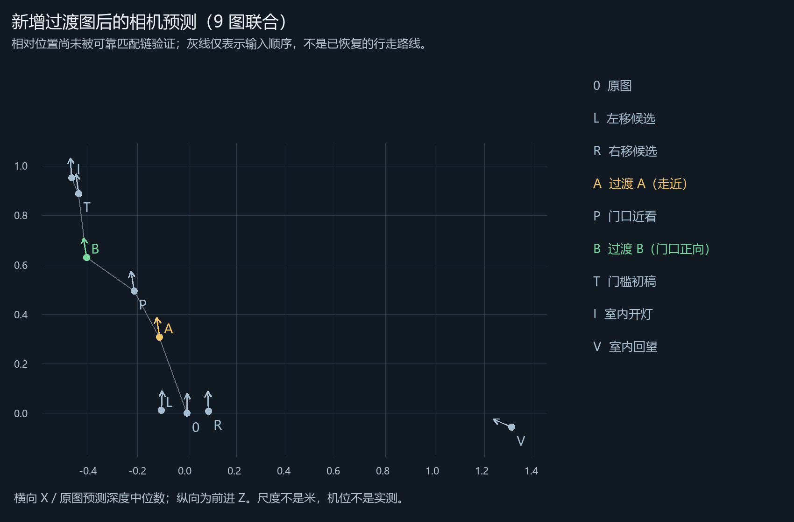

# 两张入口过渡图：生成与 VGGT 复检

2026-11-16。用户确认后，实际执行此前约定的小实验：补 A“走近途中”、B“门槛过渡”两张图，再用现有 VGGT 和同一套独立匹配检查，对照能否把室外与室内连接起来。**本轮未通过入口连接验收，按约定暂停继续用通用图像模型自由补图的这条试验路线。没有训练高斯，也没有修改旧模型。**

[本轮查看器](http://127.0.0.1:8776/) · [上一轮原始检验](http://127.0.0.1:8775/) · [验收前后对照](../../assets/canal-entry-bridge-test/before-after-verdict.png)

## 实际生成的两张图片

使用内置 **image_gen 图像编辑工具**，后端精确模型标识未公开，不称为某个指定 GPT Image 版本。没有调用 ChatArt、ViewCrafter 或新世界模型。

- [A：走近途中](../../assets/canal-entry-bridge-test/bridge-a.png)。输入原图＋既有门口近看图，要求同高同焦距向入口走近一半距离，保留完整红棚、邻店、桥岸和门窗细节；门叶保持原图关闭状态。
- [B：门槛目标的实际候选](../../assets/canal-entry-bridge-test/bridge-b.png)。输入既有门口图＋原门槛图＋A，要求短步跨向门槛，同时保留固定门框与室内柜台、花瓶、货架。

**B 实际仍然偏门外正向观察，保留了整片外墙、户外桌椅与前景人行道，没有严格实现“刚跨门槛”机位。** 此结果如实保留，不用后期裁切伪装成指定机位。所有相机距离与方向均为文字提示意图，没有输入数值相机矩阵或硬深度约束。

本轮只生成这两张，没有看到结果不理想后反复生图挑选。原始输出逐文件复制保留，未做图像修补、几何扭曲或调整尺寸。完整提示词和输入顺序见 [prompts.json](prompts.json)。

## 实际 VGGT 检验

复用上一轮 [infer_multi.py](../canal-vggt-consistency/infer_multi.py)，使用同一已有 VGGT-1B 权重、518×294 预处理、BF16 聚合器、FP32 相机／深度头和逐帧深度分块。权重 SHA256 仍为 `f164acf60724910d8fe1578bb499d800850c7bb0948db7555c413f9fbe60467e`，没有安装新依赖或修改上游源码。

配置：[manifest.json](manifest.json)。实际共运行八组：

- 9 图联合：原图、左右、A、原门口、B、原门槛、室内开灯、回望。
- 入口 6 图：原图、A、原门口、B、原门槛、室内开灯。
- 门口 4 图：A、原门口、B、原门槛。
- 五组独立两图：原图—A、A—门口、门口—B、B—原门槛、B—室内。

一次首次启动在 `GROUP_START joint` 后提前退出，未保存预测，原因没有确定。随后按**完全相同配置与输入**重试，全部八组成功并保存有限值预测，没有降分辨率或换图掩盖问题。完成的一轮含模型构建、读取与记录约 28.62 秒；9 图主组前向及保存约 4.13 秒，进程峰值已分配显存约 3.20GiB。此记录不包含首次 Python 启动，也不是普遍速度／显存承诺。

## 沿用的检查方法与门槛

独立 SIFT 双向匹配，0.72 比率筛选，以两视图 F-RANSAC 去除部分误配。固定 VGGT 的相机和深度，将源图点反投影后投到目标图，不用匹配来调整 VGGT。

保持上一轮自定条件：至少 20 对筛选匹配，源／目标 6×4 网格各覆盖至少 4 格，才有一定检查支持；局部几何支持要求前向投影偏差中位 ≤5px、P90 ≤15px。所有偏差换算到宽 1000×高 563 的画面。只满足匹配数量而不满足投影条件，不能当作三维连接通过。

| 新增连接 | 筛选对应 | 9 图联合中位偏差 | 单独两图中位偏差 | 本轮判断 |
| --- | ---: | ---: | ---: | --- |
| 原图—A | 89 | 7.5px | 4.3px | 有局部对应，尾部／联合偏差仍超门槛 |
| A—原门口 | 53 | 60.6px | 52.1px | 与模型投影明显不符的候选，需排除误配等因素 |
| 原门口—B | 15 | 不作可靠判断 | 不作可靠判断 | 共同细节稀少，连接证据不足 |
| B—原门槛 | 87 | 29.5px | 17.2px | 没达到同一局部空间的检查门槛 |
| B—室内 | 38 | 46.2px | 6.8px | 受联合输入显著影响，不能当可靠桥接 |

补图前，达到匹配支持条件的分组为“原图＋左右”“原门口单独”“原门槛＋室内”“回望单独”。补图后，“原图＋左右＋A＋原门口”形成更多**纹理匹配**连接，“B＋原门槛＋室内”形成另一组，但两组之间仍未找到足够的连接证据。即使只看匹配支持图，也没有原图通往室内的可靠完整路径；更严格的投影条件同样未通过。

原先室内“原门槛—室内”的 219 对相同匹配，在 7 图联合中位偏差约 12.9px，加入 A/B 后的 9 图联合中增到约 **58.9px**；原图—右图从约 2.9px 增至约 5.5px。这说明增加图片并没有使联合定位更稳定。由于联合输入上下文改变，不能把变化全部归为补图几何错误或算法能力排名。

## 标注与误配核对

[A—原门口](../../assets/canal-entry-bridge-test/pair-bridge_a-approach.png)、[B—原门槛](../../assets/canal-entry-bridge-test/pair-bridge_b-threshold.png)、[原门口—B](../../assets/canal-entry-bridge-test/pair-approach-bridge_b.png)、[原图—A](../../assets/canal-entry-bridge-test/pair-original-bridge_a.png)、[B—室内](../../assets/canal-entry-bridge-test/pair-bridge_b-inside.png)。

同号圆圈为匹配候选，粉色叉为联合 VGGT 预测投影。黄色包含相对低置信或稀疏证据，红色仍只是待核对冲突候选。显示点经过空间抽样，不是全图错误率。

目视核对发现，A—原门口有一处自动描述符将“邻店木框”匹到“咖啡店圆牌支架附近”，不属于同一个物理点。此点从**结构矛盾示例**中排除，原自动统计和全部对应记录保留，避免改变前后检查口径。见 [manual-review.json](../../assets/canal-entry-bridge-test/manual-review.json)。其他重复灯具、罐子或窗格也可能误配，不能把每根红色箭头都称为实际几何错误。

原图／A 中门叶关闭，原门口／B 中门叶打开，属于已知状态变化；门叶和玻璃反射不能作为刚性空间真值。重点应是固定门框、墙体和柜台的对应，但本轮未取得足够可靠的连续结构约束。

相机位置是模型在未可靠连通数据上的推测，尺度不是米。不能用这张图反过来证明图片已经属于一个空间。

## 结论与边界

**本次通用图像模型“再补两张中间视角”的实验没有把入口连接验证通过。按执行前约定，到此暂停继续用自由补图堆叠这条主线，不进入高斯训练。** 这不是证明所有通用图像模型或其他匹配方法都不可能成功；它说明本次工具、图片与检查方法尚不能提供可靠重建输入。后续若继续，需要另行验证显式相机／共享三维状态约束，不能把新增几张漂亮图片当作问题解决。

原图、旧输入图片、原始 SHARP PLY、旧 `.blend` 和上一轮 `prediction.npz` 的前后哈希一致，均未改动。实际完整记录：[inference.json](../../assets/canal-entry-bridge-test/inference.json)、[analysis.json](../../assets/canal-entry-bridge-test/analysis.json)。计算数据保存于 `.local/canal-entry-bridge-test/`，没有发布到外网。

脚本：[evaluate.py](evaluate.py)、[build_figures.py](build_figures.py)、[serve.py](serve.py)。复检只读旧检查方法，所有新输出使用新目录，旧测量结果不覆盖。

本轮查看器已在内置浏览器实际检查：两张新图、前后对照与相机标注全部加载；切换 A—门口、B—原门槛的对应图，显示了相同统计；最终停在验收前后页。[查看器检查记录](../../assets/canal-entry-bridge-test/ui-check.json)。
