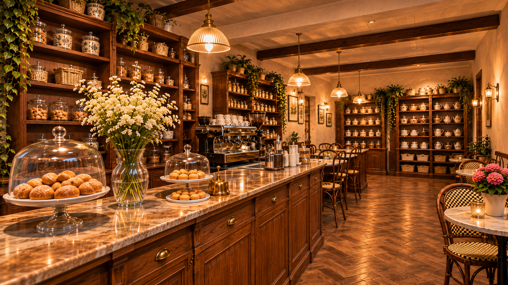
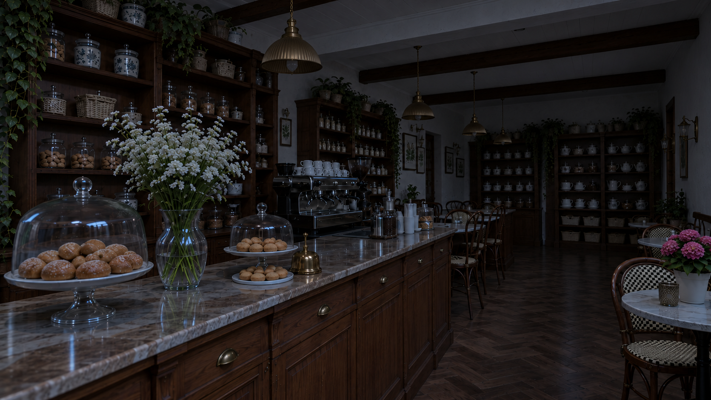

# 运河咖啡店：室内补图与关灯对照

2026-11-16。沿用用户上一轮“先不重建、不修改旧模型”的边界，继续检查店铺内部与光照的生成能力。本轮只生成候选图片、执行二维检查。没有生成连续三维镜头，没有编辑 Blender、PLY 或 GLB，也没有实现高斯物理重打光。

## 实际生成结果

使用内置 **image_gen** 图像编辑工具，精确后端模型标识未公开。按顺序生成：

1. [门口近看并开门](../../assets/canal-imagegen-interior/approach.png)：原图＋上一轮右视角作为参考。
2. [室内方向初稿](../../assets/canal-imagegen-interior/interior-on-v1-threshold.png)：仍含前门门框，更像门槛附近的观察，未作为最终室内候选。
3. [向内移动后的开灯候选](../../assets/canal-imagegen-interior/interior-on.png)：纠正前门应位于相机后方，保留同一柜台、货架与灯具的意图。
4. [同构图关灯候选](../../assets/canal-imagegen-interior/interior-off.png)：只要求关掉吊灯、壁灯、桌面烛光和机器指示灯，保留傍晚室外入光，不移动物体和相机。
5. [室内回望街道候选](../../assets/canal-imagegen-interior/reverse.png)：要求从开灯候选的同站位转身约 180°，柜台由画面左侧变为右侧、座位反向，桥在外景左侧方向，不把原店铺复制到对岸。

所有“前进 1.5m”“同站位转身”的表述均为**给图像模型的提示意图，不是已标定或测得的位姿**。生成器没有接收真实相机矩阵与硬空间约束。原图没有展示的室内深处、对岸和背面均是生成假设，不是原图恢复真值。

## 本轮观察

- 门口图保留红棚、深木门窗、相邻蓝绿色店面及暖木室内的风格，补出了门后的货架、柜台和地面。
- 开灯／关灯图中的柜台、灯具、花瓶、咖啡机和货架在二维位置上大体保持，暖色发光和部分镜面高光被去除，后部比前部更暗。
- 这证明了**单张室内候选的光照外观编辑**可以保留较多图像结构；不证明恢复了材质反照率、灯位、光源强度或真实光传输。
- 回望图采用了“柜台在右、座位在左、桥在外景左侧”的整体方向，但与向内图的同站位关系没有得到验证。咖啡机与花瓶沿柜台的可见顺序存在疑点：模型可能为了继续展示标志性物件而移动机位或物件。
- 门口、室内与回望图之间的玻璃分格、灯具、家具数量和遮挡没有逐物体锁定。单张图画得好看不能证明共同空间成立。

**结论：室内外观与二维关灯效果已经有实际候选；同一完整三维空间、连续走入、真实高斯换光均未通过验证。** 本轮到此停止，不用漂亮室内图片冒充三维成品。

## 二维开关灯检查

脚本：[check_lighting_pair.py](check_lighting_pair.py)，只读取生成图片，使用既有 OpenCV 与 NumPy，不求三维点、深度或相机位姿。

- 双向 SIFT＋0.72 比率筛选取得 920 对特征，覆盖 8×5 图像网格中的 32 格。
- 对应点原始位移中位数 1.339px，90 分位 2.217px；83.91% 的筛选对应点位移不超过 2px。这不是整幅图几何正确率。
- 用空间分块约三分之二匹配拟合单应变换，322 对留出匹配的残差中位数为 0.555px、90 分位 1.418px。它只说明匹配到的图像结构大体保留，黑暗未匹配区域及物体身份仍需检查。
- 对固定区域的图像线性亮度采样，关灯／开灯比值约为：近处灯泡 0.065，前柜台 0.159，后货架 0.066，过道地面 0.057。这是图片中的亮度变化，**不是照度、能量或物理重打光准确率**。

原始数值、图片尺寸与哈希：[image-check.json](../../assets/canal-imagegen-interior/image-check.json)。完整提示词、输入顺序及唯一一次机位修正：[prompts.json](prompts.json)。

## 来源与边界

本轮输入为用户既有 AI 运河原图及上轮实际生成候选，输出为本次工具真实图片，没有使用第三方演示。原图 SHA256 仍为 `6ebfd8652e498e31ad522045a22e7abdb32b92f5b5e825f62ae7df13ec844f1e`。未调用 ChatArt、ViewCrafter 或其他世界模型，未下载新权重、安装依赖或发布文件。
