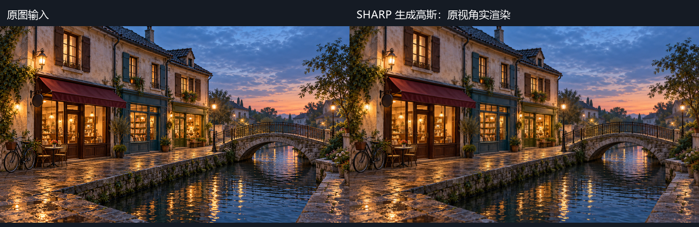

# 运河原图直接生成高斯场景：SHARP 实测

2026-11-15，本机真实完成。**原图 → 官方 SHARP → 新高斯 `.ply` → Spark 实际渲染。** 生成过程没有使用旧 Blender 模型或上轮 VGGT 输出，没有调整旧模型。

后续第一步已完成：[固定右侧机位草图、深度/覆盖诊断与候选标注](view-diagnosis/README.md)。仅检查新视角，不代表已完成 AI 补图或场景修复。

## 实际效果




[原视角渲染](../../assets/canal-single-sharp/original.png) · [左移](../../assets/canal-single-sharp/left.png) · [右移](../../assets/canal-single-sharp/right.png) · [前移](../../assets/canal-single-sharp/forward.png) · [较大右移](../../assets/canal-single-sharp/wide.png)

观察：原图的灯光颜色、墙面纹理、湿地反光、植物和远景得到了较完整的保留，原视角有轻微软化。小范围移动可看到前后景视差。就保留本图外观而言，比上轮通过深度调整旧语义模型的结果更接近用户目标；这不是两种算法在同任务、同条件下的通用性能排名。

本实验没有其他真实视角照片，不能确认新露出的区域是否真实，也未验证绕建筑、走进店铺或完整自由漫游。高斯文件不等于按房屋、门窗分件的普通可编辑网格。原图视角相似也不能证明深度和尺度准确。

## 已验证的数据

| 项目 | 记录 |
| --- | --- |
| 原图 | 历史运河 `assets/reference.png`，1672×941；SHA256 `6ebfd8652e498e31ad522045a22e7abdb32b92f5b5e825f62ae7df13ec844f1e` |
| 模型 | [Apple SHARP 官方仓库](https://github.com/apple-aiml-research/ml-sharp)，提交 `aed6527499ef91cba3b54c18d49a870f25947190` |
| 权重 | 官方 CDN `sharp_2572gikvuh.pt`，2,809,738,232 bytes；本地 SHA256 `94211a75198c47f61fca7d739ba08a215418d8d398d48fddf023baccc24f073d`；ZIP CRC 全部通过，此哈希作为本次来源记录，不冒充上游发布的校验值 |
| 实际推理 | Windows、Python 3.10.11、PyTorch 2.3.1+cpu、NumPy 1.26.4、timm 1.0.22，CPU Float32 |
| 分辨率及适配 | 官方默认 1536×1536 内部输入；保持所有滑窗图块，仅把 ViT 独立图块批次拆为至多 4 个，不降低分辨率 |
| 相机 | 原 PNG 无 EXIF；沿用官方 30mm 回退公式，f=1330.3168 px。无真实相机标定，预测尺度未经独立测量 |
| 时间 | 预测 113.60 秒；含模型构建、载入、后处理和保存 129.47 秒；不含首次环境安装和权重下载 |
| 高斯产物 | 1,179,648 个高斯，66,061,086 bytes；包含位置、颜色、不透明度、三个尺度和四元数；所有几何属性有限 |
| PLY SHA256 | `f016afa60f439dd76c7aac808b0a27e7e7fec224a3e56638029169d81069c1a0` |
| 查看器 | Spark 2.4.0、Three.js 0.187.0；实际捕获 Chrome WebGL2 / Intel UHD D3D11 渲染，并非把图片或点云截图冒充高斯 |
| 视角及视频 | 5 个视角、60 个非空运动帧；左右平移为预测深度中位数的 ±3%，前移 3%，较大右移 10%；均朝向中位深度处的画面中心 |
| 交付视频 | 3 秒、60 帧、H.264、1000×564，原渲染 1000×563，仅补一行黑边以符合编码；这是离线帧序列，未测实时帧率 |
| 历史工程保护 | 末尾仅做只读哈希检查，V3/V4 与上一轮记录完全一致 |

首次设置中安装了独立 CUDA PyTorch 2.3.1+cu118，安装耗时约 12 分钟；为减少等待，同时复用已安装的 CPU PyTorch 执行 SHARP，最终交付是 **CPU Float32** 这次结果，未另做 GPU 精度对照。没有让 VGGT 参与预测。CPU 环境路径中保留旧实验名称不代表运行了 VGGT 模型。

## 文件与查看器

大权重、运行库、66MB 高斯文件、完整运动帧及 MP4 留在独立本机实验目录，不纳入研究仓库。仓库保存脚本、实测报告和必要的对照图片/GIF。模型文件名为 `canal-sharp.ply`；它是高斯属性 PLY，不是普通三角网格或仅含 XYZ 的点云。

运行中的本机查看器：[http://127.0.0.1:8769](http://127.0.0.1:8769)。仅绑定 loopback，未公开部署；服务停止后需要按下列命令重启。可点原视角/左右/前移按钮，拖动查看或播放小范围运动。首次加载需要上传并排序高斯，短暂空画面不代表文件为空。

```powershell
python serve.py --modules <本机查看器依赖的node_modules> --results <包含PLY和inference.json的结果目录> --port 8769
```

## 复现步骤

1. 固定版本官方源码和官方权重，按 `fetch_weights.py --url <官方权重URL> --out <权重路径>` 下载并保存校验记录。依赖按需安装在独立目录，保留官方许可证。
2. 使用 CPU Float32：`infer_sharp.py --device cpu --source <官方源码目录> --weights <权重路径> --image <原图> --out <结果目录>`。若轻量依赖另装到 target 目录，使用 `--support <目录>`。本脚本针对这张无 EXIF PNG，读图后使用官方相同回退焦距和双线性预处理。
3. 本地依赖：`playwright-core`、`three@0.187.0`、`@sparkjsdev/spark@2.4.0`。用 `serve.py` 开服务，再用 `node capture.cjs <node_modules> <结果目录> <本机URL> 60` 渲染。相机保持官方 OpenCV 约定到 Three.js 的 X 轴旋转 180° 转换，不改变预测高斯内部几何。
4. `prepare_results.py` 检查实际 PLY 属性、不同视角图片和全部 60 帧非空，并核对原工程哈希，生成带明确标签的原图/高斯对照。
5. 使用 FFmpeg 以 20fps 合成 MP4；GIF 为同一批实渲染帧的 10fps、640px 宽预览，不是 AI 视频生成或原图二维变形。高清查看以 MP4 或本地交互渲染为准。

机器记录：[推理](reports/inference.json)、[高斯渲染](reports/render-report.json)、[完整性与源文件保护](reports/verification.json)。首次捕获曾早于异步排序完成而产生空图，已修正等待条件并完整重新捕获；交付的五个视角和全部 60 帧均已检查非空。

## 来源和使用边界

原图来自用户历史 AI 运河概念图项目；图片对照、高斯截图和运动帧均由本轮实际生成。没有借用上游案例图。SHARP 源码和权重分别以官方 LICENSE、LICENSE_MODEL 为准；本轮为本机研究实验，未发布第三方权重或上线服务，不能据本次测试推定商业授权。

来源：[官方 README](https://github.com/apple-aiml-research/ml-sharp/blob/aed6527499ef91cba3b54c18d49a870f25947190/README.md)、[官方预测流程](https://github.com/apple-aiml-research/ml-sharp/blob/aed6527499ef91cba3b54c18d49a870f25947190/src/sharp/cli/predict.py)、[模型许可](https://github.com/apple-aiml-research/ml-sharp/blob/aed6527499ef91cba3b54c18d49a870f25947190/LICENSE_MODEL)、[Spark 查看器](https://sparkjs.dev/docs/)。
