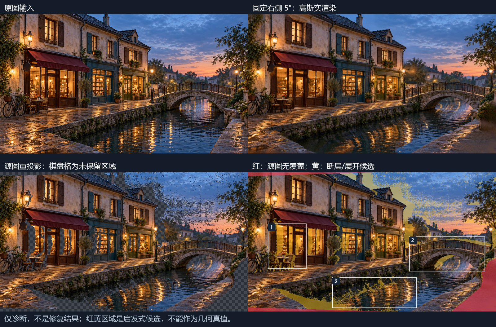

# 第一步：固定新视角草图与待核对区域

2026-11-15。本轮仅执行用户确认的第一步：读取现有 SHARP 高斯文件，固定一个右侧机位，输出实渲染、源图重投影、预测深度代理及候选区标注。**未执行 AI 补图，未修复或改写高斯，未使用旧 Blender 模型。**

## 三项主要交付

- 原视角：[源图](../../../assets/canal-single-vggt/reference.png)、[高斯原机位实渲染](../../../assets/canal-sharp-view-diagnosis/source-view.png)。
- 新视角：[固定右侧机位的实渲染](../../../assets/canal-sharp-view-diagnosis/target-view.png)。
- 候选标注：[带图例的完整标注](../../../assets/canal-sharp-view-diagnosis/annotated-with-legend.png)。

本机诊断页：[http://127.0.0.1:8770](http://127.0.0.1:8770)，可切换原机位、固定新机位、候选标注、源图重投影和深度代理；不提供自由绕转，便于复查同一个机位。旧查看器和原高斯文件继续保留。

## 机位定义

画面为 1000×563。原相机为 SHARP 的 OpenCV 坐标原点：X 向右、Y 向下、Z 向前。先向右平移 `focus × tan(5°)`，再朝原轴线上预测中位深度处的焦点看。

- 焦点深度：16.216293334960938 个预测坐标单位。
- 右移量：焦点深度的 8.748866%，并朝左转向 5°；这不是相机原地转头。
- 单位和尺度来自模型预测，没有独立实测，不能把这些数值直接当真实米数。
- 内参、外参、投影检查点均已固定保存在 [cameras.json](reports/cameras.json)。

这个机位用于检查一次确定的侧移，不代表已验证所有小角度或更大绕行。

## 标注含义与观察

| 标记 | 计算含义 | 占当前目标画面 |
| --- | --- | --- |
| 红色 | 源图按预测深度回投后没有覆盖的区域，主要见于边缘 | 4.75% |
| 黄色 | 回投跨越明显深度跳变、发生展开或翻转的候选区 | 12.61% |
| 白框 1 | 人工优先核对咖啡店门窗与遮挡轮廓 | 不作为错误率 |
| 白框 2 | 人工优先核对桥洞、栏杆和新露出部分 | 不作为错误率 |
| 白框 3 | 人工优先核对水面倒影；不能把其深度直接理解成河床或真实水面几何 | 不作为错误率 |

**红黄比例不是模型错误率，白框也不是已确认的错误。** 它们用于确定下一步要检查哪里。天空、倒影、细栏杆与透明玻璃都容易触发这种几何诊断；正确的物体边缘本身也会有深度跳变。未标记区域不等于正确。

当前高斯在目标画面上的 CPU 估计高覆盖区域为 99.855%，但“把画面填满”不证明这些位置获得原图充分支持。源图安全回投覆盖约 83.78%；它与红黄两项并非简单互补，因为安全回投和含风险三角形可能在不同深度重叠。

本轮候选图不能整张直接当自动补图蒙版。下一步需要选取局部区域，保留已有结构并另行检查补图是否符合固定相机；本轮到此停止。

## 深度与重投影方法

1. 从原始 1,179,648 个高斯的位置、尺度、四元数和不透明度出发，用 CPU 投影椭圆进行前向透明度累积。
2. 累积透明度达到 0.5 时，取对应高斯中心的相机 Z，得到**深度代理**。它不是真实射线表面深度，也不是单独下载的新深度模型。
3. 取原机位覆盖大于等于 0.9 的像素，将原图颜色和深度代理重投影到目标机位。使用三角形连接，避免把纯采样缝隙都当作新露出区域。
4. 将三角形最大/最小源深度比大于 1.08、投影面积比大于 1.8 或发生翻转的位置标为风险候选。生成草图时断开这些连接，所以棋盘格部分既可能是没有覆盖，也可能是主动舍弃的风险连接。
5. 高斯 CPU 投影采用 0.3 像素协方差正则、最大 √8 标准差、轴向最大 512 像素半径与最小 0.5/255 alpha；这是诊断近似，不能冒充 Spark 的逐像素真实可见性或物理测量。

辅助图：[源图回投草图](../../../assets/canal-sharp-view-diagnosis/source-reprojected-draft.png)、[原位深度代理](../../../assets/canal-sharp-view-diagnosis/source-depth-proxy.png)、[目标深度代理](../../../assets/canal-sharp-view-diagnosis/target-depth-proxy.png)。深度图共用对数色标，蓝近红远。

## 验证与边界

- 固定机位的 RGB 图由 Spark 2.4.0 实际渲染现有高斯得到；深度代理和蒙版由独立 CPU 计算，不混同两类结果。
- Python 相机投影与实际浏览器相机检查点差异小于 `1e-12` 像素；OpenCV/Three.js 外参转换一致。
- 原机位恒等回投在保留区域的 RGB 平均绝对差为 0；该项仅验证实现的坐标约定，不证明预测几何准确。
- 两张实际渲染均非空；页面五个切换按钮通过实际浏览器检查，无页面脚本错误。
- 源 PLY 前后 SHA256 同为 `f016afa60f439dd76c7aac808b0a27e7e7fec224a3e56638029169d81069c1a0`。
- 本轮没有其他真实视角、几何真值或补全结果，不能据此断言哪些侧后方内容是真实的。

记录：[诊断参数与比例](reports/diagnostic-report.json)、[浏览器实际相机](reports/actual-camera-render.json)、[相机和源文件核对](reports/verification.json)、[页面按钮检查](reports/ui-check.json)。完整数值数组保存在本机实验目录的 `diagnostic-arrays.npz`，不纳入研究仓库。

## 脚本

- `project_diagnostics.py`：只读源 PLY 和原图，保存固定机位、深度代理、蒙版及回投草图；使用现有 NumPy、SciPy、Numba、Pillow 和 plyfile，无新模型下载。
- `capture.cjs`：在隔离的无界面 Chrome 中捕获固定两机位的实际高斯渲染与矩阵。
- `finalize.py`：验证坐标、图片与源 PLY，生成带明确图例的标注和对照图；标注属于研究诊断图，不是 AI 修复。
- `check_viewer.cjs`：逐个验证诊断页切换并截图。
- 本轮启动父目录 `serve.py` 时指定 `--viewer <本目录/viewer.html> --source-results <原高斯结果目录> --results <本轮诊断目录> --port 8770`；仅绑定 loopback，未公开发布。

原图和高斯均沿用用户已有实验。标注、深度伪彩图和草图为本轮实际计算产物，不使用上游演示素材；模型、查看器和原图权利边界沿用父级实验记录。
