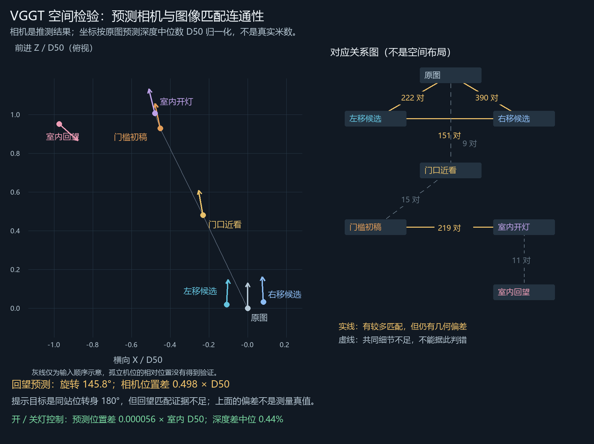
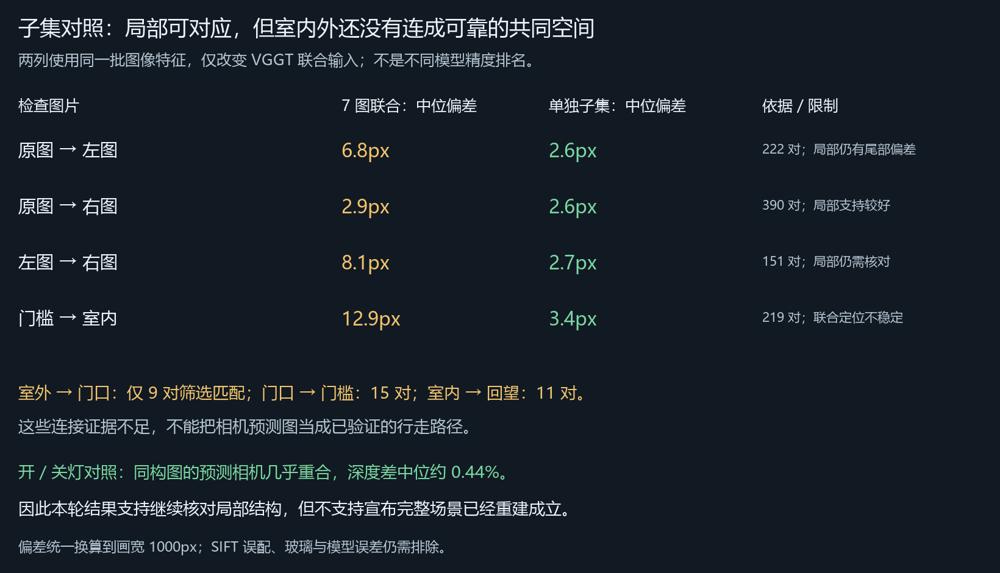
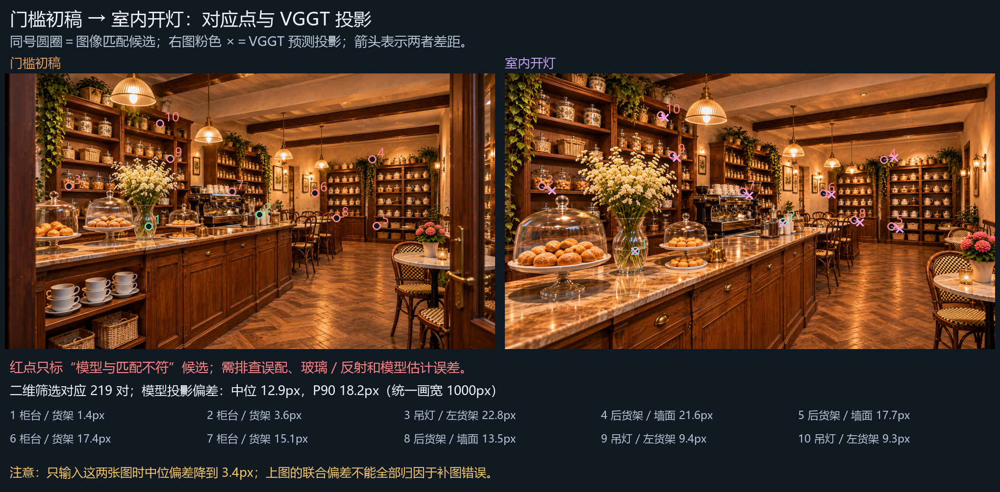
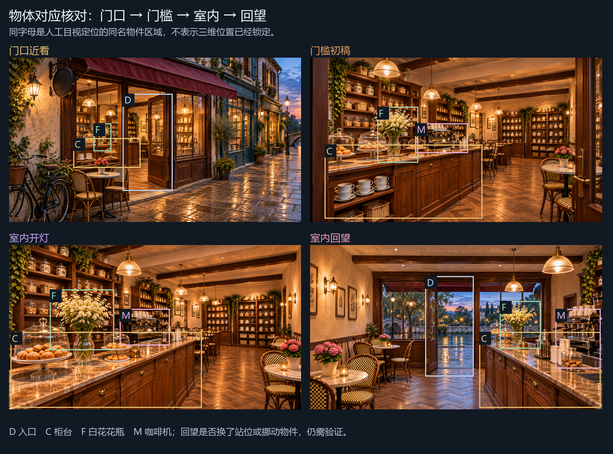

# 运河与咖啡店：VGGT 多图空间一致性实测

2026-11-16。按用户授权，使用已有本地 VGGT 检查实际生成的运河与咖啡店图片，交付预测相机、物体对应区域、跨图投影冲突候选与控制对照。**没有训练高斯，没有修改旧 Blender 工程、原图或原高斯。**

[本机交互查看器](http://127.0.0.1:8775/) · [相机与连通性](../../assets/canal-vggt-consistency/camera-map.png) · [物体区域对应](../../assets/canal-vggt-consistency/object-correspondence.png) · [子集对照](../../assets/canal-vggt-consistency/subset-controls.png)

## 结论

**外景三图、室内相邻两图分别有局部空间支持，但目前没有足够证据将整批图片确认成同一个完整空间。主要缺口是室外到门口、门口到室内，以及室内回望的可靠对应链。**

不能简单归结为“AI 图片全错了”：同一批室内对应点，单独两图推理的前向投影中位偏差约 3.4px，加入室外等图片后升到约 12.9px，说明联合定位的不稳定本身也是重要因素。这里的像素统一按画宽 1000px、画高 563px计算，不是真实几何误差。

开灯／关灯图是正向控制：模型预测相机几乎重合，深度相对差中位约 0.44%。这支持两张图大体保留了同构图结构，**不是三维物理重打光通过证明**。

## 输入与实际运行

- 主组 7 张：原图、左移、右移、门口近看、门槛初稿、室内开灯、室内回望。门槛初稿保留为过渡视角候选，不把它当成已标定机位。
- 控制组 2 张：室内开灯、室内关灯，独立推理，避免把不同灯光状态混作同一固定外观。
- 补充子集：外景三图；原图＋门口＋门槛＋室内；门槛＋室内；室内＋回望。用于区分局部图像关系与跨区域联合推理的不稳定。
- 所有输入均为已有实际图片，没有本轮新生图、合成真值或下载新模型。

本地模型为 `facebook/VGGT-1B`，源码起点提交 `a288dd0f14786c93483e45524328726ab7b1b4ce`，权重 SHA256 仍为 `f164acf60724910d8fe1578bb499d800850c7bb0948db7555c413f9fbe60467e`。

环境：RTX 4070 Laptop 8GB，既有 PyTorch 2.3.1+cu118；图像由官方预处理缩为 518×294。为降低显存，聚合器权重／计算使用 BF16，相机和深度头使用 FP32，深度头每次处理一帧；只启用 camera/depth，不启用 point/track。沿用已有源码的中间层缓存策略，只保留相机与深度头使用的层；聚合器文件与原本地下载 ZIP 内的文件哈希相同。各源码文件哈希已记录，本轮未写入上游源码或权重；混合精度及分阶段调用不作为上游标准 FP32 精度基准。

现有 GPU 环境缺少的纯 Python `einops` 从已有 VGGT CPU 环境只读复用，没有安装依赖或替换任何环境。主组前向与保存约 2.62 秒，开关灯组约 0.45 秒；主轮含构建、读取权重和记录哈希约 17.45 秒，不包括首次 Python 启动。进程自身峰值已分配显存约 3.15GiB，不能据此宣称整机只占该显存或给其他输入作速度承诺。

完整配置：[manifest.json](manifest.json)、[manifest-aux.json](manifest-aux.json)；实际运行、权重哈希、输入哈希和源文件前后核对：[inference.json](../../assets/canal-vggt-consistency/inference.json)。

## 对应与冲突是如何检查的

1. 用独立 OpenCV SIFT 双向匹配、0.72 比率筛选找图像对应；再用两视图基础矩阵 RANSAC 过滤部分误配。外景粗略排除大片天空和水面，没有虚称完成语义分割。
2. 不用这些匹配调整 VGGT。固定模型预测的相机和深度，将源图点反投影到世界，再投到目标图，比较它与实际匹配点的位置，同时计算反向投影、目标深度差、预测相机的极线残差。
3. 超过 20 对筛选匹配，且在源／目标 6×4 网格分别至少覆盖 4 格，才将其视为有一定空间检查支持。否则标为“证据不足”，不把大残差直接定成物体移动或图片不一致。
4. 对较多匹配的图片对，局部支持的自定门槛为中位偏差 ≤5px、P90 ≤15px。主轮仍有尾部偏差，不能只报中位数宣布整幅通过。
5. 图上同号圆圈是二维匹配候选，粉色叉是固定 VGGT 预测位置。超过 5px 的抽样点标红作核对，**不代表已确认错误**。匹配可能落在重复罐子／窗户、玻璃或反射上；模型自身也可能预测错误。

| 图片对 | 二维筛选匹配 | 7 图联合前向中位偏差 | 单独子集前向中位偏差 | 解释 |
| --- | ---: | ---: | ---: | --- |
| 原图—左图 | 222 | 6.8px | 2.6px | 外景局部对应较多，仍有大偏差尾部 |
| 原图—右图 | 390 | 2.9px | 2.6px | 外景子集局部支持较好，不等于全图正确 |
| 左图—右图 | 151 | 8.1px | 2.7px | 外景关系受联合输入影响，边缘／反射需核对 |
| 原图—门口 | 9 | 不作可靠判定 | 不作可靠判定 | 重叠／可识别细节不足 |
| 门口—门槛 | 15 | 不作可靠判定 | 不作可靠判定 | 未形成可靠过渡连接 |
| 门槛—室内 | 219 | 12.9px | 3.4px | 两图局部可解释，整体联合定位不稳 |
| 室内—回望 | 11 | 不作可靠判定 | 不作可靠判定 | 匹配集中且稀少，不能验证同站位转身 |

主轮预测“室内→回望”的旋转约 145.8°、位置差约为原图深度中位数的 0.498 倍，和“原位转身 180°”的提示目标不符。独立两图又预测约 151.0°和不同相对位移，进一步说明该机位缺乏可靠约束。**这些是模型输出之间及与提示目标的差异，不能当作实测相机运动。**

完整图对：[原图—右图](../../assets/canal-vggt-consistency/pair-original-right.png)、[原图—左图](../../assets/canal-vggt-consistency/pair-original-left.png)、[左图—右图](../../assets/canal-vggt-consistency/pair-left-right.png)、[门口—门槛](../../assets/canal-vggt-consistency/pair-approach-threshold.png)、[室内—回望](../../assets/canal-vggt-consistency/pair-inside-reverse.png)。

## 物体对应与诊断点

人工目视框出 D 入口、C 柜台、F 白花花瓶、M 咖啡机。它们是同名物件的区域索引，不是实例分割、三维包围盒或刚性位置已确认的结果。

查看器可旋转 7 个预测相机和 3,960 个稀疏深度反投影样本，按外景／室内过滤。它们来自模型自身的预测，用于检查相对关系；**不是训练好的高斯、完整点云重建或可编辑场景**。同轮深度与相对置信对照见[深度总览](../../assets/canal-vggt-consistency/depth-overview.png)。

## 限制、保护与交付

- 图像全部是单张 AI 参考的衍生视角，没有真实侧面照片、尺度或深度真值。
- 基础矩阵可拟合不等于全部点刚性正确；近水平极线对沿水平方向改形不敏感。
- 低重叠也可能来自检测／匹配方法局限，不能断言图片在物理上不可能一致。
- 模型置信度不是校准后的正确概率；缩图、BF16 和生成纹理均会影响结果。
- 所有原图、原始 SHARP PLY、旧咖啡店 `.blend` 和旧世界主 `.blend` 的前后哈希相同；未训练或新建高斯缓存。
- 数据在 `.local/canal-vggt-consistency/`；标注图和轻量记录保存在本项目 `assets/canal-vggt-consistency/`。临时服务仅监听 127.0.0.1，未发布到外网。

脚本：[infer_multi.py](infer_multi.py)、[analyze.py](analyze.py)、[build_report.py](build_report.py)、[serve.py](serve.py)。运行器拒绝覆盖已经完成的预测；复查时应复制配置并指定新输出目录，不清理或覆盖旧结果。

查看器实际通过内置浏览器检查了图对切换、物体标注页、三维诊断点显示与过滤、开关灯图片切换，并保留在浏览器中。独立静态图可直接打开，无需运行查看器。
