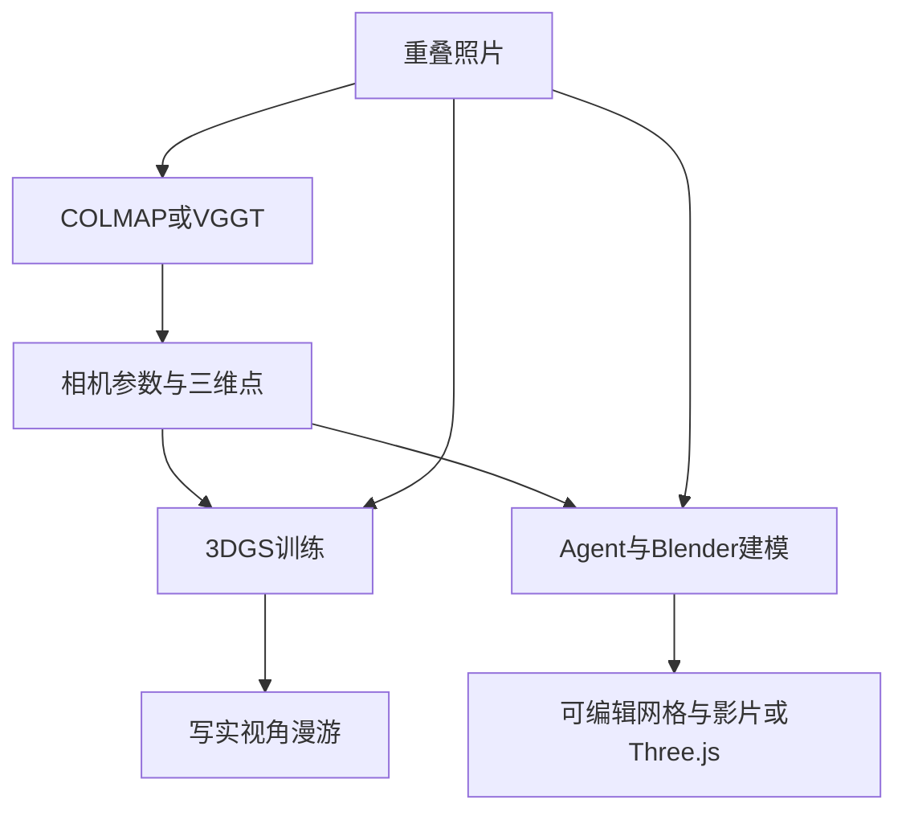

# VGGT、COLMAP 与高斯泼溅的关系及选择

调研日期：2026-11-15。本文补充本项目的工具选择，不表示已经在本机运行过这些方案。

**后续状态（2026-11-16）：** 本文保留最初调研时的判断。此后已实际运行原版 VGGT 的单图及 7／9 图多视角相机／深度推理；COLMAP、VGGT-Omega 和作者完整多照片链路仍未本机验证。最新结果见[多图一致性检查](experiments/canal-vggt-consistency/README.md)、[入口补图复检](experiments/canal-entry-bridge-test/README.md)和[研究网页](WEB-RESEARCH.md)，不要把本文初始“未运行”当作全部后续状态。

- 原版 VGGT 所审提交：`a288dd0f14786c93483e45524328726ab7b1b4ce`。
- 作者建模项目：`8a298ad0fd40e6e6d636b89db61326bb0533a04b`。
- 同时查阅当前 VGGT-Omega 官方 README、COLMAP 官方 FAQ 和原始 3DGS 论文项目页。
- 本机已知 GPU：RTX 4070 Laptop，8GB 级显存。以下推荐为依据文档及源码作出的工程判断，端到端效果和资源占用尚待实测。

## 分工

| 环节 | 作用 | 输出 |
| --- | --- | --- |
| COLMAP | 从多视图匹配和几何优化求解空间；可继续进行多视图立体重建 | 相机内外参数、三维点，进一步得到密集点云/网格 |
| VGGT / VGGT-Omega | 用训练好的网络预测几何；原版 VGGT 还提供可选几何优化 | 相机参数、深度、三维点等 |
| 3DGS（高斯泼溅） | 在典型照片重建流程中，用位姿和初始点训练可实时渲染的场景外观 | 一组具有位置、形状、不透明度、颜色等属性的三维高斯 |
| Agent＋Blender | 根据照片与几何依据，组织结构并构建可修改的网格 | 建筑、门窗等模型、参数和生成脚本 |

这是本研究的简化流程图；3DGS 是场景表示与优化渲染方法，也有直接预测高斯的其他研究，不能把此图理解为所有 3DGS 方法都必须依赖 COLMAP。

## VGGT 能替代什么

**可以替代常规链路中相机与初始几何估计的一部分，并作为下游的另一个输入来源。**

原版 VGGT 官方 `demo_colmap.py` 支持：

- 直接推理，导出 cameras.bin、images.bin、points3D.bin。
- 加 `--use_ba`，利用 pycolmap 做 bundle adjustment（联合优化相机和三维点，使投影更符合观测）。
- 官方给出了把导出结果接入 gsplat 的示例，说明这种互通有实际接口支持。

这不等于已经完整替代 COLMAP 的全部工具、数据管理、畸变处理、密集重建和大场景工作流。模型效果也不等于所有现场都优于或弱于传统几何方法。

还要区分 **COLMAP 软件** 与 **COLMAP 文件格式**。作者只要读取标准相机与点云文件，前端并不一定非得由 COLMAP 软件运行产生。

## 作者脚本的适配依据与注意点

作者 `scripts/colmap_io.py` 接受文本或二进制的 cameras、images、points3D，搜索根目录、sparse/0、sparse 等位置。原版 VGGT 导出 sparse/ 的标准二进制，文件层面存在明确接入路径，但本机尚未验证。

需要逐项核对：

1. 图片文件名、尺寸、裁剪与内参必须对应。VGGT 脚本会预处理图片，导出时再调整参数回原图；不能手工缩图后继续使用旧内参。
2. 原版所审导出代码对径向畸变支持仍有 TODO；无 BA 分支使用 PINHOLE。作者投影函数也忽略畸变。手机广角原图应先去畸变，直接输入 360° 经纬全景更不能假定正确。
3. 坐标系、地面朝向与尺度必须验证，两条方法都不能据输出文件直接宣称得到可靠的米制尺寸。
4. VGGT 默认非 BA 导出分支会筛选并最多取 100000 点，不应将其直接等同于作者清理后的完整 dense.ply。
5. VGGT 预测点的置信度与多视图几何点的误差含义不同；原作者对点云可靠性的经验不能不加检查地套用。
6. 若用独立深度生成密集点云，需要与导出的相机保持相同的尺度和坐标。先让几何与照片的重投影一致，再交给 Agent 测量。

## 我们先选哪个

**建议首轮以 COLMAP 为主线；VGGT/Omega 做同一组照片上的小样本对照。**

理由：

- 第一轮目标是验证真实尺寸、布局、Blender 生成与验收，先保留较清楚的观测与误差检查过程。
- 当前 COLMAP 有 Windows 图形界面和成熟的几何工作流；特征提取/匹配等稀疏阶段可用 CPU，密集阶段则可通过图像大小和邻接视图数控制显存。CPU 回退可能明显变慢，也会占系统内存。
- VGGT 推理有速度潜力，但模型、输入序列、图像分辨率、可选跟踪/BA 都影响资源和总耗时。官方的短推理示例不能当作我们的处理总工时。
- 对新版本不能沿用“老版 VGGT 太耗显存”的笼统判断；VGGT-Omega 已发布，并公布了具体资源表，仍需结合本机预算评估。
- 不预设哪种必然更准确；纹理、镜头、重叠和场景都影响结果，以我们的定标与多视角验收决定。

## VGGT-Omega 的显存证据

当前官方 README 对 `VGGT-Omega-1B-512` 的测试：NVIDIA A100，624×416 输入，计入模型加载到 GPU 和完整前向过程的峰值。

| 输入帧数 | 1 | 10 | 25 | 50 | 100 |
| --- | --- | --- | --- | --- | --- |
| 官方峰值显存（GB） | 6.02 | 6.67 | 7.80 | 9.66 | 13.37 |

这是作者 A100 条件下的测试，**不是本机成绩或最低配置保证**。25 帧已接近 8GB 级显存，桌面程序也会占显存；因此不建议将第一轮 40–80 张照片一次性套入该默认配置。max_size 模式、缩图或减少帧可能降低占用，适合单独测试。拆批推理后各批的相对坐标仍需配准，不能简单拼接点云。

项目页所称训练显存约为前代的 30%，指训练条件，不应直接当作我们推理显存的换算系数。

## 高斯泼溅是什么

在典型实景 3DGS 中，空间由许多带颜色与不透明度、具有方向和尺度的高斯表示。训练调整它们，让从已知照片机位渲染的图像接近原图；完成后可以交互地观看新的视角。

高斯点云和普通点云也要区分：普通点云主要记录空间样本；3DGS 的高斯还参与图像合成，包含形状、不透明度和视角相关外观。它因此擅长再现观感，但不能将这种外观表示直接当作规整的墙体、门窗或碰撞网格。

高斯可以编辑，也有转网格的方法；“可视化漫游”与“按语义修改门窗、加室内、布置碰撞”仍需要不同的资产处理。作者转做参数化 Blender 模型，就是为了获得便于修改的形体结构；3DGS 可以保留作外观参考。

## 建议的实验顺序

1. 以自有的有纹理小场景采集 40–80 张重叠照片，三段实测长度，先完成 COLMAP→去畸变数据/点云→Agent＋Blender。
2. 同时从中挑 5–10 张有视差、覆盖同一局部的图，做 VGGT/Omega 资源和几何质量对照；这是实验建议，尚未执行。
3. 比较固定视角重投影、独立尺寸误差、缺失/漂浮、耗时与峰值显存，不凭点云看起来饱满来决定胜负。若加 BA，计入额外耗时和占用。
4. 若目标是写实漫游，再添加小规模 3DGS；若目标是改建筑、加室内或影片预演，优先完成 Blender 可编辑模型。
5. 三条分支分时执行，避免在 8GB 显存上同时运行重建网络、3DGS 训练和复杂渲染。

## 来源

- [VGGT README 与 COLMAP 导出](https://github.com/facebookresearch/vggt/tree/a288dd0f14786c93483e45524328726ab7b1b4ce#exporting-to-colmap-format)
- [VGGT demo_colmap.py](https://github.com/facebookresearch/vggt/blob/a288dd0f14786c93483e45524328726ab7b1b4ce/demo_colmap.py)
- [VGGT-Omega 模型、输入模式与显存表](https://github.com/facebookresearch/vggt-omega#runtime-and-gpu-memory)
- [VGGT-Omega 项目页](https://vggt-omega.github.io/)
- [COLMAP 官方 FAQ](https://colmap.github.io/faq.html)
- [作者的输入读取代码](https://github.com/Kotohibi/ai-wide-area-modeling/blob/8a298ad0fd40e6e6d636b89db61326bb0533a04b/scripts/colmap_io.py)
- [原始 3DGS 论文项目页](https://repo-sam.inria.fr/fungraph/3d-gaussian-splatting/)
- [原始 3DGS 实现](https://github.com/graphdeco-inria/gaussian-splatting)

未执行第三方代码，未下载模型权重，未做本机端到端验证。没有因这次比较安装任何工具或改动现有三维场景。
