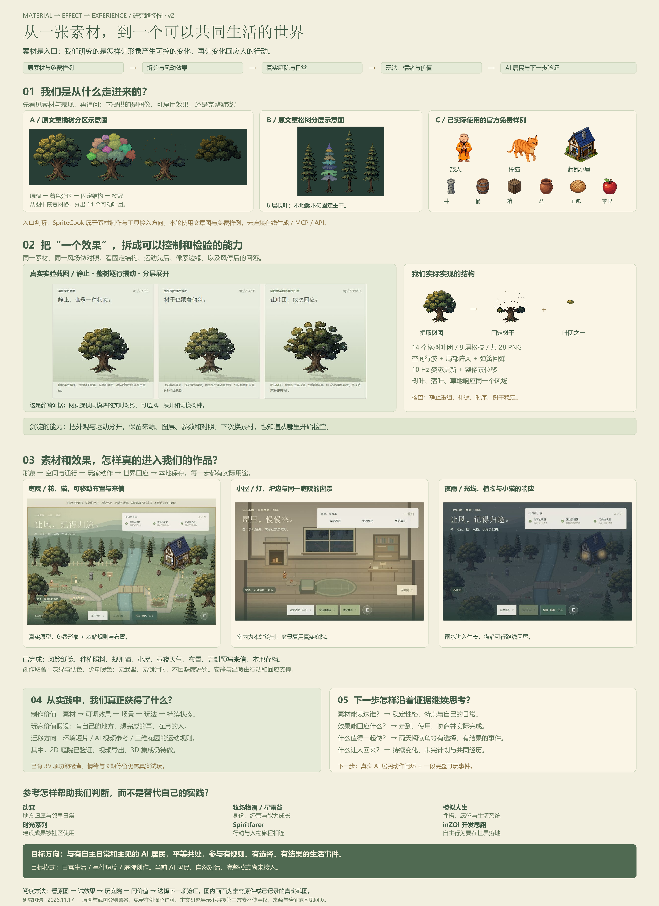
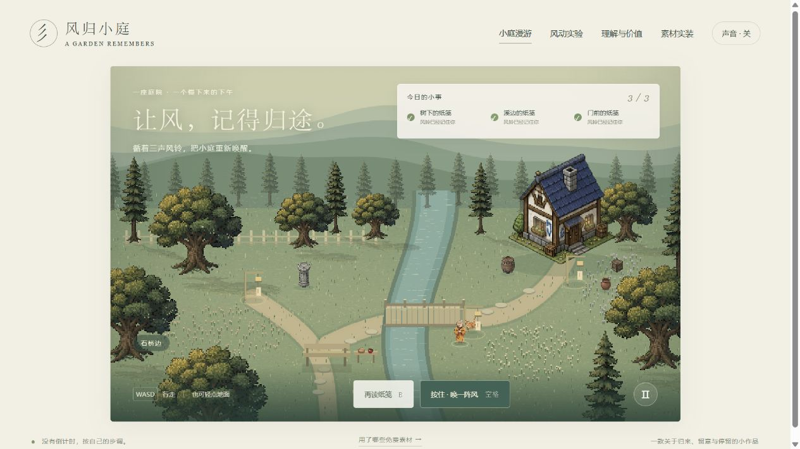
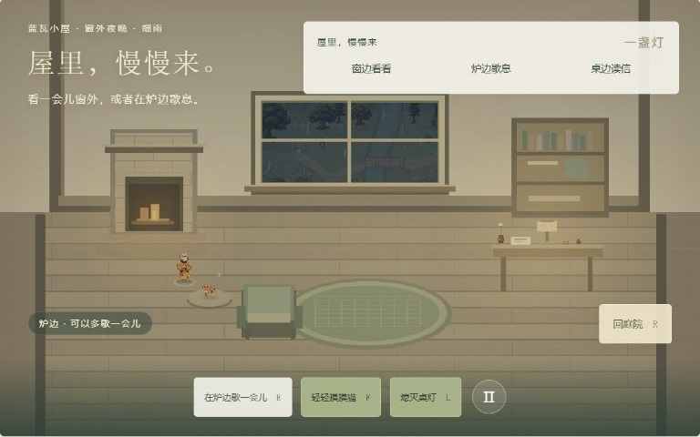
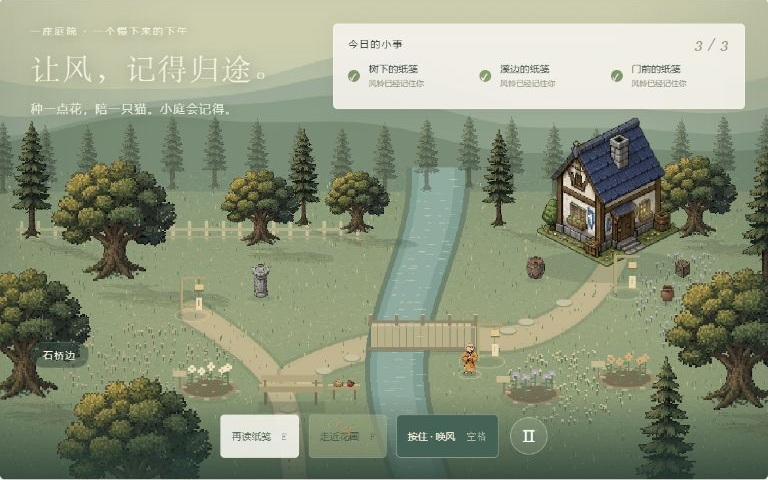
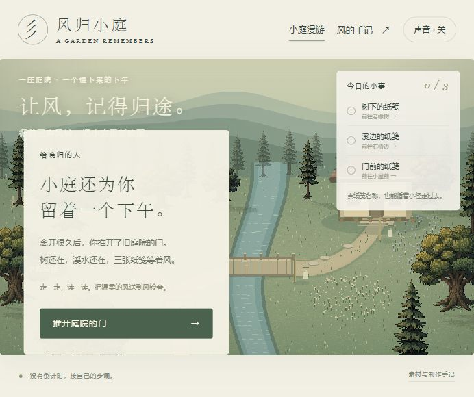
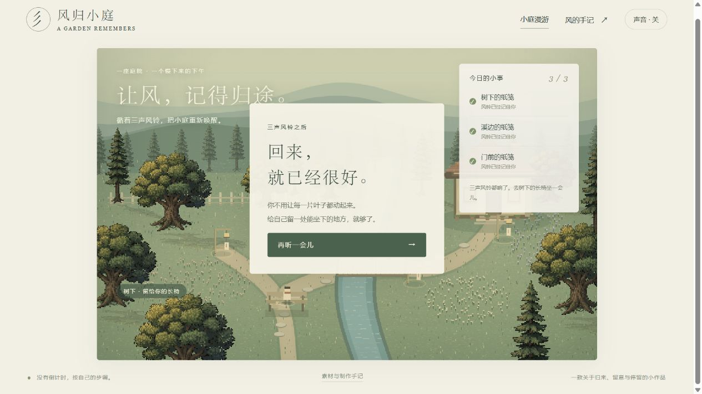
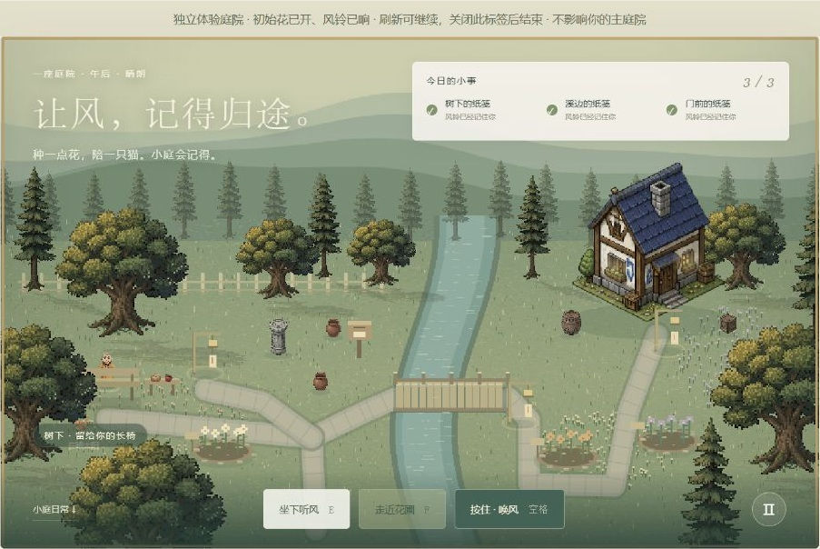
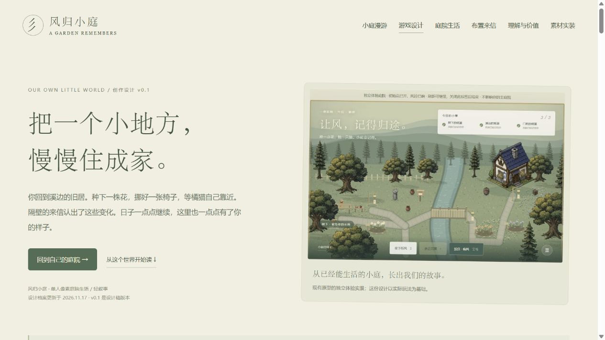

# 0005 · 风归小庭 · 像素风与庭院游戏

以素材为入口，研究它怎样成为可控制的效果，再成为有行动与回应的庭院。素材提供统一形象，分层风动提供可调整的自然反馈；游戏通过送风、种植、猫、屋内晴雨、布置、来信和保存形成持续日常。

对我们的价值是可复用的素材处理、运动模块、空间与反馈方法。可扩展到自有资产、完整事件和 AI 居民，并研究环境视频与三维花园的迁移。真实 AI、自然对话、完整模式和跨项目集成仍待实现或验证。

[游戏主页 · 庭院演示](https://yydshly.github.io/20261115_codex_project/demos/0005-wind-return-garden/index.html) · [房间演示](https://yydshly.github.io/20261115_codex_project/demos/0005-wind-return-garden/index.html?visit=preview&space=inside) · [我的庭院 · 接续存档](https://yydshly.github.io/20261115_codex_project/demos/0005-wind-return-garden/index.html?visit=home) · [制作与研究图谱](https://yydshly.github.io/20261115_codex_project/demos/0005-wind-return-garden/overview.html) · [素材来源与范围](THIRD_PARTY_NOTICES.md) · [发布记录](publication.md)



以下保留研究过程与各轮历史状态；当前发布范围以上述记录为准。

将 SpriteCook 原文真实树木素材和分层风动机制，接入一款关于归来、照料与停留的可玩庭院。

- 原始参考：[How to make pixel art trees move in the wind](https://www.spritecook.ai/blog/pixel-art-trees-wind-animation)，SpriteCook，2026-11-10。
- [进入游戏](https://yydshly.github.io/20261115_codex_project/demos/0005-wind-return-garden/) · [风动实验 / 能力对照](https://yydshly.github.io/20261115_codex_project/demos/0005-wind-return-garden/lab.html) · [理解与价值 / 完整创作档案](https://yydshly.github.io/20261115_codex_project/demos/0005-wind-return-garden/understanding.html)
- [免费素材实装 / 逐项用途与许可](https://yydshly.github.io/20261115_codex_project/demos/0005-wind-return-garden/assets.html)：2026-11-16 新增 2 个角色、1 座住宅、6 类生活道具，实际进入游戏。
- [庭院生活 / 新玩法与独立试种](https://yydshly.github.io/20261115_codex_project/demos/0005-wind-return-garden/life.html) · [我的花圃与庭院小记](https://yydshly.github.io/20261115_codex_project/demos/0005-wind-return-garden/#garden-life)：三块花圃、三种花、小猫自主日常和完整本地存档。
- [小屋与晴雨 / 独立交互预览](https://yydshly.github.io/20261115_codex_project/demos/0005-wind-return-garden/shelter.html) · [小屋与天气操作](https://yydshly.github.io/20261115_codex_project/demos/0005-wind-return-garden/#home-weather)：可进出的小屋、实时窗景、灯光、昼夜晴雨，以及花圃与猫的共同反应。
- [庭院布置与邻居来信](https://yydshly.github.io/20261115_codex_project/demos/0005-wind-return-garden/arranging.html) · [我的布置与信件册](https://yydshly.github.io/20261115_codex_project/demos/0005-wind-return-garden/#arrangement)：两只花盆、长椅与茶桌，三条小径、两种铺面，五封回应行动的故事来信。
- [我们的游戏设计 v0.3](https://yydshly.github.io/20261115_codex_project/demos/0005-wind-return-garden/design.html) · [完整设计文档](research/game-design.md)：AI 居民的自主日常、平等交流、游戏运行职责与三种玩法模式，区分现有原型和目标设计。
- [从素材到体验 / 研究图谱 v2](https://yydshly.github.io/20261115_codex_project/demos/0005-wind-return-garden/overview.html) · [含原图与实景的高清图谱](assets/understanding-research-map-v2-public.png) · [完整矢量图](assets/understanding-research-map-v2-public.svg)：素材入口、实时效果、庭院用途、创作迁移、价值与 AI 方向，第三方素材分别署名。
- 已通过 GitHub Pages 上线并完成公开页面验收。源提交、Actions、截图与实际范围见 [发布记录](publication.md)；总库 demo_url 现指向游戏主页；制作与研究总览保留为次级入口。

## 它解决什么问题

让静态树木素材获得可控、可重复修改的环境动画，再将动画作为游戏行动的反馈。实际使用原文橡树、松树示意图中提取的像素素材；庭院实时重组和驱动图层，没有播放原文预录视频。

游戏与能力页共用 [wind.mjs](web/js/wind.mjs) 和 [assets.mjs](web/js/assets.mjs)，对照与游戏使用相同的风场、图层和姿态计算。

## 为什么值得玩

离开很久之后，玩家回到旧庭院。三张纸笺留在老橡树、溪桥和小屋旁。玩家先走近阅读，再调整一口风的力度，让每处风铃回应。

第二处完成后猫会沿可通行路线陪着走，第三处后小屋窗前暖光增强，回到长椅停留可触发结尾。没有倒计时；结尾之后仍可自由散步。情绪由阅读、行动和回应共同组织，详见 [创作总纲](research/art-direction.md)。

### 免费素材实际接入（2026-11-16）

使用 [SpriteCook 官方免费样例](https://www.spritecook.ai/free-pixel-art-sprites)，未调用在线生成或消耗额度。选入 9 项素材、10 个原始 PNG，保留文件原貌、逐文件 SHA-256 和 4 份许可通知。没有复制完整素材包到运行目录。

| 实际素材 | 在游戏中的用途 | 情绪与使用边界 |
| --- | --- | --- |
| Happy Monk 橘衣旅人 | 替换代码人物；玩家行走、停步、送风、长椅停留 | 无武器、温暖的人物入口；只有 8 帧待机，移动为世界位移，无独立走路与坐姿帧 |
| Ginger Cat 橘猫 | 第二声风铃后跟随，独立待机与走动帧，沿桥避水 | 以陪伴回应进展，无养成压力 |
| building5.png 蓝瓦住宅 | 替换代码建筑，第三处地标与完成后的暖光 | 给归来一个落点；可按 R 进入本站绘制的室内 |
| stone_well.png 石井 | 橡树东侧的井边小记，可靠近按 E 阅读 | 生活痕迹，无取水任务 |
| barrel.png、crate_intact.png、pot.png | 门前储物生活角，有实物避让与小记 | 有人照料的住所，无战利品与强制收集 |
| bread.png、apple.png | 放在长椅旁的小木台，可读点心小记 | 留给归人的寻常照料；没有进食动画 |

游戏与素材页共用 [free-assets.mjs](web/js/free-assets.mjs)，从同一份 [清单](web/assets/free-samples/manifest.json) 加载原始图像。通过落脚点、最近邻采样、遮挡排序与绘制时降饱和协调原画；任务栏改为浅横条，避免遮住小屋。

建筑和道具 ZIP 内为 CC0。角色总包内层标 CC0，ZIP 根目录及官网标 sample license，存在口径差异；两份通知均保留，保守遵循 sample license，随游戏使用、不作为独立素材包再分发。新增免费包不改变旧文章树图的许可边界，整款游戏仍用于本地研究。



2026-11-16 内置浏览器实际画面；三声风铃完成，旅人与橘猫位于溪桥右侧。逐项说明见 [素材实装网页](web/assets.html)。

### 完整理解与价值指南

[understanding.html](web/understanding.html) 按九章整理我们的讨论：能力位置、13 项场景元素、动画原理、游戏与情绪、对我们的创作价值、可复用制作方法、适用边界、验证进展和来源。包含真实场景点读、元素分类筛选、四个创作方向切换与展开阅读，并逐项区分作者声明、本站判断与实际验证。

价值分析对应 AI 视频、三维花园、像素游戏和能力沉淀，也说明与总库 0001–0004 项目的关系。页面中的迁移设想不代表已经完成跨项目集成；视频编码、官方在线生成与正式发布仍未接入。

### 操作

| 行动 | 桌面 | 窄屏 / 鼠标 |
| --- | --- | --- |
| 行走 | WASD / 方向键 | 点击地面；任务项可自动沿小径前往 |
| 读纸笺 | 靠近风铃按 E | 点击“读一读纸笺” |
| 送风 | 按住空格，在柔风区松开 | 按住“唤一阵风”，在柔风区松开 |
| 柔风 | 保持 0.8–1.65 秒后松开 | 同左，有力度标记 |
| 坐下 | 到长椅按 E 停留；三处完成后保留原结尾 | 到长椅，点“坐下听风” |
| 暂停 | Esc / 暂停按钮 | 暂停按钮；切后台也会暂停 |
| 声音 | 右上开关，默认关 | 同左 |

风太弱或太强会收到提示，可重新尝试。保留原 Local Storage 键 `wind-return-garden:v1`，内部载荷已升级到 version 4，保存当前庭院、室内外与晴雨状态；本作品的 `wind-return-garden:before-life-v2` 与 `wind-return-garden:before-home-v3`、`wind-return-garden:before-letters-v4` 各保留对应升级前的原记录。没有更改其他网站或应用的数据。

### 小屋、昼夜与晴雨（2026-11-16）

点击“小屋与天气操作”里的“沿小径去小屋”，到门前后按 **R** 或点按钮进屋。室内继续支持地面点击、WASD 和方向键，家具参与碰撞；顶部地点按钮可沿室内路径前往窗边、炉边和书桌。

| 行动或变化 | 实际实现 | 情绪与边界 |
| --- | --- | --- |
| 窗边按 E | 使用同一庭院渲染器，裁取溪桥与花圃作为实时窗景 | 看见自己照料过的地方，没有另放无关背景 |
| 炉边 / 书桌按 E | 炉边停留、读固定旧信，写入小记 | 不强制添柴，不设恢复数值；人物仍用待机帧，无独立坐姿 |
| L / 桌灯按钮 | 开关桌灯，改变室内暖光与外窗的额外光晕 | 熄灯后仍保留炉边基础暖意 |
| R / 回庭院 | 在室内与小屋门前转换，分别保留位置 | 旧的花圃、风铃和结尾继续可用 |
| 清晨、午后、黄昏、夜晚 | 自动约 18 分钟一日，也可固定喜欢的光线 | 夜里花朵合拢，天亮舒展，生长阶段不倒退 |
| 晴朗、薄云、细雨 | 自动约 12 分钟晴雨节奏，也可固定天气 | 雨水真实接入生长，雨后有短暂保湿；不损坏花朵，不是现实预报 |
| 小猫雨夜回屋 | 沿真实通行路线过桥、到门口，再进入室内暖垫歇息 | 不瞬移到屋里，晴朗白日且玩家已出屋后可以自己出门 |
| 室内外保存 | 保存进屋状态、两处位置、灯光、晴雨偏好与猫所在空间 | 当前浏览器与 origin，保留多窗口保护，没有云同步 |

室内与天气都是本站 Canvas 绘制及规则，不新增生成服务或收费依赖。室内复用已选免费陶盆、面包和苹果，角色继续使用原有 PNG。声音默认关闭，开启后有合成风雨底噪，进屋后减轻；没有声称是现场录音或已做主观听审。

[shelter.html](web/shelter.html) 按操作、天气反应、节奏、创作意义与实现边界整理，并提供可切室内外、昼夜、晴雨与桌灯的独立预览，不写入真实庭院存档。



2026-11-16 真实游戏截图裁切，人物与猫在炉边，窗外为同一庭院。已实玩进出、窗边、读信、歇息、开关灯、屋内亲近和刷新恢复；28 项检查通过。证据：[完整室内截图](assets/home-night-live.jpg) · [夜雨庭院](assets/garden-night-rain.jpg) · [手机室内](assets/home-mobile-live.jpg) · [新玩法预览页](assets/shelter-guide-live.jpg)。

### 种植、小猫与会留下来的变化（2026-11-16）

南径、溪边和门前各有一块花圃，可选小雏菊、金盏花、风铃草。在游戏下方的“小庭日常”选花并点“沿小径过去”，靠近后按 F 或照料按钮种下、浇水。新花草是本站 Canvas 像素绘制，与真实庭院共用风场；没有冒充第三方新增素材。

- **照料有结果**：种下即见嫩芽，第一壶水让叶片舒展，之后含苞、开花。首次浇水约 70 秒完成一轮；离开时结算已留下的湿润生长时间，不枯萎、不扣进度、不要求每日登录。反复浇水有温柔提醒，不产生可刷奖励。
- **小猫有去处**：第一次浇水或第二声风铃解锁；自主选择散步、花旁驻足、晒太阳、长椅边打盹，也会陪行。真实寻路与通行规则约束移动。走近按 F 或点“轻轻摸摸”，增加保存的熟悉程度；原样例只有待机与走动，打盹为静止待机加标记，没有独立睡姿原画或生成式情绪模型。
- **庭院会记住**：花种、成长、浇水、玩家位置、猫的位置与熟悉程度、最近 18 条小记，以及原有风铃和结尾。照料后立即保存、漫游约每 4 秒保存，后台和离开页面时尽力保存。旧版进度升级前先保留原记录；“重听风铃”保留花圃与猫。
- **两扇窗口不互相覆盖**：另一扇游戏窗口写入后，本窗口暂停写入并提供重新载入入口。存档只在当前浏览器、当前 origin；没有账号和云同步，清除网站数据会丢失存档，写入失败会明确提示。

[life.html](web/life.html) 说明每项行动、情绪意图、保存范围与限制，并提供独立试种区；试种采用相同生长规则与绘制器，但不写入玩家庭院。游戏下方三块花圃卡片实时显示自己的状态和小记。



2026-11-16 实际游戏截图，三处花圃与原风铃、桥、小屋共存。已走通种植、浇水、自然开花、亲近、刷新恢复、多窗口保护及原长椅结尾；18 项自动检查通过。更多实景：[自己的花圃与小记](assets/living-garden-notebook.jpg) · [手机花圃卡片](assets/living-garden-mobile.jpg) · [新玩法说明页](assets/life-guide-live.jpg)。

## 研究结论与边界

| 环节 | 本轮结果 |
| --- | --- |
| 实际素材 | 两份原文示意图，恢复原生像素网格，生成橡树 14 块、松树 8 层，共 28 个 PNG |
| 原图一致性 | 提取与移除背景后，树干与叶团可逐像素重组原图；输出逐一记录 SHA-256 |
| 动画机制 | 主干固定、叶团分层、位置相关行波、局部阵风、弹簧回弹、10 Hz 整像素姿态 |
| 场景反馈 | 玩家风影响植物、落叶、草地亮斑；成功送风唤醒风铃 |
| 游戏流程 | 实际走通三处风铃、过桥、长椅结尾、继续漫游和刷新恢复 |
| 能力展示 | 静态 / 整树逐行摆动 / 分层行波三种对照；支持松树、分层展开、随机时序、力度与暂停 |
| 在线服务 | 未连接 SpriteCook MCP/API、未消费生成额度；[官方插件](https://github.com/SpriteCook/codex-plugin)仅作接入参考 |

此版松树主干固定，未实现原文松树主干弯曲着色器；阴影为整树投影近似。使用原生 Canvas 2D，未安装或运行 Godot。未声称在三维场景、真实手机或所有设备验证相同效果。

## 运行与验证

要求 Node.js 20+，运行时无需安装 npm 依赖。双击 [web/start.cmd](web/start.cmd)，然后打开 [游戏](https://yydshly.github.io/20261115_codex_project/demos/0005-wind-return-garden/) 或 [能力页](https://yydshly.github.io/20261115_codex_project/demos/0005-wind-return-garden/lab.html)。结束时双击 [web/stop.cmd](web/stop.cmd)，停止前会核对 PID 和本项目服务路径。

也可在 `web/` 下执行：

```powershell
npm start
npm run check
npm run build
```

素材已在本机准备好。源图和派生 PNG 因许可边界被 Git 忽略；复制源码到其他机器时，需要另行准备有使用权的素材。取得原文两份示意 PNG 后，在项目目录重建：

```powershell
python -X utf8 scripts/prepare_assets.py --oak <橡树示意图路径> --pine <松树示意图路径>
```

素材脚本需要 Pillow 和 numpy；运行游戏不需要 Python 图像库。[来源记录](research/sources.md)说明素材过程与权利边界，[素材清单](web/assets/trees/manifest.json)记录原件和输出哈希。

本地构建输出 `web/dist/`，使用相对路径，对应未来 `/20261115_codex_project/demos/0005-wind-return-garden/`。本轮没有公开部署。

验收环境：Windows、Node.js 22.15.0、Python 3.10、Codex 内置 Chromium。检查结果见 [verification.md](research/verification.md)。

## 实际画面



2026-11-15 初版内置浏览器实际运行截图。初版人物、猫和小屋为本站绘制；2026-11-16 已由上述免费样例替换。树木仍由原文图像提取，界面与玩法为本站实现；图像版权仍属相应权利人。



更多证据：[分层对照](assets/lab-layered-live.jpg) · [390×844 窄屏](assets/mobile-live.jpg)。

## 后续计划

- [x] 取得实际树木素材，记录来源和哈希
- [x] 共享风动模块、三种对照与两类树
- [x] 完成庭院、行动、纸笺、蓄风与长椅结尾
- [x] 实际流程、存档和窄屏操作验证
- [ ] 准备有明确再分发授权的一套自有素材后再考虑发布
- [ ] 按具体需求接入官方在线生成服务
- [ ] 真实手机性能、触屏手感与声音听感验收

## 来源与许可

详见 [来源记录](research/sources.md)。JS 为按机制独立编写；树木原件与提取 PNG 仅用于本次本地研究，不随源码提交或上传。本轮未把用户自生成输出条款推定为文章配图再分发许可。


### 庭院布置与邻居来信（2026-11-16）

把布置、使用空间与被回应的日常连起来：两只免费陶盆可分别移动；长椅与放着面包、苹果的小茶桌成组移动；小径有归家、绕花、沿溪三条走向，以及暖土、旧石两种铺面。选择物件、点地面预览、箭头微调，最后“放好并保存”；可撤回上一次成功布置。编辑时人物与猫停下，天气和植物仍继续。

布置真实接入碰撞与加权寻路：物件不能占据溪水、固定物、花圃、门口或角色位置；每次检查常用目的地可达。人物与猫优先沿新路走，草地仍能通行；长椅的新位置同时改变人的停留、点心位置和猫的午睡去处。不是逐块铺砖、任意移动房屋或自由建造系统。

邻居阿岚的五封预写来信依次回应玩家选择与实际行动：挪花盆或长椅 → 选择并铺好绕花或沿溪小径 → 在椅边停留或屋内看窗景 → 留下一句邀请 → 收到回信。没有现实等待、期限、积分或惩罚；已送达信件不会因撤回布置而消失，旧信可重读，单封回话首次选择后锁定。信箱旁 E、屋内书桌 E 或网页信件册都能读。所有回话仅改变作品内状态，不向现实邻居发送消息。

第 4 版存档同时保存几何布置、一次撤回、布置事件、送达/已读/回话和停留事件；与风铃、花圃、小猫、室内外和晴雨共用原主键。第 3 版原文在 `wind-return-garden:before-letters-v4` 保留一次，损坏的新字段单独回退。主庭院使用 Local Storage；`?visit=preview` 明确标注独立体验，使用该标签的 Session Storage，刷新可继续、不影响主庭院，关闭标签后结束。不提供云同步。

[玩法与价值说明](web/arranging.html) 包含操作、空间保护、故事展开、素材用途和存档边界；[实际验收](research/verification.md) 区分模型与浏览器证据。新增信箱、长椅、茶桌、小径由本站 Canvas 绘制，陶盆、点心与角色复用原始免费样例，未添加收费服务或生成素材。




### 我们的游戏设计 v0.1（2026-11-17）

核心命题：**把一个小地方，慢慢住成家。** 世界暂名「溪湾」，以一院一屋为首个完整版本的边界。角色聚焦归来的住客、庭院橘猫与通过来信出现的阿岚；察觉、选择、行动、收到回应与带着记忆回来，成为统一的玩法循环。

现有风铃、花圃、布置、猫、小屋晴雨与五封信整理为《归来的第一天》的四幕情绪结构：循风入庭 → 把日子安顿好 → 有人认出你的脚步 → 给另一个人留位置。章节名与世界背景属于本次创作设计，尚未改写游戏开场或增加强制章节锁；阿岚实际来访、溪岸步道与季节篇章均标为后续构想。

[完整设计文档](research/game-design.md) 包含世界、角色目标与变化、玩法与故事、视听规则、设计价值、素材边界、开发优先级及后续试玩问题。[设计网页](web/design.html) 提供六处地点点读、三种日常片段切换、故事折叠阅读及已实现/后续构想筛选。主庭院和既有说明页均增加了阅读入口；页面只访问素材，不读取或写入游戏存档。

桌面与手机阅读交互已验收，原有 39 项游戏检查通过；设计情绪与受众效果仍待真实试玩。[验收详情](research/verification.md)。




### 平等共处设计 v0.2（2026-11-17）

根据用户明确的“可以融合、角色有特点、与玩家平等”的方向，设计调整为共同生活型叙事游戏：世界提供事情与空间，角色带着自己的偏好、目标、长处和不完美参与，双方可协商、共同行动，也能今天各自安排。成长发生在玩家的理解与表达、世界的生活痕迹、伙伴的经历和相处方式中。

[平等共处网页](https://yydshly.github.io/20261115_codex_project/demos/0005-wind-return-garden/design.html#together) 用“雨天把阅读角放在哪里”的三个预写分支点读说明选择、代价、共同行动与后续记忆。角色协商、来访、共同活动、个人计划与 AI 表达均明确属于未来设计。当前原型仍是规则驱动的猫和预写来信；本轮只更新设计与阅读展示。

页面可筛选 8 项已有系统与 5 项后续构想，已验证三种分支、键盘和手机排版。完整修订见 [game-design.md](research/game-design.md)，对应画面见 [共处设计实景](assets/equality-design-live.jpg)。


### AI 居民与独立玩法设计 v0.3（2026-11-17）

按用户进一步要求，目标角色由 AI 核心驱动，具有稳定性格、自主日程、自己的目标、可执行行动、连续经历和平等交流。她通过观察植物、照料约定角落、回屋、邀请和事件协作实际参与世界运作。游戏同时保留自身的空间规则、目标条件、操作与结果。

[AI 居民与游戏模式](https://yydshly.github.io/20261115_codex_project/demos/0005-wind-return-garden/design.html#resident-game) 说明三种目标模式：日常生活、事件短篇、庭院创作。页面可切换查看每种模式的目标、行动、结果和居民作用；基础运行划分为世界规则、AI 居民与事件组织，世界事实与完成条件由引擎核对。

当前只有规则驱动的猫、预写来信和庭院系统。真实 AI、居民日程执行、可执行动作接入及独立模式菜单尚未制作，全部在设计页标明。页面的 14 项范围中 8 项已有、6 项后续；本轮只修订设计与阅读交互，未连接模型或创建常驻代理。完整接入顺序与验收边界见 [game-design.md](research/game-design.md)。


### 我们的理解总览与一图总结（2026-11-17）

[理解总览网页](https://yydshly.github.io/20261115_codex_project/demos/0005-wind-return-garden/overview.html) 集中回答做了什么、价值是什么、可以怎样扩展、参考了哪些思路。六组案例分别保留官方依据、我们的机制分析和取舍；AI 居民及完整模式仍清楚标为目标设计，体验价值留待真实试玩验证。


[高清 PNG](assets/understanding-overview-v1.png) · [可编辑 SVG](assets/understanding-overview-v1.svg) · [完整文字与来源](research/understanding-overview.md) · [生成脚本](scripts/render_understanding_overview.py)。总览图为原创信息设计，不是游戏截图；网页另有逐节文字版，便于手机阅读。

### 素材到体验研究图谱 v2（2026-11-17）

根据用户指出的前期信息遗漏，新图按「原素材与免费样例 → 风动拆解与实验 → 庭院/小屋/夜雨实景 → 创作价值与迁移 → AI 居民和后续问题」组织，包含 18 处实际画面。v1 作为设计结论摘要保留，v2 回到素材入口解释我们怎样一步步研究到这里。

[新版网页](https://yydshly.github.io/20261115_codex_project/demos/0005-wind-return-garden/overview.html) 同时提供原图、免费图集、三种风动方式的实时对照、历史证据原件、思考问题和创作迁移。直接复用原有实验模块，不修改生产游戏和存档。每一步都连接可继续查看或操作的证据。

[3200×4400 PNG（本地）](assets/understanding-research-map-v2-public.png) · [SVG（本地）](assets/understanding-research-map-v2-public.svg) · [逐图来源与裁切](assets/understanding-research-map-v2.json) · [生成脚本](scripts/render_research_map.py)。由于加入未确认再分发许可的文章图，新版图像及运行副本已从 Git 跟踪排除；根索引保留 v1 纯文字预览。没有生成新的场景截图，也没有接入在线素材生成或 AI 居民。
