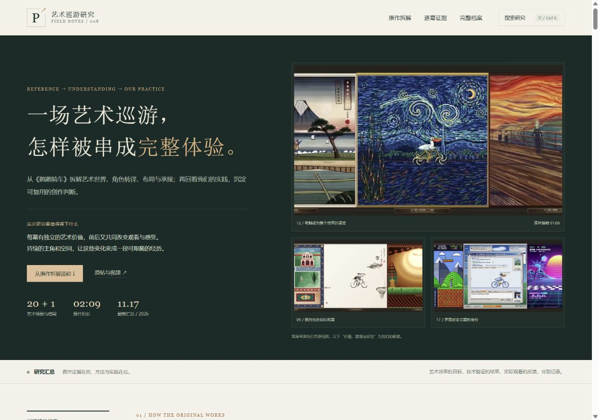
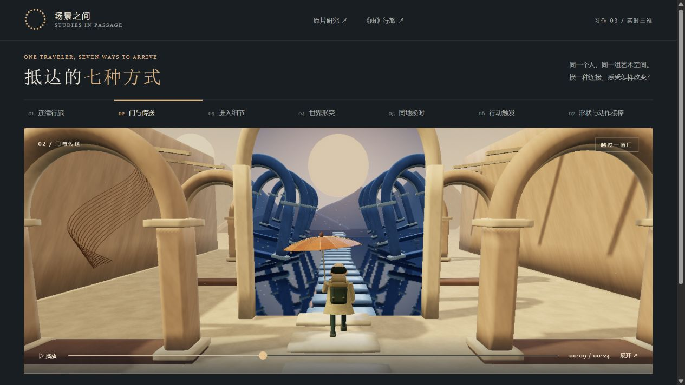
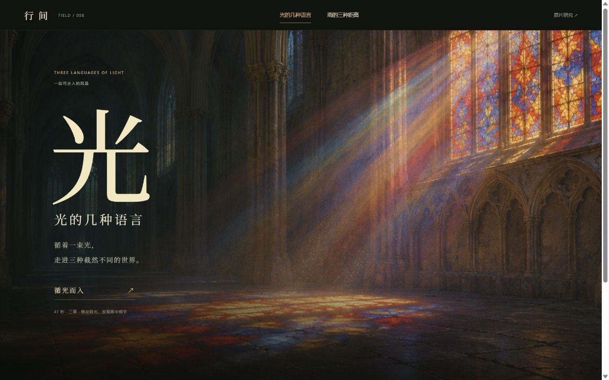
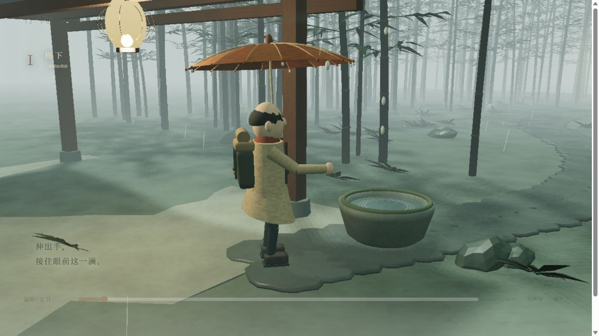
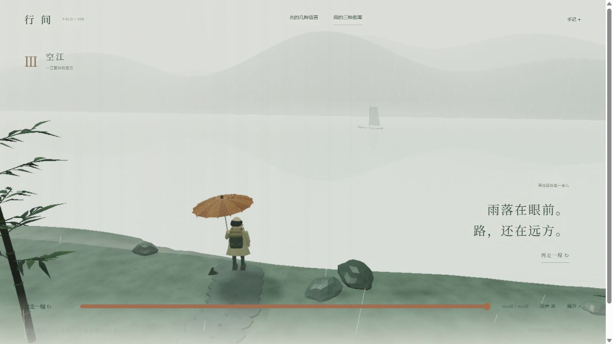
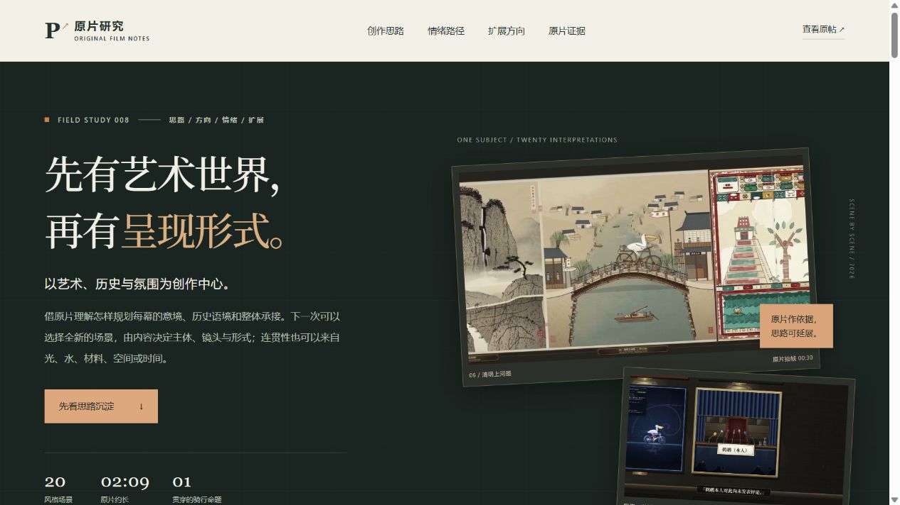

# 0008 · 鹈鹕骑车研究 · 艺术巡游的价值、方法与扩展

原作以持续的骑行题目和三维空间巡游，连接20个各自完整的艺术场景；角色、环境、材料与观看方式共同转译，前后顺序和真实结尾形成整体。其价值在整幕美术、注意力交接与规划，对我们意味着沉淀艺术统筹、叙事、情绪组织和跨题材迁移能力。

以艺术、历史与氛围为中心，后续可以换题、换主体、换空间。我们试做了《光》《雨》、七种连接和传送：保留可运行效果，也明确情绪不足、普通3D demo感和构图遮挡的局限。它们帮助校准方法，尚未复现原作的艺术质量。20个原片场景与真实结尾始终是分析依据。

2026-11-17已将网页重整为完整研究汇总。开篇优先分析原效果的组成、核心价值和对我们创作的意义；12个阅读章节之后接完整专题档案。实验保留为历史案例与失败边界，当前不继续扩展艺术演示，也不把技术测试通过当作艺术效果已复现。

- 网页入口：[web/index.html](web/index.html)
- 一图汇总：[高清 PNG](assets/research-understanding-map-20261117.png) · [可编辑 SVG](assets/research-understanding-map-20261117.svg)；原片证据 → 创作价值 → 扩展方向，并接入《光》《雨》与传送实验的实际截图。
- 本地预览：[http://127.0.0.1:52918/](http://127.0.0.1:52918/)，服务启动时可访问
- 全部专题网页：[完整研究档案](web/archive/index.html)，12份专题全文、12份原始数据；支持全文和段落搜索
- 实验档案：[光的几种语言](http://127.0.0.1:52918/light.html) · [雨的三种距离](http://127.0.0.1:52918/rain.html) · [制作记录与素材](art-studies.md)
- 新增连接习作：[抵达的七种方式](http://127.0.0.1:52918/connections.html) · [艺术方向与比较说明](connections.md)
- 传送缺陷案例：[一道门，两种世界](http://127.0.0.1:52918/portal.html) · [艺术质量未通过的完整复盘](portal-art-direction.md)
- 早期试验：[三组白鸟骑行网页动画](http://127.0.0.1:52918/experiments.html) · [设计、操作与范围](experiments.md)
- 原始来源：[@NFT_Chen 的帖文与视频](https://x.com/nft_chen/status/2121616583110115341)
- 最新汇总：2026-11-17，北京时间
- 思路沉淀：[creative-framework.md](creative-framework.md)
- 综合分析：[analysis.md](analysis.md)
- 逐场景全文：[scene-notes.md](scene-notes.md)
- 发布范围与实际状态：[publication.md](publication.md)；上线核验前，`demo_url` 保持 `null`

## 页面内容

研究首页按12章组织：原效果拆解、价值与我们的意义、历史与媒介主线、情绪与相邻承接、20幕与真实结尾、可复用方法、七种连接、扩展方向、实验过程、差距与教训、后续规划、完整档案与来源。首页集中给出当前综合判断，逐幕阅读器保留八项分析和放大、键盘、深链接功能。

专题原文转为可直接阅读的HTML档案，同时提供逐字节一致的Markdown/JSON原文。全站搜索覆盖首页章节、21个场景、专题全文与段落；检索在浏览器本地完成。较早记录中的“当前”和“通过”明确限定版本，原作观察、我们的解读、原创实验和未知项分别标注。

《抵达的七种方式》最初以同一旅人和重复拱形比较七种连接。本轮传送扩展为46秒的《一道门，两种世界》：静止的雕版回廊，接到有风、巨叶与水光的彩色花园；主角发现、靠近、探手、穿越、回望后再向远方走。其他六段约24秒。不是原片手法的事实判定，也不作为历史场景复原。

当前《雨的三种距离》为有主角的连续三维行旅：同一撑伞旅人接雨、起步、穿林、抵岸与停留，三幕共用地形、石径、天气和摄影机。角色、竹林、建筑、雨与江面均在三维空间中，支持遮挡、阴影和水面反射，约 68 秒。当前为艺术打磨版：近处的暖灯、木纹与湿石，接到林间天光和薄雾，再展开为淡山、远帆与留白。详见 [本轮艺术方向与验证](rain-art-direction.md)，[首版空间结构](rain-journey.md) 保留对照。旧版保留对照。《光》为现有约 47 秒的静帧镜头习作。

1. **思路与方向**：艺术命题 → 历史语境 → 每幕氛围 → 整体承接 → 按需选择主体与形式。贯穿线索可以是光、水、材料、空间、时间或视角。
2. **情绪组织**：用原片的尺度、疏密、笔触、界面和结尾，说明感受如何变化；属于本次解读。
3. **扩展优先级**：首先研究艺术语言与意境、历史语境中的场景体验、氛围与感受的连续展开；尺度、媒介、互动等随后按内容选择。三组白鸟动效仅保留为早期试验，不作为后续题材模板。
4. **原片证据**：全片主线、20 个风格场景与真实结尾。逐幕查看原图及八项分析，支持切换、键盘、深链接与放大。
5. **证据边界**：可见事实、方法与情绪解读、迁移设想分别标注，模型声明保持未验证。

## 研究网站实际截图



[逐幕图文阅读](assets/research-reader-20261117.jpg) · [完整档案目录](assets/research-archive-20261117.jpg) · [全文搜索](assets/research-search-20261117.jpg) · [手机首页](assets/research-mobile-20261117.jpg) · [手机场景阅读](assets/research-mobile-reader-20261117.jpg)。2026-11-17内置浏览器实际截图，分别核对1280×900与390×844视口。原片图片仍按原来源与权利边界引用。

## 内容来源与生成

第一轮连接习作的历史运行画面（传送已重做，下图不代表当前精修版）：



[进入一滴水的画面](assets/connections-detail.jpg) · [伞面接棒](assets/connections-match-umbrella.jpg) / [月亮接棒](assets/connections-match-moon.jpg) · [窄屏抵达](assets/connections-mobile-arrival.jpg)。这组为原创程序建模与实时渲染，没有新增生成图片或视频；[验证记录](assets/connections-verification.json) 区分已检查与未覆盖的交互。

以下为两部新习作的实际浏览器运行截图：







[三维版窄屏截图](assets/rain-art-mobile-bamboo.jpg) · [光的播放画面](assets/light-emotion-playing.jpg) · [六幅完整提示词](assets/art-studies/prompts.json) · [生成、尺寸与哈希记录](assets/art-studies/generation-record.json)。《雨》当前为原创程序建模的实时三维网页，本轮未生成图片或视频；《光》及旧版《雨》的六幅 image_gen 静帧和记录继续保留。可选网页合成声景默认关闭。



[创作思路截图](assets/creative-thinking.jpg)。[情绪路径](assets/emotion-path.jpg)、[旧扩展规划](assets/extensions.jpg)与[旧窄屏阅读](assets/mobile-thinking.jpg)保留为阶段性实测记录，当前优先顺序以正文为准。

早期固定题材试验截图：[入口](assets/demo-overview.jpg)、[夜景沉浸](assets/demo-immersive.jpg)、[刻线](assets/demo-engraving.jpg)、[尺度拉远](assets/demo-scale-far.jpg)、[手机端](assets/demo-mobile-scale.jpg)。均为代码绘制，无声音；仅验证当时的媒介、尺度与停留尝试。

[scenes.json](scenes.json) 是逐场景分析的唯一内容来源。构建生成浏览器可直接读取的 `web/scenes.js` 和可独立阅读的 [scene-notes.md](scene-notes.md)。修改场景分析后重新构建。

抽样点为 0、6、12……114 秒；另核对 120、123、126、128 秒结尾。时间是抽帧位置，不是精确的场景起止。名称依据原片铭牌与总览，意境、氛围和承接为本次解读。

## 运行

纯 HTML、CSS、JavaScript，Python 3.10+ 用于静态导出，不需要 npm 依赖。

```powershell
python scripts/build.py
python -m http.server 52918 --bind 127.0.0.1 --directory dist
```

也可双击 [start.cmd](start.cmd)。若端口占用，另选端口，不结束不明进程。`dist/` 为忽略的生成目录，网页和资源使用相对路径。

## 主要文件

| 文件 | 作用 |
| --- | --- |
| [scripts/build_understanding_map.py](scripts/build_understanding_map.py) | 生成一图汇总：5400×4050 PNG/JPG、内嵌引用图的 SVG 与来源哈希记录 |
| [web/research-template.html](web/research-template.html) / [web/research.css](web/research.css) | 研究首页的策展内容、阅读层级、目录与响应排版 |
| [scripts/build_research.py](scripts/build_research.py) | 生成12份专题、12份数据页、档案目录、本地检索索引与原文副本 |
| [scripts/verify_research.py](scripts/verify_research.py) | 检查全站链接、锚点、资料完整性及原文副本一致性 |
| [connections.md](connections.md) / [web/connections.html](web/connections.html) | 七种连接的艺术方向、承接设计与网页体验 |
| [web/connections-score.mjs](web/connections-score.mjs) / [web/connections-world.mjs](web/connections-world.mjs) | 可重采样的镜头谱与原创三维场景；复用《雨》的旅人和颜料材质 |
| [scenes.json](scenes.json) | 21 条原片场景与结尾的分析 |
| [rain-art-direction.md](rain-art-direction.md) | 当前《雨》的艺术质感、光影、情绪方向与实际验证 |
| [rain-journey.md](rain-journey.md) | 三维路线、主角行动与首版实现记录 |
| [art-studies.md](art-studies.md) / [art-studies.json](art-studies.json) | 两部当前艺术习作的命题、氛围、时长、前后承接与素材 |
| [web/light.html](web/light.html) / [web/rain.html](web/rain.html) | 当前独立演示；《雨》由 rain-journey.html 构建，《光》由共享模板生成 |
| [web/art-studies.js](web/art-studies.js) / [web/art-studies.css](web/art-studies.css) | 镜头、光雨动效、过渡、播放、章节、进度与沉浸观看 |
| [creative-framework.md](creative-framework.md) | 思路、方向、情绪、四条扩展与下一次创作的规划卡 |
| [experiments.md](experiments.md) | 三组延展的命题、艺术意图、承接、操作与验证范围 |
| [web/experiments.html](web/experiments.html) | 三组原创动画的体验入口；配套 experiments.css / experiments.js |
| [web/index.html](web/index.html) | 思路沉淀、情绪路径、扩展方向及原片证据 |
| [web/reader.js](web/reader.js) / [web/reader.css](web/reader.css) | 原片图文切换、键盘、深链接、放大与响应布局 |
| [web/app.js](web/app.js) | 阅读进度与章节导航 |
| [scripts/build.py](scripts/build.py) | 内容校验、数据与全文生成、静态导出 |
| [assets/SOURCES.md](assets/SOURCES.md) | 来源、采样、归因与许可范围 |
| [assets/source-manifest.json](assets/source-manifest.json) | 原片引用图的 SHA-256 和来源 |
| [verification.md](verification.md) | 当前网页实际验收记录 |

## 研究结论

值得延续的是艺术、历史与氛围如何组织成体验：每幕的意境与主题成立，历史语境和感受变化支持场景顺序，前后承接与结尾共同形成整体。内容明确后再选择主体和呈现形式；固定角色是原片的具体串联方式之一。

研究不替作者补写剧情。没有取得创作总纲、源码、完整提示词或生成记录，不能把推断写成原作者意图。

## 素材与范围

研究页引用画面来自原视频，早期演示为本站代码绘制，《光》为生成静帧与网页动效，当前《雨》为原创实时三维场景；三者分别标注。原作权利仍属原作者及相关权利人，未发现明确开放许可；发布前应核对引用与许可。完整视频未复制进项目。此前用于替代原作分析的虚构故事已撤下，原片分析与获授权制作的新作分别保留。
