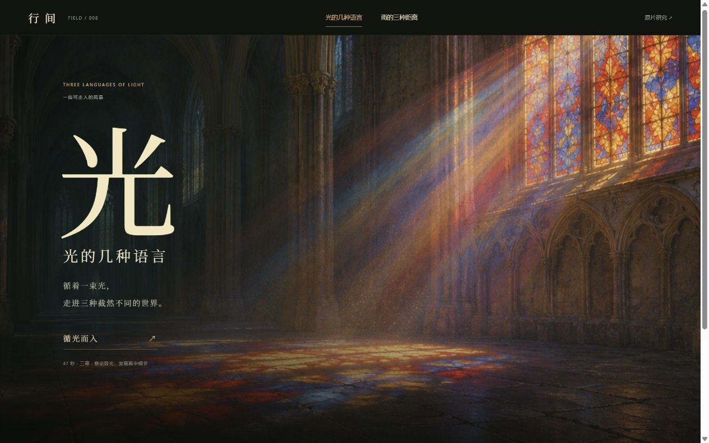
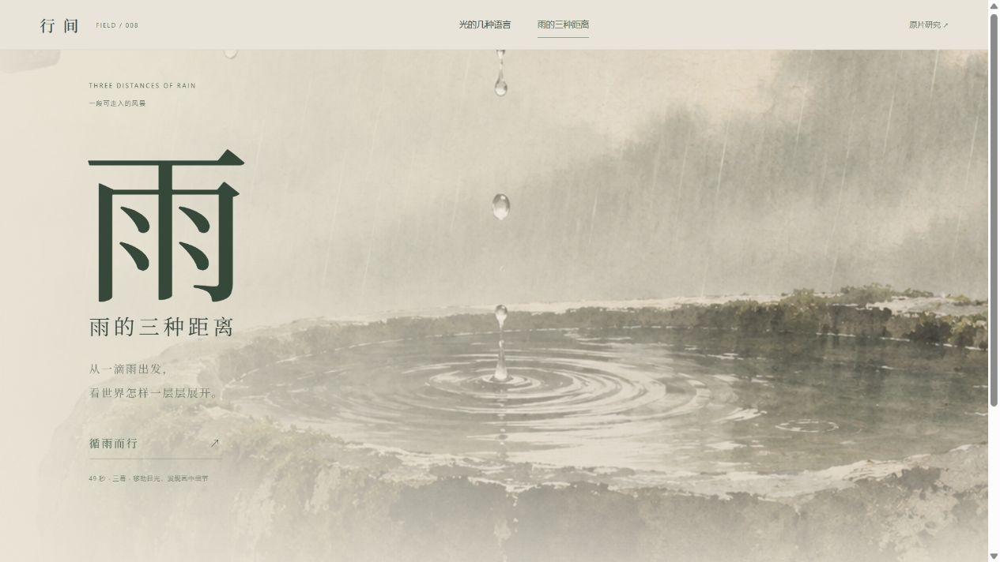

# 两部网页艺术习作 · 情绪修订版

当前更新：《雨的三种距离》已重做为有主角的连续三维行旅，见 [三维版制作记录](rain-journey.md)。以下《雨》的静帧结构为上一版历史记录，可在 [rain-still.html](http://127.0.0.1:52918/rain-still.html) 对照；《光》仍沿用情绪修订版。

日期：2026-11-16。用户观看第一版后反馈“感觉没有情绪”，并明确选择“惊奇 → 向往：强化艺术变化与探索感”。本版沿用六幅生成画面，重做观看路径与节奏，没有追加图片生成。

- [光的几种语言 · 本地预览](http://127.0.0.1:52918/light.html) / [网页文件](web/light.html)
- [雨的三种距离 · 本地预览](http://127.0.0.1:52918/rain.html) / [网页文件](web/rain.html)

## 为什么第一版没有传达情绪

用户反馈是当前唯一的观看者评价。以下是据此对实际页面做的设计判断，不是对所有观众的结论。

第一版先完整陈列画面，随后只有约 2%～5% 的缩放。文字、缩略图和说明同时出现，使观众更像在阅读作品目录。三幕有顺序，但几乎没有新的发现；文案写了“庄严”“舒展”，画面发生的事却不够支撑这些感受。

新版把目标转成可观察的观看变化：先见到局部线索，再看见完整空间；下一幕从这条线索里展开；结尾继续保留可以探索的远方。通过视距、构图、揭示速度和艺术语言的变化，尝试让人想继续看。

## 《光的几种语言》

光作为持续出现的视觉线索，经过哥特彩窗的几何与空间、明暗法的体积与材质、印象派的碎色与反光。沿用既有艺术史支点，不把它写成完整艺术史或特定地点复原。

| 幕 | 观看中的事件 | 前后关系 |
| --- | --- | --- |
| 彩窗 · 13 秒 | 从地面彩光的近处缓缓抬头，暗部退开，高拱与彩窗逐步显现 | 先给一个亮处，让观看有发现空间的过程；随后沿亮处靠近，空间收进暖光 |
| 暗室 · 11 秒 | 从器物局部退开，斜光显出陶、梨和布的材质 | 光从建筑变成可触摸的体积；暖色亮点以柔化色斑向外展开，接成水面的颜色 |
| 水面 · 16 秒 | 由局部碎色退成花园，水面轻微流动，结束前放慢 | 光不再只照亮物件，变成整个风景的表达；最后留出继续停留的余地 |

两次过渡各 3.6 秒，合计约 47 秒。窄屏有独立取景，避免照搬桌面中心裁切而丢失彩窗和水滴。

画面文件：[彩窗](assets/art-studies/light-cathedral-v1.webp)、[暗室](assets/art-studies/light-darkroom-v1.webp)、[花园](assets/art-studies/light-garden-v1.webp)。

艺术史参考：[中世纪彩窗与光](https://www.metmuseum.org/met-publications/radiance-and-reflection-medieval-art-from-the-raymond-pitcairn-collection)、[卡拉瓦乔与光的戏剧性](https://www.metmuseum.org/es/essays/caravaggio-michelangelo-merisi-1571-1610-and-his-followers)、[印象派光色与笔触](https://www.metmuseum.org/fr/essays/impressionism-art-and-modernity)。这些是表达支点，生成图不复制具体画作。

## 《雨的三种距离》

从一滴雨的接触，进入一林的浓墨，再展开一江的留白。目标从“展示近中远”推进到“一个小发现把观看带向更远的地方”。

| 幕 | 观看中的事件 | 前后关系 |
| --- | --- | --- |
| 檐下 · 12 秒 | 从水滴落点的近景退开，显出檐口与石盆；可点击画面留下涟漪 | 等待一次微小接触，涟漪扩散成为走入竹林的入口 |
| 竹间 · 13 秒 | 前景浓墨包围，视线沿中央亮处推进，雨与横雾维持纵深 | 正在接近的林间空隙，被软边雾气进一步打开 |
| 空江 · 16 秒 | 从远水局部退开，远山与大面积留白进入视野 | 密度、距离和观看速度一起变化；极轻的涟漪回应开头，远处仍留有未走完的雨 |

两次过渡各 3.8 秒，合计约 49 秒。全部为原创水墨意境，没有古画复原或特定年代归属的声明。

画面文件：[檐下](assets/art-studies/rain-eaves-v1.webp)、[竹间](assets/art-studies/rain-bamboo-v1.webp)、[空江](assets/art-studies/rain-river-v1.webp)。

## 制作与交互

六幅静帧由内置 `image_gen` 根据文字生成，未输入参考图。本次使用原图重组网页，没有生成视频。精确生成记录、原件与前版保留：

- [六幅画面的完整实际提示词](assets/art-studies/prompts.json)。
- [生成与 SHA-256 记录](assets/art-studies/generation-record.json)：原始与 WebP 尺寸、哈希；模型版本与种子未返回。
- 六幅 WebP 各 1672×941，共约 2.57 MiB；六张原始 PNG 保存在本地 `assets/art-studies/originals/`，不进入 Git 和静态导出。
- [前版源文件快照](revisions/art-studies-v1/)、[前版光页面](assets/light-study.jpg)、[前版雨页面](assets/rain-study.jpg)，便于比较。
- [章节与镜头数据](art-studies.json)、[页面模板](web/art-template.html)、[播放器与动效](web/art-studies.js)、[样式](web/art-studies.css)。

新版默认先给出观看邀请，点击后播放。说明收进创作手记；支持暂停、续播、逐幕选择、进度、方向键、Home/End、章节深链接、展开画面与 Escape 退出。移动目光带来轻微取景变化，光中可探照细节，雨中可点击留下涟漪。页面隐藏时停止推进，减少动态效果偏好下取消镜头与动效。

声音默认关闭，可通过“声音 开”启用网页合成声景。光使用渐变的正弦和声与轻噪声；雨使用过滤噪声与短促合成滴音。不是现场录音，也没有使用第三方音乐。

## 验证与评价边界

构建、资源与实际浏览器记录见 [情绪修订验收](assets/art-studies/emotion-v2-verification.json)。技术检查验证播放和交互；情绪目标是否传达，等待用户观看反馈。不能把功能通过当作“情绪已成立”。

最初因 D 盘空间不足中断的审批流程已在用户释放空间后恢复；没有执行 D 盘原件删除或迁出。D 盘源文件和 F 盘已核验原件继续保留。
