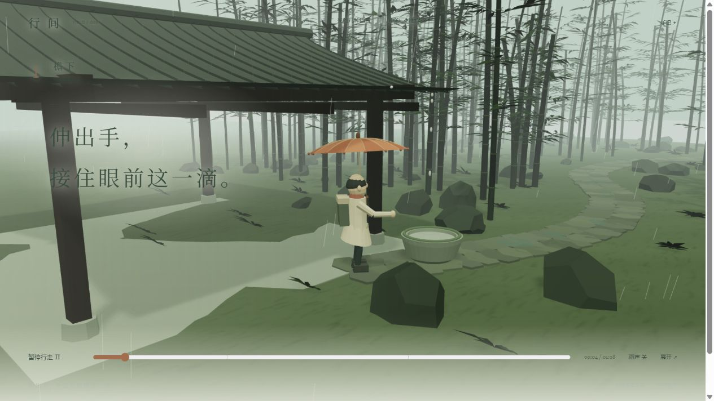
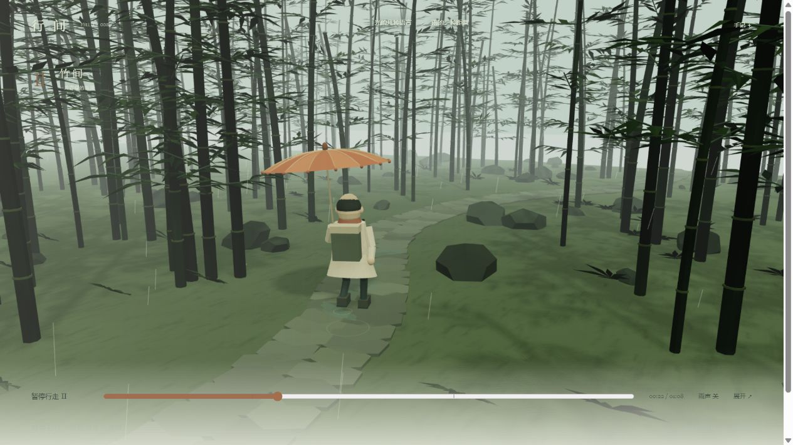
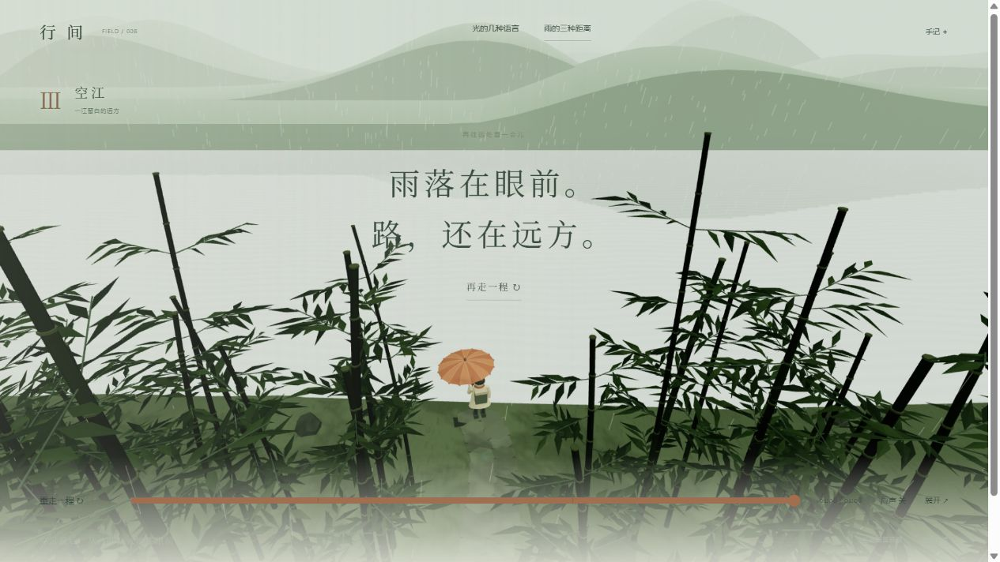

# 《雨的三种距离》· 连续三维行旅

当前艺术打磨版见 [rain-art-direction.md](rain-art-direction.md)：新增表面染色、纸感纹理、近景墨线、暖灯、林间薄雾与天光，远处以淡帆接住人物视线。以下保留最初三维路线和首版实现记录。当前验收为 [rain-art-verification.json](assets/rain-art-verification.json)，首版验收与截图用于历史对照。

2026-11-16。用户要求：同一主角在三维空间中穿行，做好三幕的艺术氛围和空间承接，不能在背景静帧上叠加角色。此前选定的情绪方向为“惊奇 → 向往”。

[本地观看](http://127.0.0.1:52918/rain.html) · [网页源文件](web/rain-journey.html) · [上一版静帧演示](http://127.0.0.1:52918/rain-still.html)

## 串联依据

主角的注意和行动贯穿全篇：接雨 → 起步 → 沿石径穿林 → 来到江岸 → 停下望远。路、水、伞与连续跟拍共同连接三幕。场景切换没有替换背景、重建主角或使用幕间淡出；“檐下、竹间、空江”是同一三维世界中约 39.66 米长石径上的三段观看。

三幕不是地理或历史复原。当前是原创程序建模的青绿与纸感立体绘景，尚待用户评价艺术氛围和情绪是否成立。

| 时段 | 行动与关系 | 艺术氛围目标 | 空间承接 |
| --- | --- | --- | --- |
| 0–19 秒 · 檐下 | 前 7.5 秒停在檐边，伸手接雨；随后离开木廊 | 木、瓦、石盆围住近处；橙褐伞作为持续识别点，小事件引起好奇 | 檐口水滴落进石盆，石径从木廊边伸进竹林；镜头随旅人离开遮蔽 |
| 19–45 秒 · 竹间 | 同一旅人沿弯曲石径行走，镜头连续绕到另一侧跟拍 | 近处浓墨色竹干与枝叶包围视野，远处退入湿雾，形成疏密、远近与纵深 | 竹干、叶与伞在同一深度空间互相遮挡；镜头沿林间亮处向出口推进 |
| 45–68 秒 · 空江 | 穿出最后一丛竹叶；约 55 秒抵达江岸并停步，镜头继续抬升退远 | 浓密前景退向画幅两侧，江面留白和淡色雾山展开，人物逐渐变小 | 地形与石径连续到岸边，真实平面反射延续山体；末段保留观看远方的时间 |

## 真实空间中的实现

- **主角**：程序建模的人物、背包与分瓣伞面；腿部两节逆运动学、脚掌姿态、伸手动作、轻微身体起伏、衣摆与伞面风动。人物沿固定路径移动，不是屏幕坐标上的贴图。
- **接触与天气**：脚掌落在石径高度；脚步涟漪与少量水花使用脚踝的世界坐标。屋檐和伞覆盖范围内的雨段停止在遮蔽表面；檐滴、手边雨滴和石盆水圈也有各自的空间位置。采用专门的几何关系，不是完整流体或刚体模拟。
- **场景**：瓦顶、廊柱、横梁、石盆、石径、地形、竹节、枝叶、石块和远山均为三维几何体。竹林用实例化几何组织，叶片按风向轻动。实际阴影、景深中的雾和镜头运动建立空间关系。
- **江面**：Three.js 官方 Reflector 模块提供随摄影机变化的平面反射，再加入轻微水纹和距离雾。石径上的小水洼为独立三维湿润表面，不逐个渲染镜面反射。
- **画面风格**：青绿、褐伞、低饱和纸色与前浓后淡的空间层次。表面纹理和纸感颗粒均由代码生成，不调用旧版三幅背景静帧。

## 文件与依赖

| 文件 | 作用 |
| --- | --- |
| [rain-journey.html](web/rain-journey.html) / [rain-journey.css](web/rain-journey.css) | 当前体验与交互界面，构建为 rain.html |
| [rain-journey.js](web/rain-journey.js) | 摄影机、播放、进度、章节、环顾、声景与窗口管理 |
| [rain-route.mjs](web/rain-route.mjs) | 路线、弧长采样、连续镜头、行动与步态计算 |
| [rain-traveler.mjs](web/rain-traveler.mjs) | 人物、伞、手臂、腿与衣摆 |
| [rain-world.mjs](web/rain-world.mjs) | 建筑、地形、竹林、江面、雨和接触反馈 |
| [rain-route.test.mjs](tests/rain-route.test.mjs) | 路线单调、幕间连续、镜头连续和脚部落地验证 |

依赖固定为 Three.js **0.180.0**，保留 [MIT 许可证](web/vendor/three/LICENSE) 与 [来源、完整性和文件哈希](web/vendor/three/provenance.json)。通过 [vendor_three.py](scripts/vendor_three.py) 从 npm 官方注册表取包，按包的 SHA-512 integrity 校验后，仅提取所需运行时、Reflector 和许可证。浏览器使用本地模块，运行时不请求 CDN。

使用的官方资料：[Three.js 文档](https://threejs.org/docs/)、[Three.js 源码](https://github.com/mrdoob/three.js)。本轮没有生成图片或 AI 视频，没有引用新的外部模型或音乐。

## 操作

点击“随雨而行”开始约 68 秒的连续行旅。可暂停主线、拖动全程进度，或选择一幕。拖动画面可小幅环顾，松开后逐渐回到原镜头；画面获得焦点时，空格暂停/继续，左右方向键前后移动 3 秒。“展开”进入页面内全屏画幅，Escape 退出。

暂停主线时，雨和树叶仍可轻动，便于停留观察空间。页面隐藏或画面离开视口时停止推进和渲染。减少动态效果偏好下关闭环境运动与环顾；主动播放仍保留作品核心行旅。

“雨声”默认关闭，为网页合成声景。滤波噪声、合成滴音和短促脚步声随位置改变；没有使用现场录音。

## 验证与边界

执行构建、模块语法检查及三项运动测试。可运行 `python scripts/build.py`、`node --test tests/rain-route.test.mjs`、`python scripts/verify_rain.py` 复核。路线与镜头在 19 / 45 秒处连续；主角在 55 秒后停在同一岸边，腿部计算能保持落地脚掌的高度。实际浏览器验证单独记录在 [rain-3d-verification.json](assets/rain-3d-verification.json)，截图均从实际运行页面取得。

首轮实看修正了结尾被前景竹林遮满的问题，改为沿出口上方抬升，并调整人物在最终画幅中的比例；另减弱日照阴影、调整伞杆与柱子的间距，补上手边水滴和雨段遮蔽。

这是可运行的实时三维样片，人物与自然采用程序化造型。艺术氛围与情绪是否达到预期，等待实际观看反馈，不以功能通过替代情绪评价。
