# 原视频逐场景分析

来源：https://x.com/nft_chen/status/2121616583110115341

名称以原片铭牌与总览为依据；时间为抽帧点，不是精确分幕边界。主题、意境、氛围、承接与规划是本次基于画面证据的解读。

## 01 · 撒哈拉岩画

抽帧：00:00；阅读分组：墙面与古代图像。

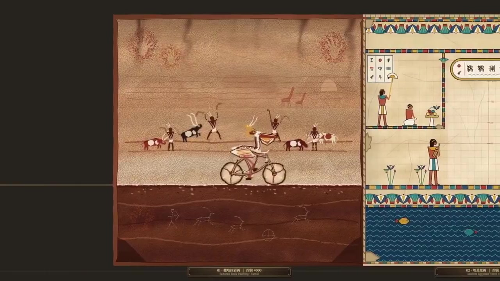

**主题解读**：把骑车这一现代动作，放进早期人类记录生活的图像环境。

**画面事实**：赭褐底面带有粗糙纹理，动物与人物横向排列；鹈鹕和车以简化轮廓加入这组形象。

**艺术意境解读**：平面的侧身形象、土色和岩面质感共同建立古老的记录感，场景内部并不依靠写实透视成立。

**氛围解读**：朴拙、干燥、遥远；现代自行车的加入带来轻巧的时间错位。

**角色融入**：主体保持可辨认的鸟、车与骑行动作，同时被压成与周围动物接近的简洁图形。

**承接前幕**：原片从这一展板进入，先给观众一个容易识别的主题和较早期的图像语境。

**带向后幕**：接到埃及壁画：保留墙面、侧身与横向阅读，色彩和分区变得更加规整。

**设计与规划思路**：开篇先建立主角和图像规则的差异；用场景内部的材质与造型完成时代感，而不只依赖铭牌。

## 02 · 埃及壁画

抽帧：00:06；阅读分组：墙面与古代图像。

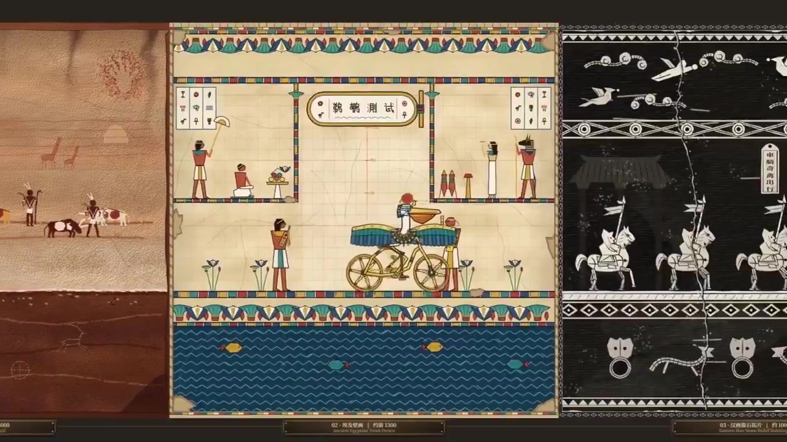

**主题解读**：让骑行进入一个分层、装饰化且有仪式感的世界。

**画面事实**：上下分区、几何边框、侧身人物与下方水波并置；鹈鹕呈侧面，身上出现水平展开的彩色装饰。

**艺术意境解读**：图案边框和层带构图组织全幅，角色的平面轮廓与周围形象遵守相近的观看方向。

**氛围解读**：明亮、规整、仪式化；骑行在庄重秩序里显得俏皮。

**角色融入**：角色与车进入中间的叙事层，装饰色参与身份转换，而不是停留在外部背景上。

**承接前幕**：延续岩画的墙面图像与侧身阅读，把松散记录推进到明确的装饰秩序。

**带向后幕**：接到汉画像石拓片：人物行列仍在，鲜明彩色转成黑白，材质感由壁画转向拓印。

**设计与规划思路**：相邻场景保持一部分共同语法，再改变材质、配色与密度，让转场既可跟随又可辨认。

## 03 · 汉画像石拓片

抽帧：00:12；阅读分组：墙面与古代图像。

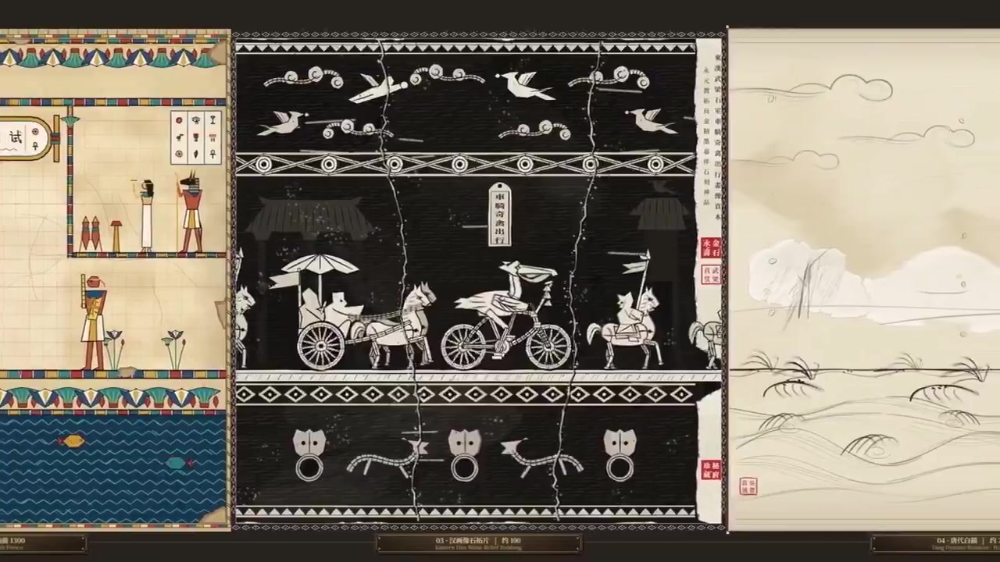

**主题解读**：把骑车编入古代车马出行的图像行列。

**画面事实**：黑底白形、车马人物行列与上下纹样带同时出现；骑行的鹈鹕成为白色轮廓，与马车等形象并排。

**艺术意境解读**：拓片式黑白关系和横向带状布局让画面像一整块被读取的石刻图像，主体与环境共享平面化处理。

**氛围解读**：古朴、凝练，带有行列展开的庄重与节奏。

**角色融入**：车轮这一形状能与旁边的古代车马呼应，荒诞主题获得了具体的进入位置。

**承接前幕**：从埃及壁画承接分层与队列，用强烈黑白反差重新定义场景。

**带向后幕**：接到唐代白描：白色实形转成纸面上的线，厚重的拓印感让位给流动轮廓。

**设计与规划思路**：利用主题中的车轮和行进，与原有场景里的出行图像建立关系，使接入显得有依据。

## 04 · 唐代白描

抽帧：00:18；阅读分组：绘画构图与舞台。

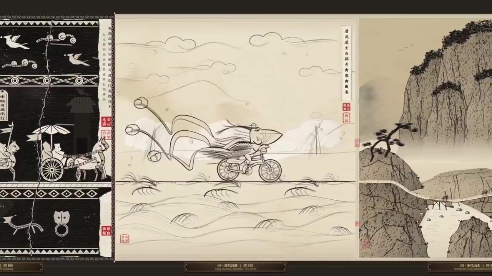

**主题解读**：让骑行动作变成线条、衣带与方向感的表演。

**画面事实**：浅色底面、云线与山形留白，鹈鹕身后延伸出长带状线条；鸟与自行车主要由线勾出。

**艺术意境解读**：画面把重量交给轮廓和曲线，长线条把视线引向骑行的方向，纸面空处参与轻盈感。

**氛围解读**：舒展、轻灵、带有飘动感；与前一幕的石刻厚重形成清楚对比。

**角色融入**：角色的轮廓和附属长线共同表达前行，动势也成为风格的一部分。

**承接前幕**：承接拓片中的行进主题，从黑白实形进入更疏的线描空间。

**带向后幕**：接到宋代山水：从角色身边的线性动势，扩大为人与山川之间的尺度关系。

**设计与规划思路**：同一个动作可以被不同艺术语言重述；改变线条和留白，就能改变动作的感受。

## 05 · 宋代山水

抽帧：00:24；阅读分组：绘画构图与舞台。

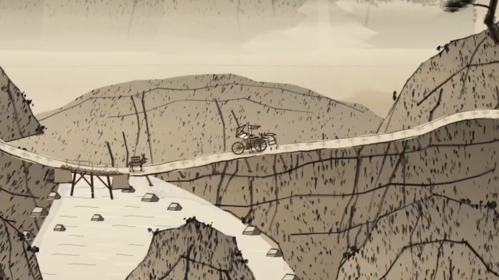

**主题解读**：让骑行者成为巨山、幽谷与道路中的小小点景。

**画面事实**：高山、瀑布、树木与细路构成空间，骑行主体明显缩小；这一段还有局部放大的观看变化。

**艺术意境解读**：山体纹理和远近层次建立可游历的空间，主体的尺度让山川显得更辽阔，道路成为进入画面的依据。

**氛围解读**：幽远、沉静、开阔；注意力从角色本身转向它所在的天地。

**角色融入**：角色不必始终最大、最居中；沿山路的小尺度骑行，反而让它与环境发生关系。

**承接前幕**：从白描的轻线与空处，进入浓淡、体量与纵深，观看重心随之扩大。

**带向后幕**：接到清明上河图：保留道路与游历，把宏观山川转成有桥、船和建筑的生活空间。

**设计与规划思路**：让场景决定主体尺度，并通过观看距离的变化揭示意境；不把同一个主角大小机械地套到每幕。

## 06 · 清明上河图

抽帧：00:30；阅读分组：绘画构图与舞台。

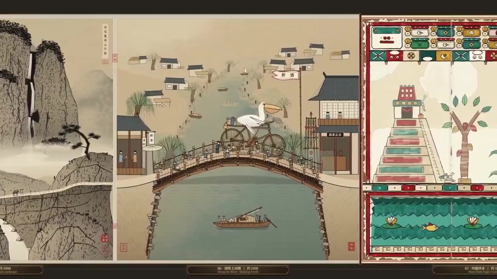

**主题解读**：把骑行带入河道、桥梁和街市组成的日常世界。

**画面事实**：拱桥横跨水面，船与两岸建筑建立纵深；鹈鹕骑上桥，车身与桥面方向产生对应。

**艺术意境解读**：桥梁既是构图中心，也是行动路线；河道和远处建筑将一段骑行放进更大的生活空间。

**氛围解读**：温和、有生活气息，观看从远山的辽阔落到可经过、可停留的地方。

**角色融入**：角色在桥上行进，场景提供真实可读的路径，接入方式具有空间理由。

**承接前幕**：承接山水里的游历和细路，转向人间市井与更密集的空间细节。

**带向后幕**：接到玛雅抄本：从河道纵深转为符号分区，观看方式由游历空间转向读取图像。

**设计与规划思路**：布局同时承担景观表达与角色路线。观众跟着行动，就能读到环境的结构。

## 07 · 玛雅抄本

抽帧：00:36；阅读分组：绘画构图与舞台。

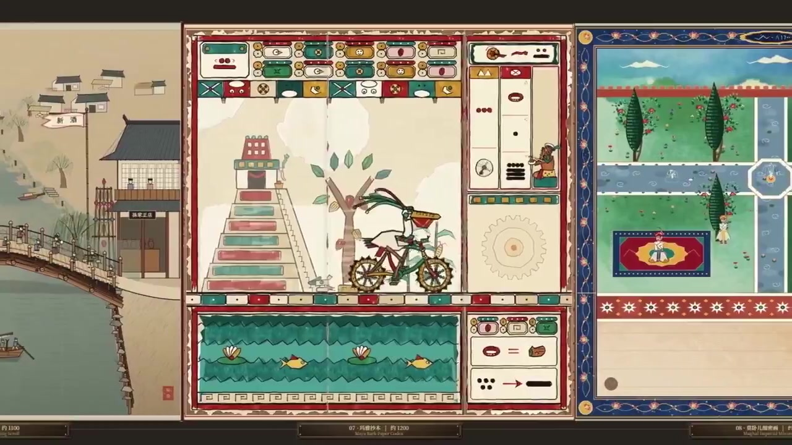

**主题解读**：把骑车变成抄本中一则由符号、建筑与自然元素组成的图像事件。

**画面事实**：阶梯建筑、树、玉米状植物、水带与密集图形边栏并置；鹈鹕带有装饰，车辆进入分区中的主体区域。

**艺术意境解读**：符号带和块状分格建立阅读秩序，色彩与边栏让整页先具有抄本的身份，空间不依赖前一幕的透视。

**氛围解读**：鲜明、神秘、带有典籍和仪式图像的气息。

**角色融入**：主体的装饰与轮廓也随场景变化，使它像这一页的图像内容，而不是浮在抄本之外。

**承接前幕**：从清明上河图的连续生活空间，转成可逐区读取的符号世界。

**带向后幕**：接到莫卧儿细密画：延续装饰边框与精细设色，再把分区重心转向花园、人物和建筑。

**设计与规划思路**：为每一幕选择自己的阅读规则。风格化布局要同时组织背景、边栏和主体位置。

## 08 · 莫卧儿细密画

抽帧：00:42；阅读分组：绘画构图与舞台。

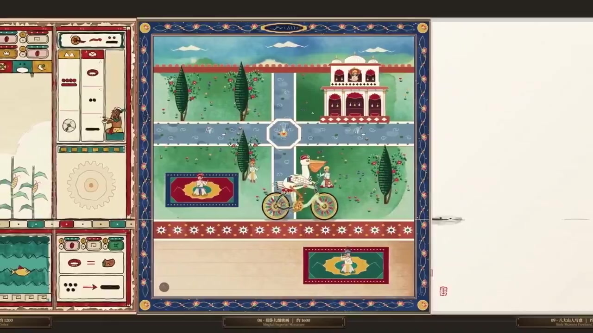

**主题解读**：让骑行进入精致、有秩序的花园与宫廷式场景。

**画面事实**：花园被水渠分开，树木、人物、建筑和地毯状装饰分布其中，外圈有细密边框；鹈鹕和车使用装饰性配色。

**艺术意境解读**：俯看式花园分区与精细设色并用，多个小区域被边框收成一页，形成可以慢慢阅读的细节。

**氛围解读**：雅致、繁密、平稳，有被精心安排的秩序感。

**角色融入**：骑行主体进入花园的一角，与周围人物和装饰处于同一图像层次。

**承接前幕**：从玛雅抄本承接装饰边框和分区，再改变图像中的生活内容与细节处理。

**带向后幕**：接到八大山人写意：繁密设色突然让位于大片空白与少量墨迹，形成一次明显的观看停顿。

**设计与规划思路**：相邻页的密与疏可以承担节奏工作；此幕的丰富使下一幕的极简更容易被感受到。

## 09 · 八大山人写意

抽帧：00:48；阅读分组：绘画构图与舞台。

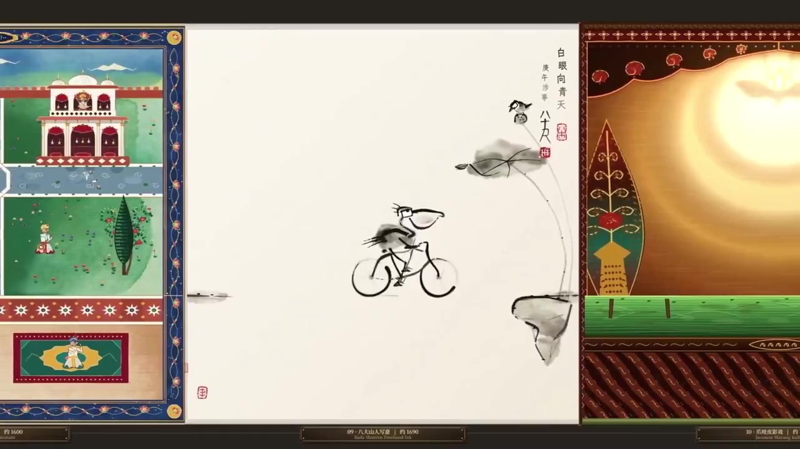

**主题解读**：以极少的笔墨，让骑行与空白共同组成一页。

**画面事实**：白底、少量荷叶与鸟形、题字和印章；鹈鹕及车主要是简洁的墨线，周围留出大片空处。

**艺术意境解读**：墨迹的浓淡、少量形象与留白共同建立关系，角色不需要依靠大量背景细节才有存在感。

**氛围解读**：疏冷、安静、带一点孤高和诙谐；是全片密度较低的一站。

**角色融入**：骑车的动作被压缩为轻巧线条，与写意形象共享少而准的表达方式。

**承接前幕**：紧接细密花园，将信息密度和色彩大幅减弱，让观众换一种观看速度。

**带向后幕**：接到爪哇皮影戏：白纸的开放空处转成有幕边与灯光中心的表演空间。

**设计与规划思路**：留白本身就是场景内容；简约的一幕能够为长序列提供呼吸，也能保留鲜明主题。

## 10 · 爪哇皮影戏

抽帧：00:54；阅读分组：绘画构图与舞台。

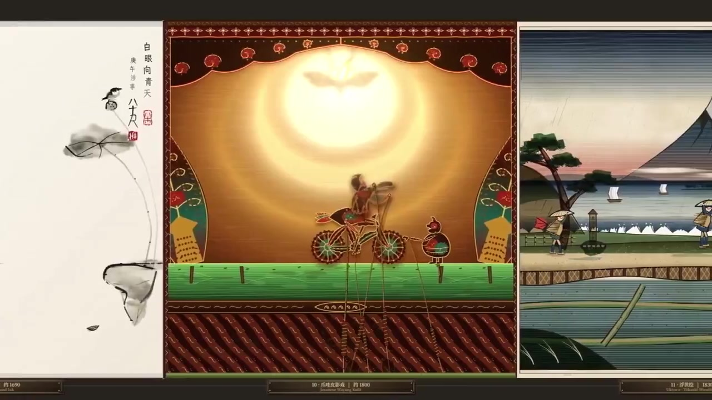

**主题解读**：把鹈鹕从画中角色转为一个正在被表演的皮影形象。

**画面事实**：暖色中央光源、幕布边界、两侧装饰和另一个皮影形象构成舞台；鸟和车带有纹样与操纵杆。

**艺术意境解读**：光、幕框与装饰把一整页组织成剧场，主体的材料感和操纵痕迹也成为艺术表达。

**氛围解读**：温暖、神秘、具有表演感；观众仿佛在看一幕小戏。

**角色融入**：装饰纹样和操纵杆让骑行动作被重新解释，角色与舞台采用同一种表演语境。

**承接前幕**：从写意留白接到被灯光聚拢的舞台，空处的用途从纸面转成表演空间。

**带向后幕**：接到浮世绘：离开剧场内部，进入山、水、树与人物构成的横向景观。

**设计与规划思路**：让氛围来自具体的光源、边界和主体材料关系。角色的接入方式可以连同动作语义一起改变。

## 11 · 浮世绘

抽帧：01:00；阅读分组：绘画构图与舞台。

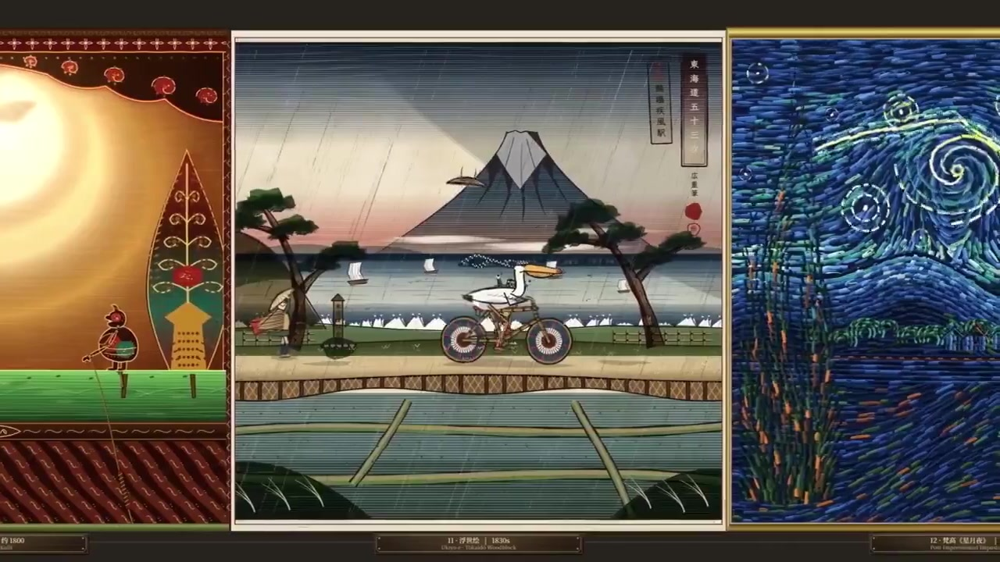

**主题解读**：把骑行嵌入可横向展开的山水与日常景观。

**画面事实**：山峰、水面、松树、岸边人物、下方船只与雨线等图形并置；角色沿岸边的水平通路前进。

**艺术意境解读**：平面色块、轮廓线和前后分层组织画面，远山稳定视线，下部景物与通路承接骑行。

**氛围解读**：清凉、舒展、带有天气与行旅感。

**角色融入**：主角保持清楚的平面轮廓，沿景观中的横向层面穿行。

**承接前幕**：从皮影的室内舞台打开到户外景观，保留平面形象，改变光色和空间感受。

**带向后幕**：接到梵高《星月夜》：仍有天空、地面与建筑，但线与色块转为密集、旋转的笔触。

**设计与规划思路**：保留部分空间分层，改变笔触和天空组织，让艺术语言的差别成为转场的主要信息。

## 12 · 梵高《星月夜》

抽帧：01:06；阅读分组：主观感觉与光影。

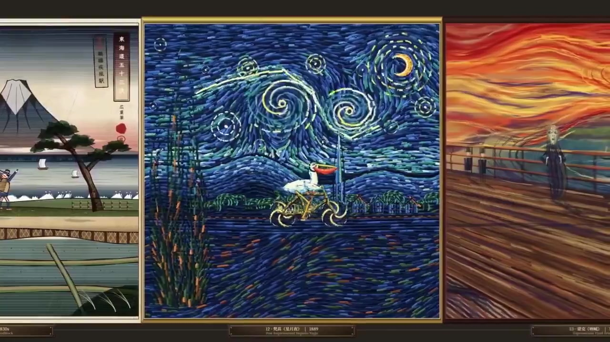

**主题解读**：让天空、车轮和骑行动势共同进入旋转的笔触世界。

**画面事实**：蓝黄笔触形成旋转天空，建筑和树构成下部层次；鹈鹕与车轮也带有曲线和亮色笔触。

**艺术意境解读**：笔触方向让环境拥有强烈动势，主体与背景共享曲线节奏，风格作用于整幅画面。

**氛围解读**：明亮而涌动，有梦境般的能量感。

**角色融入**：车轮和轮廓参与旋转线条的表达，骑行获得画面内部的视觉节奏。

**承接前幕**：承接浮世绘的景观层次，转入更密集、更主观的色彩与笔触。

**带向后幕**：接到蒙克《呐喊》：继续使用流动线条，却把蓝黄的旋转转为橙红天空与斜向桥面的紧张。

**设计与规划思路**：相似的曲线语言可以承载不同感受；情绪变化来自线条方向、颜色关系和空间倾斜的共同调整。

## 13 · 蒙克《呐喊》

抽帧：01:12；阅读分组：主观感觉与光影。

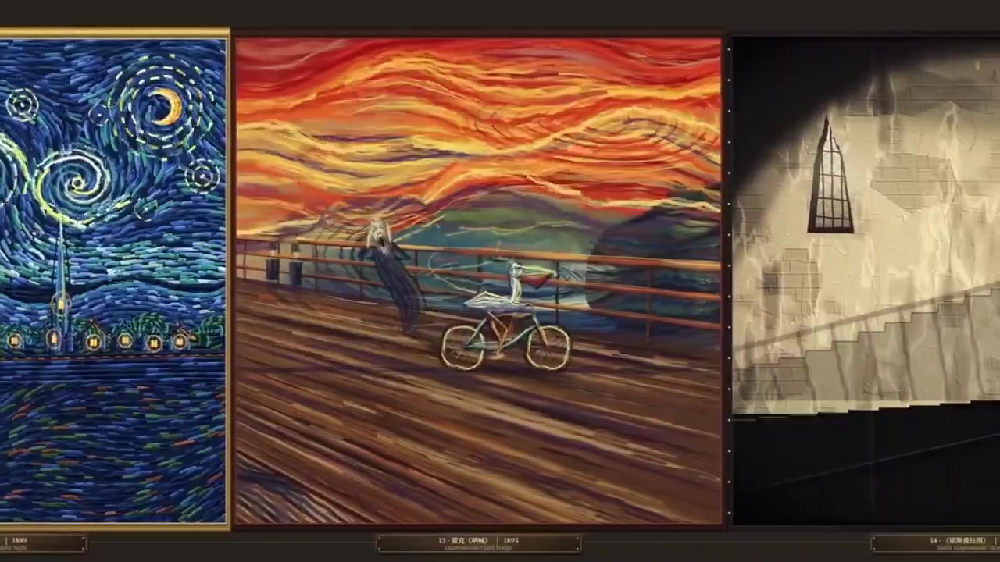

**主题解读**：把骑行置于具有心理张力的桥面与天空之间。

**画面事实**：橙红色波状天空、斜向栏杆与桥面、远处人物轮廓同在；骑车主体经过桥的前部。

**艺术意境解读**：桥的斜线与天空的扭动线形成拉扯，场景把外部空间组织成一种紧张的感受。

**氛围解读**：灼热、躁动、略显不安；熟悉的骑车主题在其中保持一种荒诞的轻巧。

**角色融入**：仍然是骑车，却因地面倾斜、空间压迫和天空颜色而获得不同心理语境。

**承接前幕**：从《星月夜》承接富于动势的线条，用橙红与斜向空间转换感受。

**带向后幕**：接到《诺斯费拉图》：从色彩表达的紧张，转成明暗、剪影和夸张影子的戏剧性。

**设计与规划思路**：情绪不只靠给画面换色；主体与空间的相对关系、方向和压迫感也参与氛围。

## 14 · 《诺斯费拉图》

抽帧：01:18；阅读分组：主观感觉与光影。

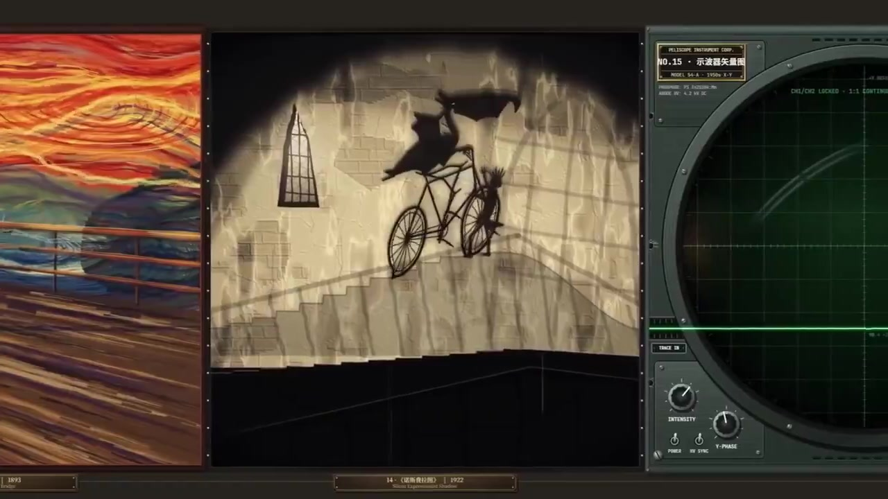

**主题解读**：用剪影、楼梯与夸张影子，把骑车变成一幕暗影表演。

**画面事实**：单色偏褐的室内楼梯、壁灯和大块影子；鹈鹕与车成为深色剪影，身形与影子显得夸张。

**艺术意境解读**：光源和投影组织戏剧性，主体能否辨认依靠轮廓，空间中的明暗关系承担风格身份。

**氛围解读**：幽暗、怪诞、带有默片式的戏剧感。这里只分析可见画面，不判断声音。

**角色融入**：鸟与车的轮廓被保留，同时借夸张阴影改变观看感受。

**承接前幕**：接住《呐喊》的紧张感，把色彩与笔触的表现改写为灯光和剪影。

**带向后幕**：接到示波器矢量绘图：黑暗背景仍在，阴影实形变成发光线迹，观看从电影语境进入技术屏幕。

**设计与规划思路**：用相邻场景共享的暗部作桥梁，再改变主体的可见方式，让跨媒介转换有连续性。

## 15 · 示波器矢量绘图

抽帧：01:24；阅读分组：屏幕、界面与生成。

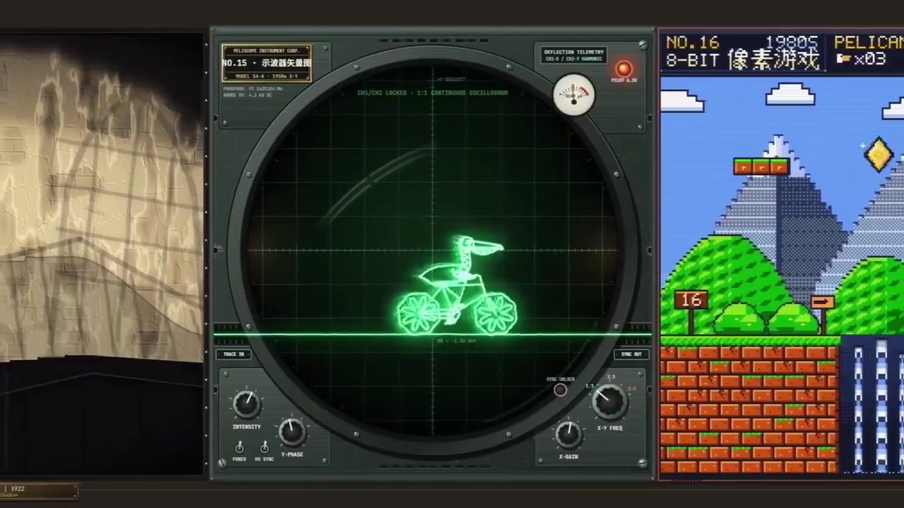

**主题解读**：把同一个骑行主题转成屏幕上的发光轨迹。

**画面事实**：圆形网格屏幕、仪表边框和旋钮；鹈鹕与自行车由绿色亮线构成，轮子呈花瓣状线迹。

**艺术意境解读**：技术设备外壳与内部发光线图一起构成整页，线的亮度、余辉感和黑底共同建立媒介气质。

**氛围解读**：冷静、复古技术感，兼具线迹运动的轻巧。

**角色融入**：鸟、车、轮子被重新编码为轨迹，主体身份通过轮廓继续保持。

**承接前幕**：从默片暗影承接黑背景，将实形剪影转成细亮线，跨到电子显示。

**带向后幕**：接到 8-BIT 游戏：继续处于屏幕中，矢量线图转成离散像素、地形与状态信息。

**设计与规划思路**：媒介转换也可以是场景主题。设备边框、成像规则与主体处理需一起改变。

## 16 · 8-BIT 像素游戏

抽帧：01:30；阅读分组：屏幕、界面与生成。

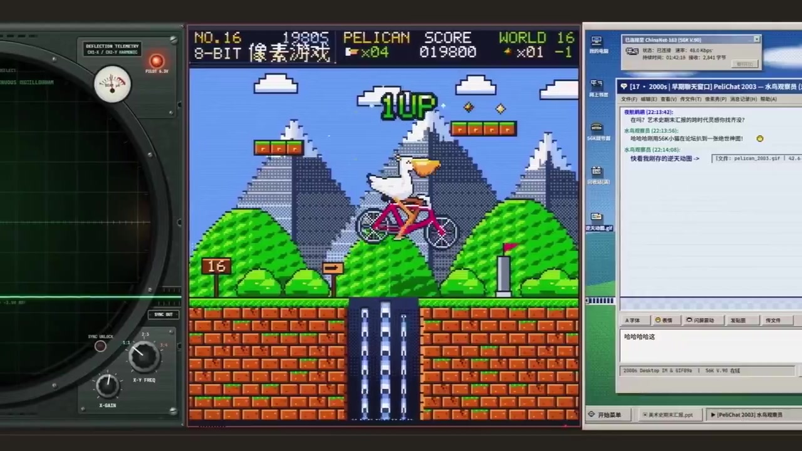

**主题解读**：让骑车进入有地形、状态与奖励符号的游戏语境。

**画面事实**：像素山、砖块、沟壑、计分栏与金币式形状并置；这段可见骑车主体跃起及 1UP 字样。

**艺术意境解读**：顶部状态、背景远山和前景地形分层清楚，像素网格决定边缘与细节的组织方式。

**氛围解读**：明快、轻松、有闯关与获得反馈的趣味。

**角色融入**：主体开始与地形、跃起姿态和奖励字样关联。录像中的这些变化不等于已经验证可玩交互。

**承接前幕**：从示波器承接电子屏幕主题，加入离散像素、世界规则和游戏符号。

**带向后幕**：接到早期聊天界面：从游戏中的主角转成窗口中可查看的骑车内容，屏幕语境继续扩展。

**设计与规划思路**：题材进入一种媒介后，要连同该媒介的信息层级和反馈符号一起规划，才能形成完整场景。

## 17 · 早期聊天 UI

抽帧：01:36；阅读分组：屏幕、界面与生成。

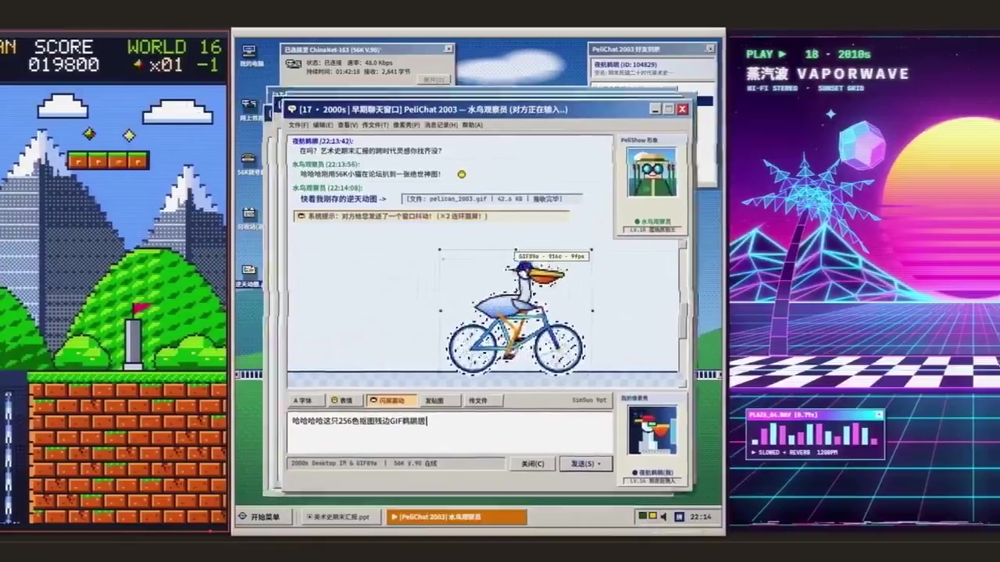

**主题解读**：把骑车从场景中的行动，变成桌面聊天里被观看和交流的内容。

**画面事实**：旧式桌面、层叠窗口、聊天文字、头像区和任务栏；骑车鹈鹕位于聊天内容或图像预览区域。

**艺术意境解读**：窗口边框、密集文字与小图标组成完整界面布局，主角的展示位置由媒介容器决定。

**氛围解读**：怀旧、日常，带有早期网络交流的亲近感。

**角色融入**：角色被放进聊天画面中，身份由行旅者进一步变成可展示、可交流的图像。

**承接前幕**：承接游戏的屏幕体验，把关注对象从世界里的行动转到界面里流通的内容。

**带向后幕**：接到蒸汽波：旧桌面的数字怀旧继续存在，但功能性窗口转成强烈的空间与装饰美学。

**设计与规划思路**：同一主题的容器变化也是叙事变化；界面本身可以交代内容如何被看见。

## 18 · 蒸汽波

抽帧：01:42；阅读分组：屏幕、界面与生成。

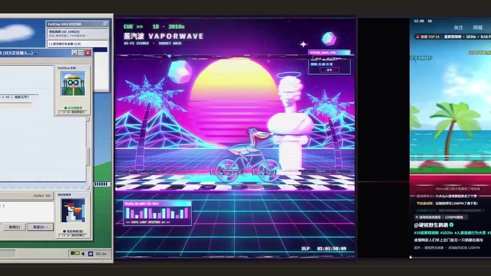

**主题解读**：让骑车进入一个由数字怀旧和霓虹景观组成的舞台。

**画面事实**：紫粉青色、透视网格、落日圆盘、雕像、线框树与播放样式信息并置；角色和车也带有霓虹轮廓。

**艺术意境解读**：透视网格与中央落日组织纵深，雕像和悬浮几何物构成装饰中心，配色贯穿角色与环境。

**氛围解读**：梦幻、复古、饱和而带人工感，是数字段落中的一次视觉放大。

**角色融入**：角色以霓虹般的轮廓融入景观，继续骑行但感受已不同于桌面聊天里的日常。

**承接前幕**：从早期聊天承接数字怀旧，减弱阅读文字的任务，强调色彩、空间和装饰。

**带向后幕**：接到竖屏短视频：从横向景观收进更窄的内容框，点赞和信息流语法开始主导观看。

**设计与规划思路**：不仅规划画面内容，也规划画幅和观看任务的变化；宽阔展示与竖屏聚焦能形成明确节奏。

## 19 · 短视频信息流

抽帧：01:48；阅读分组：屏幕、界面与生成。

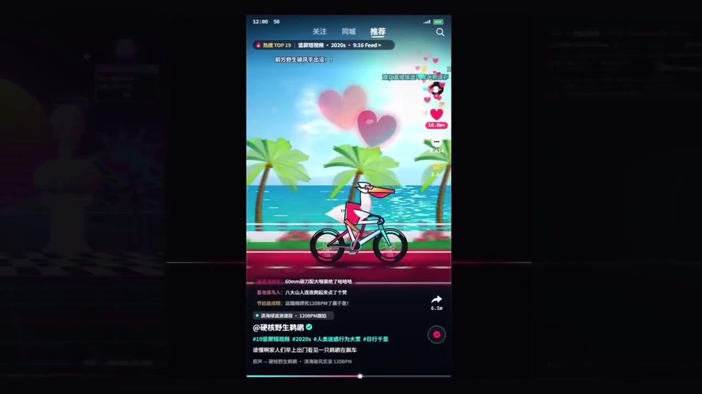

**主题解读**：把鹈鹕骑车放进当代竖屏内容被浏览与点赞的语境。

**画面事实**：窄竖屏、海边与树、右侧互动图标、下方文字区和浮动心形符号；骑行主体位于内容画面的主要区域。

**艺术意境解读**：上下信息和侧边互动区围住主内容，画幅与界面层级共同改变主体的观看方式。

**氛围解读**：轻快、熟悉，带有短视频式的即时反馈与娱乐感。

**角色融入**：相同角色成为信息流中的被观看对象，点赞符号强化了它作为内容的身份。

**承接前幕**：从蒸汽波的数字景观进入当代平台容器，保持明亮人工色彩，同时改变画幅。

**带向后幕**：接到代码美学：从内容的消费界面转向带生成规则外观的展示，观看进一步回到表达如何形成。

**设计与规划思路**：平台界面、画幅和角色位置是一套共同的场景设计；它们让观众迅速理解当前的观看语境。

## 20 · 代码美学

抽帧：01:54；阅读分组：屏幕、界面与生成。

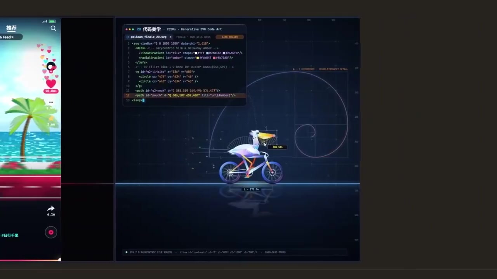

**主题解读**：让骑车主题与几何、参数和代码式说明同时进入画面。

**画面事实**：深色画面中有代码样式面板、几何辅助线、骑行主体和倒影；文字区域与主体形成空间分工。

**艺术意境解读**：精细线条、深色留白和局部发光构成生成艺术气质，解释性图形与表现结果并置。

**氛围解读**：理性、精致、带有自我指涉意味：画面似乎也在谈自身的构成。

**角色融入**：主体重新获得清楚而较精细的形体，又被放进规则和几何的展示语境中。画中代码不能替代实际源码。

**承接前幕**：承接信息流里的被观看内容，将注意力转向内容的表达规则与生成外观。

**带向后幕**：镜头不再只向下一种风格前进，而是拉远回看整个画廊，再推向空置的“鹈鹕本人”发布席。

**设计与规划思路**：最后一个风格场景把主题引向表达本身，为随后的总览与幽默回扣准备观看位置。

## 21 · 总览与“鹈鹕本人”

抽帧：02:06；阅读分组：总览与幽默收束。

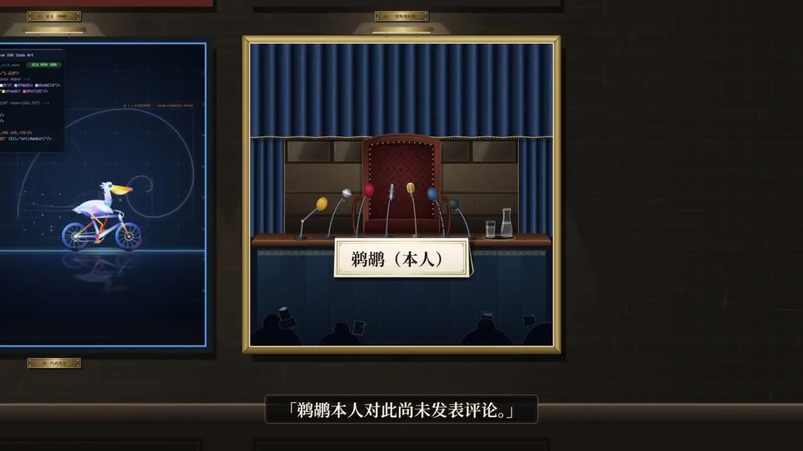

**主题解读**：把二十种表达回收成整体，再把注意力交还给被描绘的主角。

**画面事实**：约 120 秒镜头拉远，20 个场景同框并出现答卷式总结；随后推近有麦克风、名牌和空椅子的发布席，字幕以主角尚未置评收尾。

**艺术意境解读**：先用全景把局部组织为收藏式整体，再用一个空置的正式场面制造反差；空位也成为画面内容。

**氛围解读**：从回顾的完整感转为幽默、留白与一点自我调侃。此处不为缺席主角编造心理或对白。

**角色融入**：前面持续作为图像主题出现，结尾却在标为“本人”的席位上缺席。主体与人类表达之间的距离被重新看见。

**承接前幕**：接住代码美学对表达方式的关注，镜头拉远让观众意识到前面看到的是一组关于同一题目的回答。

**带向后幕**：没有再增加一段外来的剧情。空位和字幕回扣始终贯穿的骑车命题，给整段巡游留下幽默余味。

**设计与规划思路**：整体叙事靠主题展开、视角变化和结尾回扣成立：逐幕体验 → 总览比较 → 将主角作为“本人”重新提出。
