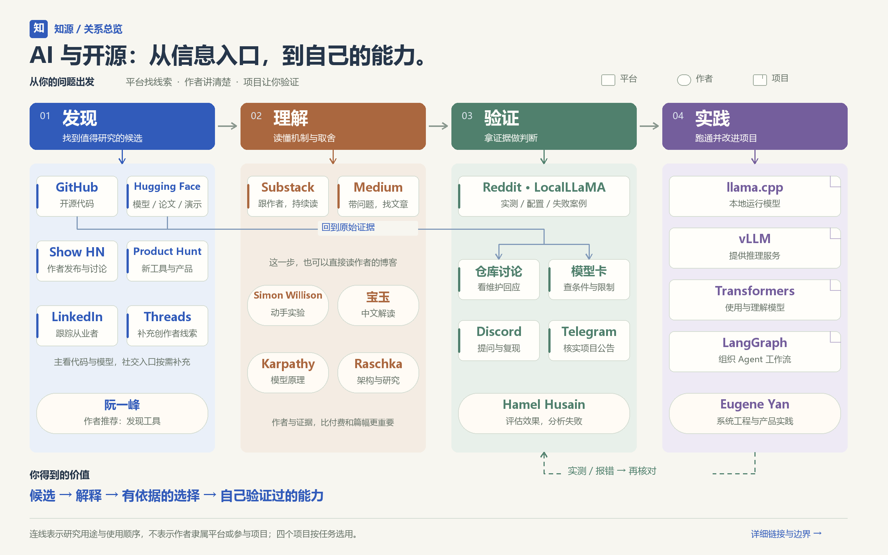

# 0009 · 知源：AI 与开源信息源指南

把网站收藏清单整理为可阅读、可筛选的个人研究指南。保留讨论中的质疑：平台提供入口，具体作者、证据与用途决定阅读收益；原帖的效率承诺没有提供统计依据。

- 网页入口：[web/index.html](web/index.html)
- 关系总览：[高清 PNG](assets/relation-map.png) · [可点击 SVG](assets/relation-map.svg) · [放大阅读页](web/map.html)
- 详细清单图：[完整长图](assets/source-map.png) · [含全部参考链接的 SVG](assets/source-map.svg)
- 原始来源：[@yxl44 的十个平台清单](https://x.com/yxl44/status/2121581932412895507)
- 整理日期：2026-11-16，Asia/Shanghai
- 研究状态：以根目录 `projects.json` 为准；验证范围见 [verification.md](verification.md)
- 本地静态网页，未配置发布，`demo_url` 为 `null`

## 它解决什么问题

研究 AI 与开源项目时，怎样选择信息源、关注具体作者，并把阅读转为项目选择与实际验证？网页总结我们的讨论，提供任务导向的入口、判断边界与研究记录模板。

## 为什么关注

原帖提供十个平台，却没有给出具体关注对象、筛选办法和收益证据。后续讨论补充 Hugging Face、七位作者与四个仓库，并区分网站作用、个人判断和可验证内容。

## 网页与研究结论

默认入口改为 **2400×1500 关系图**：用“发现 → 理解 → 验证 → 实践”串联 11 个平台、7 位作者和 4 个项目，重点画出原始证据跨阶段使用及实践反馈。方框表示平台，胶囊表示作者，折角卡片表示项目。连线是研究用途和使用顺序，不是作者隶属、合作或项目必须组合使用的声明。图面从原长图的 282 行文字降为 77 行，24 个节点均保留相应入口，网页支持缩放。

原 **3000×5731 详细清单图**继续保留，涵盖全部 36 个不同链接、平台边界、三条研究路径和五项检查标准。需要完整说明时可从关系图或阅读页进入。

1. **我们的判断**：以能否帮助选择、解决问题或安排一次验证为标准。热度、点赞、付费与篇幅均不能单独证明质量。
2. **信息源地图**：原帖十个平台加 Hugging Face；按发现项目、深入理解、使用反馈和项目协作筛选，支持搜索与展开链接。
3. **Substack 与 Medium**：前者适合挑少量作者持续读，后者适合带着具体问题找文章。这是使用建议，两者均有作者关注与内容发现能力。
4. **关注清单**：七位作者与四个仓库，排序按当前用途安排，不代表全网质量排名。
5. **实践路径**：寻找工具、判断项目、理解技术三条路径；示例不冒充已验证的第三方项目。
6. **研究记录**：输入问题、勾选阅读检查项，生成可选取的 Markdown 文本，提供下载链接；不上传、不自动保存。
7. **来源与边界**：区分作者声明、我们的判断与验证范围，保留 Threads 本轮抓取遇到 429 的限制。

## 完整入口

| 平台 | 具体入口 | 使用建议 |
| --- | --- | --- |
| GitHub | [Trending 周榜](https://github.com/trending?since=weekly) | 发现候选，再核对仓库与维护记录 |
| Hugging Face | [模型](https://huggingface.co/models?sort=trending)、[论文](https://huggingface.co/papers/trending)、[演示](https://huggingface.co/spaces)、[论坛](https://discuss.huggingface.co/) | 沿模型、论文与代码追溯来源 |
| Reddit | [r/LocalLLaMA](https://www.reddit.com/r/LocalLLaMA/) | 查实测、配置与失败案例 |
| Hacker News | [Show HN](https://news.ycombinator.com/show) | 发现作品，阅读答复与质疑 |
| Substack | [Ahead of AI](https://magazine.sebastianraschka.com/) | 先读免费内容，再选择作者订阅 |
| Medium | [LLM 主题](https://medium.com/tag/large-language-models) | 用工具名与问题搜索，逐篇核验 |
| Product Hunt | [产品发布](https://www.producthunt.com/) | 核对功能、开源与适配条件 |
| LinkedIn | [职业社区](https://www.linkedin.com/) | 跟踪明确作者与团队 |
| Discord | [官网](https://discord.com/) | 从项目官方链接加入社区 |
| Telegram | [官网](https://telegram.org/) | 关注已确认来源的频道 |
| Threads | [官网](https://www.threads.com/) | 可选入口；本轮内容访问受限 |

七位作者：[Simon Willison](https://simonwillison.net/tags/llms/)、[阮一峰](https://www.ruanyifeng.com/blog/weekly/index.html)、[Andrej Karpathy](https://karpathy.ai/)、[Sebastian Raschka](https://sebastianraschka.com/blog/)、[Hamel Husain](https://hamel.dev/)、[Eugene Yan](https://eugeneyan.com/start-here/)、[宝玉](https://baoyu.io/)。

四个仓库：[llama.cpp](https://github.com/ggml-org/llama.cpp)、[vLLM](https://github.com/vllm-project/vllm)、[LangGraph](https://github.com/langchain-ai/langgraph)、[Transformers](https://github.com/huggingface/transformers)。本项目未运行这些第三方软件。

## 关键机制与文件

| 文件 | 作用 |
| --- | --- |
| [web/index.html](web/index.html) | 正文、平台对比、检查表和来源边界 |
| [web/styles.css](web/styles.css) | 纸色阅读布局、桌面侧栏、窄屏导航和打印样式 |
| [web/data.js](web/data.js) | 平台、作者、仓库、研究路径与来源记录 |
| [web/app.js](web/app.js) | 搜索、筛选、标签页与 Markdown 生成 |
| [web/map.html](web/map.html) / [web/map.js](web/map.js) | 总图阅读、缩放及高清图片入口 |
| [scripts/make_source_map.py](scripts/make_source_map.py) | 从既有清单生成同内容 PNG、可点击 SVG 与链接覆盖清单 |
| [scripts/make_relation_map.py](scripts/make_relation_map.py) | 生成简洁关系图、PNG / SVG 与节点和连线说明 |
| [scripts/build.py](scripts/build.py) | 用标准库导出六个页面文件和四份图形，修正资源相对路径 |
| [start.cmd](start.cmd) | 启动仅监听本机的预览 |

页面没有远程字体、第三方脚本、统计或后端依赖。外部链接由读者点击后进入对应服务。关闭 JavaScript 时，正文仍可阅读，完整入口见本 README。

## 运行与验证

在本目录双击 [start.cmd](start.cmd)，或执行：

```powershell
python scripts/build.py
python -m http.server 52919 --bind 127.0.0.1 --directory dist
```

访问 `http://127.0.0.1:52919/`，按 Ctrl+C 停止服务。若端口占用，换一个端口，不结束不明进程。

独立导出：

```powershell
python scripts/build.py
```

`dist/` 被 Git 忽略；脚本不递归清理目录。资源使用相对路径，未来可放在 `/20261115_codex_project/demos/0009-ai-source-field-guide/`。本次未修改总库部署配置。

更新总图时运行 `python scripts/make_source_map.py`，再执行静态导出。图形生成使用本机已有 Node.js、Pillow 与微软雅黑字体，不下载依赖或字体。生成器会检查文字宽度、画布边界和清单中全部链接是否覆盖。网页本身不依赖 Pillow，也不需要安装 npm 包。

更新关系图时运行 `python scripts/make_relation_map.py`。脚本复用原有字体与数据读取逻辑，检查主入口覆盖、文字边界和节点重叠，再输出 `relation-map.png`、`relation-map.svg` 与 `relation-map-manifest.json`。简图只呈现主要入口；完整参考链接仍以详细清单为准。

验证环境：Windows、Python 3.10.11、Node.js v22.15.0 与 Codex 内置浏览器。普通脚本和相对资源路径支持在允许本地文件的浏览器打开；内置浏览器禁止 `file:`，本次验收使用本机 HTTP。下载事件未获得完成反馈；已验证的记录获取方式是页面内预览与文本选取。完整结果见 [verification.md](verification.md)。

## 图片与演示



[关系图浏览器实际渲染](assets/relation-map-browser.jpg) · [详细清单图](assets/source-map.png) · [原网页预览](assets/overview.jpg) · [原网页窄屏截图](assets/mobile.jpg)。图形和截图来自本库原创整理，2026-11-16；没有嵌入第三方网站截图。见 [assets/SOURCES.md](assets/SOURCES.md)。

## 后续计划

- 按真实使用反馈调整关注顺序，记录对具体项目选择产生的帮助。
- 链接或规则变化时更新来源记录，不以页面冒充实时监测。
- 新增案例时补上环境、版本和验证结果。
- 有明确发布任务后，再接入统一站点构建并验证公开地址。

## 来源与许可

本库原创页面、视觉示意与讨论整理。原帖、官方文档、作者主页和项目仓库以少量概述与链接引用，完整来源保存在网页末尾及 [web/data.js](web/data.js)。未复制第三方代码、完整文章、网站图标或媒体；引用项目的许可证以各自仓库为准。
