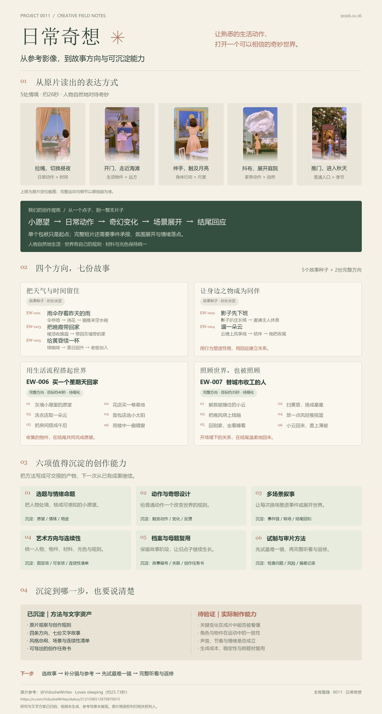

# 0011 · 日常奇想 · 参考影像与故事创作档案

从“普通生活动作触发奇幻变化”的参考短片出发，整理原片效果、创作价值、四条故事方向，以及五个故事种子和两份完整短片方向。以后按需选择故事，继续分镜、试制与成片。

- 阅读入口：[一图总览](web/map.html) → [完整研究](web/index.html) → [七份故事](stories.md)。核心内容不依赖网络。
- 本地启动：[start.cmd](start.cmd)，端口52921。
- 原始来源：[@VidusheWrites 的 Loves sleeping 帖文及视频](https://x.com/VidusheWrites/status/2121596512878870615)。没有确认影片创作者与上游源码仓库，以 source_url 登记。
- 日期：2026-11-16，北京时间；原片查看发生于11月15日及16日。
- 研究状态：以根目录 `projects.json` 为准
- 网页发布与公开地址：[publication.md](publication.md)。登记表demo_url在实际线上核验后更新。

## 它解决什么问题

把一次对影像的喜爱转成可继续使用的创作档案：看清原片在做什么，理解效果对我们的作用，保留故事发展阶段，在需要制作时取得故事全文、场景草案、连续性资产与待补事项。

## 为什么关注

用户关注原片的“创意、故事”，并指出最初的单点点子不足以支撑原片的氛围与长度。约26秒的原片已经展开卧室、厨房、餐桌、庭院和电话亭多个情境。本项目以完整影片为策划单位，保留单点创意的种子状态。

## 研究结论

- 原片以熟悉动作引出可见变化，让自然、空间和天体获得生活物件般的关系。
- 人物自然地使用这个世界，材料、光色和环境共同托住气质。
- 可提炼“具体愿望 → 普通动作 → 世界变化 → 人物或世界回应”的方法。
- 多个事件需要共享愿望、任务、关系或世界规则；增加同一包袱的机位不能自动补足整片内容。
- 创作方法与可扩展用途属于我们的判断，未通过本库生成样本验证。

完整画面事实、意义解释与讨论变化见[reference-study.md](reference-study.md)。风格固定项、可变项、策划配方与验收问题见[style-guide.md](style-guide.md)。

## 页面与故事档案

网页以我们整理的创意与能力总览图作引导，串联原片五处情境、六条创作原则、五项具体价值、四条故事方向、七份故事全文、可扩展用途与来源边界。支持原图切换和放大、键盘导航、阶段筛选、搜索、深链接、Markdown全文与创作任务书导出。

| 编号 | 故事 | 当前阶段 | 草案时长 |
| --- | --- | --- | --- |
| [EW-001](stories/EW-001.md) | 雨伞存着昨天的雨 | 故事种子 | 未定 |
| [EW-002](stories/EW-002.md) | 影子先下班 | 故事种子 | 未定 |
| [EW-003](stories/EW-003.md) | 把晚霞带回家 | 故事种子 | 未定 |
| [EW-004](stories/EW-004.md) | 遛一朵云 | 故事种子 | 未定 |
| [EW-005](stories/EW-005.md) | 给黄昏续一杯 | 故事种子 | 未定 |
| [EW-006](stories/EW-006.md) | 买一个星期天回家 | 完整方向，待细化 | 目标约40秒 |
| [EW-007](stories/EW-007.md) | 替城市收工的人 | 完整方向，待细化 | 目标约35秒 |

全部文字见[stories.md](stories.md)。七份方案均未生成，用户尚未选定实施。完整方向尚需拆镜和确定画幅；场景衔接、风险与试制建议是本轮整理补充。

## 关键机制

| 文件 | 用途 |
| --- | --- |
| [research.json](research.json) | 原片观察、原则、价值、方向与扩展用途的内容来源 |
| [stories.json](stories.json) | 七份故事的阶段、情绪、规则、场景、风险和母题关系 |
| [web/index.html](web/index.html)、[styles.css](web/styles.css)、[app.js](web/app.js) | 静态网页和阅读导出交互 |
| [scripts/build.py](scripts/build.py) | 校验内容，生成网页数据及Markdown，导出dist |
| [assets/SOURCES.md](assets/SOURCES.md) | 素材出处、裁取方式和权利范围 |
| [verification.md](verification.md) | 网页实际验收记录与未验证范围 |

编辑JSON后运行构建。web/data.js、stories.md和stories/*.md为生成的可阅读交付副本，避免手工修改后被覆盖。网页无账户与后台，不调用生成服务，搜索仅在当前页面执行。

## 运行与验证

Python 3.10+用于构建，无需安装依赖；浏览器只读静态文件。没有绑定未知的第三方原工程版本。

在本项目目录执行：

```powershell
python scripts/build.py --dist
node --check web/app.js
python -m http.server 52921 --bind 127.0.0.1 --directory dist
```

打开 http://127.0.0.1:52921/ ，结束时Ctrl+C。端口占用时另选端口，不结束不明进程。也可直接打开web/index.html离线阅读。

在总库根目录运行登记表检查：

```powershell
python scripts/projects.py check
```

dist/是忽略的可重建目录，相对资源路径用于统一站点下的/20261115_codex_project/demos/0011-everyday-wonders/。原有本地检查见[verification.md](verification.md)，本轮部署与线上结果见[publication.md](publication.md)。“已验证”仅指网页检查，不表示视频已生成或参考效果已复现。

## 图片与演示

### 一图总览



[2400×4480 原图](assets/creative-summary-v1.png) · [可编辑SVG](assets/creative-summary-v1.svg)。区分已整理的方法与文字资产、尚待成片验证的实际制作能力。原片定位图用于本地研究引用，其他图文由本库编排。

图文内容维护于[summary-map.json](summary-map.json)，故事名称、编号和阶段读取stories.json，参考画面映射读取research.json。用已有Pillow运行以下命令可重建PNG、SVG与来源元数据，不调用图片生成服务：

```powershell
python scripts/render_summary.py
```

### 网页运行截图

六张原片定位引用图存放在assets/，来源与权利范围见[素材说明](assets/SOURCES.md)。未生成任何虚构故事的成片或参考图。


[故事正文与场景阅读](assets/stories-reader.jpg) · [窄屏首屏](assets/mobile.jpg) · [窄屏故事正文](assets/mobile-reader.jpg)。均为实际网页运行截图，页面内原片画面另有权利归属。

网页已通过本地HTTP实际验收，包括故事筛选、全文切换、深链接、任务书下载与窄屏无横向溢出。内置浏览器不允许file协议，直接文件打开未完成浏览器实测；后续需要同样的预览环境时运行start.cmd。

## 后续计划

- [ ] 按具体用途选择故事，确认情绪、画幅和时长。
- [ ] 补齐可生成镜头及统一人物、空间、物件参考。
- [ ] 先试最难的一镜，保存实际输入、工具与原件。
- [ ] 完整听看后记录偏差，再决定扩展整片。

## 来源与许可

原始来源为上文X帖文，帖文账号不等于已确认的影片创作者。网页使用低分辨率定位图支持具体分析，未收录完整影片，不声明引用图具有开放再分发许可。页面实现、研究文字和扩展故事由本次讨论整理；引用图与本库原创内容分别标注。归因与范围见[THIRD_PARTY_NOTICES.md](THIRD_PARTY_NOTICES.md)。原片声音、模型、提示词、工程与成本保持未验证。
