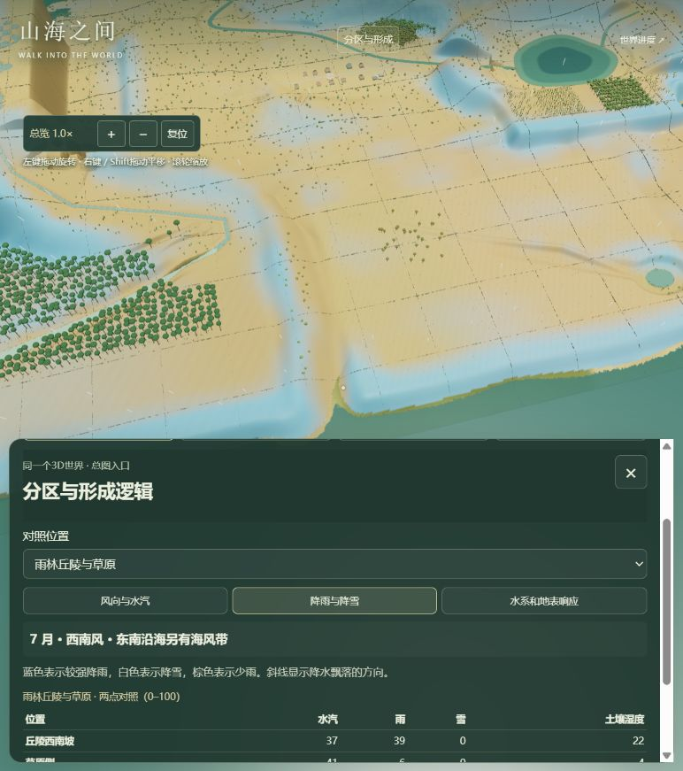

# 全年风向、降水与区域响应

逐月雨雪已进入[流域补给、蓄水和水量收支](WATERSHED-BALANCE.md)主线。以下保留全年风雨视图的范围。

[打开大地图的「全年风雨」](http://127.0.0.1:52932/expedition.html?plan=annual#build-1)。在「区域过渡」选择任意一段后，也可用「对比四季风雨」继续观察同一地点。

- **风向与水汽**。月份可选 1–12，也可以播放全年。春季主风来自南西南，夏季以西南为主并叠加东南沿海水汽，秋季转向东东南，冬季转为西北。相邻月份在四个设定之间插值。箭头表示去向，颜色和长度随水汽变化。
- **降雨与降雪**。实际高度场以 40 米间距采样并作平滑。水汽随风输送，路经海面获得补充。迎坡抬升消耗水汽，背坡下沉削弱降水。按相对冷暖把降水分成雨和雪，低温期留雪，回暖后融水参与下一期补给。
- **水系和地表响应**。地块只沿地势较低的网格连向登记水路。中央主河合计直接来水、冰雪支线、北部双支流和内陆湖线，高原经雨林河口另行出海，盐地示意盆内汇水。补给指数控制实景里的流纹宽度和速度，冲积扇同步使用原有两档可见水面。土壤蓄水和积雪分别驱动地表的湿暗、雪色和部分植物的返青或变黄。
- **同地点对比**。六段经由同一组布局视角定位。在南部比较丘陵西南坡与草原侧，在北部比较山口和扇面，在高山看降雪与春季融雪。

四季风向与水汽来源是创作设定。水汽、降水、土壤和河道读数都使用相对指数。0–100 的补给指数以各水系自身全年峰值为 100，适合比较同一水系不同月份。封闭洼地和无法沿 40 米网格接入已登记水道的地块留在当地。湖泊水位、地下水交换、完整流域水量收支和群落生长下一阶段另行深化。

迎背风的地形效应参考 [WMO 国际云图](https://cloudatlas.wmo.int/en/orographic-influences-on-the-windward-side.html)。降雪积累与融水补给的关系参考 [USGS 的 Snow to Flow](https://water.usgs.gov/vizlab/snow-to-flow/index.html)。

构建 `a3a9f1349671` 的内置浏览器验收覆盖夏冬风向、迎背风降雨、冲积扇两档水面、逐月滑杆、跨月至暂停、区域入口及退出后的设置恢复。七月南部对照点的降雨指数为 39 和 6，中央主河补给指数为七月 100、一月 27。原 116 个构建观察点和 464 条讲解的数量检查通过。 [模型检查](assets/annual-climate-check.json) · [浏览器记录](assets/annual-climate-browser-check.json)

[七月风向](assets/annual-wind-july.jpg) · [一月风向](assets/annual-wind-january.jpg) · [北部扇面七月](assets/annual-north-july.jpg) · [北部扇面一月](assets/annual-north-january.jpg)
