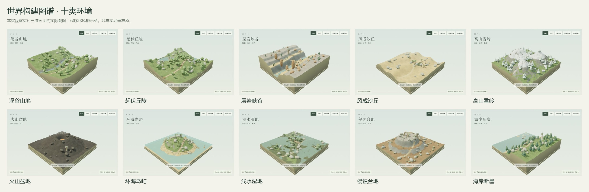
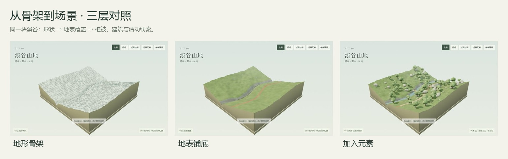
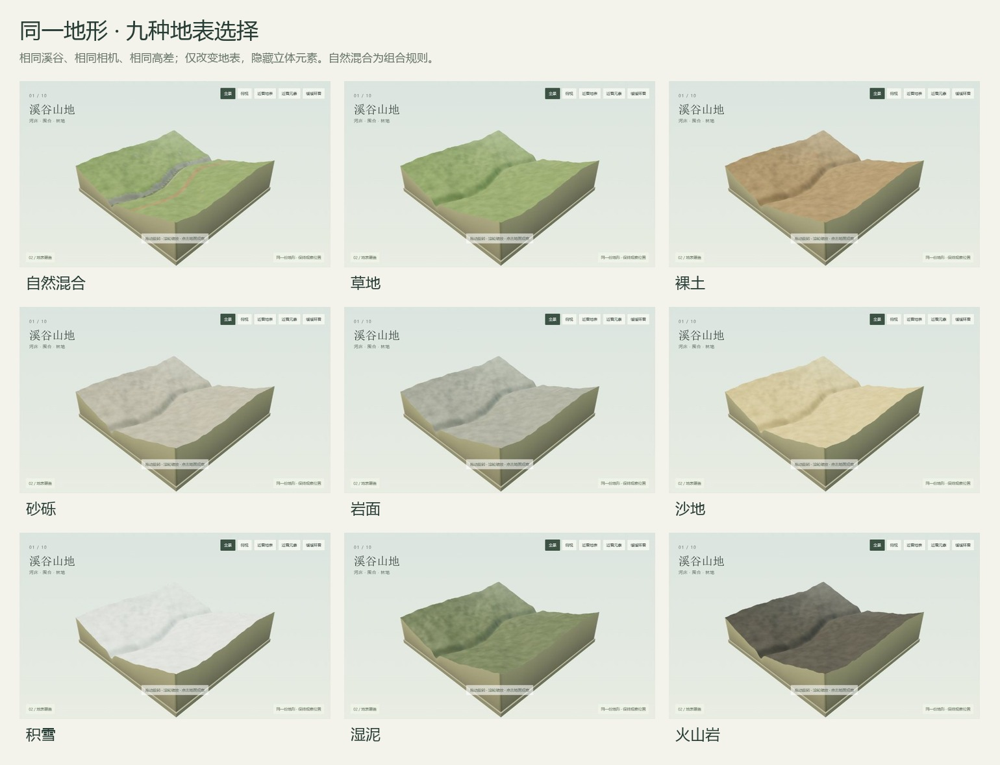
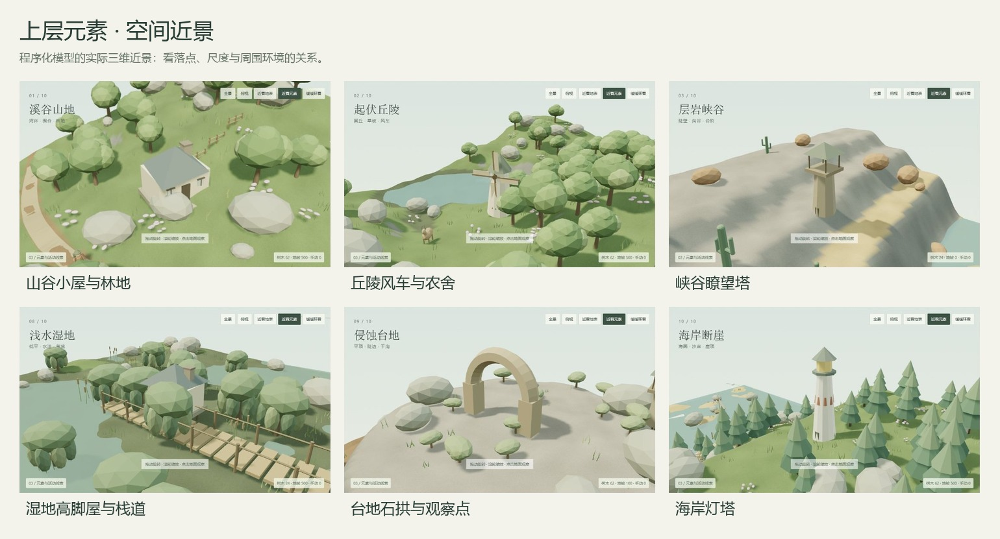

# 前一版独立样本图谱（保留档案）

当前主入口已升级为[连续世界主线](README.md)。以下记录对应atlas.html与之前采集的独立场景图。

# 0012 · 世界构建实验室

本库原创的实时三维教学网页，用 **10类地形、9种地表选择、7类元素分层**，理解构建一个世界由哪些能力组成。支持旋转、缩放、换覆盖、调高差与密度，以及点击地面检查或放置元素。

本地入口：[打开世界构建实验室](http://127.0.0.1:52932/atlas.html)；服务关闭后双击 [start.cmd](start.cmd) 重启。尚未公开部署。

这是从《红色沙漠》参考研究延伸出的独立练习。所有地形、纹理与模型由本库代码生成，没有提取或复现该游戏资产。登记的Three.js仓库是渲染依赖来源，本网页并非Three.js官方案例。



## 怎样看

1. 选“溪谷山地”，依次切换 **地形骨架 → 地表铺底 → 加入元素**。相机和地形保持一致，直接比较增加了什么。
2. 在第二层切换草地、沙地、积雪。形状不变，分清地貌大形和表面覆盖。
3. 在第三层关闭树木、水体或建筑，查看它们对场所识别的贡献；用“近看元素”检查局部尺度。
4. 比较峡谷、丘陵、台地和火山：除了高低，顶部、边缘、沟槽与凹陷也会改变空间。
5. 选择放置小屋或树木，点击地面添加，可以撤回。放置不会自动处理碰撞、平整地基或验证通行。

下半部分保存 **28张实际运行截图**：10张环境、9张同地形地表、6张元素近景、3张分层对照。可以点击进入对应实时视图；静态图是默认参数样本，不随参数变化。

## 构建能力与价值

| 层次 | 决定什么 | 本次例子 | 可复用价值 |
| --- | --- | --- | --- |
| 用途与体验 | 人或镜头去哪、看什么、做什么 | 场景说明与观察问题，尚无完整任务 | 在精细制作前确定空间需求 |
| 地形骨架 | 高低、围合、展开、边界 | 窄沟、岛体、台地、火口 | 用草模比较空间方案与路线可能性 |
| 地表覆盖 | 地面是什么、如何过渡 | 草、土、砂砾、岩面、沙、雪、湿泥、火山岩 | 积累覆盖方案与高度、坡度、水岸的分配规则 |
| 立体素材 | 立起来的物件 | 树、草丛、岩块、小屋、塔、桥、人物 | 建立素材族、尺度与组合方法 |
| 场景组织 | 元素放在哪里、如何相互影响 | 地标、植物簇、水岸与路径 | 研究疏密、留白、视线、落点与跨越关系 |
| 氛围表现 | 光线、色彩、天气、声音 | 固定日光、阴影、雾、统一配色 | 本次只验证基础画面统一；完整昼夜天气与声音待实现 |
| 内容与规则 | 人物、故事、交互与状态 | 简化旅人、鸟、船、风车运动 | 承载内容的空间基础；故事和玩法仍需按目标设计 |

**价值在于可以反复组合、比较和修改的构建方法。** 实际项目先明确用途，再搭地形草模验证尺度与路线，随后细化覆盖、素材与光照；角色、故事、交互持续参与设计。三层拆解方便理解，不代表生产中只能严格串行。



## 十类环境

| 环境 | 骨架重点 | 元素与内容线索 |
| --- | --- | --- |
| 溪谷山地 | 两侧坡地、低处河床 | 阔叶林、木桥、小屋、旅人 |
| 起伏丘陵 | 连续圆丘、开阔草坡 | 风车、农舍、花草、鹿 |
| 层岩峡谷 | 陡壁、窄沟、台阶 | 仙人掌、岩柱、塔、跨沟桥 |
| 风成沙丘 | 波状沙脊、局部低洼 | 棕榈绿洲、帐篷、旅人 |
| 高山雪岭 | 峰脊、鞍部、湖盆 | 针叶林、雪岩、山屋 |
| 火山盆地 | 山锥、内凹火口 | 枯木、黑岩、熔岩池、观察站 |
| 环海岛屿 | 岛心、缓坡、浅滩 | 棕榈、木屋、码头、帆船 |
| 浅水湿地 | 小幅起伏、水洼 | 柳树、芦苇、高脚屋、栈道、水鸟 |
| 侵蚀台地 | 平顶、陡边、低沟 | 低灌木、石拱、瞭望塔 |
| 海岸断崖 | 海面、沙岸、崖顶 | 海岸松、灯塔、渔屋、船 |



自然混合是按高度、坡度和临水条件分配的组合规则，另外八种是单一覆盖。材质采用程序化颜色与生成纹理，不是摄影扫描PBR素材库。改变地表不会同时改变树种和建筑，方便理解各层的独立性。



## 实现与复用位置

- [web/terrain.js](web/terrain.js)：高度函数、确定性噪声、坡度、覆盖分配。每个水平坐标只有一个高度，不能直接表达洞穴和悬挑；石拱使用独立模型。
- [web/models.js](web/models.js)：原创几何素材族，共享几何与材质，植被和岩石实例化。
- [web/world-data.js](web/world-data.js)：环境说明、地表目录、元素分层和放置选项。
- [web/main.js](web/main.js)：组装、开关、地形射线检查、放置、相机与简化动画。
- [scripts/build.py](scripts/build.py)：固定版本运行时准备与静态构建。资源为相对路径，便于未来按总库规则放入子路径；本次未配置发布。

## 运行与验证

需要Python 3.10+、Node.js及支持WebGL 2的浏览器；Three.js固定 **0.180.0**。在本项目目录执行：

```powershell
# 没有可复用的同版本Three.js时，首次先安装：
cd web
npm install --ignore-scripts
cd ..

python -X utf8 scripts/build.py
python -m http.server 52932 --bind 127.0.0.1 --directory dist
```

本机已有`0002-valley-garden/web/node_modules/three`的相同版本，本次直接复用；独立使用时安装本项目`web/package.json`即可。构建生成忽略的`web/runtime/`与`dist/`，复制MIT许可并记录哈希。网页启动后没有CDN依赖。

```powershell
npm --prefix web run check
node scripts/check.mjs
python -X utf8 scripts/build.py
```

实际测试见 [verification.md](verification.md)。重新生成截图拼图才需Pillow，不是网页或日常构建依赖。

## 边界

- 风格化教学示例，不是《红色沙漠》画质复现，也不做地质、生态或水文模拟。
- 水与熔岩使用平面/圆盘与地形相交，植被采用采样规则，路径是贴地带状几何。极端参数和手动放置可能出现遮挡、穿插和未连通路线。
- 旅人沿简化曲线往返，鸟和船循环运动；不含导航AI、骨骼表演、角色控制、碰撞、任务、存档或多人系统。
- 放置只保留当前页面会话，切换环境清除，刷新不保存。生产工具还需保存导出、雕刻、道路连通、地基适配、资产管线与性能预算。
- 本机验证浏览器交互和390px布局，尚未验证移动真机、低端GPU或长期稳定性。

## 来源

本库原创教学代码与程序化视觉。第三方渲染库：[Three.js](https://github.com/mrdoob/three.js)，MIT，保留 [许可](assets/THREE-LICENSE.txt) 与 [运行时哈希](assets/runtime-manifest.json)。图片出处见 [assets/SOURCES.md](assets/SOURCES.md)。

前置研究：[《红色沙漠》体验研究](../0006-crimson-desert-experience/README.md)、[价值汇总](../0007-crimson-desert-value-guide/README.md)。两者保存原片分析，本项目展示我们自己实现的构建练习。
