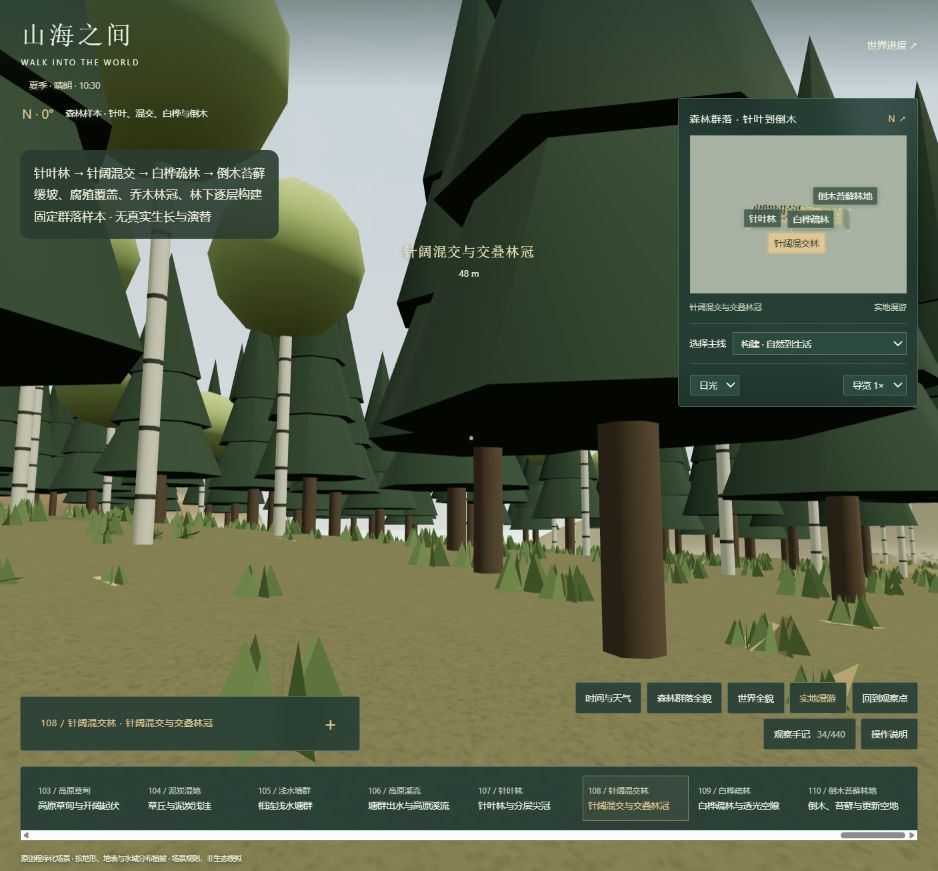
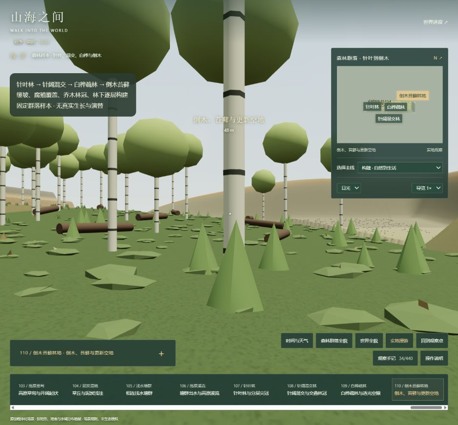

# 寒温带森林群落：针叶、混交、白桦与倒木林地

本轮在同一张3840×3120m大地图的西北部空地加入四站，范围x=-1210..-930、z=-800..-660。52—64m为紧凑世界的创作高程；本组展示森林形态组合，不代表真实纬度、气候分带或物种分布。

[进入四站主线](http://127.0.0.1:52932/expedition.html#boreal-1) · [倒木林地](http://127.0.0.1:52932/expedition.html#boreal-4)

## 实际展示和对我们的价值

| 场景 | 当前实际形体 | 可参考与扩展价值 |
| --- | --- | --- |
| 针叶林 | 77株深色尖冠乔木，圆柱树干与三层锥状冠体；树下为苔藓和针叶碎片样覆盖 | 用垂直轮廓、冠层密度和低矮地被建立森林性格 |
| 针阔混交林 | 46株针叶形态与34株浅干阔叶形态共同形成交叠冠层，蕨形林下补齐下部空间 | 同一地形通过树形比例与覆盖组合形成另一种群落 |
| 白桦疏林 | 42株浅色树干、深色横纹与开阔阔叶冠，密度低于混交段 | 透光空隙、树干节奏和落叶色共同改变氛围，形态不用于物种鉴定 |
| 倒木苔藓林地 | 12株残留乔木围出空地，九根实体倒木、苔藓块与34株幼树形态 | 森林内部还要布置地面细节、更新空地和可通行空间，不能只重复种树 |

共211株乔木，1349处林下地被形态、675处落叶碎片和34株幼树形态。全部采用程序化原创几何，按形态批量实例化，不新增外部素材或第三方资产。根部使用实际地面高程；圆木两端分别支撑实际坡面，具有实体体积和阻挡。

## 主线与分层观看

从高原湿地末站以明确标记的教学镜头转场进入针叶林；四站之间沿同一条连续干地缓坡步行。转场不是可步行的跨区域道路。四层顺序：缓坡微地形 → 落叶腐殖覆盖 → 乔木林冠 → 林下与倒木。森林群落全貌镜头与中文小地图使用同一套地面和树木分布数据；全局地图保留一个“森林群落”入口。

当前主线110站440处，旧106站424个观察ID和浏览器存储键保留；水系、植被专线数量不变。

## 当前限制

固定造型和分布不包含真实生长、光合作用、落叶累积、倒伏、分解、养分循环或生态演替，也没有真实叶面积或光照竞争计算。季节与天气沿用已有表现系统，本组树木尚无独立物候响应，不把外观变化登记为真实生态过程。竹林、季风林、更多荒漠和海岸变体仍可继续补充。

## 验证

`node scripts/check-boreal.mjs`执行12000个实际移动采样，检查原有路线前缀、观察ID、地面视线、树干和倒木阻挡、四层控制器、有限几何和三种视口全貌镜头。报告见[assets/boreal-check.json](assets/boreal-check.json)。完整导航构造与21种导航模式另由`check-map-startup.mjs`覆盖。浏览器实测范围另记于[verification.md](verification.md)，不等同于逐站或GPU性能全面验收。

## 内置浏览器实际画面

以上为构建`7c6788b7dd01`的实际内置浏览器截图，属于原创程序化场景；不含外部游戏截图。
