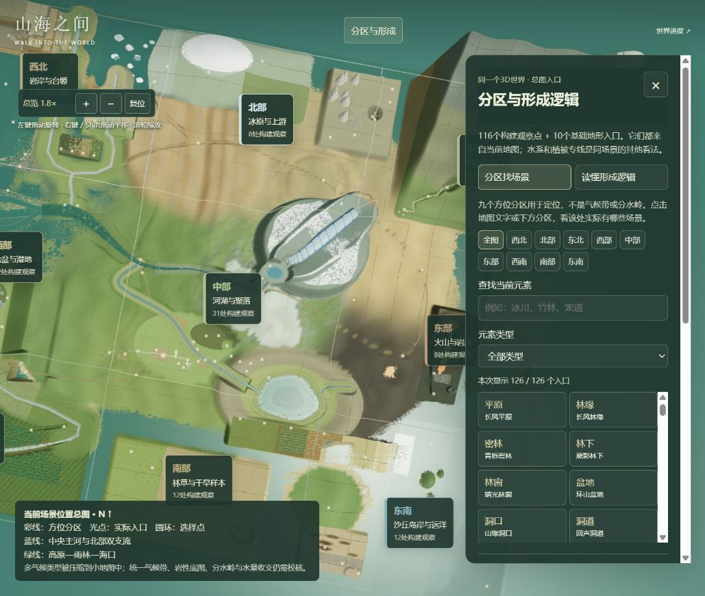

# 鼠标、总览与缩放

2026-11-18。本轮修正总览每帧固定镜头造成的鼠标无效，并补上大图和小地图的缩放。原世界场景、116站、464处观察和手记键不变。

| 当前视角 | 操作 |
| --- | --- |
| 各类全貌、连接带全貌、同图分区 | 左键拖动旋转；右键或Shift+左键拖动平移；滚轮缩放；方向键平移 |
| 地面、洞内、暂停巡河 | 原左键拖动转向；滚轮或＋/−改变视野；WASD沿原规则移动 |
| 三维小地图 | 滚轮或小地图＋/−缩放；放大后聚焦当前位置；复位回原范围；展开进入可操作的大图 |
| 触屏总览 | 单指旋转，双指平移与捏合缩放 |

左上角的＋、−、复位始终可见。总览复位恢复进入该全貌时的镜头，地面复位恢复原视野宽度；地面缩放只调整镜头，不改变人物位置。界面面板中的滚轮用于滚动面板，地图操作作用于场景画面。

总览保留原来的初始构图、剖视、图层与说明，再应用用户操作后的相机。地形文字、入口标记和方向显示随真实相机重新投影；缩放小地图也使用实际三维相机，不是缩放一张截图。

[主控制检查](assets/view-controls-check.json)使用实际Three.js 0.180.0 OrbitControls与合成DOM事件，检查左右拖动、滚轮、双指捏合、键盘平移、逐帧不复位、视角复位、地面位置不变以及小地图投影与聚焦。浏览器实测范围见[验证记录](verification.md)，不把CPU手势测试当作原生鼠标或手机实测。

最终构建 `caf94635aad8` 已在内置浏览器加载，实测＋/−、原生左拖、原生滚轮和复位。此前同轮构建另已实测地面视野、小地图缩放、复位与展开。[浏览器记录](assets/camera-browser-check.json)。

