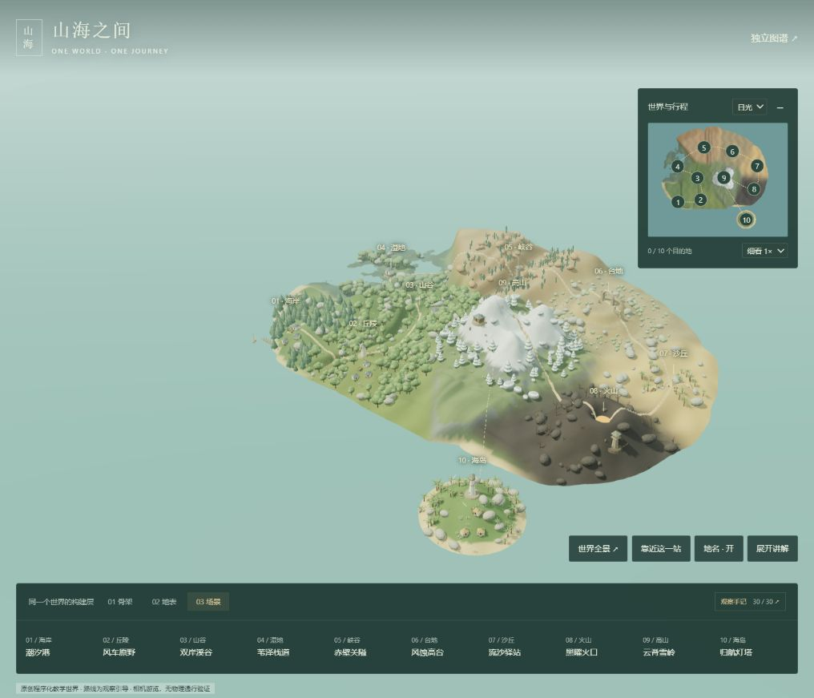
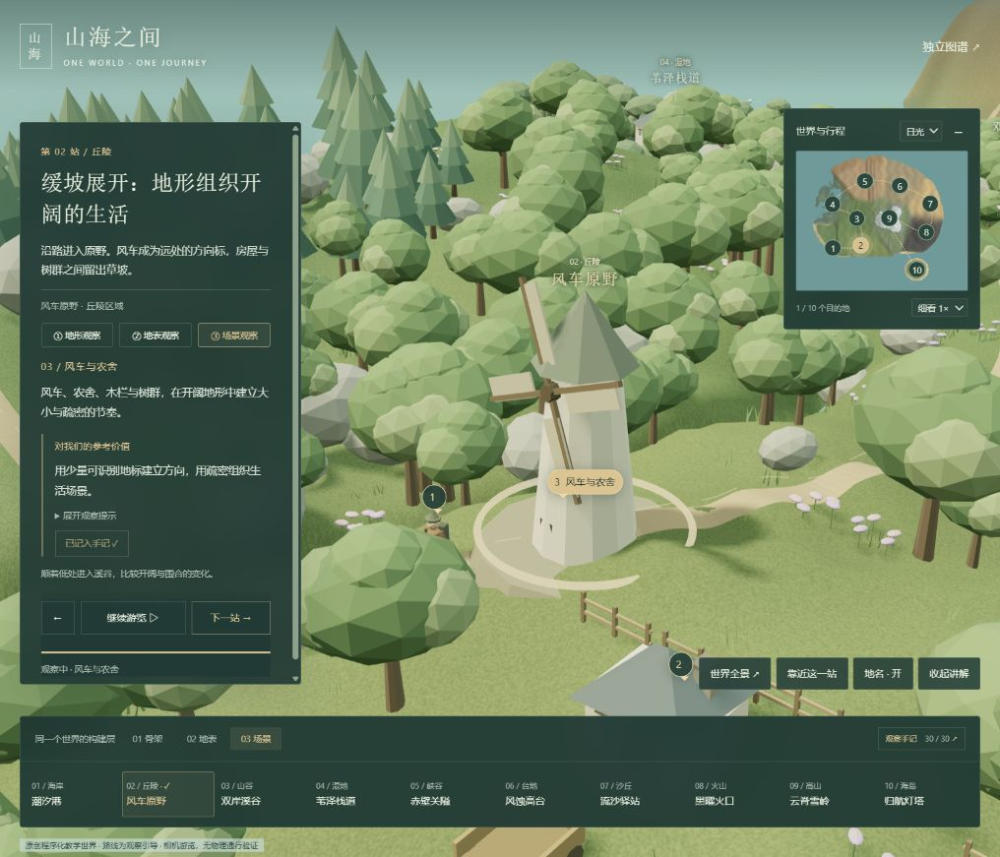

# 前轮构建总览（保留）

主入口现为[地面尺度大地图](README.md)，以下内容对应journey.html。

# 0012 · 山海之间：一个世界的构建之旅

**一个连续三维世界，一条十站主线。** 从潮汐港出发，穿过丘陵、溪谷、湿地、峡谷、台地、沙丘、火山与雪岭，最后抵达归航灯塔。所有区域同时存在，地形之间连续过渡，镜头在世界中移动。

[打开主线游览](http://127.0.0.1:52932/journey.html) · [独立样本图谱](http://127.0.0.1:52932/atlas.html) · [启动脚本](start.cmd)

这是根据“用一个完整3D世界、由一条主线带着理解”的要求重做的主要入口。前一版分立地形图谱保留在`atlas.html`，说明归档至[ATLAS.md](ATLAS.md)。网页本地运行，未公开部署。



## 怎样体验

1. 首屏先看整个世界、小地图与十处目的地；点击**开始主线游览**。
2. 相机连续抵达第一站。每站的三段讲解各6秒，分别切入**地形 → 地表 → 元素**的观察镜头，再前往下一站。细看1×全程约五分钟，快览2×约两分半；实际时间受浏览器帧率影响。
3. 可以暂停、继续，或用上一站、下一站按自己的节奏阅读。小地图和底部节点支持跳到任一站。
4. 使用世界全景回看区域之间的关系，靠近这一站查看地标；拖动环看、滚轮缩放，双击地面靠近。
5. 下方三个构建层作用于**整个同一世界**。骨架层保留海平面作为边界参照，隐藏立体素材；地表层加入覆盖，场景层显示全部素材。
6. 最后一站完成后回到世界全景，归纳这套构建方法对我们项目的价值。

主线采用**文字讲解和相机游览**，没有配音。测绘旅人送记录的故事是本库为教学编排的虚构线索，不是原游戏故事，也没有任务系统。

## 本轮继续补全

- **30个三维观察点**：每站3处，点击场景里的编号或讲解按钮，镜头对准具体对象。海岸观察点定位到海陆分界，雪岭地表观察点定位到雪线附近。
- **把观察转成方法**：每处同时解释空间关系、观察提示和对我们可复用的构建方法。界面优先显示参考价值，观察提示可展开。
- **沿路线移动**：相邻站点的镜头与旅人标记沿同一条曲线路线移动。为主路线留出树木、岩块与草丛间距；水上段补木质铺面与支撑，最后跨海段不铺陆路。
- **补充生活与环境细节**：原野的土垄与作物、港口货箱木桶和货车、沙丘驿站的井与营火、峡谷岩柱、台地遗迹、山路石堆和标记，以及鸟与船的循环运动。
- **地表与元素能直接对照**：土路和农田铺底属于第二层，立体作物、木栏、货物和桥面属于第三层；纹理细颗粒用于近看地面。
- **日光与暮色**：比较同一场景下天空、雾、日光、环境光和水面配色的变化。这是两种固定艺术设定，没有真实昼夜或天气模拟。
- **观察手记**：记录已浏览的点位，刷新后保留在当前浏览器、当前站点；可导出包含完整30处观察与参考方法的Markdown。自动游览经过一个讲解阶段后会记录，也可手动记下。记录不代表已经掌握。
- **完成状态更准确**：到访目的地与浏览三处讲解分别计数，跳站后仍能从手记看到待观察内容。



## 一条路怎样带出不同能力

| 站点 | 地形与场景 | 带着理解的问题 |
| --- | --- | --- |
| 01 潮汐港 | 海岸、港口、渔屋与码头 | 地形和水位怎样一起画出世界边界？ |
| 02 风车原野 | 丘陵、草坡、风车与农舍 | 缓坡、开阔和地标怎样组织生活空间？ |
| 03 双岸溪谷 | 连续河道、两岸林地、小屋与桥 | 低地怎样围合空间，跨越需求怎样带出桥？ |
| 04 苇泽栈道 | 湿地、浅水、柳树、芦苇与高脚屋 | 小幅高差怎样改变覆盖和建筑形式？ |
| 05 赤壁关隘 | 峡谷、陡壁、岩柱与瞭望塔 | 垂直空间怎样改变观看和通路？ |
| 06 风蚀高台 | 平顶台地、低灌木与石拱 | 同样很高，顶部形态为何影响用途？ |
| 07 流沙驿站 | 沙丘、棕榈、帐篷与旅人 | 地形大形与表面材质是什么关系？ |
| 08 黑曜火口 | 火口、黑岩、枯木、熔岩与观察站 | 形状、覆盖、素材怎样一起表达环境条件？ |
| 09 云脊雪岭 | 高山、雪线、针叶林与山屋 | 高度和坡度怎样共同影响分布？ |
| 10 归航灯塔 | 海岛、沙岸、灯塔、房屋与船 | 人物、目标和旅程怎样把空间组织成世界？ |

这条路线是教学顺序：先看边界与缓坡，再看围合与微高差，之后比较垂直、平顶、沙脊、火口、雪线，最后在岛屿回看整体。区域的气候与距离被压缩用于对照，不代表真实尺度的自然地理。

## 完整世界怎样构建

- **一份地形**：640×520场景单位的连续高度场，用257×209顶点生成单一地面网格。各区域的局部形态按平滑权重混合，而非切换加载十个独立场景。
- **共同边界**：统一海平面、主大陆、延伸至海的河道、与大陆有水道分隔的远岛。火口使用独立熔岩高度。
- **覆盖过渡**：按区域权重、高度与坡度混合颜色，组织草土、砂岩、沙地、玄岩、岩雪与水岸。
- **同场布置**：树木、草丛、岩块和各区域地标一次性生成；切换讲解层只是改变显示，不销毁或替换世界。
- **主线组织**：道路、引导虚线、十站地图与镜头移动共同指向目的地；最后一段跨海，停止铺陆地道路。道路是几何示意，未验证真实步行通行。
- **教学内容**：每站有故事引入、地形解释、地表解释、元素解释与下一段过渡提示。全程自动讲解，也可中断观察。

对我们的价值是：积累可以组合和调整的**空间骨架、覆盖规则、素材族、分布方法与体验路线**。这些能力能用于自己的世界、关卡、虚拟场景或镜头游览；具体故事、角色和玩法仍要按目标设计。

## 运行与验证

需要Python 3.10+、Node.js、支持WebGL 2的浏览器；Three.js固定0.180.0。双击`start.cmd`可构建并启动。首次缺少依赖时，在`web/`执行`npm install --ignore-scripts`；本机已复用0002项目的同版本依赖。

在本项目目录执行：

```powershell
npm --prefix web run check
node scripts/check-world.mjs
node scripts/check-learning.mjs
node scripts/check.mjs
python -X utf8 scripts/build.py
python -m http.server 52932 --bind 127.0.0.1 --directory dist
```

运行时与构建产物被忽略；没有CDN请求。构建保留MIT许可并记录运行时文件哈希。实际验证见[verification.md](verification.md)，旧图谱记录仍保留。

## 代码入口

- [web/world-layout.js](web/world-layout.js)：统一高度场、区域混合、河道、覆盖和十站讲解。
- [web/journey.js](web/journey.js)：完整世界、地图、地标、沿路镜头、三维观察点、手记与层次切换。
- [web/journey-learning.js](web/journey-learning.js)：30处观察、参考方法、边界定位与Markdown手记生成。
- [web/scene-details.js](web/scene-details.js)：本轮原创的货物、货车、水井、营火、路标、石堆与遗迹几何。
- [web/journey.html](web/journey.html)、[web/journey.css](web/journey.css)：主线界面；`index.html`为相同入口。
- [web/models.js](web/models.js)：本库原创的程序化模型，供连续世界与旧图谱共同使用。
- [web/atlas.html](web/atlas.html)：保留前一版独立对照实验室。

## 当前边界

风格化教学展示，非《红色沙漠》复原或游戏资产提取。尚无角色控制、碰撞寻路、任务、世界存档、多人、真实昼夜天气或声音。手记只保存浏览记录，不保存地形、物件或角色状态。相机飞行与引导路线方便阅读，不能证明道路可走、坡面可爬；素材与地形可能局部穿插；人物是简化模型的位置移动，没有完整步行动画。高度场不能直接表达洞穴，石拱使用独立模型。没有真机或低端GPU性能验证。

第三方渲染库来自[Three.js](https://github.com/mrdoob/three.js)，MIT，保留[许可](assets/THREE-LICENSE.txt)。截图来源见[assets/SOURCES.md](assets/SOURCES.md)。参考作品分析仍单独保存在[0006](../0006-crimson-desert-experience/README.md)和[0007](../0007-crimson-desert-value-guide/README.md)。
