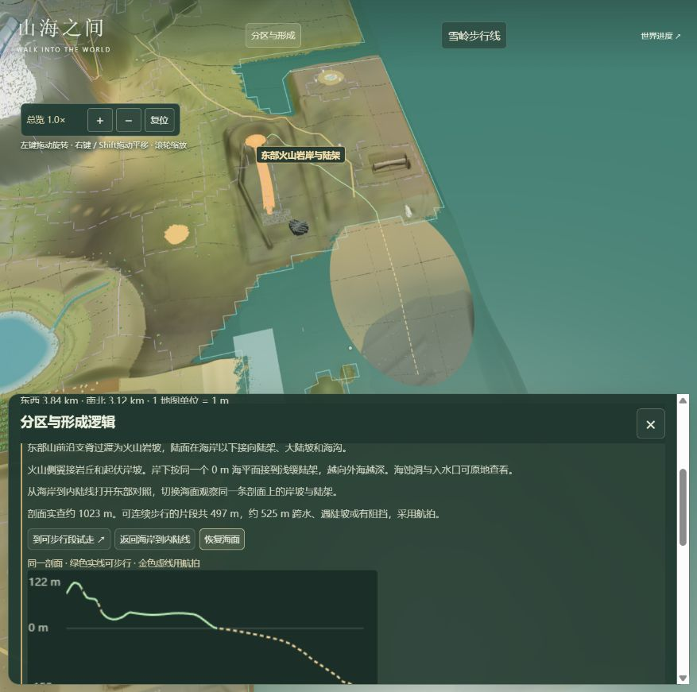

# 现代环境基座 V1 · 规模、通行与环境过渡

[从雪岭实走到海湾](http://127.0.0.1:52932/expedition.html?walk=snow-to-bay#ice-1) · [在 3D 地理底图复查接缝](http://127.0.0.1:52932/expedition.html?plan=foundation#build-1) · [世界总览](http://127.0.0.1:52932/journey.html#geographic-foundation)

[第二阶段 · 在同一路线切换史前时间层](BENCHMARK-TIME.md)

## 同一张地图

东西 3.84 公里，南北 3.12 公里，1 地图单位等于 1 米。总览标有 1 公里比例尺、北向、0 米海岸、主山脊和分水岭。结合 1 月西北风、7 月西南湿风和东南近岸水汽，可对照三条环境线。

| 环境线 | 核对关系 |
| --- | --- |
| 顺水 | 雪岭和北部支流汇入中央海湾。西南高原塘溪经雨林独立入海。低盆缘把西部盐湖和盐沼围在内流区。 |
| 南北冷暖 | 从北部冷岸、冷坡和混交林，到南部暖地。从东北青岚山脉和雪岭还能看到海拔带来的降温。 |
| 海岸到内陆 | 西南水汽抬升后，迎风侧长出湿林，越岭后过渡为草地和砾地。东部从岩岸向海下延伸到陆架与大陆坡。 |

[全图实景](assets/environment-v1-overview.jpg) · [三流域同一场雨的实景读数](assets/environment-v1-basins.jpg)

## 雪岭到中央海湾

在同一张大地图上，以干岸、缓坡和架空栈道接通约 **2,483 米**。冰川侧坡沿冰碛外侧下降，绕开陡坎和冰体。下游沿较高岸缘走，经湿地与河口，到中央海湾岸端。

| 环境 | 路线累计距离 |
| --- | --- |
| 雪岭、冰川侧坡、冰碛湖 | 0、208、505 米 |
| 融水溪、源池、跌水岸路 | 589、655、854 米 |
| 中央河谷、苇泽湿地 | 1,358、1,869 米 |
| 分汊河口、中央海湾 | 2,306、2,483 米 |

进入步行面板后可用 WASD 或方向键移动，也可点「从起点步行导览」。导览按地面移动规则逐步检查落脚、水域、坡度和障碍物。切换到三条环境线可从空中看同一片流域的地势和支流。

[雪岭起点实景](assets/modern-foundation-snow-start.jpg) · [中央海湾抵达实景](assets/modern-foundation-bay-finish.jpg)

## 四处接缝

从「分区与形成 → 地理底图」打开对应环境线，在「接缝定位」选择剖面。绿色实线表示可连续步行的片段，金色虚线表示用航拍观察的片段。「到可步行段试走」把观察者落到该剖面最长的可步行段。

| 环境线与接缝 | 可步行合计 | 最长连续段 | 航拍 | 每约 25 cm 的最大高差 |
| --- | ---: | ---: | ---: | ---: |
| 南北冷暖 · 北部冰岸与混交林 | 689 m | 205 m | 70 m | 0.53 m |
| 海岸到内陆 · 南部湿林与背风干地 | 714 m | 630 m | 23 m | 0.24 m |
| 顺水 · 西部盐盆与高原坡脚 | 516 m | 159 m | 130 m | 0.81 m |
| 海岸到内陆 · 东部火山岩岸与陆架 | 497 m | 396 m | 525 m | 0.51 m |

北部沿冷坡与林缘试走，支沟和较陡处换用航拍。南部可在迎背风坡之间走最长的一段地面。西部沿干岸与高原坡脚分段观察，地表分水岭仍把内流盐盆和出海流域分开。东部岩岸有地面观察段，越过岸线后的陆架通过航拍和「显示海床」查看。

北部把冰岸、冲积扇和支谷的接合处改成渐变。南部保留原河床，压掉岸边由图层切换造成的台阶。西部修顺塘溪边缘和谷地弯道，内流盆缘及陡坡保有原来的分隔作用。东部实测高程已经连续，海面下的段落用航拍查看。

## 核验范围

2026-11-19 在内置浏览器打开统一底图，复查四处剖面并在各处落地试走，核对东部海床视图和三流域的同场雨读数。标杆路线先前已在内置浏览器实走至终点，本次重新跑通双向移动回归。保留 116 个构建站和已有的史前对照。通行距离分别取整，孤立短落脚区归入航拍。

V1 可用作聚落和交通的选址底图。四条剖面只覆盖所选路径，通行按现代默认水位核验。航拍仍可辨认部分雪冰、植被和底质样区的直边。气候和地貌形成采用教学尺度，洪峰、风暴潮和其他时间层的通行条件要分别看。

[地面通行回归脚本](scripts/check-modern-foundation.mjs) · [三条环境线与形成逻辑](ENVIRONMENT-LINES.md)
