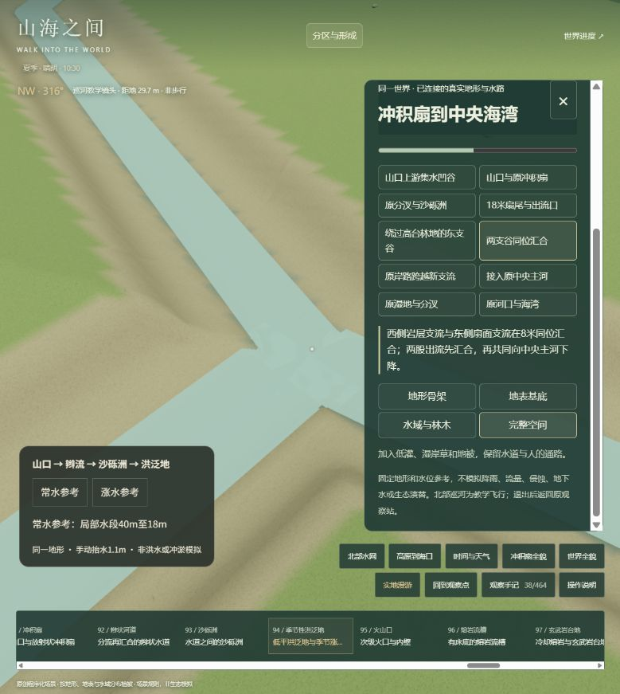
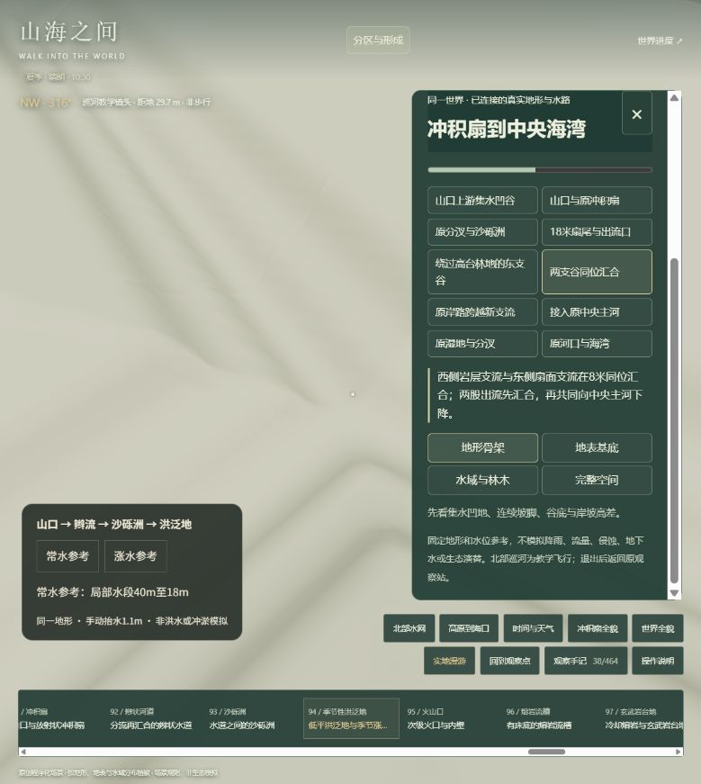
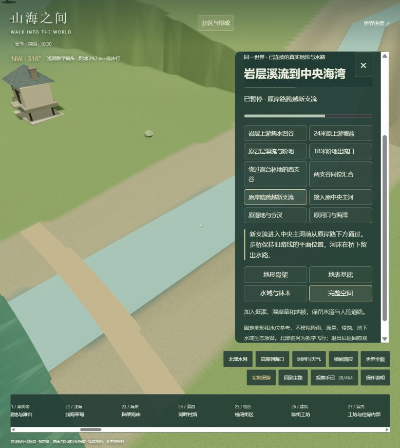
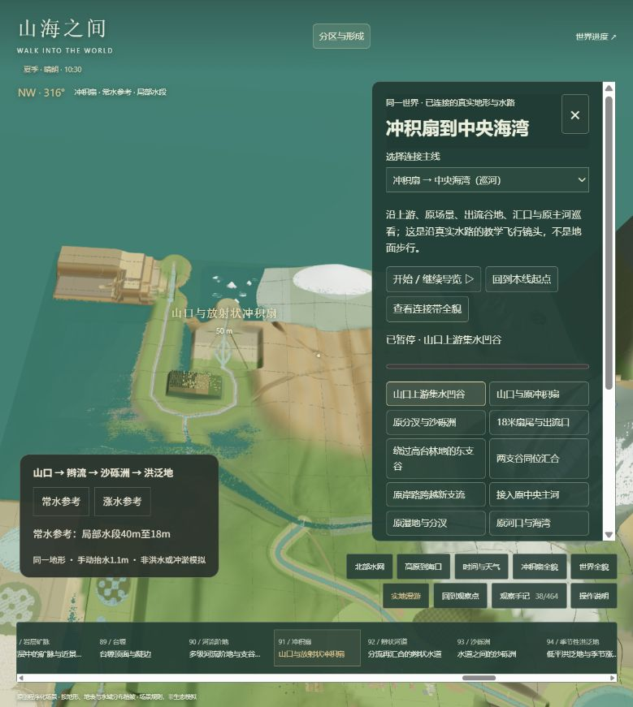

# 北部双支流：冲积扇、岩层溪流与中央主河

2026-11-18。原116站464处继续保留。继高原—雨林连接带之后，本轮补上北部两处局部水系的上游、出流谷地和实际汇口，全部使用当前大地图的高度场与水域查询。

[冲积扇到中央海湾](http://127.0.0.1:52932/expedition.html?connection=north-fan#build-91) · [岩层溪流到中央海湾](http://127.0.0.1:52932/expedition.html?connection=north-strata#build-90) · [原高原到海口](http://127.0.0.1:52932/expedition.html?connection=1#build-106)

## 为什么这样连接

原岩层溪流的末端约18米，原冲积扇入口约40米，因此两者应各自外流并在更低处汇合。新增西支谷和东支谷分别绕过原高台森林，8米处同位汇合；汇流槽再以约2.19米水位进入原中央主河0.62处，沿原湿地、河口与海湾出海。

| 水路 | 高程与实际衔接 |
| --- | --- |
| 岩层支流 | 新34米上游凹谷 → 原24—18米岩层溪流 → 西支谷 → 8米汇口 |
| 冲积扇支流 | 新72米上游凹谷与碎屑坡 → 原40—18米扇面分汊 → 东支谷 → 8米汇口 |
| 共同下游 | 8米汇流低谷 → 原中央主河约2.19米接点 → 原湿地、分汊与海湾 |
| 其他流域 | 高原—雨林仍是一条独立外流水系；盐盆继续保持内流 |

五段新增水路合计约1.72公里，都是实际下切河床与水面，不只是总图连线。原先部分低洼或海面以下间隔被重新塑造成集水凹谷、坡脚陆地和岸坡，这是明确的局部创作地形修改，并非从原地貌自动推导出了正确地质史。

两股低水位溪流在高台森林两侧绕行，原林内四站及通路保留；两侧溪谷与中间高台形成可观察的高差关系。当前仍没有自动提取真实分水岭、汇水面积或地下水系统。

## 如何观看

连接带面板现在有三条主线。原高原线保持约1.95公里地面导览；新增两条北部巡河线约1.69公里和1.93公里，各有10处检查点。北部镜头沿实际水路飞行，用于比较上游、原场景、出流谷地、汇口与海湾，不表示玩家可沿河床步行或已经实现船舶交通。

可选点、暂停继续，并按地形骨架、地表基底、水域与林木、完整空间对照。新支流穿过原中央主河岸路的位置有窄步桥与通行支撑；退出巡河回到对应的原观察站。

原扇面常水/涨水两档参考继续保留。扇面上下接点随参考水位衔接，新河段的地形、植被和岸路不随按钮重建；这仍是手动边界状态，不是洪水传播、流量守恒或输沙模型。

九区总图的蓝线现在包含中央主河、原扇面和岩层溪流及五段新连接，绿色仍表示高原—雨林水系。线条表示实际几何连通，不能代替水文收支证明。

## 原内容保留与本轮改动

- 保留116个观察站及464个原观察ID，原站点三维位置与改动前逐项比较一致；观察手记键不变。
- 原主线11501个采样的平面位置不变。新增地形会使途经区间的地面与镜头高度随高度场变化，本轮不声称全程三维轨迹完全不变，具体差异见[northern-preservation-check.json](assets/northern-preservation-check.json)。
- 原岩层、扇面、寒温带森林、高山、洞穴、聚落、生产交通与高原雨林线继续保留；局部地表、植被落点和岸坡会响应新水路。
- 北部巡河的20个检查点用于解释连接，不并入原116站或冒充新增20种地貌。

## 验证与未完成范围

[northern-watershed-check.json](assets/northern-watershed-check.json)记录两档水位30010个连续水面采样、零下游抬水、床底和最低分辨率地形网格检查、实际水面三角形、岸路跨水2000次移动、常水条件下陆生落点避水、三条导览的完成与暂停继续，以及三种宽度的总览面板避让。

[verification.md](verification.md)记录其他回归与内置浏览器范围。尚未统一全图岩性构造、水汽温度、气候尺度、宽生态过渡、集水范围与收支；泥炭浅洼、绿洲、泉与地下水补给仍缺完整耦合。没有降雨径流、地貌侵蚀、泥沙输运或真实生态演替。

## 内置浏览器实景

截图来自本机程序化世界，不是参考游戏图片。浏览器验收只覆盖记录中的选定场景与交互，完整全程与性能仍待系统验证。
