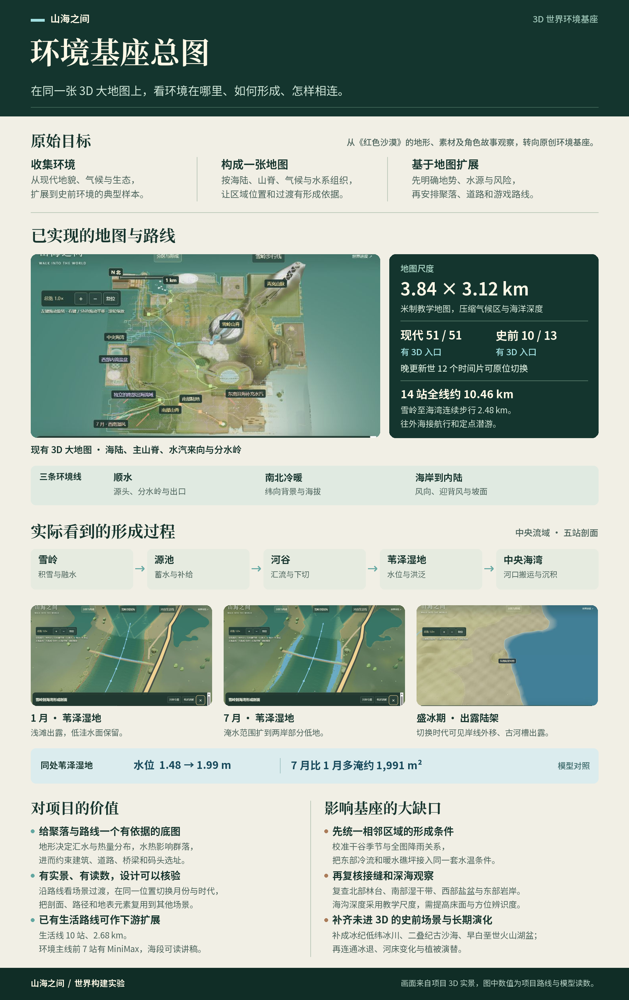
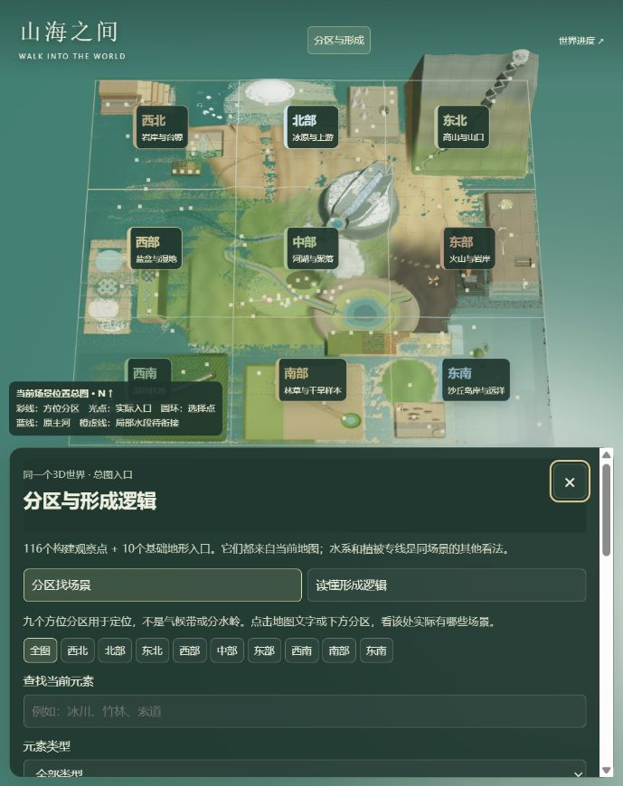
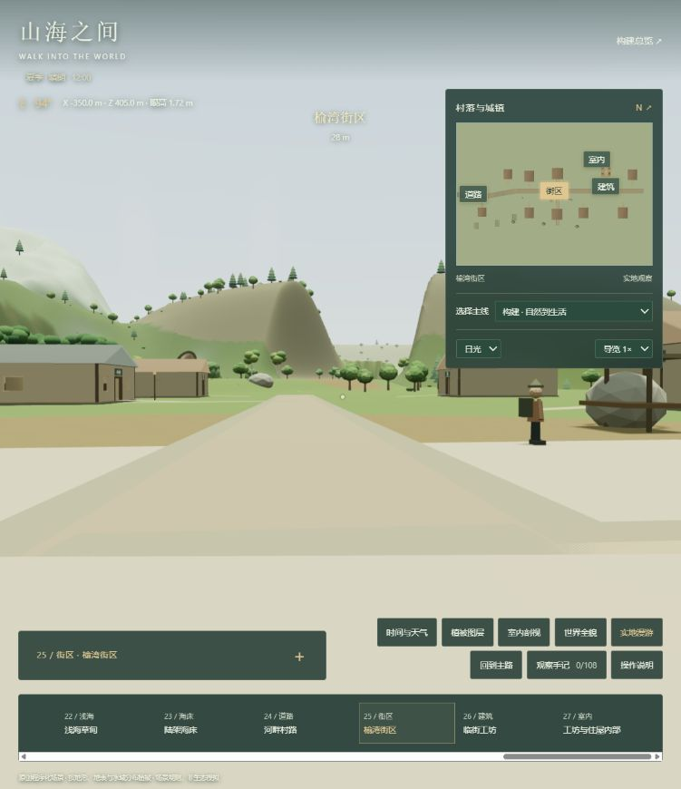
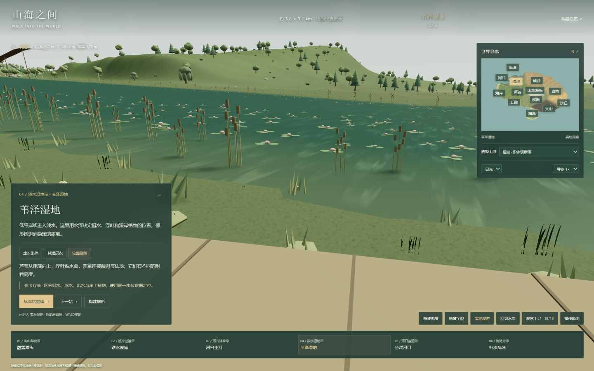
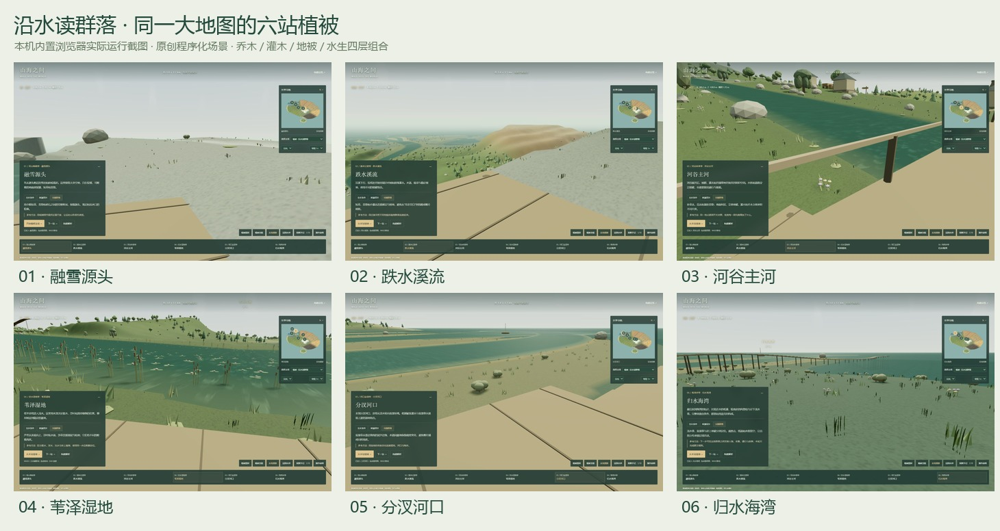
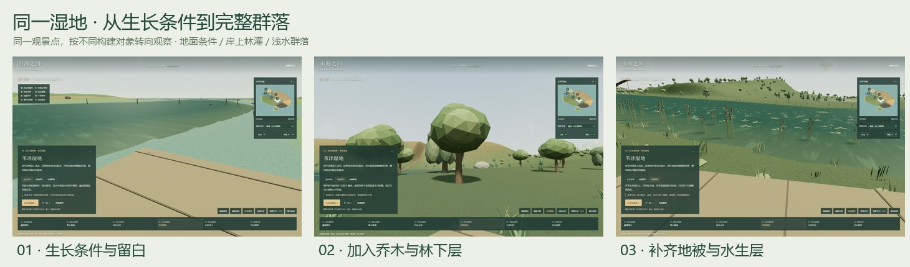
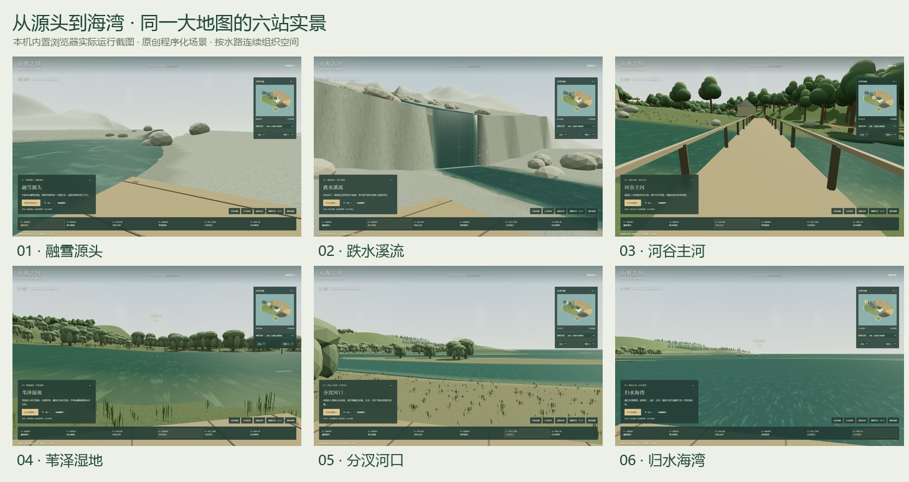
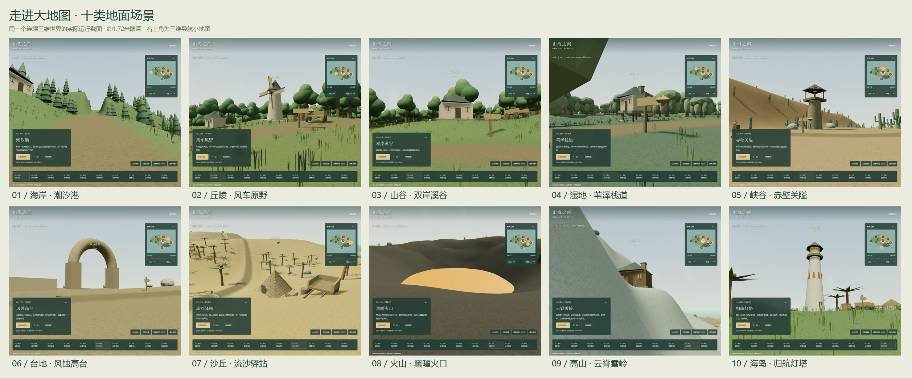

# 山海之间 · 多种地理效果与 3D 环境基座

在同一张可探索的原创 3D 地图中实现多种现代与史前地理效果，包括山脉、冰川、河流、湿地、盐盆、雨林、海岸和深海。沿实景路线对照地形、岩性、气候、水系与植被怎样共同形成这些环境，再用地势与水源推导聚落和交通选址。

[项目总览](https://yydshly.github.io/20261115_codex_project/demos/0012-world-building-lab/world-report.html) · [进入世界导览](https://yydshly.github.io/20261115_codex_project/demos/0012-world-building-lab/) · [查看总图 PNG 原图](assets/world-foundation-summary.png)

[](assets/world-foundation-summary.png)

当前可作为环境基座 V1。现代图谱 51 项均有入口，史前 13 项已有 10 项进 3D。地形与季节读数采用场景尺度，跨区条件和长期地貌演化仍有待补。以下为专题入口与各阶段研究记录。

[世界总览 · 统一地理底图](https://yydshly.github.io/20261115_codex_project/demos/0012-world-building-lab/journey.html#geographic-foundation) · [3D 地理底图](https://yydshly.github.io/20261115_codex_project/demos/0012-world-building-lab/expedition.html?plan=foundation#build-1) · [环境覆盖与形成缺口](https://yydshly.github.io/20261115_codex_project/demos/0012-world-building-lab/journey.html#environment-coverage)

[环境缺口与补全顺序](https://yydshly.github.io/20261115_codex_project/demos/0012-world-building-lab/journey.html#next-steps) · [在 3D 大地图定位](https://yydshly.github.io/20261115_codex_project/demos/0012-world-building-lab/expedition.html?plan=gaps#build-1)

## 雪岭到深海 · 连续主线

[从雪岭出发](https://yydshly.github.io/20261115_codex_project/demos/0012-world-building-lab/expedition.html?walk=snow-to-deep#ice-1) · [十四站内容、语音设置与后续规划](MAINLINE-GUIDE.md)

## 河谷到海湾生活线

[从榆湾农田出发](https://yydshly.github.io/20261115_codex_project/demos/0012-world-building-lab/expedition.html?walk=valley-life#life-2) · [十站路线与洪泛对照](LIFE-ROUTE.md)

沿村街、市场、桥梁、货运码头和出湖河干岸步行 2.68 公里，在两河汇口接回既有下游岸路。可在木桥、码头和苇泽洪泛滩原地对照新增淹水范围。

## 现代环境 V1 · 连续步行与接缝

[实走雪岭到海湾](https://yydshly.github.io/20261115_codex_project/demos/0012-world-building-lab/expedition.html?walk=snow-to-bay#ice-1) · [现代环境基座验收](MODERN-FOUNDATION.md)

沿冰碛外侧、干岸和栈道走 2.48 公里到中央海湾。三条环境线共用一张 3.84 × 3.12 公里的底图。四处接缝已复查高程和通行，可在地图上查看步行和航拍范围。

## 史前环境 · 暖期、入冰与退冰

[在同一张 3D 地图查看入冰时间线](https://yydshly.github.io/20261115_codex_project/demos/0012-world-building-lab/expedition.html?plan=timeline&epoch=inception&focus=water&station=bay#build-1) · [地理底图与比例依据](REGIONAL-GEOGRAPHY.md#冰期与现在)

[沿雪岭到海湾的标杆路线切换时期](https://yydshly.github.io/20261115_codex_project/demos/0012-world-building-lab/expedition.html?walk=snow-to-bay&epoch=interglacial&at=2306#ice-1) · [各期步行与航拍读数](BENCHMARK-TIME.md)

十二个节点覆盖约 12.5 万年前的末次间冰期、五个入冰切片、约 2.1 万年前的盛冰期和四个退冰切片，最终回到现在。顺水看冰舌和河口，南北冷暖看同一林坡上的林带变化，海岸到内陆看浅岸和陆架怎样出露。

## 更早的史前环境 · 内陆海道与高纬暖湿林

沿山前、滨海低地、砂脊、海道轴到东岸，在同一片低地对照海侵和海退。揭开水面看砂与泥的位置。水位为场景米。[打开晚白垩世内陆海道](https://yydshly.github.io/20261115_codex_project/demos/0012-world-building-lab/expedition.html?plan=deep-time&case=seaway#build-1) · [USGS 地层剖面](https://www.usgs.gov/publications/west-east-lithostratigraphic-cross-section-cretaceous-rocks-central-utah-western)

沿曲流、河漫滩、积水洼地、林冠与河阶观察较暖的高纬森林，在同一站看长昼、长夜与现代。古地形和群落独立构建，地图坐标用于比较。[打开始新世高纬暖湿林](https://yydshly.github.io/20261115_codex_project/demos/0012-world-building-lab/expedition.html?plan=deep-time&case=forest&station=canopy#build-1) · [埃尔斯米尔岛化石森林调查](https://journalhosting.ucalgary.ca/index.php/arctic/article/view/64792)

## 海底流体出露与陆上地热

沿东南海床看硬底热液烟囱、大陆坡、甲烷冷泉和海沟。打开剖面对照海水受热回升、含甲烷流体沿沉积物渗出，以及相应的矿物沉积和群落。[进入海底热液与冷泉](https://yydshly.github.io/20261115_codex_project/demos/0012-world-building-lab/expedition.html?plan=fluid-vents&route=ocean&station=vent#build-1)

沿东部地热区看补给坡、原有热泉、间歇泉、钙华溢流阶地和酸性泥池。可手动切换间歇泉的三个阶段或播放一轮。地下通道和喷发节奏采用教学尺度，地表和海床位置沿用现有地图。[进入陆上地热](https://yydshly.github.io/20261115_codex_project/demos/0012-world-building-lab/expedition.html?plan=fluid-vents&route=land&station=geyser#build-1)

# 中央海湾流域 · 降雨、潮汐与岸线

[在原 3D 大地图看泥沙与岸线](https://yydshly.github.io/20261115_codex_project/demos/0012-world-building-lab/expedition.html?plan=storm&focus=estuary&study=sediment#build-1) · [试算、站点和模型边界](STORM.md)

从北部山口调雨量和时长，沿扇尾泉口、苇泽湿地到中央河口。用同一条时间尺对照涨潮和退潮时的湿地出水、盐度前缘和泥沙去向，再按洪水场次观察浅脊和潮滩抬高后的岸线。

从同一片新露滩地观察耐盐草和芦苇的演替，并在相同复冲条件下比较截留泥沙、床面冲失与重淹范围。[在 3D 大地图看滩地植被](https://yydshly.github.io/20261115_codex_project/demos/0012-world-building-lab/expedition.html?plan=storm&focus=estuary&study=plants#build-1)

分别调海平面抬升和风暴增水，对照潮滩与沙洲的暂淹、退水后冲刷以及耐盐草和芦苇向较高滩面迁移的路径。[在 3D 大地图看海面与风暴潮](https://yydshly.github.io/20261115_codex_project/demos/0012-world-building-lab/expedition.html?plan=storm&focus=estuary&study=sea#build-1)

## 河口潮汐、盐度与植被

[在原 3D 大地图看河口](https://yydshly.github.io/20261115_codex_project/demos/0012-world-building-lab/expedition.html?plan=estuary#build-1) · [潮汐与咸淡水混合](ESTUARY.md)

沿淡水湿地、分汊河口、潮间带走到中央海湾。独立切换潮段和丰枯来水，对照海水顶托、盐度前缘、露滩范围以及芦苇和耐盐草的分布。

## 洪泛、退水与湿地植被

[在原 3D 大地图看河流与湿地](https://yydshly.github.io/20261115_codex_project/demos/0012-world-building-lab/expedition.html?plan=wetland#build-1) · [水位、退水与植被分带](WETLAND.md)

沿河道、河漫滩、季节性湿地到常年湿地。切换丰枯水期，在同一段河岸看洪水淹到哪里、露出的泥面如何失水，以及莎草、芦苇与岸草为什么各在不同位置。

## 地表与地下两条水路

[在原 3D 大地图看水路汇合](https://yydshly.github.io/20261115_codex_project/demos/0012-world-building-lab/expedition.html?plan=exchange#build-1) · [双路、季节与停雨试算](WATER-EXCHANGE.md)

沿北部冲积扇看分水岭、坡面径流和地下补给。两条路径在扇尾泉口所在的支谷汇合，继续流到中央主河与苇泽湿地。切换丰枯水期，或对照连续停雨 14 天后的基流。

## 岩性、地下水与三条环境线

[在原 3D 大地图比较同雨与地下水](https://yydshly.github.io/20261115_codex_project/demos/0012-world-building-lab/expedition.html?plan=groundwater#build-1) · [区域设定与地下水模型](GROUNDWATER.md)

查看四类基岩和砂砾盖层如何改变同一场雨的去向，再沿干谷含水层追到绿洲泉池，或打开已有的北部岩溶洞网看落水入洞。

## 连续地质剖面 · 东南海沟到中央河谷

[在 3D 大地图看连续剖面](https://yydshly.github.io/20261115_codex_project/demos/0012-world-building-lab/expedition.html?plan=tectonics#build-1) · [十二站与地图设定](TECTONICS.md)

6.73 公里剖面从东南海沟经火山弧、青岚山前和高山，跨鞍部到跌水、汇口和中央河谷。可切换基岩、风化覆盖和水流，放大最后 160 米的河谷横切。

[在原 3D 大地图看三条环境线](https://yydshly.github.io/20261115_codex_project/demos/0012-world-building-lab/expedition.html?plan=lines#build-1) · [线路、过渡和验收](ENVIRONMENT-LINES.md)

顺水、南北冷暖、海岸到内陆三条观察线共用同一地图。可以开关海陆、山脉、季风和分水界标记，切换 1 月与 7 月，以及沿三段新地表和植被过渡观察。

---

# 环境图谱与地图基座

[打开环境图谱](https://yydshly.github.io/20261115_codex_project/demos/0012-world-building-lab/environment.html) · [形成逻辑与收录范围](ENVIRONMENT-ATLAS.md)

先按类型展示现代与史前环境，逐项记录可见效果和形成条件，再把适用于同一时期的环境组织到大地图。图谱包括日照互动、现有场景入口和史前概念剖面。

---

# 土壤形成与植被过渡

[沿河观察四段土壤与植被](https://yydshly.github.io/20261115_codex_project/demos/0012-world-building-lab/expedition.html?plan=soil#build-91) · [母质、剖面与季节参数](SOIL.md)

山口薄土、冲积扇砂砾土、苇泽河漫滩泥土和中央海湾盐湿土，共用已有地形、逐月水量和泥沙。可在同一位置切换三维剖面、湿度与盐度、植被分布，查看三处样点。

---

# 流水侵蚀与泥沙沉积

[沿水进入五段泥沙主线](https://yydshly.github.io/20261115_codex_project/demos/0012-world-building-lab/expedition.html?plan=sediment#build-91) · [形成逻辑与模型范围](SEDIMENT.md)

在同一张大地图里沿北部山口、冲积扇、支谷、苇泽湿地和中央海湾观察。可以比较各月的坡面冲刷、河道带走的泥沙、漫滩细泥与河口沙洲，也可以查看退水后留下的年内累积沉积。

---

# 北部双支流实际接回主河 · 2026-11-18

鼠标操作已补齐：总览左拖旋转、右拖平移、滚轮缩放，左上角可放大、缩小、复位；地面滚轮调整视野，小地图也有独立缩放与展开。[操作说明](CAMERA-CONTROLS.md)。

原116站464处保留。新增两处上游凹谷、分别绕过原高台森林的东西支谷，以及8米汇口和约2.19米中央主河接点；再沿原水系到海湾。两条北部巡河主线各10处检查点，原高原—雨林地面导览仍可选择。真实分水岭、水量收支、气候与岩性背景仍未统一。

[冲积扇到中央海湾](https://yydshly.github.io/20261115_codex_project/demos/0012-world-building-lab/expedition.html?connection=north-fan#build-91) · [岩层溪流到中央海湾](https://yydshly.github.io/20261115_codex_project/demos/0012-world-building-lab/expedition.html?connection=north-strata#build-90) · [详细改动与边界](NORTHERN-WATERSHED.md)

以下保留此前记录的当时范围。

---

# 首条实际地理连接带 · 2026-11-17

原116站464处与原主线路径保留。新增约861米下行溪谷、坡脚陆地、出水步桥和岸边群落，把原220米高原出水接到原14米雨林河网，再沿红树林到零米海口。八处连接带检查点提供约1.95公里地面导览与分层对照；原中央主河和内流盐盆分别保留。尚未完成全图气候、岩性、流域与过程统一。

[进入高原到海口](https://yydshly.github.io/20261115_codex_project/demos/0012-world-building-lab/expedition.html?connection=1#build-106) · [详细改动与边界](WATERSHED-INTEGRATION.md)

以下保留此前记录的当时范围。

---

# 0012 · 山海之间：世界进度总览与3D大地图

现在入口已统一：**index.html / journey.html 查看当前世界进度，expedition.html 进入同一张完整3D地图**。总览与大地图内“世界进度”共用一份清单，按“已完成展示 / 简化样本 / 尚未制作”解释范围。

[打开统一总览](https://yydshly.github.io/20261115_codex_project/demos/0012-world-building-lab/journey.html) · [进入3D大地图](https://yydshly.github.io/20261115_codex_project/demos/0012-world-building-lab/expedition.html#build-1) · [查看七步补全顺序](https://yydshly.github.io/20261115_codex_project/demos/0012-world-building-lab/journey.html#next-steps) · [文字版进度](PROGRESS.md)



当前41项清单中，4项完成了明确的展示能力、32项为简化样本、5项尚未制作；不将这些范围不同的条目换算成游戏完成百分比。116站464处是空间观察与讲解数量，原个人浏览记录另行保留。

当前已有大量环境样本，仍未形成完整自然世界。现在优先统一同图布局、岩性、气候与流域约束，补过渡带和局部水网；环境过程、人物、经济与故事仍需后续制作。

**大地图包含一百一十六站世界构建主线**：长风平原 → 林缘 → 密林 → 林下 → 林窗 → 环山盆地 → 洞口 → 洞道 → 洞厅 → 地下水域 → 返回地表 → 澄镜内陆湖 → 雪山 → 冰川 → 冰湖 → 融水溪流 → 汇流河谷 → 苇泽湿地 → 分汊河口 → 归水海湾 → 礁岸 → 潮间带 → 浅海 → 海床 → 沿岸路返回 → 村路 → 街区 → 建筑 → 室内 → 青岚山脚村 → 登山路 → 峡谷吊桥 → 索道下站 → 索道上站 → 山脊 → 主峰 → 资源林地 → 农田 → 渔场 → 仓储 → 市场 → 作坊 → 住宅 → 道路 → 桥梁 → 码头 → 转运场 → 公共取水 → 检修休憩 → 极地海岸 → 海冰冰山 → 冰盖 → 苔原 → 极光夜景 → 教学镜头转场 → 外海 → 群岛 → 大陆架 → 大陆坡 → 深海海沟 → 教学镜头转场 → 雨林林缘 → 林冠 → 林下 → 雨林河岸 → 红树林 → 河海交界 → 教学镜头转场 → 连续草原 → 林草过渡 → 戈壁砾地 → 干谷 → 绿洲 → 沿原路返回草原 → 云层变化 → 雷暴闪电 → 沙尘 → 夜空 → 教学转场 → 海蚀洞 → 岩桥 → 分支洞网 → 火山地热 → 教学转场 → 峰林 → 石林 → 天坑 → 竖井 → 多层洞穴 → 地下河 → 原路返回地表 → 教学转场 → 盐湖 → 盐沼 → 盐壳滩地 → 干涸湖盆 → 教学转场 → 层状岩壁 → 岩层矿脉 → 台塬 → 河流阶地 → 教学转场 → 冲积扇 → 辫状河道 → 沙砾洲 → 季节性洪泛地 → 教学转场 → 次级火口 → 熔岩流槽 → 冷却玄武岩台地 → 柱状节理 → 教学转场 → 风蚀雅丹 → 开放风蚀槽 → 荒漠石漠 → 砾石台地 → 教学转场 → 高原草甸 → 泥炭湿地 → 浅水塘群 → 高原溪流 → 教学转场 → 针叶林 → 针阔混交林 → 白桦疏林 → 倒木苔藓林地 → 教学转场 → 竹林林缘 → 竹林内部 → 季风密林 → 季风疏林 → 临海前缘沙丘 → 背风沙丘。地貌站依次对照**地形骨架 → 地表覆盖 → 水域关系 → 植被群落**；森林四站依次对照**林地基底 → 树冠围合 → 林下层次 → 完整空间**。地下四站依次对照**空间骨架 → 岩层表面 → 地下水域 → 完整洞境**。冰雪四站依次对照**山体与冰体 → 雪冰覆盖 → 冰湖与融水 → 完整冰雪环境**。海岸四站按**海岸骨架 → 地表与底质 → 水位与水深 → 完整海岸生态**递进。聚落四站按**道路与场地 → 街区与公共空间 → 建筑与界面 → 室内与生活细节**递进。水系专线仍为冰雪到海床十四站，原植被与十站地形路线仍可切换。

这是**可进入、可移动的地面尺度三维场景**。右上角只用三维缩略图定位；主视窗从约1.72米眼高，看道路、树木、建筑、山体与远景。

[进入完整构建主线](https://yydshly.github.io/20261115_codex_project/demos/0012-world-building-lab/expedition.html#build-1) · [进入村落与城镇](https://yydshly.github.io/20261115_codex_project/demos/0012-world-building-lab/expedition.html#town-1) · [进入森林段](https://yydshly.github.io/20261115_codex_project/demos/0012-world-building-lab/expedition.html#forest-1) · [进入地下段](https://yydshly.github.io/20261115_codex_project/demos/0012-world-building-lab/expedition.html#cave-1) · [进入海岸与水下](https://yydshly.github.io/20261115_codex_project/demos/0012-world-building-lab/expedition.html#marine-1) · [进入冰雪段](https://yydshly.github.io/20261115_codex_project/demos/0012-world-building-lab/expedition.html#ice-1) · [冰雪到海床水系](https://yydshly.github.io/20261115_codex_project/demos/0012-world-building-lab/expedition.html#water-1) · [世界进度总览](https://yydshly.github.io/20261115_codex_project/demos/0012-world-building-lab/journey.html) · [独立样本图谱](https://yydshly.github.io/20261115_codex_project/demos/0012-world-building-lab/atlas.html) · [启动脚本](start.cmd)

总览负责说明当前进度与下一步，三维小地图负责定位，大地图主视窗负责实际空间体验。早期十境镜头演示保留在[legacy-journey.html](https://yydshly.github.io/20261115_codex_project/demos/0012-world-building-lab/legacy-journey.html)，明确标注为存档，原观察手记仍可查看；它不作为当前世界进度依据。前轮方法说明继续保留在[CONSTRUCTION-GUIDE.md](CONSTRUCTION-GUIDE.md)。

## 同图分区与形成逻辑

[打开同图分区总图](https://yydshly.github.io/20261115_codex_project/demos/0012-world-building-lab/expedition.html?plan=1#build-1) · [形成逻辑六章](https://yydshly.github.io/20261115_codex_project/demos/0012-world-building-lab/expedition.html?plan=logic#build-1) · [布局、成因与实际缺口](WORLD-LOGIC.md)

- 九个方位区在当前同一3D场景内定位全部116个构建点和10个基础地形入口，支持按地形、水域、植被、地下、天空、生活、交通筛选并进入现场。
- 19类形成卡、六章因果主线和15份机构原始资料，分开写前提、过程、当前样本与缺口。原四层开关是制作拆解，不等于自然形成的时间顺序。
- 原主河用蓝线标出，后加塘溪、扇面分汊和岩层溪流用橙色虚线标为待衔接。方位格是导航分区，不能视为气候带或分水岭。
- 此轮没有搬迁场景或更改地形：完整气候分带、岩性构造底图、过渡带、统一水网和自然过程仍未完成，已在图内和进度中明确列出。

## 新增竹林、季风林与海岸沙丘六站

[进入六站环境主线](https://yydshly.github.io/20261115_codex_project/demos/0012-world-building-lab/expedition.html#warm-1) · [实际展示与参考价值](WARM-WORLD.md)

- 竹林林缘与内部、湿润季风密林与较干疏林、前缘与背风沙丘沿同一丘坡至海岸连通；原湖岸与海上通道保留。
- 四层对照地形、地表水岸、植被骨架、完整群落；978根竹秆具有节环和窄叶簇，季风林143/48株形成不同冠层，沙丘上38簇前缘草与311簇背风草、36处低灌分布。
- 当前116站464处，旧110站440个观察ID与存储键保留；20000个实际通行采样、阻挡、水岸裁切、图层和镜头CPU检查通过。季风段是固定空间样本，尚无真实生长、物候、风沙输运或沙丘迁移。

## 新增寒温带森林群落四站

[进入针叶到倒木四站](https://yydshly.github.io/20261115_codex_project/demos/0012-world-building-lab/expedition.html#boreal-1) · [实际展示与参考价值](BOREAL-WORLD.md)

- 针叶林、混交林、白桦疏林与倒木苔藓林地接入同一缓坡，211株乔木通过树形与密度形成不同空间，九根实体倒木具有阻挡。
- 四层对照缓坡、落叶腐殖、乔木林冠、林下倒木；小地图直接使用地形文字，可切换全貌。当前110站440处，旧106站424个ID与路线保留。
- 12000个实际移动采样、树干倒木阻挡、控制器与三种视口检查通过；完整导航启动覆盖21种模式。当前为固定群落样本，尚无真实生长、分解、气候分带或生态演替。

## 新增高原草甸与湿地四站

[进入高原湿地四站](https://yydshly.github.io/20261115_codex_project/demos/0012-world-building-lab/expedition.html#upland-1) · [实际展示与参考价值](UPLAND-WORLD.md)

- 压缩创作高程的草甸、泥炭样草丘浅洼、五处塘洼与四段水道接入西部高地；低草、莎草和垫状形态按干湿依地面分布。
- 当前106站424处，旧102站408个ID与路线保留；18000个干岸采样、4004个水道采样、水面裁切和控制器检查通过。
- 本轮修复小地图启动中的两个变量拼写错误，并新增完整导航构造回归；内置浏览器已实际进入地图。全面实景与GPU性能验收仍待后续。

## 新增风蚀与荒漠地表四站

[进入风蚀四站](https://yydshly.github.io/20261115_codex_project/demos/0012-world-building-lab/expedition.html#yardang-1) · [实际展示与参考价值](YARDANG-WORLD.md)

- 六组定向残丘、开放通槽、石漠和约39m砾石台面接入南部大地图；主线由西侧进入通槽，再从东侧出口走向台面。
- 267块较大棱角石、814块小砾石和41株低灌形成不同尺度与疏密。本组保持干燥，风向线仅是静态造型参考。
- 当前106站424处，旧98站392个ID与路线保留；18000个实际移动采样、通槽墙体/顶部/出口与图层检查通过，实景验收继续暂缓。

## 新增火山与冷却岩体四站

[进入火山四站](https://yydshly.github.io/20261115_codex_project/demos/0012-world-building-lab/expedition.html#volcanic-1) · [实际展示与参考价值](VOLCANIC-WORLD.md)

- 原火山区东侧新增次级火口、实际熔岩流槽、冷却玄武岩台地与79根实体六边形柱岩；原主火口保留，坡道连接四个观察点。
- 熔岩表现面从90m降至40m，独立于原水系；372块冷岩碎块与稀疏低灌依地形放置。当前不模拟喷发、热传导或真实冷却。
- 当前106站424处，旧94站376个ID与原路线保留；18000个通行采样、熔岩裁切和柱体支撑检查通过，实景验收继续暂缓。

## 新增冲积扇与洪泛四站

[进入冲积四站](https://yydshly.github.io/20261115_codex_project/demos/0012-world-building-lab/expedition.html#fan-1) · [实际展示与参考价值](ALLUVIAL-WORLD.md)

- 冲积扇、三条分汊水道、实体沙砾洲与低平洪泛地接入北部内陆；颗粒由粗到细，低草灌丛随干岸与低地分布。
- 常水／涨水两档相差1.1m，同一地形的洲地与洪泛范围实际改变，主画面与小地图同步；尚无洪水演算和泥沙输运。
- 当前106站424处，旧90站360个ID与路线保留；两档各15000个步行采样、6006个水段采样与控制器检查通过，实景验收继续暂缓。

## 新增岩层与阶地四站

[进入岩层四站](https://yydshly.github.io/20261115_codex_project/demos/0012-world-building-lab/expedition.html#strata-1) · [实际展示与参考价值](STRATA-WORLD.md)

- 层状岩壁、三条贴岩脉带与27簇晶体、108m平顶台塬和多级阶地接入西北大地图；坡道连接壁脚、顶面和低岸。
- 局部溪流24m至18m，实际床底与池岸连续，中心约3m深；尚未接回原主河。矿脉不是已实现的采矿或资源系统。
- 当前106站424处，旧86站344个ID与路线保留；18000个步行采样、矿脉贴壁遮挡、水面射线及控制器检查通过。实景验收继续暂缓。

## 新增内流盐地四站

[进入盐地四站](https://yydshly.github.io/20261115_codex_project/demos/0012-world-building-lab/expedition.html#salt-1) · [实际展示与参考价值](SALT-WORLD.md)

- 盐湖、盐沼、盐壳与干涸湖盆接入西部同一大地图；湖床、浅洼土丘、实体盐脊和旧岸阶地逐层展示，低草与耐盐灌丛按湿岸分布。
- 原位置比较高低两档水位，独立湖床不动，岸线实际收缩，小地图同步。当前为手动参考，不模拟蒸发、盐分与水循环。
- 当前106站424处；原82站328个ID与路线保留。两档各15000个步行采样、水岸裁切、图层与水位按钮检查通过，实景验收继续暂缓。

## 新增岩溶与垂直地下六站

[进入岩溶六站](https://yydshly.github.io/20261115_codex_project/demos/0012-world-building-lab/expedition.html#karst-1) · [直接看竖井](https://yydshly.github.io/20261115_codex_project/demos/0012-world-building-lab/expedition.html#karst-4) · [构建与参考价值](KARST-WORLD.md)

- 峰林、石林、真实天坑、开放竖井、独立上下洞层与地下河接入北部高平台，四层讲解解释由地表到垂直地下的构建方法。
- 平台实际连接地表74m、上层38m与下层−28m；主线先走上层回环，再降至下层，可暂停、转向、手动换层和分层剖视。
- 当前106站424处，旧76站304个ID与原路线位置保留。27540个实际步行采样、2458个升降采样及954段遮挡射线检查通过；实景验收按用户选择暂缓。

## 新增地质与地下环境

[进入地质四站](https://yydshly.github.io/20261115_codex_project/demos/0012-world-building-lab/expedition.html#geology-1) · [直接探索分支洞网](https://yydshly.github.io/20261115_codex_project/demos/0012-world-building-lab/expedition.html#geology-3) · [空间构建与参考价值](GEOLOGY-WORLD.md)

- 东部补海崖空腔、干路与0m连海侧槽；实际岩桥有桥顶、拱腹和支撑，主线经过桥顶后进入7段、含尽端支洞与回环的洞网。
- 洞顶与上方岩体分别保留，交汇处使用空腔并集，不以封闭管道重叠堵住岔口；可实地进入，也可地质剖视对照。
- 地热区有矿物壳、55m水位/3m深热泉、3个气口与240个上升蒸汽点；减少动态停止蒸汽运动，地下使用教学补光。
- 当前106站424处，旧72站与288个观察ID保留；26880个实际移动采样、1855个桥面采样、洞口地表裁切、交汇无隔墙、地下与剖视控制检查通过，实景验收暂缓。

## 已有天空与特殊天气

[进入天空四站](https://yydshly.github.io/20261115_codex_project/demos/0012-world-building-lab/expedition.html#sky-1) · [直接看雷暴](https://yydshly.github.io/20261115_codex_project/demos/0012-world-building-lab/expedition.html#sky-2) · [同景机制与参考价值](SKY-WEATHER.md)

- 四站复用已有草原、疏林、戈壁与绿洲，按晴日基准、天空光照、能见度地表和完整氛围逐层比较；原地可切换晴日、层云、雷暴、沙尘和晴夜。
- 增加高低两层云、约12秒一次低频电光与场景补光、900个尘粒、520个星带点；雷暴和沙尘接入原天气选择、光照、距离雾与水面状态。
- 当前106站424处，原68站和272个观察ID保留。20000个地面移动采样、预设不打断主线、原天气与时钟状态恢复、遮蔽及减少动态检查通过；实景验收继续暂缓。

## 已有草原、戈壁与绿洲

[进入干湿五站](https://yydshly.github.io/20261115_codex_project/demos/0012-world-building-lab/expedition.html#dryland-1) · [直接看绿洲](https://yydshly.github.io/20261115_codex_project/demos/0012-world-building-lab/expedition.html#dryland-5) · [构建与扩展价值](DRYLAND-WORLD.md)

- 南部同一高度场增加连续草原、疏林过渡、戈壁砾地、下切干谷与4m深静态泉池；每站按地形、地表、水源与植被四层展示。
- 1965个草丛、2093块实际砾石、280个灌丛及38株过渡/绿洲冠树，按干湿与水源距离分布；主路留空，池心无陆生植物。
- 当前106站424处；旧63站和252个观察ID保留。12000个实际步行采样、12000个转场采样、水深与实际分层控制检查通过，实景验收继续暂缓。

## 已有雨林、红树林与河海交界

[进入湿热六站](https://yydshly.github.io/20261115_codex_project/demos/0012-world-building-lab/expedition.html#tropical-1) · [直接看红树林](https://yydshly.github.io/20261115_codex_project/demos/0012-world-building-lab/expedition.html#tropical-5) · [构建方法与扩展价值](TROPICAL-WORLD.md)

- 西南同一高度场补上高林地、湿润土层、从14m下降到0m的淡水河、两条下游分汊和与海面相接的泥岸。
- 714株高大阔叶树、86株红树林，1141个林下/湿岸实例，3372段板根/支柱根和1666段垂藤；按地形、水域与盐湿参数分布，深槽和通路留空。
- 每站依次看地形土壤、河网盐湿、乔木林冠和林下根系；林冠为距地26m教学镜头，其他站沿地面通路；可开合林冠、查看湿热全貌。
- 新增24处讲解，原57站和228个观察ID保留。水位、支撑、24000个路线采样与6000个实际步行采样通过；实景验收继续暂缓。

## 已有远洋、群岛与深海海沟

[进入远洋五站](https://yydshly.github.io/20261115_codex_project/demos/0012-world-building-lab/expedition.html#ocean-1) · [直接观察海沟](https://yydshly.github.io/20261115_codex_project/demos/0012-world-building-lab/expedition.html#ocean-5) · [构建方法与参考价值](OCEAN-WORLD.md)

- 东南侧同一高度场增加外海、三座带水下基座的岛体、平缓大陆架、带沟槽大陆坡和约371m深海沟；金线连接实际海面与床底。
- 五站依次对照海洋地形、底质、海面水深与水下元素。海洋小地图使用直接地形文字和水深颜色，海洋剖视暂时移开同一海面，返回保留观察位置。
- 深水为可移动教学观察镜头，使用补光和可辨认雾距；深坡与沟底不种光合植物。极地到外海明确标为教学镜头转场，不登记为步行道路或实际船程。
- 当前106站424处，旧52站路线及208个观察ID保留；新增24000个路线采样、实际相机和3种视口比例检查通过，GPU画面与性能继续按用户选择暂缓验收。

## 已有极地环境与动态极光

[极地五站](https://yydshly.github.io/20261115_codex_project/demos/0012-world-building-lab/expedition.html#polar-1) · [直接进入极光晴夜](https://yydshly.github.io/20261115_codex_project/demos/0012-world-building-lab/expedition.html?aurora=1#polar-5) · [形体、效果与环境补全顺序](POLAR-WORLD.md)

- 北部同一高度场新增极地海岸、7块厚海冰、3座带水下体积的冰山、中心厚42m的实体冰盖、420个低矮苔原实例与2m深浅融水池。
- 极光为两层动态光带，随北部位置、昼夜、云量与雾变化。可一键进入冬季晴夜并朝北观看，再恢复原天气；减少动态设置停止光带运动。
- 五站接回既有道路与主线，新增20处观察；当前106站424处，旧188个ID保留。形体、支撑、32000个步行采样和极光状态/预设控制检查通过，实景验收仍按用户选择暂缓。
- 当前环境优先：远洋五站已补，湿热已补，下一组补草原荒漠、天空与地质类型。原室内、人物和故事规划保留但后置，尚未制作的项目不会登记为完成。

## 已有交通运输与公共设施

[从道路进入六站](https://yydshly.github.io/20261115_codex_project/demos/0012-world-building-lab/expedition.html#transit-1) · [打开水陆联运](https://yydshly.github.io/20261115_codex_project/demos/0012-world-building-lab/expedition.html?transport=1#transit-3) · [方法与扩展价值](TRANSPORT-SERVICES.md)

- 道路、原跨河木桥、河湾新码头、村口转运场、公共取水与检修休憩六站，接到原生活链之后；该轮47站188处，旧164个观察ID保留。
- 8份渔获从上游小船经码头换装、跨桥、转运暂存、公共补水与检修后送原粮仓，再由原生产生活批次完成市场、作坊和家庭使用。交接只执行一次。
- 可播放、暂停和跟随联运；关闭桥梁可观察桥头等待，关闭自动服务可手动安排取水及检修。送水沿实际街道运行，缺补给或检修未完成会等待放行。
- 新增通路14400个步行采样、2880帧货物/公共水数量检查、船底净空、桥梁规则、服务条件和实际交接控制器检查通过；实景验收继续按用户选择暂缓。

## 已有生产生活链

[从资源林地出发](https://yydshly.github.io/20261115_codex_project/demos/0012-world-building-lab/expedition.html#life-1) · [从农田播放一批收成](https://yydshly.github.io/20261115_codex_project/demos/0012-world-building-lab/expedition.html#life-2) · [方法与扩展价值](PRODUCTION-LIFE.md)

- 林地、农田与河湾渔场作为并行来源，经同一村路进入粮仓、市场、作坊与住宅；新增28处讲解，该轮47站188处，旧136个观察ID保留。
- 实际补上麦行、小块耕地、林地原木、渔场栈台与网架、分类粮仓货架、工坊来料及一栋住宅的餐桌、床铺和照明；可沿真实门洞进入。
- 生产面板可播放谷物、渔获或木材批次：实际货车沿路运输，货堆随入库、分配、加工和到家使用变化。可暂停、续播、重播、重置或跟随运输，数量按教学配方记录。
- 18000个通路采样、4000个新门洞往返采样、三种批次共6600帧数量检查与UI/跟随控制通过。沿用用户选择，仅提供内置浏览器入口，新增画面尚未实景验收。
- 当前为单批生产生活展示；长期供需、价格、居民工作与作息、故事任务仍未实现。

## 已有大山、高峰与索道

[进入高山七站](https://yydshly.github.io/20261115_codex_project/demos/0012-world-building-lab/expedition.html#mountain-1) · [索道下站](https://yydshly.github.io/20261115_codex_project/demos/0012-world-building-lab/expedition.html#mountain-4) · [方法与扩展价值](MOUNTAIN-WORLD.md)

- 东北侧增加独立山体、支峰、山脊和约738m主峰；从山脚村落经折返山路、真实峡谷吊桥、索道上下站到峰顶。接在原聚落室内之后，旧27站的路线和108个观察ID保留。
- 四层递进为山体骨架、岩土与雪线、道路与索道、完整高山场景。“高山全貌”查看同一山体的空间关系，文字小地图定位七站。
- 下站约190m，上站约470m。站台可乘同一车厢上行或下行，32秒为1倍演示行程；可暂停、车内转向，到站恢复步行。
- 几何、2.8万步行样本、双向乘坐与暂停控制检查通过。当前新增区域未完成浏览器实景验收，仍为简化样本；不含绳索动力学、多车调度与排队。

## 新增村落、城镇与可进入室内

- 在原平原与出湖河附近补上跨河木桥、村路、宅地、菜圃、主街、横巷、公共广场和10栋建筑；工坊重点补全工作区、储物与起居空间。
- 建筑采用独立基础与入口坡道，门洞、窗洞、隔墙和坡屋顶都是实际几何；可用WASD从街道穿门进入，再沿同一通道返回。室内剖视移开原屋顶与前墙。
- 聚落阶段扩为27站108处，高山阶段为34站136处，当前已扩为47站188处；原92个ID与记录保留。水系14站42处保持；原海床经已有海岸和水岸路线返回，再过新桥进入聚落。
- 街灯随昼夜变化，室内保留暖光，屋顶参与降水高度遮罩；静态人物、车、井与摊位表达用途，未实现居民、经济或任务系统。
- 几何、支撑、门洞往返、碰撞、分层与旧系统回归通过；本轮已使用内置浏览器实际查看街区/室内/剖视，并测试门洞进出与夜景。

[道路 → 街区 → 建筑 → 室内](https://yydshly.github.io/20261115_codex_project/demos/0012-world-building-lab/expedition.html#town-1) · [直接进入工坊](https://yydshly.github.io/20261115_codex_project/demos/0012-world-building-lab/expedition.html#town-4) · [构建与扩展价值](SETTLEMENTS.md)



## 已有天气、昼夜与季节变化

- 同一世界增加0–24小时连续昼夜、晴/阴/雨/雪/雾和春夏秋冬；太阳方向、天空、雾、植被外观、地表湿润感与水面表现共享状态并平滑变化。
- 新增“时间与天气”面板及48秒同景演变：春晨 → 夏午 → 暮色 → 秋雨 → 冬雪 → 冬夜。保留观察位置，结束恢复原设定；可随时手动改时间、天气和季节。
- 构建主线在平原、密林、内陆湖、冰湖、湿地与浅海六处追加定点对照，再接着走；可取消“主线六处加入同景演变”。原空间ID保持，新增高山后当前为136/42处记录。
- 阔叶、常绿与地被分别响应季节；冬季薄雪按露地与朝向着色，淡水湖加薄冰视觉层，水下不铺雪，海水不铺冰；原水位与通行保持。
- 实际参数、Three.js对象、着色器源码挂接、UI事件适配器、导览与旧系统回归通过；GPU编译、浏览器画面和交互尚待复验。

[打开时间与天气](https://yydshly.github.io/20261115_codex_project/demos/0012-world-building-lab/expedition.html?climate=20261117#forest-2) · [湖岸对照](https://yydshly.github.io/20261115_codex_project/demos/0012-world-building-lab/expedition.html?climate=20261117#build-11) · [详细方法与价值](TIME-WEATHER.md)

## 已有复杂海岸与水下环境

- 海湾之后接入礁岸、潮间带、浅海和海床，实际岸坡、礁体、潮池凹地与陆架使用同一高度场；海面统一0米。
- 浅海、海床观察点对应约8.13米与24.57米海床水深，镜头实际位于水下；新增海草、藻形、贝壳形与岩块共1183个专用实例，按水深、坡度与底质分布。
- 新增“海床剖视”、海床深度配色、海岸四站文字导航与高低水位参考线。参考线不驱动潮汐，当前水下是沿海床观察，未实现游泳。
- 当前构建47站188处、水系14站42处；原构建76个、水系30个ID与记录保留。几何、潮池、附着、默认视线、往返、导览控制器和相机分层检查通过，浏览器画面仍待复验。

方法、参考与扩展价值见[MARINE-WORLD.md](MARINE-WORLD.md)。下方旧截图未展示新增海岸与水下。

## 已有冰川与冰雪环境

- 同一大地图增加雪山、实体冰川、独立积雪覆盖、冰湖和融水溪流；冰体有顶、底、侧面和末端，沟槽实际改变上表面形状。
- 积雪按场景高程与坡度覆盖山岩，裸岩、白雪、蓝冰分别呈现；雪面高度也参与步行支撑。冰体和深水限制普通步行。
- 冰湖水位244米、最深10米。末端窄溪约66米，出湖融水约119米，进入原源头池前降至212米，再沿原主河连接海湾。
- 冰雪阶段扩为19站、76处，现已进一步扩为23站、92处；水系现为14站、42处；构建60个原ID、水系18个原ID及浏览记录保留。
- 小地图加入冰体、雪面、冰湖和融水，直接使用地形文字定位。新增几何、贴合、覆盖、默认视线、水位、导览和分层逻辑检查通过；浏览器画面仍待复验。

方法与扩展价值见[GLACIAL-WORLD.md](GLACIAL-WORLD.md)。下方前轮实景不代表新增冰雪区域的画面验收。

## 已有洞穴与地下空间

- 同一山体中补上洞口、洞道、洞厅和地下水岸，洞底、两侧洞壁、拱顶与末端实际形成连续空腔；洞顶上方的原地表继续存在。
- 山坡开口移除相交的地表三角面。步行区分地上和地下，洞内使用洞底高度，洞壁、石笋和地下深水限制通行；沿原洞道返回入口后接回湖泊主线。
- 地下水面27.8米，盆底最低22.8米，最大水深5米；干岸与水盆都有实际几何。
- 新增地下导航和“地下剖视”，可以移开对应覆土、洞顶与近侧洞壁，理解空腔、净空和多层地面的关系。
- 地下阶段新增16处观察，现已并入47站188处构建主线，原44个观察ID与记录保留。CPU几何、视线、步行往返、实际导览更新函数和分层检查通过；画面与浏览器交互仍待复验。

构建方法和扩展价值见[CAVES.md](CAVES.md)。当前没有新洞穴实景截图，下面的前轮画面保留原有来源。

## 已有连续森林内部

- 林缘、密林、林下和林窗位于同一片林地，接在平原与盆地之间；树干、上方树冠、低灌、蕨草、地被和倒木共同组织可进入的空间。
- 两种高冠树形提供约13米以上的树冠净空，树冠交叠形成顶部；密林和林下的冠幅投影覆盖估算约94%与91%。林窗中央不种乔木并为冠幅退让，中心覆盖估算为0%。
- 林地区域固定植物3397个、倒木6根；树干、灌丛和倒木为主线留出通道。阴处使用蕨草、苔垫和落叶色覆盖，明处使用草丛与花丛。
- 森林四站有独立的逐层讲解，森林阶段新增16处观察，现已并入47站188处完整主线，原28个地貌观察ID与记录保留。

构建方法、空间价值与验证边界见[FOREST.md](FOREST.md)。此前未做该区域的浏览器验收，以下前轮实景不代表本轮新增森林的画面验收。

## 已有平原、盆地与内陆湖

- 新区域直接修改现有高度场：约630×420米的平原影响区、约800×560米的盆地影响区，以及约360×264米基础范围的扰动湖岸。平原内部低起伏，盆地外围高、内部低。
- 湖面32米、湖心床底18米；山坡入湖溪先降到湖面，出湖河从32米连续下降到原木桥处的25米主河，再接湿地、河口和海湾。
- 四层在同一观察位置逐步显现：先露出湖盆与河床，再着色地表、加入水面，最后加入按坡度、地表、水深分布的植物。
- 小地图新增“平原”“盆地”“内陆湖”文字定位；构建路线原有28条观察已并入当前108条手记，保留原三条路线的记录。

详细构建方法、参考价值与扩展用途见[INLAND-WORLD.md](INLAND-WORLD.md)。新增地形、水面网格、路线和分布的数据检查已通过；该区域前轮未做浏览器验收，实际画面与交互尚待复验，不能把下面的前轮截图当作新区域截图。

## 前轮植被与水系实景



## 已有植被上层元素

- 四层实际植被：**乔木、灌木/林下、地被、水生植物**，全图固定实例约1.8万、23种形态，近景草丛另外更新。
- 分布读取实际海拔、坡度、地表、水深、离水远近及场景湿润/盐湿参数；水下床底和水面分别定位根生与浮叶植物。
- 每站依次展示**生长条件 → 林灌层次 → 完整群落**，相机看向实际植株与群落。
- “植被图层”支持四层独立开关、生长分区染色和当前环境读数，检查条件与配置的联系。
- 原有水系与地形记录保留，植被新增独立18处观察与导出。





完整方法与对我们的参考、扩展价值见[VEGETATION.md](VEGETATION.md)。这些是原创场景规则与形态示意，未作真实生态、生长或物种模拟。

## 已有水域与水系

- 主河中心线约1875米，源头水位212米，终点接统一0米海平面；设置8米跌水。高程是本库场景规则，非真实地理测量。
- 河床、岸坡和海湾盆底实际修改地形；水面按同一条纵向高程与宽度曲线生成。河口两条支汊与主河连通，中间保留露地。
- 补上源头池、砾石岸、跌水泡沫与流纹、湿地芦苇/柳树、跨河木桥、六处观察平台和下游架高栈道。
- **水系全貌**在同一3D场景中俯看整条水路；六处名称可点击回到岸边。右上角小地图同步蓝色水道、金色岸线导览和当前方向。
- **构建解析**分别查看河床、水面岸线、生态使用：河床层隐藏水面与附属元素，可以直接检查凹地和沟槽。
- 当前水系专线有30处观察与Markdown导出，保留原六站18个ID，不覆盖原地形路线的30处记录。

详细方法、每站价值与扩展方向见[WATER-SYSTEM.md](WATER-SYSTEM.md)。



## 环境覆盖与待补

已有十类基础地貌，新增独立平原、盆地和内陆湖，接入连续水系与四层植被，并新增连续森林内部。后续可补更多森林类型和上游支流，地下段已具备洞口、洞道、洞厅和地下水域，冰雪高地与融水也已连接原水网，海岸与水下已补入四站；天气、昼夜与季节表现已补入同景对照；后续可扩展洞网分支、悬挑、海沟、潮汐与真实状态过程。详细区分已有原型与待补内容见[ENVIRONMENT-COVERAGE.md](ENVIRONMENT-COVERAGE.md)。

小地图已改为直接显示地形与环境名称，兼顾当前主线与全图地貌；点击文字可定位，平原、盆地和湖泊进入构建路线，其余主线之外的地貌进入地形路线。

## 怎样体验

- **WASD / 方向键移动，拖动画面转向，Shift加速**。手机使用方向按钮移动，拖动画面转向。
- **开始主线**：沿当前路线快速导览。构建五十二站串联地貌、森林、地下、冰雪、海岸水下、聚落与高山交通空间，森林段看林地基底、树冠围合、林下层次、完整空间，地下段看空间骨架、岩层表面、地下水域、完整洞境；其他站看地形、地表、水域、植被；植被六站讲生长条件、林灌层次、完整群落；水系十四站从冰雪高地讲到海床，中间原六站保留原河床、岸线和生态内容；原地形十站讲地形、地表与场景。导览1×/2×是演示节奏，不模拟真实步行耗时。
- **实地漫游**：随时退出自动行进，在当前区域移动观察；**回到水岸 / 主路**可返回当前站点附近。
- **海床剖视**：在海岸四站移开海面、对照真实岸坡和水深；再次点击恢复原位置。水下用方向键沿海床观察。
- **小地图地形文字或下方站点**：前往对应区域。小地图方向标同步当前实际位置与朝向。
- **时间与天气**：拖动时间、播放昼夜、选择天气与季节；同景演变在当前站固定位置对照六段，各8秒。主线六处自动驻足可取消，完成恢复开始前设定。
- **构建解析**：构建路线用固定观察方向对照四层；植被路线按条件、林灌、完整群落实际递进；水系与地形路线保留各自的三层解析。植被图层可独立对照四层和生长分区。
- **观察手记**：构建路线记录424处、水系记录42处、植被记录18处、地形记录30处构建方法，独立保存在当前浏览器并可导出Markdown。大地图与旧总览的浏览记录分开保留。

## 大地图与小地图的分工

| 展示层 | 具体实现 | 用途 |
| --- | --- | --- |
| 主场景 | 地面相机、真实位置移动、近处草丛、树干、建筑、路面、远山与雾 | 感受尺度、距离、遮挡、坡度与空间纵深 |
| 三维导航小地图 | 相同高度数据的简化几何、地形名称、主线、位置与朝向标记 | 判断所在位置、方向与地区之间的关系 |
| 构建总览 | 保留前轮的完整俯瞰模型与分层讲解 | 研究整个世界如何组织，以及地形、覆盖、元素的关系 |
| 独立图谱 | 保留十类地形、九种地表与局部放置 | 对照单个构建变量 |

## 尺度与场景

- 采用1场景单位约1米的演示约定，主范围约 **3840×3120米**；原地形的水平距离放大6倍、基础高差放大3倍。
- **房屋、树木与人物独立保留近人尺度**，没有随整个地形同比放大。相邻区域间距至少约528米，建筑半宽通常不足6米，眼高约1.72米。
- 十类地形仍属于同一连续高度场：港口、原野、溪谷、湿地、峡谷、台地、沙丘、火山、雪岭和远岛。
- 加入道路整坡、路旁建筑让位、陆路与水上桥面、港口/海岛码头支撑、聚落、货物、林地、近景草丛、基础雾与天空。
- 地形按160米分块，根据距离切换网格密度；近处加密、远处简化。树林实例化并按区域裁剪，近景草丛随相机区域更新。

这些比例用于空间展示，不对应真实地理资料；美术仍是本库程序化风格。这里实现的是大地图展示与基础地面漫游，不是完整写实游戏。



## 行进与边界

地上移动跟随地表高度，地下移动跟随洞底，洞口连接两个层次；避开水域和过陡坡面；树干、建筑设置基础阻挡。主路按演示坡度上限整坡，码头与水上段提供简单支撑高度。自动导览与地图前往便于观察，不能证明每条路线已完成游戏级导航与碰撞验收。

目前没有完整物理刚体、角色步行动画、寻路AI、战斗、任务、多人或世界存档。道具不都具备碰撞；跨海段是相机导览。常速与加速移动参数为了演示取用，未作真实行走动力学标定。日光/暮色是两种固定设定。

## 运行与验证

需要Python 3.10+、Node.js 20.6+、支持WebGL 2的浏览器。Three.js固定0.180.0，沿用现有依赖。双击`start.cmd`构建启动；首次没有依赖时在`web/`运行`npm install --ignore-scripts`。

在本项目目录：

```powershell
npm --prefix web run check
python -X utf8 scripts/build.py
node scripts/check-glacial.mjs
node scripts/check-cave.mjs
node scripts/check-forest.mjs
node scripts/check-inland.mjs
node scripts/check-vegetation.mjs
node scripts/check-water-system.mjs
node scripts/check-large-world.mjs
node scripts/check-learning.mjs
python -m http.server 52932 --bind 127.0.0.1 --directory dist
```

实际验证见[verification.md](verification.md)。没有公开部署或真机/低端GPU性能结论。

## 主要文件

- [web/world-progress-data.js](web/world-progress-data.js)：总览与地图共用的20项状态、当前范围及七步补全顺序。
- [web/world-progress.js](web/world-progress.js)：清单筛选、搜索、大地图进度弹窗与带站点的往返链接。
- [web/journey.html](web/journey.html) / [web/index.html](web/index.html)：当前统一总览；[web/legacy-journey.html](web/legacy-journey.html)保留旧演示。
- [scripts/render-progress.mjs](scripts/render-progress.mjs)：按同一数据源生成[PROGRESS.md](PROGRESS.md)。

- [web/settlement-layout.js](web/settlement-layout.js)：路网、桥、建筑基础、室内楼面、门洞与碰撞共享规则。
- [web/settlement-learning.js](web/settlement-learning.js)：道路、街区、建筑、室内四站及16处观察。
- [web/settlement-scene.js](web/settlement-scene.js)：10栋建筑、广场、工坊内部、屋顶与夜间照明。

- [web/world-weather.js](web/world-weather.js)：共享昼夜、天气与季节参数、六段学习内容及序列。
- [web/weather-scene.js](web/weather-scene.js)：光照、夜空、降水、植物/地表材质与水面响应。
- [web/weather-ui.js](web/weather-ui.js)：手动控制、同景对照、暂停与状态恢复。

- [web/marine-geography.js](web/marine-geography.js)：礁岸、滩台、潮池、陆架与水深共享数据。
- [web/marine-learning.js](web/marine-learning.js)：海岸四站、陆上连接与沿海床观察路线。
- [web/marine-scene.js](web/marine-scene.js)：潮位参考、底质实例、按水深分布的上层元素。

- [web/glacial-geography.js](web/glacial-geography.js)：雪山与冰川谷地、冰湖、融水、积雪厚度及水位共享规则。
- [web/glacial-scene.js](web/glacial-scene.js)：实体冰川、独立雪面、冰湖/融水、薄冰与冰缘岩块。
- [web/glacial-learning.js](web/glacial-learning.js)：冰雪四站、十四站水系、解析、连接路线与兼容旧记录的手记。

- [web/cave-layout.js](web/cave-layout.js)：洞体截面、净空、地下水盆、导览干地与岩体边界。
- [web/cave-navigation.js](web/cave-navigation.js)：地上/地下步行、洞口进入与原路返回。
- [web/cave-scene.js](web/cave-scene.js)：洞底、洞壁、洞顶、地表开口、地下水面、岩层与剖视。
- [web/cave-learning.js](web/cave-learning.js)：四处地下空间与16条构建观察。

- [web/forest-layout.js](web/forest-layout.js)：连续林地轮廓、森林四站、林窗与地表覆盖。
- [web/forest-learning.js](web/forest-learning.js)：四种森林空间、16处观察与四步构建。
- [web/forest-scene.js](web/forest-scene.js)：贴地倒木、苔块与通道让位。

- [web/inland-geography.js](web/inland-geography.js)：平原、盆地、湖盆、入出水路与地表覆盖的共享数据。
- [web/inland-scene.js](web/inland-scene.js)：同一岸线生成湖面和溪河网格。
- [web/construction-learning.js](web/construction-learning.js)：一百零六站四层、自然环境与聚落高山生产交通极地远洋路线、424处独立观察。

- [web/vegetation-rules.js](web/vegetation-rules.js)：共用环境条件、分类、放置规则、确定性分布和生长分区。
- [web/vegetation-scene.js](web/vegetation-scene.js)：23种植物形态、四层实例化、分块显示与观察目标。
- [web/vegetation-learning.js](web/vegetation-learning.js)：沿水六站的植被讲解、路线与独立手记。
- [web/water-system.js](web/water-system.js)：中心线、水位、宽深、河床塑形、支汊、岸线步道与六站观察内容。
- [web/water-scene.js](web/water-scene.js)：连续水面、跌水、流纹、沿岸生态、木桥与栈道。
- [web/expedition.js](web/expedition.js)：地面相机、移动、基础阻挡、沿路导览、站点、解析与手记。
- [web/large-world.js](web/large-world.js)：大尺度高度、道路连续插值与整坡、建筑场地、码头支撑与步行表面。
- [web/large-scene.js](web/large-scene.js)：分块地形、树林、草丛、聚落、天空与材质。
- [web/large-map.js](web/large-map.js)：独立简化的三维导航渲染与朝向指示。
- [web/legacy-journey.html](web/legacy-journey.html)：保留早期十境样本和旧观察手记。
- [CONSTRUCTION-GUIDE.md](CONSTRUCTION-GUIDE.md)、[ATLAS.md](ATLAS.md)：之前的构建分析与样本研究。

模型、地形、纹理和界面由本库代码生成，没有提取《红色沙漠》资产。渲染依赖[Three.js](https://github.com/mrdoob/three.js)采用MIT，保留[许可](assets/THREE-LICENSE.txt)与[素材来源](assets/SOURCES.md)。
