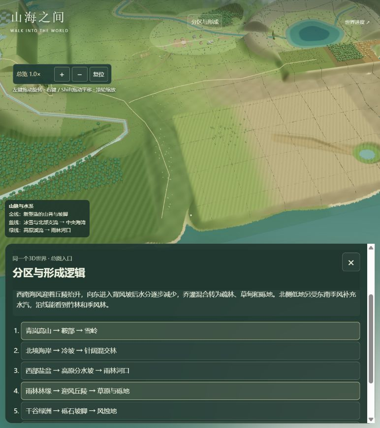
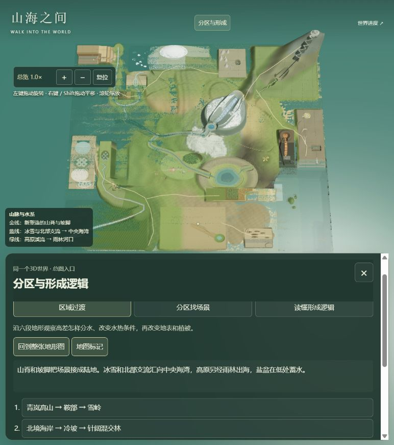

# 同一大地图的六段区域过渡

[总览地理底图](http://127.0.0.1:52932/journey.html#geographic-foundation) · [3D 地理底图](http://127.0.0.1:52932/expedition.html?plan=foundation#build-1)

两个视图共用东西 3.84 km、南北 3.12 km 的场景水平范围，上北右东，标出 1 km 比例尺。海陆与地表分水界来自同一个 40 m 格网。中央河汇入中央海湾，西南雨林河独立出海，西部盐盆为内流。1 月主风来自西北，7 月西南湿风为主，东南沿海补充水汽。冷暖以相对纬向位置和高程表达。

顺水线可对照西部盆缘与高原独立出海水路，南北冷暖线可查看北部冷岸与混交林侧坡，海岸到内陆线可查看南部迎背风植被带及东部岸坡。四处可在同一 3D 场景查看金线所经过的地面高程剖面。东部可显示海床，再恢复 0 m 海面。降水与群落分布仍采用场景相对指标。

[在 3D 地图对照三流域](http://127.0.0.1:52932/expedition.html?plan=formation#build-1)

全年降水沿用同一份地形、风向和逐月降雪。每个陆地格网按基岩、沉积盖层和坡度分配地表径流、土壤储水和浅层补给，再沿已有地表水路汇至各自的出口。切换「岩性与地表」「汇流与地下补给」和「植被分带」，可以在同一个实景位置对照母质、根区水分、盐分和适宜生境。

三流域状态用场景水量表达。停雨后 14 天的对照用共同的浅层储库规则计算当日释水，岸线使用所选月的参考水位。等量降雨对照取三个实景样点，各下 48 mm、历时 8 小时。植被分带表达适宜生境，深层含水层连通、盐量迁移和群落演替仍有独立专题。

[在 3D 看同一场雨走完三流域](http://127.0.0.1:52932/expedition.html?plan=formation&study=event#build-1)。这一对照逐小时覆盖整片已划分的集水格网。可同时查看两个出海流域的出口和盐盆内的蓄水、蒸发及留盐，再进入各流域三站看水面、沉积与湿岸。[模型、阶段和验收读数](BASIN-EVENT.md)

三条地理观察线和季风、分水界标记见[三条环境线](ENVIRONMENT-LINES.md)。

逐月空气流动、降水与水系响应已接到这六段，见[全年风向、降水与区域响应](ANNUAL-CLIMATE.md)。

[在内置浏览器查看六段区域过渡](http://127.0.0.1:52932/expedition.html?plan=geography#build-1)

在大地图打开「分区与形成 → 区域过渡」，选择一段即可定位到同一三维世界。可旋转、平移、缩放，或者关闭「地图标记」直接看地形。

| 观察段 | 地形、水域、地表与群落 |
| --- | --- |
| 青岚高山到雪岭 | 重新塑造主脊和两侧山肩。旧道路经过较缓的低槽，登山入口保留原走向。高处沿冰湖、融水溪接中央河源。 |
| 北境到混交林 | 陆侧补上低丘和冷坡。缩小北部支谷对海床的影响，把原扇面源头移出冰湾，继续保持向扇面下行。 |
| 盐盆到高原与雨林河口 | 高原坡脚连接邻近陆地。盐湖在盆内蓄水，高原出水沿已有溪谷进入雨林和潮沟。 |
| 雨林林缘到草原 | 较湿的西南迎风坡接疏林和草地，再向东过渡到干砾地。竹林与季风林获得低处沿海水汽补充。 |
| 干谷到风蚀地 | 泉池边保留局部湿润面，砾石缓坡接到已有雅丹和风蚀槽。 |
| 东部山前到外海 | 山前支脊接到火山外围与岩岸。海平面以下，原岩岸与远洋剖面之间的海床更早开始向大陆架过渡。 |

地表和过渡区植被共用相对冷暖、湿润度、离水距离与坡度条件。西南与东南的水汽来向是本图的创作设定。形成说明参考 [WMO 对迎风抬升和背风雨影的说明](https://cloudatlas.wmo.int/en/orographic-influences-on-the-windward-side.html)。全年风场、降雨径流、水量收支及全图岩性演化仍待细化。

116个构建观察点的平面坐标、464个观察ID和原主线的平面轨迹经过核对。雪岭观察点的镜头高度随更新后的地形调整。北部入海水路的扇面上游移动到陆岸，两个入海出口及盐湖水位保持原有设定。

最终构建 `196f2ccabd65` 已在内置浏览器检查六段定位、地图标记、缩放和原126个入口。南部原水隙共核对16,027处地形点。盐湖和盐沼按当前参考水位在2米网格上检查水面所连通的低地。登山、极地、水路、植被、海床和其他原专题已运行对应回归。 [地形检查](assets/regional-geography-check.json) · [浏览器记录](assets/regional-geography-browser-check.json)

## 冰期与现在

[在同一张 3D 地图切换时期](http://127.0.0.1:52932/expedition.html?plan=timeline#build-1)。在同一站切换时期时，地图水平坐标、观察目标和缩放基准一致。全图可叠加现在岸线，在冰期地形上识别退海范围。

末次盛冰期取距今约 2.1 万年的环境切片。更多水储存在陆地冰体时，全球海平面降低，浅陆架可出露。现代海面设为 0 米，冰期水面压缩为 −48 米，并从既有海床边缘延续外侧陆架。中央主河和西南河沿出露低地延伸到新的入海口，内流盐盆的水面单独保留。冰舌厚度、河槽、气候和植被分带使用这张虚构地图的场景参数。真实全球平均海面的同期重建接近 −134 米。[古海平面重建](https://doi.org/10.1073/pnas.1411762111) · [末次盛冰期冰川年代](https://doi.org/10.1126/science.1172873) · [古植被重建](https://doi.org/10.1046/j.1365-2486.2003.00640.x)

### 退冰时间节点

| 约距今 | 场景海面 | 在同一张地图上观察 |
| --- | ---: | --- |
| 2.1 万年 | −48 m | 盛冰期的宽冰缘、大片出露陆架和向海延伸的长河槽 |
| 1.65 万年 | −43 m | 退冰展开，较薄的冰缘先消退，外缘旧河口开始被淹 |
| 1.4 万年 | −27 m | 一段快速海面上升之后，浅岛间的陆架被淹，原冰湖水面开始显露 |
| 1.15 万年 | −20 m | 全新世初，冰舌退出湖盆，草灌和新露地相接 |
| 8200 年 | −5 m | 海水进入中央湾谷，河口往陆侧移动，低岸有草沼并接到上方疏林 |
| 现在 | 0 m | 回到现有大地图的海面、冰体、植被和其他场景 |

四个中间节点共享一张海床。海面只淹没与开阔海相连的低地，内流盐盆仍独立。橙圈由河槽与当期连通海水的交点决定，金色虚线是现在岸线。冰厚和植被参数由各阶段的冰缘、水热条件与近岸位置分别控制，保留高处残冰，给脱冰地表留出演替空间。

时间节点参考全球重建，其实测约束和不确定性见 Lambeck 等图 4。1.4 万年前取快速上升之后，1.15 万年前取末期放缓后回升的时段。表中是教学地图的压缩水位，局地冰缘、气候与植被是场景设定。[全球海平面重建](https://pmc.ncbi.nlm.nih.gov/articles/PMC4217469/#fig04)

### 末次间冰期高海面

[在同一张 3D 地图查看中央湾头低岸](http://127.0.0.1:52932/expedition.html?plan=timeline&epoch=interglacial&focus=water&station=tidal-bank#build-1)。末次间冰期取距今约 12.5 万年的代表性暖期，场景海平面设为 +8 米。Dutton 与 Lambeck 的重建给出这段时期的全球峰值约高出现在 5.5 至 9 米。局地海平面还受陆地运动等影响，地图用于对照环境条件。[海平面和冰量重建](https://doi.org/10.1126/science.1205749)

- **顺水**　暖期在现代地形的同一海拔基准上重算连通海域。中央河槽与暖期海域的交点向上游移动，湾头低岸被淹。雪岭与北境的冰体按场景规则收缩。冰碛湖站沿用今天的湖盆形状作对照。
- **南北冷暖**　温度、水分和坡位一起控制植被。湿坡可从冰期冻原变为阔叶林，北境仍见开阔植被，山顶只在较冷的局部保留冰体。区域植被分带参考间冰期植被记录的变化，树种和边界为场景参数。[北芬兰花粉与植物遗存记录](https://pmc.ncbi.nlm.nih.gov/articles/PMC6054633/)
- **海岸到内陆**　西南浅岸站在暖期被淹，河口草沼出现在较高、近河且仍与海相通的岸带。东南浅海更深，内流盐盆的水面仍独立。亮浅水标出高位海面覆盖的现今低地，金色虚线指向现在的海陆边界。

### 从末次间冰期进入冰期

[在同一张 3D 地图从中央海湾开始观察](http://127.0.0.1:52932/expedition.html?plan=timeline&epoch=inception&focus=water&station=bay#build-1)。五帧补在约 12.5 万年前的暖期和约 2.1 万年前的盛冰期之间。新增水位取 Spratt 与 Lisiecki 全球海平面数据的七记录叠合列，按既有海面比例乘以 48/134 再取整。时间和海面顺序保留早先冰体增长后的回摆及冰期中段的回升。[海平面原始数据](https://doi.org/10.25921/rd66-5820) · [末次冰期初期的冰体增长与后退](https://doi.org/10.5194/cp-17-397-2021)

| 约距今 | 全球参考海面 | 场景海面 | 同一地点观察 |
| --- | ---: | ---: | --- |
| 11 万年 | −46 m | −17 m | 雪岭冰体加厚，西南浅岸和中央湾底露出 |
| 10 万年 | −19 m | −7 m | 冰缘阶段性后退，中央低湾重新进水，湿坡疏林局部恢复 |
| 6.5 万年 | −83 m | −30 m | 冰舌抵近现有冰湖盆地，冻原扩展，河口进一步向海 |
| 5.1 万年 | −63 m | −23 m | 海面阶段性回升，两河河口向陆侧移动 |
| 3 万年 | −106 m | −38 m | 冰缘逼近盛冰期范围，东南浅陆架的砾地出露 |

- **顺水**　先看雪岭冰川或冰碛湖，再到中央海湾看低湾出露、回淹和再出露。橙圈沿当期河槽移动。
- **南北冷暖**　在针阔混交林站切换 11 万、10 万和 6.5 万年，观察草地、疏林、冻原在同一坡面上的切换。
- **海岸到内陆**　在西南外海看 11 万年出露与 10 万年重新进水，再到东南陆架看 3 万年前的露出砾地。

入冰各帧共用近海网格和低海面河槽。场景按水位重算连通海域、岸线与河口，冰体随各帧参数从厚冰核心向薄冰边缘扩张，植被按各帧的温度、水分和地形条件重算。局部冰界和植被分布为教学参数，退冰阶段沿用已有四帧。
