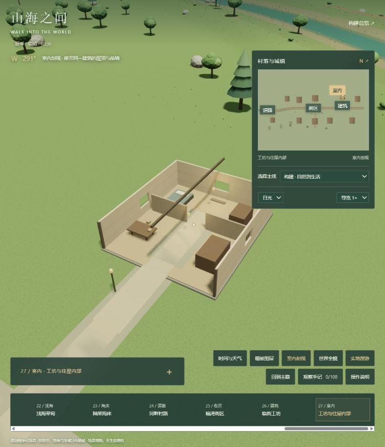
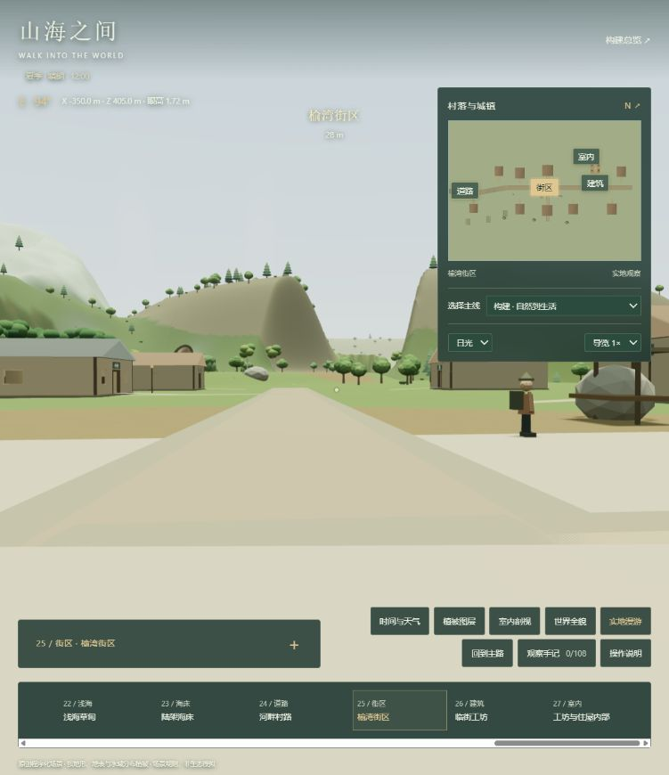

# 自然环境怎样承接村落、城镇与室内

在原平原与出湖河附近补入榆湾聚落：跨河木桥、顺地形村路、田圃、宅地、街区与广场、十栋建筑，以及一个有工作区、储物和住处的完整工坊内部。全部位于原3.8×3.1公里大地图中，人在同一坐标里经过真实门洞进入室内。

[道路](http://127.0.0.1:52932/expedition.html#town-1) · [街区](http://127.0.0.1:52932/expedition.html#town-2) · [建筑](http://127.0.0.1:52932/expedition.html#town-3) · [室内](http://127.0.0.1:52932/expedition.html#town-4)

## 四处场景与参考价值

| 场景 | 实际效果与构建 | 对我们的价值 | 后续可扩展用途 |
| --- | --- | --- | --- |
| 河畔村路 | 木桥跨过出湖河，路面贴合实际地面，村屋用基础与坡道消化高差，菜圃安排在宅地附近 | 先决定水源、通路与建设场地，让自然条件参与聚落选址 | 交通、农业、取水与村落生活 |
| 榆湾街区 | 主街与横巷组织宅地，路口广场配置井、摊位和停留位置，村落疏松地块过渡到镇内相邻建筑 | 街道、公私边界、街区开口和公共节点共同形成生活空间 | 集市、交流、服务、寻路与任务节点 |
| 临街工坊 | 独立基础、入口坡道、实际门窗开口、梁架与坡屋顶构成建筑，门口连接公共街道与内部工作场所 | 建筑应当承接街道用途，基础、界面和入口共同决定进入方式 | 店铺、生产建筑、旅店与角色住处 |
| 工坊内部 | 同一楼面连接工作区、中央通道、储物柜与后部床铺，隔墙有实际门洞，顶上有梁架与屋顶 | 室内继续使用空间分区、动线、尺度、光照和物件用途来组织内容 | 家居、制作、交易、会面、叙事线索 |

后续用途仅为扩展方向。当前是小型聚落的程序化展示原型，人物、摊位和菜圃提供静态用途与尺度，没有居民调度、经济生产、交易或任务系统。

## 逐层显示什么

四站都使用“道路与场地 → 街区与公共空间 → 建筑与界面 → 室内与生活细节”。道路与基础先出现，再加入宅地和公共节点，然后显示墙体、门窗和屋顶，最后补家具、照明、道具与静态人物。同一观察点与实际几何保持，便于比较每层增加了什么。

十栋建筑包括村屋、住屋、粮仓、烘焙坊、店铺与工坊。它们具有基础、楼面、墙体、门窗开口和屋顶；**工坊是本轮重点布置家具和内部分区的可进入样本**，其余建筑没有逐一完成家居内容。基础高度逐栋读取场地高程，没有把整个聚落压成同一平面。

新木桥桥面29.99米，跨越的原出湖河水位28.59米；桥下床底到桥面净高约3.8米。桥面与两端坡道直接参与步行支撑，原水位和河床没有改动。聚落主街宽约5.6米，横巷约3.2米，工坊门洞宽3米；中央通道与隔墙开口保留实际通行宽度。

## 室内怎样真实进入

工坊楼面约26.97米，建筑内部约16×18米。门洞、窗洞和内部隔墙开口由独立墙段组成；地面步行通过外门和中央通道进入后部住处，墙体、家具及隔墙限制移动。楼面和镜头使用室内高度，屋顶不会把人抬到房顶。

“室内剖视”移开同一工坊的屋顶与临街前墙，从上方看工作区、住处、储物与通道；再次点击回到原观察位置。碰撞仍依据真实墙体，剖视不会变成穿墙入口。小地图切换为道路、街区、建筑、室内四个文字位置，并使用同一聚落模型。

## 与原主线、自然与天气的关系

构建路线在原23站后追加道路、街区、建筑和室内，现为**27站、108处观察**。原92个观察ID、站点序号和记录保留；水系仍为14站42处。

从海床沿原海岸路线返回海湾，沿旧岸路和木桥回到出湖河岸，再经过新增跨河木桥进入村落。整段提供连续的床底、地面或桥面支撑，没有在海床与村落之间直接传送。导览采用演示用的快速移动节奏；下方站点可直接定位。

植物、近景草和旧碎石为新建筑、街道与桥头留出位置。原植物系统固定实例17,657个、23种形态，森林3397个与海岸专用1183个保持；聚落自己增加的树、菜圃和道具另计。

建筑屋面接入天气材质，街灯随昼夜调整，室内保留暖光。降水高度遮罩考虑屋顶，进入室内后屏蔽户外雨雪粒子；当前没有窗外降水与室内外独立声场、真实室内光照传播或生活时间表。

## 实际验收与边界

2026-11-17，Windows、Node.js22.15.0、Three.js0.180.0。`check-settlement.mjs`检查10栋建筑、802个网格、5盏灯、桥面支撑、20,002个新路线采样、2240个门洞往返采样、真实门洞与屋顶射线、碰撞、四层开关、剖视恢复和旧92个ID。旧自然、森林、洞穴、海岸、水系与天气检查另作回归。数据见[settlement-check.json](assets/settlement-check.json)。

本轮已通过内置浏览器查看工坊门口、室内、街区与剖视，实际执行键盘门洞进出、夜景预设和剖视切换；保存的JPEG是本地页面截图。更完整的浏览器检查记录见[verification.md](verification.md)。未把截图当作真实城镇、写实素材或完整游戏的证明。

未实现楼梯和多层室内、开关门动画、全面家具交互、室内寻路、居民行为、交通调度、商业经济及任务。人物与道具仍为简化形态；后续要按我们需要的游戏和故事内容继续构建。

实现：[settlement-layout.js](web/settlement-layout.js)共享平面、基础、支撑和碰撞；[settlement-learning.js](web/settlement-learning.js)四站与路线；[settlement-scene.js](web/settlement-scene.js)真实建筑、道路、室内与照明。没有新增第三方建筑资产或提取游戏模型。
